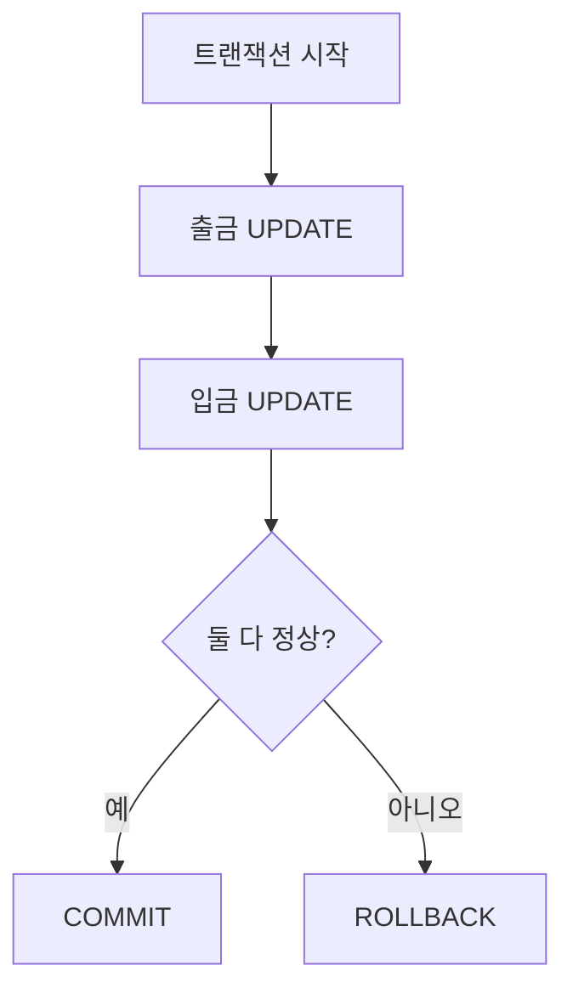

이 글은 MySQL에서 데이터를 꺼내 보고(SELECT), 골라내고(WHERE), 줄 세우고(ORDER BY), 묶고(UNION·VIEW), 빠르게 찾고(INDEX), 안전하게 바꾸는(트랜잭션) 방법을 한 번에 정리한 글이다.

2026년 10월 12일 수업에서 진행한 내용을 정리했다.

## 이게 없으면 뭐가 불편할까

식당 메뉴판이 엑셀 파일 하나에 들어 있다고 해 보자. 메뉴가 20개라면 눈으로 훑어도 된다. 그런데 메뉴가 10만 개라면 어떨까?

"13000원 이하인 메뉴만", "가격이 비싼 순서로", "지금 주문 가능한 것만" 같은 요청이 매일 들어온다. 매번 사람이 직접 찾을 수는 없다.

돈을 옮기는 일은 더 무섭다. A 계좌에서 돈을 뺐는데, B 계좌에 넣다가 문제가 생기면 돈이 사라진다.

그래서 데이터를 저장해 두는 곳인 **DB(Database, 데이터베이스)** 에 "이런 데이터를 이렇게 보여 줘", "이 작업은 한 덩어리로 해 줘"라고 말하는 언어가 필요하다. 그 언어가 **SQL**이다. 이 글에서는 SQL을 실행해 주는 프로그램 중 하나인 MySQL을 썼다.

## 먼저, 실습은 어떻게 준비했을까

수업에서는 MySQL Workbench라는 프로그램으로 실습했다. Workbench는 SQL을 입력하고 결과를 표로 보여 주는 창이다.

1. root 계정으로 접속한다. root는 모든 권한을 가진 관리자 계정이다.
2. 수업에서 받은 SQL문을 붙여 넣고, 한 줄씩 실행한다. 실행하려는 줄에 커서를 두고 `Ctrl + Enter`를 누른다.
3. 실습용 계정으로 새 커넥션(connection)을 만든다. 커넥션은 "어느 DB에, 누구로 접속할지"를 저장해 둔 접속 정보다.
4. 새 커넥션에서 `use menudb;`를 실행한다. 지금부터 `menudb`라는 DB를 쓰겠다는 뜻이다.
5. 실습용 SQL을 붙여 넣고 `Ctrl + A`로 전부 선택한 뒤 번개 모양 버튼을 눌러 한꺼번에 실행한다.
6. 주제마다 `01_select`, `02_orderby`처럼 SQL 파일을 따로 만들고, 맨 위에 `use menudb;`를 적었다. 왼쪽 목록에서 `menudb`가 진한 글씨로 바뀌면 제대로 선택된 것이다.

이 글에 나오는 테이블은 수업에서 받은 실습용 테이블이다. 테이블은 엑셀의 시트처럼 행과 열로 이루어진 표다.

| 테이블 | 담긴 내용 |
|--------|-----------|
| `tbl_menu` | 메뉴 (메뉴 코드, 이름, 가격, 카테고리 코드, 주문 가능 여부) |
| `tbl_category` | 메뉴 카테고리 |
| `users`, `courses`, `enrollments` | 학습 관리 시스템(LMS)의 사용자, 과정, 수강 등록 |
| `accounts` | 트랜잭션 실습용 계좌 |

---

## 1. SELECT — 데이터를 어떻게 꺼내 볼까?

### 한 문장으로 말하면

도서관 사서에게 "이 서가에서 책 제목만 적어 주세요"라고 요청서를 내는 것과 비슷하다. **SELECT**는 테이블에서 원하는 데이터를 꺼내 보여 달라는 명령이다. 이렇게 데이터를 꺼내 보는 일을 **조회**라고 부른다.

비유에는 한계가 있다. 사서는 요청이 애매하면 되묻지만, DB는 되묻지 않는다. 적힌 그대로만 실행하거나, 문법이 틀리면 에러를 낸다.

수업에서는 조회가 SQL의 대부분을 차지한다고 배웠다. 조회할 때 정해야 할 것은 딱 두 가지다.

1. **어떤 열을 가져올까?** — 정보의 종류 (이름? 가격?)
2. **어떤 행을 가져올까?** — 정보의 범위 (전부? 13000원 이하만?)

열은 SELECT 바로 뒤에 적고, 행은 뒤에서 배울 WHERE로 고른다.

### 직접 해보기

메뉴 테이블에서 메뉴 이름만 조회해 보자.

```sql
SELECT      -- 조회해 줘
    menu_name   -- 무엇을? (열 이름)
FROM        -- 어디에서?
    tbl_menu;   -- (테이블 이름)
```

`SELECT` 뒤에는 보고 싶은 열을, `FROM` 뒤에는 그 열이 있는 테이블을 적는다. 문장 끝에는 세미콜론(`;`)을 붙인다. "여기까지가 한 문장"이라는 표시다.

열 여러 개를 보고 싶으면 쉼표로 나열한다.

```sql
SELECT menu_code, category_code, menu_price
FROM tbl_menu;
```

모든 열을 다 보고 싶으면 `*`을 쓴다. `*`은 애스터리스크(asterisk)라고 읽고, "모든 열"을 뜻한다.

```sql
SELECT *
FROM tbl_menu;
```

### 열 이름을 바꿔서 보여 줄 수 있을까? — AS

`menu_name`, `menu_price` 같은 열 이름은 영어라서 결과 표가 읽기 불편하다. 이때 **AS**로 결과에 보일 이름을 바꿀 수 있다. 이렇게 붙인 이름을 **별칭(alias)** 이라고 부른다.

```sql
SELECT menu_name AS '메뉴이름', menu_price AS '가격'
FROM tbl_menu;
```

별칭을 작은따옴표(`' '`)로 감싼 이유는 띄어쓰기 때문이다. `'메뉴 이름'`처럼 별칭에 공백이 들어가도 하나의 이름으로 알아듣게 하려는 것이다.

별칭은 결과 표에 보이는 이름만 바꾼다. 실제 테이블의 열 이름은 그대로다.

### FROM 없이 SELECT만 쓸 수도 있을까?

있다. MySQL이 미리 만들어 둔 함수를 실행할 때는 테이블이 필요 없다. 함수는 값을 넣으면 정해진 일을 하고 결과를 돌려주는 기능이다.

```sql
SELECT now();                -- 지금 날짜와 시간
SELECT concat('마늘', '빵');  -- 문자열 합치기 → '마늘빵'
```

테이블에서 꺼내는 데이터가 아니라 계산 결과를 보여 주는 것이라 `FROM`을 적지 않는다.

> 한 줄 요약: SELECT 뒤에는 볼 열을, FROM 뒤에는 테이블을 적는다. AS로 결과 표의 이름을 바꿀 수 있다.

---

## 2. ORDER BY — 결과를 어떻게 줄 세울까?

### 한 문장으로 말하면

반 학생들을 키 순서로 줄 세우는 것과 같다. **ORDER BY**는 조회 결과를 특정 열의 값에 따라 정렬하는 명령이다.

정렬 방향은 두 가지다.

| 키워드 | 뜻 | 예 |
|--------|----|----|
| `ASC` | 오름차순. 작은 값부터. **적지 않으면 이 방향이다** | 1000 → 2000 → 3000 |
| `DESC` | 내림차순. 큰 값부터 | 3000 → 2000 → 1000 |

비유와 다른 점도 있다. 줄 세우기는 학생 자리를 실제로 옮기지만, ORDER BY는 **결과로 보여 주는 순서만** 바꾼다. 테이블에 저장된 데이터의 순서는 그대로다.

### 직접 해보기

메뉴 코드, 이름, 가격을 조회하고, 가격이 싼 순서로 정렬해 보자.

```sql
SELECT menu_code, menu_name, menu_price
FROM tbl_menu
ORDER BY menu_price ASC;
```

`ASC`는 기본값이라 빼도 결과가 같다. 비싼 순서로 보고 싶으면 `ASC` 자리에 `DESC`를 쓴다.

```sql
SELECT menu_code, menu_name, menu_price
FROM tbl_menu
ORDER BY menu_price DESC;
```

수업 노트에는 문제에 "오름차순"이라고 적어 놓고 코드는 `DESC`로 쓴 부분이 있었다. 정리하면서 다시 보니 두 방향이 섞여 있었다. 문제를 다시 읽고 방향이 맞는지 확인하는 습관이 필요하다.

### 계산한 값으로도 정렬할 수 있을까?

있다. 열끼리 계산한 결과에 별칭을 붙이고, 그 별칭으로 정렬하면 된다.

```sql
SELECT menu_code, menu_price, menu_code * menu_price AS 연산결과
FROM tbl_menu
ORDER BY 연산결과 DESC;
```

메뉴 코드와 가격을 곱한 값은 실제로 쓸모 있는 숫자는 아니다. "계산한 값으로도 정렬할 수 있다"는 걸 보여 주는 연습용 예시다.

### NULL이 있는 열은 어떻게 정렬될까?

**NULL**은 "값이 비어 있다"는 뜻이다. 0이나 빈 문자열과 다르다. 아예 아무것도 적혀 있지 않은 상태다.

`tbl_category`의 `ref_category_code` 열에는 NULL이 있다. MySQL 공식 문서에 따르면 오름차순 정렬에서는 NULL이 **맨 앞에** 나오고, 내림차순에서는 맨 뒤에 나온다.

NULL을 뒤로 보내고 싶을 때 수업에서는 이렇게 썼다.

```sql
SELECT *
FROM tbl_category
ORDER BY ref_category_code IS NULL ASC;
```

`ref_category_code IS NULL`은 값이 NULL이면 `1`, 아니면 `0`이 된다. 이 값으로 오름차순 정렬하면 `0`(값이 있는 행)이 먼저, `1`(NULL인 행)이 나중에 나온다. 그래서 NULL이 뒤로 빠진다.

여기서 하나 헷갈리기 쉽다. 이 코드는 "NULL인지 아닌지"로만 줄을 세운다. 값이 있는 행끼리는 순서가 정해지지 않는다. 값 순서까지 정리하고 싶으면 정렬 기준을 하나 더 적는다. 아래는 이해를 돕기 위한 예시 코드다.

```sql
SELECT *
FROM tbl_category
ORDER BY ref_category_code IS NULL ASC, ref_category_code ASC;
```

쉼표 뒤의 기준은 "앞의 기준이 같을 때 다음으로 볼 기준"이다.

> 한 줄 요약: ORDER BY는 보여 주는 순서만 바꾼다. 기본은 오름차순이고, MySQL에서 NULL은 오름차순일 때 맨 앞에 온다.

---

## 3. WHERE — 원하는 행만 어떻게 골라낼까?

### 한 문장으로 말하면

밀가루를 체에 거르는 것과 비슷하다. 조건에 맞는 것만 통과시키고 나머지는 걸러 낸다. **WHERE**는 어떤 행을 가져올지 조건을 적는 자리다. 이 조건을 **조건절**이라고 부른다.

비유에는 한계가 있다. 체는 걸러 낸 밀가루를 버리지만, WHERE는 결과에서만 빼고 테이블의 데이터는 건드리지 않는다.

### 직접 해보기

판매 상태(`orderable_status`)가 `'Y'`인 메뉴만 조회해 보자.

```sql
SELECT menu_name, menu_price, orderable_status
FROM tbl_menu
WHERE orderable_status = 'Y';
```

`WHERE` 뒤에 "이 열의 값이 이것과 같은 행만"이라는 조건을 적었다. 조건에 맞지 않는 행은 결과에 나오지 않는다.

### 조건에는 어떤 연산자를 쓸까?

| 연산자 | 뜻 |
|--------|----|
| `=` | 같다 |
| `!=`, `<>` | 같지 않다 |
| `>`, `<` | 크다, 작다 |
| `>=`, `<=` | 크거나 같다, 작거나 같다 |
| `LIKE` | 특정 글자 모양(패턴)을 포함한다 |
| `IN` | 목록 안의 값 중 하나와 같다 |
| `BETWEEN` | 두 값 사이에 있다 |
| `NOT` | 조건을 뒤집는다 |

가격이 13000원 이하인 메뉴만 조회하면 이렇다.

```sql
SELECT menu_name, menu_price
FROM tbl_menu
WHERE menu_price <= 13000;
```

### 조건이 여러 개면 어떻게 할까? — AND, OR

- `AND`는 조건을 **모두** 만족해야 통과한다.
- `OR`는 조건 중 **하나만** 만족해도 통과한다.

가격이 10000원 이상이고 20000원 미만인 메뉴는 두 조건을 다 만족해야 하니 `AND`를 쓴다.

```sql
SELECT *
FROM tbl_menu
WHERE menu_price >= 10000 AND menu_price < 20000;
```

같은 조건을 `AND`와 `OR`로 바꿔 쓰면 결과가 크게 달라진다.

```sql
-- 판매 상태가 Y "이거나" 카테고리 코드가 10
SELECT *
FROM tbl_menu
WHERE orderable_status = 'Y' OR category_code = 10
ORDER BY category_code;

-- 판매 상태가 Y "이고" 카테고리 코드가 10
SELECT *
FROM tbl_menu
WHERE orderable_status = 'Y' AND category_code = 10
ORDER BY category_code;
```

`OR`는 문을 넓게 열고, `AND`는 문을 좁게 닫는다고 생각하면 쉽다. `OR`로 쓰면 판매 중인 메뉴 전부에 카테고리 10번 메뉴까지 다 나온다. `AND`로 쓰면 둘 다 맞는 메뉴만 남는다.

`WHERE`와 `ORDER BY`를 같이 쓸 때는 순서가 정해져 있다. `FROM` → `WHERE` → `ORDER BY` 순서로 적는다.

### 범위를 짧게 쓸 수 있을까? — BETWEEN

`BETWEEN A AND B`는 "A 이상 B 이하"를 뜻한다.

```sql
SELECT *
FROM tbl_menu
WHERE menu_price BETWEEN 10000 AND 20000;
```

여기서 많이들 헷갈린다. MySQL 공식 문서에 따르면 `BETWEEN`은 **양쪽 끝 값을 포함한다**. 그래서 위 코드는 `menu_price >= 10000 AND menu_price <= 20000`과 같다.

앞에서 본 `menu_price < 20000`(20000 미만)과는 다르다. 가격이 딱 20000원인 메뉴는 `BETWEEN`에는 나오고, `< 20000`에는 나오지 않는다.

범위 밖을 보고 싶으면 앞에 `NOT`을 붙인다.

```sql
SELECT *
FROM tbl_menu
WHERE menu_price NOT BETWEEN 10000 AND 20000;
```

### 글자 일부로 찾을 수 있을까? — LIKE

검색창에 "마늘"만 쳐도 "마늘빵", "생마늘"이 다 나오는 것과 비슷하다. **LIKE**는 글자 모양으로 찾는다. `%`는 "아무 글자가 몇 개든 와도 된다"는 자리 표시다.

| 패턴 | 뜻 | `'마늘'`로 예를 들면 |
|------|----|----------------------|
| `'단어%'` | 단어로 **시작** | `'마늘%'` → 마늘빵 |
| `'%단어'` | 단어로 **끝남** | `'%마늘'` → 생마늘 |
| `'%단어%'` | 단어를 **포함** | `'%마늘%'` → 마늘빵, 생마늘, 흑마늘소스 |

수업에서 쓴 코드는 이렇다.

```sql
SELECT menu_name, menu_price
FROM tbl_menu
WHERE menu_name LIKE '생마늘%';
```

이 코드는 '생마늘'로 **시작하는** 메뉴를 찾는다. 노트에는 문제를 "'마늘'을 포함하는 메뉴"라고 적어 두었는데, 정리하면서 보니 포함을 찾으려면 `'%마늘%'`로 써야 했다. `%`를 어느 쪽에 붙이느냐에 따라 뜻이 완전히 달라진다.

### 여러 값 중 하나와 같은지 볼 수 있을까? — IN

카테고리 코드가 4, 5, 6인 메뉴를 찾고 싶다. `OR`로 쓰면 이렇게 길어진다.

```sql
WHERE category_code = 4 OR category_code = 5 OR category_code = 6
```

`IN`을 쓰면 한 줄로 줄어든다.

```sql
SELECT menu_name, category_code
FROM tbl_menu
WHERE category_code IN (4, 5, 6);
```

반대로 4, 5, 6이 **아닌** 메뉴는 `NOT IN`으로 찾는다. `IN`, `BETWEEN`, `LIKE`처럼 단어로 된 연산자는 앞에 `NOT`을 붙여서 뜻을 뒤집는다.

```sql
SELECT menu_name, category_code
FROM tbl_menu
WHERE category_code NOT IN (4, 5, 6);
```

### NULL은 `=`로 찾을 수 있을까?

찾을 수 없다. 여기서 많이들 막힌다.

MySQL 공식 문서에 따르면 `=`, `<>`, `<` 같은 비교 연산자는 한쪽이 NULL이면 결과도 NULL이 된다. "비어 있는 값과 같은가?"라는 질문에는 참도 거짓도 아닌 "모름"이 돌아오는 셈이다. 그래서 WHERE를 통과하지 못한다.

NULL은 전용 연산자로 찾는다.

- `IS NULL` — 값이 비어 있는 행
- `IS NOT NULL` — 값이 있는 행

카테고리 테이블에서 NULL이 있는 행을 빼고 조회하면 이렇다. 수업 노트에는 문제만 적혀 있어서, 아래 코드는 공식 문서를 보고 채운 예시 코드다.

```sql
SELECT *
FROM tbl_category
WHERE ref_category_code IS NOT NULL;
```

> 한 줄 요약: WHERE는 행을 고르는 체다. BETWEEN은 양 끝을 포함하고, LIKE는 `%` 위치가 중요하고, NULL은 `IS NULL`로만 찾는다.

---

## 4. 외래키 — 왜 어떤 데이터는 지워지지 않을까?

### 한 문장으로 말하면

학생부와 수강 신청 명단이 있다고 해 보자. 수강 명단에 "학생 1번"이 적혀 있는데 학생부에서 1번을 지우면, 수강 명단에는 누군지 모르는 사람이 남는다.

이걸 막는 장치가 **외래키(FK, Foreign Key)** 다. 외래키는 "이 열의 값은 저 테이블에 실제로 있는 값이어야 한다"는 약속이다.

| 구분 | 역할 | 실습 예 |
|------|------|---------|
| 부모 테이블 | 외래키로 쓰일 값을 **주는** 쪽 | `users`의 `user_id` |
| 자식 테이블 | 그 값을 **받아서** 쓰는 쪽 | `courses`의 `author_id` |

실습에서는 `users` 테이블의 `user_id`를 `courses` 테이블의 `author_id`가 외래키로 받고 있었다. 과정(`courses`)을 만든 사람이 누구인지를 사용자 번호로 적어 둔 것이다.

### 직접 해보기

부모 테이블에서 사용자 1번을 지워 보자.

```sql
DELETE FROM users WHERE user_id = 1;
```

삭제가 거부된다. 1번 사용자를 `courses`에서 아직 쓰고 있기 때문이다. 지금 삭제하면 자식 테이블에 주인 없는 데이터가 남는다. 수업에서는 이런 데이터를 **고아 데이터**라고 불렀다.

MySQL 공식 문서에 따르면 외래키에 삭제 규칙(`ON DELETE`)을 따로 적지 않으면 기본값은 `NO ACTION`이다. InnoDB(MySQL의 기본 저장 엔진)에서는 이것이 `RESTRICT`와 같아서, 연결된 자식 데이터가 있으면 부모 데이터 삭제를 바로 거부한다. 이때 보통 `Cannot delete or update a parent row: a foreign key constraint fails` 같은 메시지가 나온다.

테이블 구조와 데이터는 이렇게 확인했다.

```sql
DESC courses;   -- 테이블 구조(열 이름, 자료형 등) 보기
DESC users;
SELECT * FROM courses;
SELECT * FROM users;
```

비유에는 한계가 있다. 학교에서는 사람이 명단을 보고 판단하지만, 외래키는 DB가 스스로 검사해서 막는다. 사람이 실수로 지우려 해도 DB가 거부한다.

> 한 줄 요약: 외래키는 "자식이 쓰고 있는 부모 데이터는 함부로 못 지운다"는 약속이다.

---

## 5. UNION — 두 조회 결과를 하나로 합칠 수 있을까?

### 한 문장으로 말하면

반 명단 두 장을 합쳐서 한 장으로 만드는 것과 같다. 두 장에 같은 사람이 있으면 한 번만 적는다. **UNION**은 여러 SELECT의 결과를 위아래로 이어 붙이고, 겹치는 행은 하나만 남긴다. 수학의 합집합과 같다.

### 직접 해보기

`users` 테이블에서 활동 중(`active`)인 사용자와 정지된(`suspended`) 사용자 모두에게 이메일을 보내려 한다. 탈퇴한(`deleted`) 사용자는 뺀다.

```sql
SELECT name, email, status
FROM users
WHERE status = 'active'
UNION
SELECT name, email, status
FROM users
WHERE status = 'suspended';
```

위 SELECT의 결과 아래에 아래 SELECT의 결과가 붙는다.

### UNION을 쓸 때 지켜야 할 것

- 두 SELECT의 **열 개수가 같아야** 한다. 개수가 다르면 에러가 난다.
- 열은 **순서대로 짝지어진다.** 첫 번째 열끼리, 두 번째 열끼리 합쳐진다. 그래서 짝이 되는 열의 자료형이 서로 어울려야 한다.
- 결과 표의 열 이름은 **첫 번째 SELECT**를 따른다.

비유와 다른 점이 있다. 명단을 합칠 때는 사람이 이름을 보고 같은 사람인지 판단한다. UNION은 **행 전체가 똑같을 때만** 중복으로 본다. 이름이 같아도 이메일이 다르면 둘 다 남는다.

겹치는 행도 지우지 않고 다 보고 싶다면 `UNION ALL`을 쓴다. 중복을 찾는 단계를 건너뛰기 때문에 보통 더 빠르다.

참고로 이 예시는 `WHERE status IN ('active', 'suspended')` 한 번으로도 같은 결과를 얻을 수 있다. UNION은 서로 다른 테이블의 결과를 합칠 때 더 쓸모가 있다. 여기서는 UNION의 동작을 익히기 위해 같은 테이블로 연습했다.

> 한 줄 요약: UNION은 두 결과를 위아래로 합치고 중복은 지운다. 열 개수와 순서를 맞춰야 한다.

---

## 6. VIEW — 자주 쓰는 긴 조회문을 저장해 둘 수 있을까?

### 왜 필요할까

수업에서 다룬 상황은 이랬다.

- 데이터 분석팀은 매일 "과정별 등록 학생 수"를 확인한다. 이 숫자를 얻으려면 테이블 두 개를 합치고 세는 긴 쿼리를 매번 써야 한다. 쿼리는 DB에 보내는 SQL 문장 하나를 부르는 말이다.
- 마케팅팀에는 사용자의 전체 정보 대신 실제로 쓸 이메일과 이름만 주고 싶다.

긴 쿼리를 매번 다시 쓰기도 귀찮고, 원본 테이블을 통째로 보여 주기도 불안하다.

### 한 문장으로 말하면

쇼핑몰에서 "3만 원 이하, 무료 배송, 리뷰 많은 순"으로 검색 조건을 저장해 두는 것과 비슷하다. 나중에 저장한 조건을 누르기만 하면 그때의 최신 결과가 나온다.

**VIEW(뷰)** 는 SELECT 문에 이름을 붙여 저장해 둔 것이다. 수업에서는 **가상의 테이블**이라고 배웠다. 테이블처럼 `SELECT * FROM 뷰이름`으로 조회할 수 있지만, 데이터를 따로 갖고 있지는 않다.

비유에는 한계가 있다. 쇼핑몰의 저장한 검색은 나만 쓰지만, 뷰는 권한을 주면 다른 사람도 쓸 수 있다. 그래서 "보여 줄 열만 담은 뷰"를 만들어 다른 팀에 넘길 수 있다.

### 뷰를 쓰는 이유

| 이유 | 설명 |
|------|------|
| 편의성 | 복잡한 쿼리를 뷰로 만들어 두면, 다음부터는 간단한 테이블처럼 조회할 수 있다 |
| 보안성 | 원본 테이블의 민감한 열은 빼고, 보여 줘도 되는 열만 담아 줄 수 있다 |
| 가독성 | 자주 쓰는 열만 모아 두니 쿼리가 짧고 읽기 쉬워진다 |

### 직접 해보기

뷰를 만드는 문법은 `CREATE VIEW 뷰이름 AS 쿼리문`이다. 과정별 등록 학생 수를 보여 주는 뷰를 만들어 보자.

```sql
CREATE VIEW v_courses_status
AS
SELECT
    c.course_id,
    c.title,
    COUNT(e.enrollment_id) AS '등록 학생 수'
FROM
    courses AS c
LEFT JOIN
    enrollments AS e ON c.course_id = e.course_id
GROUP BY c.course_id, c.title;
```

이 쿼리에는 아직 정리하지 않은 문법이 몇 개 섞여 있다. 뜻만 짧게 적어 둔다.

- `courses AS c` — 테이블에도 별칭을 붙일 수 있다. `c.title`은 "`c` 테이블의 `title` 열"이라는 뜻이다.
- `LEFT JOIN ... ON ...` — 두 테이블을 `course_id`가 같은 행끼리 옆으로 붙인다. 등록한 학생이 없는 과정도 빠지지 않게 남긴다.
- `GROUP BY` — 같은 과정끼리 묶는다.
- `COUNT(...)` — 묶음마다 몇 개인지 센다.

만든 뷰는 테이블처럼 조회한다.

```sql
SELECT * FROM v_courses_status;
```

뷰에 다시 조건을 걸 수도 있다. 등록 학생 수가 3명 이상인 과정만 보자.

```sql
SELECT *
FROM v_courses_status
WHERE `등록 학생 수` >= 3;
```

여기서 별칭을 작은따옴표가 아니라 **백틱(`` ` ``)** 으로 감쌌다. 키보드 숫자 1 왼쪽에 있는 기호다. MySQL에서 작은따옴표는 "글자 값"이고, 백틱은 "열이나 테이블의 이름"이다. `'등록 학생 수' >= 3`이라고 쓰면 열이 아니라 글자 `'등록 학생 수'`와 3을 비교해 버린다.

### 뷰를 고치거나 지우려면?

| 하고 싶은 일 | 문법 |
|--------------|------|
| 만들기 | `CREATE VIEW 뷰이름 AS 쿼리문` |
| 고치기 (없으면 새로 만들기) | `CREATE OR REPLACE VIEW 뷰이름 AS 쿼리문` |
| 지우기 | `DROP VIEW 뷰이름` |

`status` 열을 추가하도록 뷰를 고쳐 보자.

```sql
CREATE OR REPLACE VIEW v_courses_status
AS
SELECT
    c.course_id,
    c.title,
    c.status,
    COUNT(e.enrollment_id) AS '등록 학생 수'
FROM
    courses AS c
LEFT JOIN
    enrollments AS e ON c.course_id = e.course_id
GROUP BY c.course_id, c.title;
```

지울 때는 이렇게 쓴다.

```sql
DROP VIEW v_courses_status;
```

뷰를 지워도 원본 테이블 `courses`, `enrollments`의 데이터는 그대로다. 저장해 둔 "질문"만 지워질 뿐이다.

### 뷰도 헷갈리기 쉬운 점

MySQL 공식 문서에 따르면 뷰의 정의는 만든 순간에 고정된다. 예를 들어 `SELECT *`로 뷰를 만든 뒤 원본 테이블에 열을 추가하면, 새 열은 뷰에 나오지 않는다. 원본 테이블의 구조를 바꿨다면 뷰도 `CREATE OR REPLACE VIEW`로 다시 만들어야 한다.

> 한 줄 요약: 뷰는 데이터가 아니라 SELECT 문을 저장한 가상 테이블이다. 긴 쿼리를 줄이고, 보여 줄 열만 골라 줄 때 쓴다.

---

## 7. INDEX — 데이터가 많아도 빨리 찾으려면?

### 왜 필요할까

사용자가 100만 명인 `users` 테이블에서 '홍길동'을 찾아야 한다고 해 보자.

인덱스가 없으면 DB는 첫 번째 행부터 마지막 행까지 하나씩 이름을 비교한다. 이렇게 테이블 전체를 처음부터 끝까지 훑는 것을 **풀 테이블 스캔(full table scan)** 이라고 부른다. MySQL 공식 문서에서도 인덱스가 없으면 첫 행부터 테이블 전체를 읽어야 하고, 테이블이 클수록 비용이 커진다고 설명한다.

### 한 문장으로 말하면

두꺼운 책 맨 뒤에 있는 "찾아보기"를 떠올려 보자. "홍길동 … 352쪽"처럼 단어와 쪽 번호가 가나다순으로 정리돼 있다. 책을 처음부터 넘기지 않고 352쪽으로 바로 간다.

**인덱스(index)** 는 특정 열의 값과 그 데이터가 저장된 위치를 미리 정리해 둔 목록이다. 쿼리를 실행할 때 이 목록을 보고 원하는 데이터 위치로 바로 가기 때문에 검색이 빨라진다.

여기서 하나 헷갈렸다. 자바 배열에서 인덱스는 0부터 시작하는 "몇 번째 칸" 번호였다. DB에서 인덱스는 번호가 아니라 **목차나 찾아보기**라는 뜻이다. 같은 단어지만 가리키는 것이 다르다.

비유에는 한계가 있다. 책의 찾아보기는 한 번 인쇄하면 끝이다. DB의 인덱스는 데이터가 바뀔 때마다 DB가 계속 고쳐 써야 한다. 이 차이가 아래에서 볼 단점으로 이어진다.

### 직접 해보기

먼저 **EXPLAIN**으로 쿼리가 어떻게 실행되는지 확인한다. EXPLAIN은 "이 쿼리를 실제로 어떻게 실행할 건지 계획을 보여 줘"라는 명령이다. 이 계획을 **실행 계획**이라고 부른다.

```sql
EXPLAIN SELECT * FROM users WHERE name = '홍길동';
```

이제 `name` 열에 인덱스를 만든다. 문법은 `CREATE INDEX 인덱스이름 ON 테이블명(열 이름)`이다.

```sql
CREATE INDEX idx_users_name ON users(name);
```

같은 EXPLAIN을 다시 실행한다.

```sql
EXPLAIN SELECT * FROM users WHERE name = '홍길동';
```

실습에서 실행 계획을 비교했더니 이렇게 달라졌다.

| | 살펴본 행 수 |
|--|--------------|
| 인덱스 만들기 전 | 120행 전부를 훑었다 (풀 테이블 스캔) |
| 인덱스 만든 후 | 1행만 살펴봤다 |

결과는 똑같이 '홍길동' 한 명인데, 그 한 명을 찾으려고 훑은 양이 120분의 1로 줄었다.

### 인덱스를 따로 만들지 않아도 되는 열이 있을까?

있다. **기본키(PK, Primary Key)** 와 **UNIQUE** 제약 조건이 걸린 열이다. 기본키는 행마다 하나뿐인 대표 번호이고, UNIQUE는 "이 열에 같은 값이 두 번 들어갈 수 없다"는 규칙이다.

이런 열은 값이 겹치지 않는다는 보장이 필요해서, 테이블을 만들 때 인덱스가 자동으로 생긴다. MySQL 공식 문서에서도 `PRIMARY KEY`와 `UNIQUE`를 인덱스의 한 종류로 다룬다.

> 한 줄 요약: 인덱스는 DB의 찾아보기다. 처음부터 끝까지 훑지 않고 원하는 위치로 바로 간다.

---

## 8. 트랜잭션 — 여러 작업을 한 덩어리로 묶으려면?

### 왜 필요할까

홍길동 계좌에서 김짱구 계좌로 3000원을 보낸다고 해 보자. 사람에게는 "이체" 한 번이지만, DB에서는 작업이 두 번 일어난다.

1. 홍길동 계좌에서 3000원을 뺀다.
2. 김짱구 계좌에 3000원을 더한다.

1번만 성공하고 2번이 실패하면 어떻게 될까? 홍길동의 3000원은 빠졌는데 김짱구는 받지 못했다. 3000원이 허공으로 사라진다.

### 한 문장으로 말하면

온라인 쇼핑몰에서 장바구니 물건 세 개를 한 번에 결제한다고 해 보자. 카드 결제가 실패하면 세 개 모두 주문이 취소된다. 하나만 주문되는 일은 없다.

**트랜잭션(transaction)** 은 여러 작업을 논리적으로 하나의 작업 단위로 묶는 것이다. 묶인 작업은 **모두 성공하거나, 모두 없던 일이 된다.** 그래서 하나라도 잘못되면 전체를 되돌리는 것이 핵심이다.

| 명령 | 뜻 |
|------|----|
| `START TRANSACTION` | 지금부터 작업을 한 덩어리로 묶기 시작한다 |
| `COMMIT` | 묶은 작업을 **영구히 반영**한다 |
| `ROLLBACK` | 묶은 작업을 **전부 취소**하고 시작 전으로 되돌린다 |

비유에는 한계가 있다. 쇼핑몰은 결제가 실패하면 알아서 주문을 취소해 준다. MySQL은 그렇지 않다. 언제 `ROLLBACK`할지는 **사람(또는 프로그램)이 정한다.** 이 부분이 아래 "헷갈렸던 점"의 핵심이다.

### 그림으로 보기



두 UPDATE가 모두 정상이면 COMMIT으로 확정하고, 하나라도 이상하면 ROLLBACK으로 둘 다 되돌린다.

### 직접 해보기 — 정상 이체

먼저 실습용 계좌 테이블을 만들고 두 사람의 계좌를 넣는다.

```sql
CREATE TABLE accounts (
    id INT PRIMARY KEY,
    owner VARCHAR(50),
    balance DECIMAL(10, 2)
);

INSERT INTO accounts (id, owner, balance)
VALUES (1, '홍길동', 10000.00), (2, '김짱구', 5000.00);
```

`DECIMAL(10, 2)`는 "전체 10자리, 그중 소수점 아래 2자리"인 숫자다. 돈처럼 정확해야 하는 값에 쓴다.

이제 트랜잭션을 시작하고 이체한다.

```sql
START TRANSACTION;

-- 홍길동 계좌에서 3000원 차감
UPDATE accounts SET balance=balance-3000
WHERE id=1;

-- 김짱구 계좌에 3000원 증액
UPDATE accounts SET balance=balance+3000
WHERE id=2;

-- 중간 확인
SELECT * FROM accounts;
```

중간 확인에서 홍길동 7000원, 김짱구 8000원으로 바뀐 것이 보인다. 하지만 **아직 영구 반영된 것이 아니다.** `COMMIT`을 해야 확정된다.

두 작업이 모두 성공했으니 확정한다.

```sql
COMMIT;  -- 영구 반영
```

### 직접 해보기 — 없는 계좌로 이체

이번에는 실수로 존재하지 않는 99번 계좌로 보내 보자.

```sql
START TRANSACTION;

-- 홍길동 계좌에서 3000원 차감
UPDATE accounts SET balance=balance-3000
WHERE id=1;

-- 중간 확인: 홍길동 계좌가 줄어든 것을 확인
SELECT * FROM accounts;

-- 존재하지 않는 99번 계좌에 3000원 증액
UPDATE accounts SET balance=balance+3000
WHERE id=99;
```

마지막 UPDATE를 실행하면 **에러가 나지 않는다.** 대신 결과 창에 영향을 받은 행이 0개라고 나온다. 바꾸라는 조건에 맞는 행이 하나도 없었다는 뜻이다.

작업 일부가 제대로 되지 않았으니 전부 되돌린다.

```sql
ROLLBACK;
```

`ROLLBACK`하면 홍길동 계좌에서 뺀 3000원도 돌아온다. `START TRANSACTION` 이전 상태로 돌아가기 때문이다.

> 한 줄 요약: 트랜잭션은 여러 작업을 "전부 성공 아니면 전부 취소"로 묶는다. 확정은 COMMIT, 취소는 ROLLBACK이다.

---

## 헷갈렸던 점

### 1. 없는 계좌에 넣었는데 왜 에러가 안 날까? 그럼 ROLLBACK은 누가 할까?

처음에는 "문제가 생기면 DB가 알아서 되돌려 준다"고 생각했다. 그런데 99번 계좌 UPDATE는 에러 없이 끝났다.

DB 입장에서 그 UPDATE는 문법이 맞고 실행도 잘 됐다. "id가 99인 행을 찾아서 바꿔라"를 실행했고, 그런 행이 없어서 0개를 바꿨을 뿐이다. 0개를 바꾸는 것은 DB에게 **잘못이 아니다.**

그래서 이체가 제대로 됐는지는 **사람이 판단해야 한다.** "영향받은 행이 1개여야 하는데 0개네? 이상하다"를 알아채고 직접 `ROLLBACK`을 실행해야 한다. 나중에 자바 프로그램에서 SQL을 보낼 때도 마찬가지다. 프로그램이 영향받은 행 수를 확인하고 ROLLBACK을 부르는 코드를 따로 써야 한다.

| 상황 | DB가 보기에 | 누가 되돌리나 |
|------|-------------|---------------|
| 문법이 틀린 UPDATE | 에러 | 그 문장은 실행되지 않는다. 앞서 한 작업을 되돌릴지는 사람이 정한다 |
| 조건에 맞는 행이 없는 UPDATE | 정상 (0행 변경) | 사람이 결과를 보고 `ROLLBACK` |
| 모두 정상 | 정상 | 되돌리지 않고 `COMMIT` |

### 2. COMMIT 전에 SELECT로 본 값은 진짜 값일까?

중간 확인에서 홍길동 계좌가 7000원으로 보였다. 그래서 이미 저장된 줄 알았다.

그 값은 **아직 확정되지 않은 값**이다. MySQL 공식 문서에 따르면 InnoDB 같은 트랜잭션을 지원하는 테이블에서는, `COMMIT`하기 전까지 바꾼 내용이 영구 반영되지 않는다. `ROLLBACK`하면 사라진다.

게임으로 비유하면, 캐릭터가 레벨업한 화면은 보이지만 아직 세이브를 누르지 않은 상태다. 세이브(`COMMIT`)를 눌러야 저장되고, 불러오기(`ROLLBACK`)를 누르면 레벨업 전으로 돌아간다.

### 3. START TRANSACTION을 안 쓰면 ROLLBACK할 수 없을까?

없다. MySQL은 기본적으로 **자동 커밋(autocommit)** 이 켜져 있다. 공식 문서에 따르면 이 상태에서는 문장 하나하나가 실행되자마자 바로 확정된다. 그래서 나중에 `ROLLBACK`을 해도 되돌릴 수 없다.

`START TRANSACTION`을 실행하면 `COMMIT`이나 `ROLLBACK`을 만날 때까지 자동 커밋이 꺼진다. 그래서 묶어서 되돌리고 싶은 작업은 반드시 `START TRANSACTION` 다음에 해야 한다.

### 4. 트랜잭션 안에서 CREATE TABLE을 하면?

실습에서는 `CREATE TABLE`을 트랜잭션 시작 **전에** 했다. 순서가 중요하다.

MySQL 공식 문서에 따르면 `CREATE TABLE`, `DROP TABLE`, `CREATE INDEX`, `CREATE VIEW` 같은 문장은 실행되면서 진행 중이던 트랜잭션을 **자동으로 커밋**한다. 이것을 암묵적 커밋(implicit commit)이라고 부른다. 그래서 트랜잭션 중간에 이런 문장을 실행하면, 그 전까지 한 작업은 이미 확정돼서 `ROLLBACK`으로 되돌릴 수 없다.

> 한 줄 요약: DB는 "0행 변경"을 실패로 보지 않는다. ROLLBACK은 사람이 판단해서 실행하고, COMMIT 전까지는 확정이 아니다.

### 5. 인덱스가 그렇게 빠르면, 모든 열에 다 만들면 안 될까?

처음에는 "빨라지는 거니까 많을수록 좋다"고 생각했다. 수업에서는 인덱스를 **양날의 검**이라고 배웠다. 하나를 얻으면 하나를 내주는 관계, 즉 트레이드오프(trade-off)다.

**단점 1. 공간을 더 차지한다.**

인덱스는 테이블 데이터와 별도로 저장되는 자료 구조다. 인덱스를 많이 만들수록 전체 용량이 커진다. 책 300쪽 중 목차만 30쪽이라면 책이 두꺼워지기만 하고 읽기도 불편하다.

**단점 2. 데이터를 바꾸는 작업이 느려진다.** 이것이 가장 중요하다.

MySQL 공식 문서에서도 인덱스는 INSERT, UPDATE, DELETE의 비용을 늘린다고 설명한다. 인덱스도 함께 고쳐야 하기 때문이다. 찾아보기가 가나다순으로 정리된 책에 새 단어를 끼워 넣는다고 생각해 보자.

| 작업 | 인덱스에서 따로 해야 하는 일 |
|------|------------------------------|
| INSERT (추가) | 인덱스에서도 정렬된 자리를 찾아 새 항목을 끼워 넣는다 |
| DELETE (삭제) | 인덱스에서도 그 항목을 찾아 지운다 |
| UPDATE (수정) | 인덱스가 걸린 열의 값이 바뀌면, 기존 항목을 지우고 새 자리에 다시 넣는다. 삭제와 삽입이 둘 다 일어나서 가장 부담이 크다 |

정리하면 인덱스는 **SELECT는 빠르게, 데이터를 바꾸는 작업은 느리게** 만든다. 그래서 아무 열에나 만들지 않는다. 수업에서 배운 기준은 이렇다.

1. **조회가 압도적으로 많은 테이블**에 만든다. 데이터를 바꿀 때 조금 느려지더라도 감수할 만큼 조회가 많아야 한다.
2. **값이 자주 바뀌지 않는 열**에 만든다. 자주 바뀌는 열에 걸면 UPDATE마다 인덱스를 지우고 다시 넣어야 한다.

공식 문서에는 기준이 하나 더 있다. 테이블이 작거나, 쿼리가 테이블의 대부분을 가져가야 할 때는 인덱스를 쓰는 것보다 그냥 처음부터 읽는 편이 더 빠를 수 있다. 인덱스를 쓴다고 항상 빨라지는 것은 아니다.

> 한 줄 요약: 인덱스는 조회를 빠르게 하는 대신 공간을 쓰고, 추가·수정·삭제를 느리게 만든다. 조회가 많고 값이 잘 안 바뀌는 열에 건다.

---

## 더 학습하면 좋은 개념

- **JOIN의 종류(INNER, LEFT)** — 뷰를 만들 때 `LEFT JOIN`을 그냥 따라 썼다. 테이블 두 개를 붙이는 방법에 따라 결과에 남는 행이 달라지기 때문에, 뷰가 어떤 숫자를 보여 주는지 정확히 알려면 꼭 필요하다.
- **GROUP BY와 집계 함수(COUNT, SUM)** — "과정별 학생 수"처럼 묶어서 세는 쿼리의 기본이다. 뷰 예시의 절반이 이 문법이었다.
- **트랜잭션의 ACID** — "전부 성공 아니면 전부 취소"는 트랜잭션이 지키는 네 가지 성질 중 하나일 뿐이다. 나머지를 알면 여러 사람이 동시에 이체할 때 무슨 일이 생기는지 이해할 수 있다.
- **JDBC에서 트랜잭션 다루기(`setAutoCommit`, `commit`, `rollback`)** — 이 글에서는 사람이 직접 ROLLBACK을 실행했다. 자바 프로그램에서는 영향받은 행 수를 확인하고 코드로 되돌려야 한다. [JDBC 글]({{ site.baseurl }})에서 이어진다.
- **B-tree 인덱스** — MySQL 인덱스는 대부분 B-tree라는 구조로 저장된다. 인덱스가 왜 빠른지, 왜 추가·삭제 때 비용이 드는지를 구조로 이해할 수 있다.

## 참고 자료

- [MySQL 8.4 Reference Manual — Sorting Rows](https://dev.mysql.com/doc/refman/8.4/en/sorting-rows.html)
- [MySQL 8.4 Reference Manual — Working with NULL Values](https://dev.mysql.com/doc/refman/8.4/en/working-with-null.html)
- [MySQL 8.4 Reference Manual — Comparison Functions and Operators](https://dev.mysql.com/doc/refman/8.4/en/comparison-operators.html)
- [MySQL 8.4 Reference Manual — FOREIGN KEY Constraints](https://dev.mysql.com/doc/refman/8.4/en/create-table-foreign-keys.html)
- [MySQL 8.4 Reference Manual — UNION Clause](https://dev.mysql.com/doc/refman/8.4/en/union.html)
- [MySQL 8.4 Reference Manual — CREATE VIEW Statement](https://dev.mysql.com/doc/refman/8.4/en/create-view.html)
- [MySQL 8.4 Reference Manual — How MySQL Uses Indexes](https://dev.mysql.com/doc/refman/8.4/en/mysql-indexes.html)
- [MySQL 8.4 Reference Manual — Optimization and Indexes](https://dev.mysql.com/doc/refman/8.4/en/optimization-indexes.html)
- [MySQL 8.4 Reference Manual — START TRANSACTION, COMMIT, and ROLLBACK](https://dev.mysql.com/doc/refman/8.4/en/commit.html)
- [MySQL 8.4 Reference Manual — Statements That Cause an Implicit Commit](https://dev.mysql.com/doc/refman/8.4/en/implicit-commit.html)
