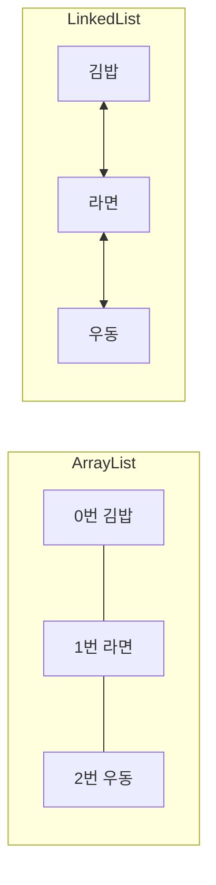

ArrayList와 LinkedList는 둘 다 값을 순서대로 담는 List인데, 값을 보관하는 방식이 달라서 잘하는 일이 다르다.

## 이게 없으면 뭐가 불편할까

두 클래스는 겉으로 보면 거의 똑같이 쓴다. 값을 넣을 때는 `add`, 꺼낼 때는 `get`, 지울 때는 `remove`를 쓰고 결과도 같다.

그래서 처음 배우면 이런 생각이 든다. "왜 똑같은 걸 두 개나 만들었지? 아무거나 써도 되나?"

차이를 모르면 이유 없이 습관대로 하나만 쓰게 된다. 반대로 차이를 알면 "지금 내가 하려는 일에는 이쪽이 맞다"고 고를 수 있다.

## 한 문장으로 말하면

먼저 비유로 감을 잡아 보자.

**ArrayList는 번호가 붙은 칸이 나란히 붙어 있는 서랍장**이다. 3번 칸에 있는 물건을 꺼내고 싶으면 3번 칸으로 바로 가면 된다.

**LinkedList는 보물찾기 쪽지**다. 쪽지마다 "내 앞 쪽지는 여기, 내 뒤 쪽지는 저기"라고 적혀 있다. 3번째 쪽지를 찾으려면 첫 쪽지부터 따라가며 세어야 한다.

이제 정확한 이름을 붙여 보자. 공식 문서에서는 ArrayList를 **크기가 자동으로 늘어나는 배열(resizable array)** 로 List를 구현한 것이라고 설명한다. 배열은 같은 종류의 값을 칸마다 나란히 담는 상자다.

공식 문서에서는 LinkedList를 **이중 연결 리스트(doubly-linked list)** 로 List를 구현한 것이라고 설명한다. 값마다 바로 앞 값과 바로 뒤 값을 가리키는 연결이 붙어 있다는 뜻이다.

비유에는 한계가 있다. 서랍장은 칸 수가 고정이지만 ArrayList는 칸이 모자라면 자동으로 늘어난다. 보물찾기 쪽지는 다음 쪽지만 알려 주지만, LinkedList는 앞과 뒤를 둘 다 안다.

> 한 줄 요약: ArrayList는 번호 칸이 붙어 있고, LinkedList는 서로를 가리키며 이어져 있다.

## 그림으로 보기



ArrayList는 번호가 붙은 칸이 붙어 있고, LinkedList는 값끼리 서로 앞뒤를 가리킨다.

## 직접 해보기

아래는 이해를 돕기 위한 예시 코드다. 메뉴 이름 세 개를 담고, 중간에 하나를 끼워 넣는다.

```java
List<String> menu = new ArrayList<>();
// List<String> menu = new LinkedList<>();  // 이렇게 바꿔도 아래 코드는 그대로 동작한다

menu.add("김밥");
menu.add("라면");
menu.add("우동");

menu.add(1, "떡볶이");               // 1번 자리에 끼워 넣기

System.out.println(menu);           // [김밥, 떡볶이, 라면, 우동]
System.out.println(menu.get(2));    // 라면
```

왼쪽 변수 타입을 `List`로 적어 두면 오른쪽만 바꿔서 ArrayList와 LinkedList를 갈아 끼울 수 있다. 결과는 똑같다. 왜 이게 가능한지는 아래 "헷갈렸던 점" 1번에서 자세히 설명한다.

결과는 똑같지만, 달라지는 건 **안에서 일하는 방식**이다.

`menu.add(1, "떡볶이")` 한 줄이 안에서 어떻게 일하는지 보자. 처음 상태는 `[김밥, 라면, 우동]`이다.

**ArrayList**는 칸을 비워 주려고 뒤의 값을 밀어야 한다.

1. 라면과 우동을 한 칸씩 뒤로 민다.
2. 비어 있는 1번 칸에 떡볶이를 넣는다.

**LinkedList**는 값을 밀지 않고 연결을 바꾼다.

1. 1번 자리까지 찾아간다. 처음이나 끝 중 가까운 쪽부터 센다.
2. 떡볶이 쪽지를 새로 만든다.
3. 김밥의 뒤와 라면의 앞이 떡볶이를 가리키게 바꾼다.

결과는 둘 다 `[김밥, 떡볶이, 라면, 우동]`이다. 값이 세 개일 때는 차이가 거의 없다. 값이 아주 많아지면 ArrayList는 "미는 일"이, LinkedList는 "찾아가는 일"이 부담이 될 수 있다.

List를 쓸 때 자주 만나는 메서드는 아래와 같다. ArrayList와 LinkedList 모두 같은 이름으로 쓴다.

| 하는 일 | 메서드 | 예 |
|---------|--------|----|
| 맨 뒤에 넣기 | `add(값)` | `menu.add("우동")` |
| 원하는 자리에 끼워 넣기 | `add(번호, 값)` | `menu.add(1, "떡볶이")` |
| 번호로 꺼내기 | `get(번호)` | `menu.get(2)` |
| 번호 자리의 값 바꾸기 | `set(번호, 값)` | `menu.set(0, "참치김밥")` |
| 번호 자리의 값 지우기 | `remove(번호)` | `menu.remove(1)` |
| 몇 개 들어 있는지 세기 | `size()` | `menu.size()` |
| 값이 들어 있는지 확인 | `contains(값)` | `menu.contains("라면")` |

## 헷갈렸던 점

**1. "`List`로 선언하고 `new ArrayList`로 만들어도 되는 이유가 뭘까? 앞뒤를 맞춰야 하는 거 아닌가?"**

가장 많이들 헷갈리는 부분이다. 앞뒤를 똑같이 맞출 필요는 없다. 규칙은 **"오른쪽이 왼쪽 타입의 한 종류이면 된다"** 는 것이다. 이유를 순서대로 풀어 보자.

**(1) 한 줄을 둘로 쪼개서 본다.**

```java
List<String> menu = new ArrayList<>();
```

이 한 줄은 사실 두 가지 일을 한다.

| 위치 | 코드 | 하는 일 | 정하는 것 |
|------|------|---------|-----------|
| 왼쪽 | `List<String> menu` | 변수를 만든다 | 이 변수로 **무엇을 할 수 있는지** |
| 오른쪽 | `new ArrayList<>()` | 실제 객체를 만든다 | **누가 실제로 일하는지** |

왼쪽은 "이 변수로 쓸 수 있는 기능의 범위"이고, 오른쪽은 "실제로 만들어지는 물건"이다. 둘은 역할이 달라서 꼭 같을 필요가 없다.

**(2) `List`는 클래스가 아니라 약속 목록이다.**

`List`는 **인터페이스(interface)** 다. 인터페이스는 "이 기능들을 반드시 만들어야 한다"는 약속 목록이다. `add`, `get`, `remove` 같은 이름만 적혀 있고, 실제로 일하는 코드는 없다.

공식 튜토리얼에서는 인터페이스를 클래스와 바깥 세상 사이의 **계약**이라고 설명한다. 이 계약은 컴파일할 때 컴파일러가 확인한다. 클래스가 어떤 인터페이스를 구현한다고 선언했는데 약속한 메서드가 하나라도 빠져 있으면 컴파일이 되지 않는다.

`ArrayList`와 `LinkedList`는 `List`의 약속을 모두 지킨 클래스다. 공식 문서에서도 ArrayList를 "`List` 인터페이스의 구현"이라고 설명하고, LinkedList를 "`List`와 `Deque` 인터페이스의 구현"이라고 설명한다.

**(3) 인터페이스는 자료형 자리에 쓸 수 있다.**

공식 튜토리얼에서는 인터페이스 이름을 다른 자료형 이름을 쓰는 곳 어디든 쓸 수 있다고 설명한다. 그리고 인터페이스 타입의 변수에는 **그 인터페이스를 구현한 클래스의 객체**를 넣어야 한다고 한다.

`ArrayList`는 `List`를 구현한 클래스다. 그래서 `List` 변수에 넣을 수 있다. `LinkedList`도 마찬가지다. 앞뒤를 맞춘다는 건, 이 규칙의 특별한 경우일 뿐이다.

**(4) 비유로 보면 리모컨과 TV다.**

- 왼쪽 `List<String> menu`는 **리모컨**이다. 버튼(`add`, `get`, `remove`)만 달려 있다.
- 오른쪽 `new ArrayList<>()`는 **실제 TV**다. 버튼을 누르면 실제로 일하는 쪽이다.

리모컨 규격만 맞으면 어느 회사 TV든 조작할 수 있다. 비유에는 한계가 있다. 리모컨에 없는 버튼은 누를 수 없다. 진짜 TV에 그 기능이 있어도 마찬가지다. ArrayList에만 있는 `ensureCapacity`(칸을 미리 늘리는 기능)가 그 예다.

**(5) 되는 경우와 안 되는 경우를 확인한다.**

아래는 이해를 돕기 위한 예시 코드다.

```java
List<String> a = new ArrayList<>();        // 가능
List<String> b = new LinkedList<>();       // 가능
ArrayList<String> c = new ArrayList<>();   // 가능

ArrayList<String> d = new LinkedList<>();  // 컴파일 에러
List<String> e = new List<>();             // 컴파일 에러

a.ensureCapacity(100);                     // 컴파일 에러
c.ensureCapacity(100);                     // 가능
```

| 줄 | 결과 | 이유 |
|----|------|------|
| `a` | 가능 | ArrayList는 `List`의 한 종류다 |
| `b` | 가능 | LinkedList도 `List`의 한 종류다 |
| `c` | 가능 | 앞뒤가 같은 가장 단순한 경우다 |
| `d` | 에러 | LinkedList는 `List`의 한 종류이지만, `ArrayList`의 한 종류는 아니다. 둘은 같은 약속을 지키는 서로 다른 클래스다 |
| `e` | 에러 | 공식 튜토리얼에서 인터페이스는 직접 만들 수 없고, 클래스가 구현하거나 다른 인터페이스가 확장할 수만 있다고 설명한다 |
| `a.ensureCapacity` | 에러 | 변수 타입이 `List`라서, `List` 약속에 없는 기능은 쓸 수 없다 |
| `c.ensureCapacity` | 가능 | 변수 타입이 `ArrayList`라서 ArrayList의 기능을 모두 쓸 수 있다 |

**(6) 그런데 왜 굳이 `List`로 선언할까?**

나중에 바꾸기 쉽기 때문이다. 아래는 이해를 돕기 위한 예시 코드다.

```java
static int count(List<String> list) {
    return list.size();
}

count(arrayList);    // ArrayList를 넘겨도 된다
count(linkedList);   // LinkedList를 넘겨도 된다
```

메서드의 매개변수 타입을 `List`로 만들어 두면, ArrayList든 LinkedList든 어느 쪽이든 받을 수 있다. 만약 `ArrayList`로 만들었다면 LinkedList를 넘길 수 없어서, 바꾸는 순간 메서드까지 고쳐야 한다.

변수도 마찬가지다. 왼쪽을 `List`로 적어 두면 ArrayList를 LinkedList로 바꿀 때 오른쪽 한 곳만 고치면 된다. 앞에서 본 JDBC의 `Connection`, `Statement`, `ResultSet`도 모두 인터페이스라서 `new`로 직접 만들 수 없다. 다음에 배울 `Map<String, Integer> map = new HashMap<>();`도 같은 모양이다.

> 한 줄 요약: 왼쪽은 "무엇을 할 수 있는지", 오른쪽은 "누가 일하는지"다. 오른쪽이 왼쪽 약속을 지키는 클래스이면 앞뒤가 달라도 된다.

**2. "LinkedList는 중간에 끼워 넣기가 빠르다던데?"**

반만 맞다. 두 클래스가 중간에 끼워 넣을 때 하는 일은 이렇다.

- ArrayList: 끼워 넣을 자리 뒤의 값을 전부 한 칸씩 뒤로 민다. 공식 문서의 `add(int, E)` 설명에도 뒤의 값들을 오른쪽으로 민다고 나온다.
- LinkedList: 앞뒤 연결만 새로 이으면 된다. 값을 밀 필요가 없다.

그런데 LinkedList는 끼워 넣을 자리까지 가는 데도 시간이 든다. 공식 문서에서는 번호로 접근하면 처음이나 끝 중 가까운 쪽부터 세어 간다고 설명한다. 끼워 넣는 일은 가벼워도, 자리를 찾는 일은 무겁다.

**3. "그럼 번호로 꺼내는 건?"**

ArrayList는 번호 칸으로 바로 간다. 공식 문서에서는 `get`과 `set`이 상수 시간(값이 많아져도 걸리는 시간이 변하지 않는다는 뜻)에 실행된다고 설명한다. LinkedList는 앞이나 뒤에서 세어 가야 한다.

**4. "ArrayList에 계속 넣으면 칸이 모자라지 않나?"**

모자라면 자동으로 칸이 늘어난다. 공식 문서에서는 `add`가 **분할 상환 상수 시간(amortized constant time)** 이라고 설명한다. 가끔 칸을 늘릴 때는 오래 걸리지만, 여러 번 넣은 평균으로 보면 빠르다는 뜻이다.

둘을 표로 비교하면 이렇다.

| 비교 | ArrayList | LinkedList |
|------|-----------|------------|
| 안쪽 구조 | 크기가 자동으로 늘어나는 배열 | 이중 연결 리스트 |
| 번호로 꺼내기 `get(i)` | 번호 칸으로 바로 간다 | 처음이나 끝에서 세어 간다 |
| 중간에 끼워 넣기 | 뒤의 값을 한 칸씩 민다 | 앞뒤 연결만 바꾼다 (자리까지는 세어 가야 한다) |
| `Deque` 구현 여부 | 구현하지 않는다 | 구현한다 (`Deque`는 앞과 뒤 양쪽에서 넣고 빼는 구조) |

**그래서 뭘 써야 할까?**

처음에는 ArrayList를 쓰면 된다. 공식 튜토리얼에서는 대부분의 경우 ArrayList를 쓰게 될 것이고, 번호로 바로 접근할 수 있어 빠르다고 설명한다. 공식 문서에서도 ArrayList의 상수 비용(작업마다 드는 기본 비용)이 LinkedList보다 낮다고 한다.

LinkedList는 **리스트의 맨 앞에 자주 값을 넣거나, 훑으면서 중간의 값을 자주 지울 때** 고려해 볼 만하다고 튜토리얼에서 설명한다. 그래도 LinkedList를 쓰고 싶다면, 정하기 전에 ArrayList와 LinkedList로 각각 직접 재 보라고 권한다. 보통은 ArrayList가 더 빠르다는 것이 튜토리얼의 안내다.

> 한 줄 요약: 번호로 꺼내는 일이 많으면 ArrayList, 연결을 이어 붙이는 구조가 필요하면 LinkedList다. 잘 모르겠으면 ArrayList부터 쓴다.

## 더 학습하면 좋은 개념

- **배열(array)** — ArrayList의 속은 배열이다. 배열이 칸 수가 고정이라는 점을 알아야 ArrayList가 왜 "자동으로 늘어난다"고 강조하는지 이해된다.
- **시간 복잡도(Big-O)** — "빠르다, 느리다"를 숫자로 비교하는 방법이다. 공식 문서의 상수 시간, 선형 시간 같은 표현을 읽으려면 필요하다.
- **인터페이스 직접 만들어 보기** — 약속 목록(인터페이스)을 직접 만들고, 클래스가 그 약속을 지키게 해 보면 "계약"이라는 말이 훨씬 구체적으로 이해된다. 다음에 배울 `Map`과 `HashMap`도 같은 관계다.
- **다형성(polymorphism)** — 하나의 변수(`List`)로 여러 종류의 객체(`ArrayList`, `LinkedList`)를 다루는 성질을 부르는 이름이다. 이 글의 1번 질문이 이 개념이다.
- **Deque와 Queue** — LinkedList가 구현한다는 `Deque`가 어떤 구조인지 알아야, LinkedList를 언제 쓰는지 이해된다.

## 참고 자료

- [ArrayList (Java SE 21 API)](https://docs.oracle.com/en/java/javase/21/docs/api/java.base/java/util/ArrayList.html)
- [LinkedList (Java SE 21 API)](https://docs.oracle.com/en/java/javase/21/docs/api/java.base/java/util/LinkedList.html)
- [List Implementations (The Java Tutorials)](https://docs.oracle.com/javase/tutorial/collections/implementations/list.html)
- [What Is an Interface? (The Java Tutorials)](https://docs.oracle.com/javase/tutorial/java/concepts/interface.html)
- [Defining an Interface (The Java Tutorials)](https://docs.oracle.com/javase/tutorial/java/IandI/createinterface.html)
- [Using an Interface as a Type (The Java Tutorials)](https://docs.oracle.com/javase/tutorial/java/IandI/interfaceAsType.html)
