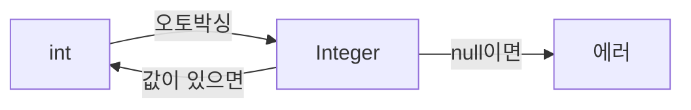

기본 자료형(`int`)은 숫자 그대로를 담고, 래퍼 클래스(`Integer`)는 숫자를 상자에 담은 것이어서 상자를 비워 둘 수 있다.

## 이게 없으면 뭐가 불편할까

반 학생들의 시험 점수표를 만든다고 해 보자. 철수는 80점을 받았다. 영희는 아파서 시험을 못 봤다. 영희의 점수 칸에는 무엇을 적어야 할까?

`0`이라고 적으면 "시험을 봤는데 0점"이라는 뜻이 된다. 영희가 억울하다. 필요한 건 **"아직 점수가 없음"을 뜻하는 빈 칸**이다.

그런데 자바의 `int`는 숫자만 담는 칸이다. 비워 둘 수가 없다. [DB의 NULL이 0.0으로 읽힐 때 해결하기]({{ site.baseurl }})에서 이 문제를 직접 겪었다. 보너스를 받지 않는 직원이 "보너스 0원"으로 바뀌어 버렸다.

또 하나 불편한 점이 있다. 점수들을 목록(`List`)에 모으려고 `List<int>`라고 쓰면 에러가 난다. 공식 튜토리얼에서도 `<>` 안에는 기본 자료형을 쓸 수 없다고 설명한다. 이 두 문제를 풀어 주는 것이 래퍼 클래스다.

## 한 문장으로 말하면

선물에 비유해 보자. 기본 자료형은 **선물 그 자체**다. 래퍼 클래스는 **선물을 넣은 포장 상자**다. 상자는 비워 둘 수 있고, 상자에는 설명서(기능)도 붙일 수 있다.

정확한 이름도 붙여 두자. **기본 자료형(primitive type)** 은 자바에 처음부터 들어 있는 숫자나 글자 같은 값이다. 공식 튜토리얼에서는 기본 자료형이 클래스로 만든 객체가 아니라고 설명한다. **래퍼 클래스(wrapper class)** 는 기본 자료형 값 하나를 객체로 감싸는 클래스다. `Integer`는 `int` 하나를 감싼다.

비유에는 한계가 있다. 포장을 풀면 선물은 그대로지만, 자바에서 상자 두 개를 `==`로 비교하면 안에 든 선물이 아니라 "같은 상자인가"를 묻게 된다. 아래 "헷갈렸던 점"에서 자세히 본다.

> 한 줄 요약: 기본 자료형은 선물 그대로, 래퍼 클래스는 포장 상자다.

둘의 차이를 표로 보면 이렇다.

| 비교 | 기본 자료형 (`int`) | 래퍼 클래스 (`Integer`) |
|------|---------------------|-------------------------|
| 비유 | 선물 그 자체 | 포장 상자 |
| 비워 두기(`null`) | 못 한다 | 할 수 있다 |
| `List`에 담기 | `List<int>`는 에러 | `List<Integer>` 가능 |
| 설명서(기능) | 없다 | 있다 (예: 문자를 숫자로 바꾸는 `Integer.parseInt`) |

## 그림으로 보기



`int`를 `Integer`에 넣을 때는 자동으로 상자에 담고, 꺼낼 때는 자동으로 상자를 푼다. 그런데 상자가 비어 있으면(`null`) 풀 때 에러가 난다.

## 직접 해보기

시험 점수표를 코드로 만들어 보자. 아래는 이해를 돕기 위한 예시 코드다.

```java
int score1 = 80;
Integer score2 = null;   // 시험 안 봄
int score3 = score2;     // 에러 발생
```

한 줄씩 읽어 보자.

1. `int score1 = 80;` 철수의 점수다. 숫자 80을 그대로 담는다.
2. `Integer score2 = null;` 영희의 점수다. 상자를 비워 두었다. "점수 없음"을 표현할 수 있다.
3. `int score3 = score2;` 영희의 상자를 풀어서 `int` 칸에 넣으려 한다. 꺼낼 숫자가 없으니 `NullPointerException`이 난다.

두 번째 줄처럼 `int`가 아닌 `Integer`를 쓴 덕분에 "점수 없음"을 표현했다. 세 번째 줄은 그 대가다. 비어 있을 수 있는 상자는 풀기 전에 비어 있는지 확인해야 한다.

우리 블로그의 `EmployeeDTO`에도 같은 구분이 있다.

```java
private int empSalary;
private Float empBonus;
```

급여는 `int`이고, 보너스는 `Float`(`float`를 감싼 래퍼 클래스)다. 보너스는 받지 않는 직원이 있어서 비어 있을 수 있게 만들었다.

기본 자료형 여덟 개와 짝이 되는 래퍼 클래스는 아래와 같다.

| 기본 자료형 | 래퍼 클래스 | 담는 것 |
|-------------|-------------|---------|
| `byte` | `Byte` | 작은 정수 |
| `short` | `Short` | 조금 작은 정수 |
| `int` | `Integer` | 보통 정수 |
| `long` | `Long` | 큰 정수 |
| `float` | `Float` | 소수 (작은 크기) |
| `double` | `Double` | 소수 (큰 크기) |
| `char` | `Character` | 글자 하나 |
| `boolean` | `Boolean` | 참 또는 거짓 |

이름은 앞글자를 대문자로 바꾸면 된다. 다만 `int`는 `Integer`, `char`는 `Character`로 철자가 다르다. 자료형의 크기와 범위는 [자료형 개념 글]({{ site.baseurl }})에 정리해 두었다.

## 헷갈렸던 점

**1. 오토박싱과 언박싱은 무슨 뜻일까?**

오토박싱(autoboxing)은 **자동으로 상자에 담아 주는 것**이다. 언박싱(unboxing)은 **자동으로 상자를 풀어 주는 것**이다. 공식 튜토리얼에서는 컴파일러가 기본 자료형과 래퍼 클래스 사이를 자동으로 바꿔 주는 일이라고 설명한다.

`Integer b = 10;`처럼 `int` 값 10을 `Integer`에 넣으면 오토박싱이 일어난다. 그래서 `List<Integer>`에 `list.add(10)`처럼 숫자를 그냥 넣어도 된다. 컴파일러가 알아서 `Integer.valueOf(10)`으로 바꿔 준다고 튜토리얼에 나온다.

**2. 비어 있는 상자를 풀면 왜 에러가 날까?**

풀 선물이 없기 때문이다. 자바 언어 명세(JLS)에서도 언박싱할 때 값이 `null`이면 `NullPointerException`이 난다고 설명한다. 위 영희의 예시에서 세 번째 줄이 그 경우다.

`EmployeeDTO`에서도 같은 일이 생길 수 있다. `getEmpBonus()`는 `Float`를 돌려준다. 이 값을 `float` 변수에 바로 넣으면, 보너스 없는 직원에서 에러가 난다. 아래는 이해를 돕기 위한 예시 코드다.

```java
Float bonus = emp.getEmpBonus();   // 보너스 없는 직원이면 null
float value = bonus;               // 에러 발생
```

**3. 같은 숫자인데 `==`로 비교하면 왜 `false`가 나올까?**

똑같은 선물이 든 상자 두 개를 떠올려 보자. `==`는 "이 두 상자가 **같은 상자**인가?"를 묻는다. 안에 든 선물이 같아도 상자가 둘이면 답은 `false`다. 안에 든 것이 같은지 묻고 싶으면 `equals`를 쓴다. 아래는 이해를 돕기 위한 예시 코드다.

```java
Integer a = 127, b = 127;
System.out.println(a == b);        // true

Integer x = 1000, y = 1000;
System.out.println(x == y);        // 보통 false
System.out.println(x.equals(y));   // true
```

127은 `true`인데 1000은 왜 `false`일까? `Integer.valueOf`는 -128부터 127까지의 상자를 미리 만들어 두고 돌려쓴다고 공식 문서가 설명한다. JLS에도 이 범위의 값은 같은 상자가 나온다고 보장한다. 그래서 127끼리는 같은 상자다.

범위를 벗어난 값은 문서가 결과를 보장하지 않는다. 보통은 `false`가 나오지만, 그것에 기대면 안 된다. 래퍼 클래스의 값을 비교할 때는 `equals`를 쓴다. 공식 문서에서는 `Integer.equals`가 상대가 `null`이 아니고 같은 `int` 값을 가진 `Integer`일 때 `true`라고 설명한다.

> 한 줄 요약: 상자끼리는 `==`가 아니라 `equals`로 비교한다.

**4. 우리 코드에는 `float`와 `Float`가 섞여 있다.**

`EmployeeDTO`의 필드는 `Float empBonus`(대문자)인데, 모든 필드를 한 번에 채우는 생성자의 매개변수는 `float empBonus`(소문자)다. 이 생성자로는 보너스에 `null`을 넣을 수 없다. `float`는 비울 수 없기 때문이다.

반대로 `setEmpBonus(Float empBonus)`는 `Float`를 받는다. 그래서 Setter로는 `null`을 넣을 수 있다. 같은 칸이어도 어떤 길로 넣느냐에 따라 "없음"을 표현할 수 있는지가 달라진다.

**5. 그래서 언제 무엇을 쓸까?**

기본은 기본 자료형을 쓰고, 아래 경우에만 래퍼 클래스를 쓰면 된다.

| 상황 | 쓸 것 | 예 |
|------|-------|----|
| 값이 항상 있다 | `int` | 철수의 점수, 직원의 급여 |
| 값이 비어 있을 수 있다 | `Integer`, `Float` | 시험 못 본 영희의 점수, 보너스 |
| `List` 같은 목록에 담는다 | `Integer` | 반 전체의 점수 목록 |

> 한 줄 요약: 값이 없을 수 있거나 목록에 담아야 할 때만 래퍼 클래스를 쓴다.

## 더 학습하면 좋은 개념

- **제네릭(Generics)** — `List<Integer>`의 `<>`가 무엇인지, 왜 기본 자료형을 못 받는지 알아야 래퍼 클래스가 필요한 이유가 완전히 이해된다.
- **NullPointerException** — 언박싱 말고도 `null`에서 에러가 나는 곳이 많다. 어디서 나는지 알면 에러 메시지를 읽고 원인을 찾기 쉬워진다.
- **`==`와 `equals()`의 차이** — 래퍼 클래스뿐 아니라 `String`을 비교할 때도 같은 문제가 생긴다. 객체를 비교하는 기본 규칙이다.
- **Optional** — `null`을 직접 다루는 대신 "값이 있을 수도 없을 수도 있음"을 표현하는 자바의 도구다. `null` 검사를 빼먹어서 생기는 에러를 줄이는 방법을 배울 수 있다.

## 참고 자료

- [Primitive Data Types (The Java Tutorials)](https://docs.oracle.com/javase/tutorial/java/nutsandbolts/datatypes.html)
- [Autoboxing and Unboxing (The Java Tutorials)](https://docs.oracle.com/javase/tutorial/java/data/autoboxing.html)
- [Restrictions on Generics (The Java Tutorials)](https://docs.oracle.com/javase/tutorial/java/generics/restrictions.html)
- [Java Language Specification, §5.1.7 Boxing Conversion](https://docs.oracle.com/javase/specs/jls/se21/html/jls-5.html#jls-5.1.7)
- [Java Language Specification, §5.1.8 Unboxing Conversion](https://docs.oracle.com/javase/specs/jls/se21/html/jls-5.html#jls-5.1.8)
- [Integer (Java SE 21 API)](https://docs.oracle.com/en/java/javase/21/docs/api/java.base/java/lang/Integer.html)
