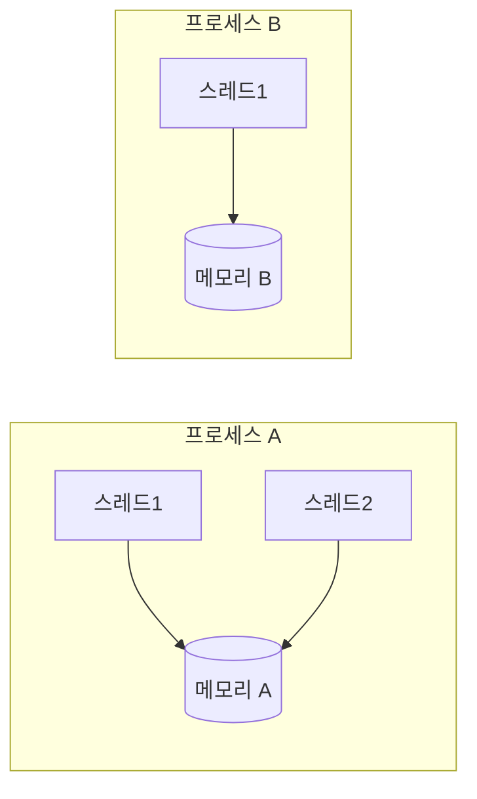

프로세스는 실행 중인 프로그램 하나이고, 스레드는 그 프로그램 안에서 실제로 일하는 일꾼이다.

## 이게 없으면 뭐가 불편할까

식당에 손님 100명이 동시에 주문한다고 해 보자. 직원이 한 명뿐이라면 한 명씩 차례로 처리해야 한다. 첫 손님의 요리가 끝날 때까지 나머지 99명은 기다린다.

웹 서버도 같은 문제를 겪는다. [웹 서버, Tomcat, 서블릿 글]({{ site.baseurl }})에서 Tomcat은 요청마다 스레드 하나를 쓴다고 했다. 일꾼이 한 명뿐이라면 한 사람의 요청이 끝날 때까지 다른 사람은 화면이 뜨지 않는다.

그래서 한 프로그램 안에서도 **여러 일을 동시에 하는 방법**이 필요하다. 그 방법이 스레드다. 스레드를 이해하려면 먼저 프로세스가 무엇인지부터 알아야 한다.

## 한 문장으로 말하면

식당으로 비유해 보자. **프로세스는 가게 하나**다. 가게마다 자기 주방과 창고가 따로 있다. **스레드는 그 가게 안에서 일하는 직원**이다. 한 가게의 직원들은 같은 주방과 창고를 함께 쓴다.

정확한 이름을 붙여 보자. 공식 튜토리얼에서는 **프로세스(process)** 를 "스스로 완결된 실행 환경"이라고 설명한다. 프로세스는 보통 자기만의 실행 자원을 갖고, 특히 **자기만의 메모리 공간**을 갖는다. 메모리는 프로그램이 값을 잠깐 올려 두는 작업대 같은 곳이다.

**스레드(thread)** 는 프로세스 안에서 일하는 실행 단위다. 튜토리얼에서는 스레드를 "가벼운 프로세스"라고도 부른다. 스레드는 프로세스 안에 있고, 모든 프로세스에는 스레드가 적어도 하나 있다. 같은 프로세스의 스레드들은 메모리와 열어 둔 파일 같은 자원을 **함께 쓴다**.

비유에는 한계가 있다. 식당 직원들은 눈치껏 서로 부딪히지 않지만, 스레드는 눈치가 없다. 둘이 동시에 같은 값을 고쳐도 서로 알아채지 못한다. 이 문제는 아래 "헷갈렸던 점" 3번에서 직접 확인한다.

> 한 줄 요약: 프로세스는 자기 메모리를 가진 가게이고, 스레드는 그 가게 안에서 메모리를 함께 쓰는 직원이다.

## 그림으로 보기



같은 프로세스의 스레드는 메모리를 함께 쓰고, 프로세스끼리는 메모리가 따로 있다.

## 직접 해보기

스레드를 만들고 실행해 보는 가장 단순한 예시다. 아래는 이해를 돕기 위한 예시 코드다. 이 글을 쓰면서 직접 실행해서 결과를 확인했다.

```java
public class ThreadDemo {
    static int count = 0;

    static class Job implements Runnable {
        public void run() {
            System.out.println("일하는 중: " + Thread.currentThread().getName());
            count = count + 1;
        }
    }

    public static void main(String[] args) throws InterruptedException {
        Thread t = new Thread(new Job());
        t.start();
        t.join();

        new Job().run();
        System.out.println("count = " + count);
    }
}
```

실행하면 이렇게 나온다.

```
일하는 중: Thread-0
일하는 중: main
count = 2
```

코드를 한 줄씩 읽어 보자.

1. `Job`은 "할 일"을 담은 클래스다. `Runnable`은 "이 클래스에는 `run`이라는 할 일 칸이 있다"는 약속이다. `run` 안에는 일하는 스레드의 이름을 출력하고, `count`에 1을 더하는 일을 적었다.
2. `new Thread(new Job())`은 새 일꾼을 만들고 할 일을 쥐여 준다.
3. `t.start()`는 새 일꾼에게 일을 시작하라고 한다. 새 스레드의 이름은 자동으로 `Thread-0`이 붙는다. 공식 문서에서는 `start`가 이 스레드를 현재 스레드와 별개로 실행하게 한다고 설명한다.
4. `t.join()`은 `t`가 일을 끝낼 때까지 기다린다.
5. `new Job().run()`은 `start`가 아니라 `run`을 직접 부른다. 새 일꾼이 아니라, 지금 이 코드를 실행하는 **`main` 스레드**가 직접 일한다.
6. `count`는 두 번 더해져서 `2`가 된다. 일꾼이 달라도 같은 `count`를 고쳤다는 뜻이다. 스레드가 메모리를 함께 쓰기 때문이다.

자바 프로그램은 처음에 **`main` 스레드** 하나로 시작한다. 공식 튜토리얼에서는 이 스레드가 다른 스레드를 만들 수 있다고 설명한다. 그래서 출력에 `main`이 나온다.

> 한 줄 요약: `start()`는 새 일꾼을 불러 일하게 하고, `run()`은 지금 있는 일꾼이 직접 한다.

## 헷갈렸던 점

**1. 프로세스와 스레드는 구체적으로 뭐가 다를까?**

가장 많이들 헷갈리는 부분이다. 한눈에 보도록 표로 정리했다.

| 비교 | 프로세스 | 스레드 |
|------|----------|--------|
| 비유 | 가게 하나 | 가게 안의 직원 |
| 메모리 | 자기만의 메모리 공간을 가진다 | 같은 프로세스의 스레드끼리 메모리를 함께 쓴다 |
| 만드는 비용 | 상대적으로 많이 든다 | 프로세스보다 적게 든다 |
| 서로 소통하는 방법 | 파이프(pipe)나 소켓(socket) 같은 별도 통로(IPC)가 필요하다 | 같은 메모리를 보면 된다 |
| 관계 | 스레드를 하나 이상 가진다 | 프로세스 안에 있다 |

만드는 비용과 소통 방법은 공식 튜토리얼에서 설명한 내용이다. 튜토리얼에서는 새 스레드를 만드는 데 새 프로세스를 만드는 것보다 자원이 적게 든다고 한다. 프로세스끼리는 운영체제가 제공하는 IPC(Inter Process Communication, 프로세스 간 통신) 통로를 쓴다고 한다.

**2. `start()`와 `run()`은 뭐가 다를까?**

앞의 예시에서 `start()`는 `Thread-0`이 일했고, `run()`을 직접 부르면 `main`이 일했다. `run()`은 그냥 일반 메서드처럼 지금 스레드에서 실행될 뿐, 새 스레드를 만들지 않는다.

공식 문서에서도 `run`은 "직접 호출하라고 만든 것이 아니다"라고 설명한다. 새 스레드에서 실행하고 싶으면 `start()`를 불러야 한다. 한 번 시작한 스레드는 다시 `start()`를 부를 수 없다. 공식 문서에서는 스레드가 최대 한 번만 시작될 수 있다고 설명한다.

| 부르는 법 | 누가 일하나 | 새 스레드가 생기나 |
|-----------|-------------|--------------------|
| `t.start()` | 새 스레드(`Thread-0`) | 생긴다 |
| `t.run()` 또는 `new Job().run()` | 지금 코드를 실행하는 스레드(`main`) | 생기지 않는다 |

**3. 메모리를 함께 쓰면 좋은 점만 있을까?**

그렇지 않다. 스레드가 메모리를 함께 쓰는 건 편리하지만 위험하기도 하다. 공식 튜토리얼에서는 이를 "효율적이지만 문제가 생길 수 있는 소통"이라고 설명한다.

두 직원이 같은 칠판에 적힌 숫자를 동시에 하나씩 올린다고 해 보자. 아래는 이해를 돕기 위한 예시 코드다. 두 스레드가 `count`를 각각 10만 번씩 올린다.

```java
public class RaceDemo {
    static int count = 0;

    static class Adder implements Runnable {
        public void run() {
            for (int i = 0; i < 100000; i++) {
                count++;
            }
        }
    }

    public static void main(String[] args) throws InterruptedException {
        Thread t1 = new Thread(new Adder());
        Thread t2 = new Thread(new Adder());
        t1.start();
        t2.start();
        t1.join();
        t2.join();
        System.out.println("count = " + count);
    }
}
```

10만 번씩 두 번이니 200000이 나올 것 같다. 하지만 이 코드를 여섯 번 실행했더니 결과는 이랬다.

```
count = 125041
count = 139279
count = 119554
count = 117173
count = 118181
count = 146340
```

모두 200000보다 작았고, 실행할 때마다 값이 달랐다.

왜 그럴까? `count++`는 한 번에 끝나는 일처럼 보이지만 사실은 세 단계다. 공식 튜토리얼에서는 이렇게 설명한다.

1. 지금 값을 읽는다.
2. 읽은 값에 1을 더한다.
3. 더한 값을 저장한다.

두 스레드가 이 세 단계를 동시에 하면 단계가 서로 겹친다. 예를 들어 둘 다 `5`를 읽고, 둘 다 `6`을 저장한다. 두 번 올렸는데 `1`만 올라간 셈이다. 튜토리얼에서는 이를 **스레드 간섭(thread interference)** 이라고 부르고, 결과를 예측할 수 없어서 원인을 찾기 어려운 버그가 된다고 설명한다.

> 한 줄 요약: 스레드는 메모리를 함께 쓰기 때문에 빠르고 편하지만, 같은 값을 동시에 고치면 결과가 꼬일 수 있다.

**4. Tomcat과는 어떻게 이어질까?**

[웹 서버, Tomcat, 서블릿 글]({{ site.baseurl }})로 돌아가 보자. Tomcat을 실행하면 보통 **프로세스 하나**가 생긴다. 그 안에서 요청이 올 때마다 **스레드 하나**가 그 요청을 맡는다.

Tomcat 공식 문서는 비동기가 아닌 요청 하나가 끝나는 동안 스레드 하나가 필요하다고 설명한다. 그리고 한 번에 만들 수 있는 요청 처리 스레드의 최대 개수(`maxThreads`)를 정하지 않으면 200이라고 한다.

그래서 요청이 동시에 200개를 넘으면 일꾼이 부족해질 수 있다. 서블릿 하나를 여러 요청이 함께 쓰는 상황에서 같은 값을 고치면, 위의 `count`처럼 꼬일 수 있다는 점도 기억해 두자.

## 더 학습하면 좋은 개념

- **동기화(`synchronized`)** — 여러 스레드가 같은 값을 안전하게 고치게 하는 방법이다. 이 글의 `count` 문제를 해결하려면 반드시 알아야 한다.
- **스레드 풀(thread pool)** — 일꾼을 미리 정해진 수만큼 만들어 두고 돌려 쓰는 방식이다. 요청마다 스레드를 새로 만드는 대신 돌려 쓰는 이유를 알면, Tomcat의 `maxThreads` 같은 설정이 왜 있는지 이해하기 쉬워진다.
- **동시성(concurrency)과 병렬성(parallelism)** — "동시에 일한다"는 말에도 번갈아 하는 것과 정말 같이 하는 것의 차이가 있다. 스레드가 실제로 어떻게 돌아가는지 이해하려면 이 구분이 필요하다.
- **스레드의 상태** — 스레드는 만들어지고, 일하고, 기다리고, 끝나는 단계를 거친다. `join`이 왜 필요한지 더 정확히 이해할 수 있다.
- **프로세스 간 통신(IPC)** — 프로세스끼리 어떻게 대화하는지 알면, 메모리를 따로 쓰는 프로세스와 함께 쓰는 스레드의 차이가 더 분명해진다.

## 참고 자료

- [Processes and Threads (The Java Tutorials)](https://docs.oracle.com/javase/tutorial/essential/concurrency/procthread.html)
- [Defining and Starting a Thread (The Java Tutorials)](https://docs.oracle.com/javase/tutorial/essential/concurrency/runthread.html)
- [Thread Interference (The Java Tutorials)](https://docs.oracle.com/javase/tutorial/essential/concurrency/interfere.html)
- [Thread (Java SE 21 API)](https://docs.oracle.com/en/java/javase/21/docs/api/java.base/java/lang/Thread.html)
- [Apache Tomcat 10.1: The HTTP Connector](https://tomcat.apache.org/tomcat-10.1-doc/config/http.html)
