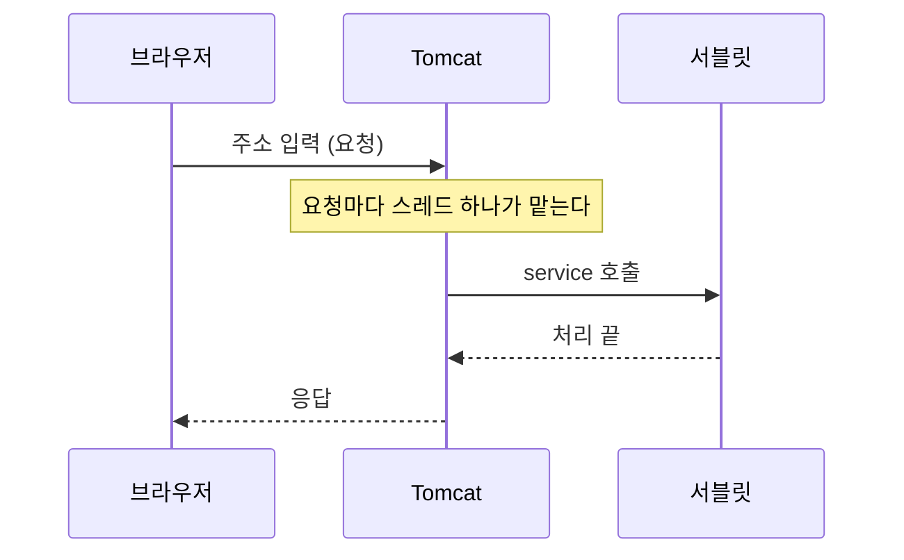
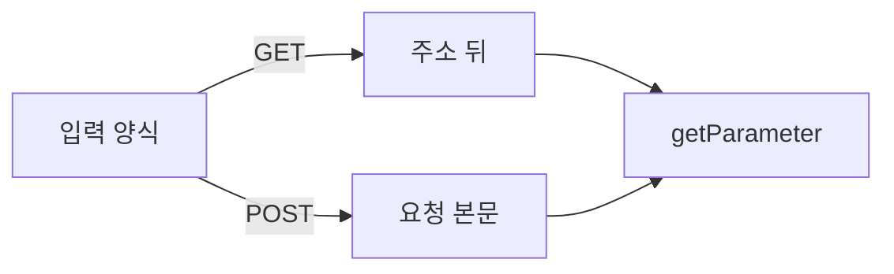

웹 서버는 만들어 둔 파일을 그대로 건네주고, Tomcat은 서블릿이라는 자바 프로그램을 실행해서 요청마다 결과를 새로 만들어 준다.

2026년 10월 21일 수업에서 진행한 내용을 정리했다.

## 이게 없으면 뭐가 불편할까

쇼핑몰 화면을 떠올려 보자. 철수가 로그인하면 "철수님 안녕하세요"가 보이고, 영희가 로그인하면 "영희님 안녕하세요"가 보인다. 주소는 같은데 사람마다 화면이 다르다.

미리 만들어 둔 파일을 그대로 건네주는 방식으로는 이걸 할 수 없다. 요청이 올 때마다 프로그램이 실행되어서 화면을 **새로 만들어야** 한다.

그런데 그 프로그램이 브라우저와 대화하는 일까지 직접 만들려면 일이 너무 크다. 브라우저가 보낸 요청을 읽고, 결과를 알맞은 형식으로 보내는 일이다. 이 일을 대신 해 주는 것이 Tomcat이다.

## 한 문장으로 말하면

식당으로 비유해 보자. 손님이 주문을 하면 음식이 나온다. 이 식당에는 진열대 직원과 주방이 있다.

| 등장인물 | 식당에서는 | 웹에서는 |
|----------|------------|----------|
| 손님 | 주문하는 사람 | 브라우저 (주소를 입력하는 쪽) |
| 웹 서버 | 진열대에서 완성품을 꺼내 주는 직원 | 만들어 둔 파일(HTML, 이미지)을 그대로 전달한다 |
| 서블릿 | 요리사가 따라 하는 레시피 한 장 | 요청을 받아 결과를 만드는 자바 프로그램 하나 |
| Tomcat | 레시피를 보관하고 주문이 오면 요리하게 하는 주방 | 서블릿을 보관하고 실행해 주는 프로그램 |

정확한 이름을 붙여 보자. 아파치(Apache) 웹 서버 공식 문서는 **정적 콘텐츠(static content)** 를 HTML, 이미지, CSS처럼 파일 시스템에 있는 파일이라고 설명한다. **동적 콘텐츠(dynamic content)** 는 요청이 올 때 만들어지고 요청마다 달라질 수 있는 것이라고 한다.

**서블릿(servlet)** 은 동적 콘텐츠를 만드는 자바 클래스다. 공식 규격(Jakarta Servlet)은 서블릿을 "컨테이너가 관리하는 웹 구성요소"라고 설명한다. 서블릿은 혼자서는 실행되지 않고, 컨테이너가 불러서 실행한다.

**Tomcat**은 서블릿을 실행해 주는 서버, 즉 **서블릿 컨테이너(servlet container)** 다. Tomcat 공식 사이트는 Tomcat을 "Jakarta Servlet 같은 규격의 오픈 소스 구현"이라고 소개한다. 공식 규격에서는 컨테이너가 요청을 해독하고, 맞는 서블릿에 넘기고, 응답을 만들어 보내는 일을 맡는다고 설명한다.

그러면 Tomcat은 웹 서버일까, 아닐까? Tomcat 공식 문서(HTTP 커넥터)는 이 설정이 Tomcat을 "서블릿과 JSP 페이지를 실행하는 능력에 더해 **독립 웹 서버로도** 동작하게 한다"고 설명한다. 그래서 Tomcat은 서블릿 컨테이너이면서, 웹 서버 역할도 할 수 있다.

**WAS(Web Application Server)** 는 Tomcat 같은 서버를 흔히 부르는 이름이다. 다만 공식 문서에서 확인한 용어는 아니다. Tomcat 공식 사이트는 자신을 웹 서버나 애플리케이션 서버라고 부르지 않고, 규격의 구현이라고만 소개한다.

비유에는 한계가 있다. 식당에서는 진열대 직원과 주방이 나뉘어 있지만, Tomcat은 한 프로그램이 두 역할을 다 할 수 있다. 그래서 "웹 서버냐 WAS냐"를 칼로 자르듯 나누기보다, **파일을 그대로 건네주는 일**과 **프로그램을 실행해서 결과를 만드는 일**을 나누어 생각하는 편이 정확하다.

> 한 줄 요약: 웹 서버는 완성품을 건네주고, 서블릿은 레시피이고, Tomcat은 레시피대로 요리하는 주방이다.

## 그림으로 보기



브라우저의 요청은 Tomcat이 먼저 받고, Tomcat이 맞는 서블릿을 불러서 일을 시킨다. 서블릿은 브라우저와 직접 대화하지 않는다.

요청 하나가 처리되는 과정을 순서대로 풀어 보자.

1. 브라우저에 주소를 입력한다. 이 요청은 서버 컴퓨터의 **포트(port)** 로 들어간다. 포트는 건물의 호수 같은 번호다. Tomcat은 설정한 포트 번호에서 요청을 기다린다.
2. Tomcat이 요청을 받으면 **스레드(thread) 하나**가 그 요청을 맡는다. 스레드는 일을 하는 일꾼 한 명이라고 생각하면 된다. Tomcat 공식 문서는 비동기가 아닌 요청 하나가 끝나는 동안 스레드 하나가 필요하다고 설명한다. 스레드가 정확히 무엇인지는 다음 글에서 다룬다.
3. Tomcat이 주소를 보고 맡을 서블릿을 찾는다. 주소와 서블릿을 이어 주는 것이 `@WebServlet`이다.
4. 그 서블릿이 아직 없으면 Tomcat이 만들고 준비시킨다(`init`). 이미 있으면 이 단계는 건너뛴다.
5. Tomcat이 `service`를 부른다. 이때 요청 정보(`req`)와 응답을 담을 그릇(`resp`)을 같이 넘겨 준다.
6. 서블릿이 요청을 읽고 결과를 `resp`에 채운다.
7. Tomcat이 `resp`를 브라우저로 돌려보낸다.

## 직접 해보기

Tomcat을 설치하고 직접 만든 서블릿이다. 설명을 위해 주석은 줄였다.

```java
@WebServlet(value="/request-service")
public class ServiceMethodServlet extends HttpServlet {
    @Override
    protected void service(HttpServletRequest req, HttpServletResponse resp) throws ServletException, IOException {
        System.out.println("req = " + req);
        String httpMethod = req.getMethod();
        System.out.println("httpMethod = " + httpMethod);
    }

    @Override
    protected void doPost(HttpServletRequest req, HttpServletResponse resp) throws ServletException, IOException {
        System.out.println("POST 요청을 처리할 메소드 호출됨...");
    }

    @Override
    protected void doGet(HttpServletRequest req, HttpServletResponse resp) throws ServletException, IOException {
        System.out.println("GET 요청을 처리할 메소드 호출됨...");
    }
}
```

위에서부터 하나씩 읽어 보자.

1. `@WebServlet(value="/request-service")` 주소가 `/request-service`로 끝나는 요청은 이 서블릿이 맡는다는 표시다. 공식 문서에서는 서블릿을 선언하는 표시이고, `value`는 서블릿의 URL 패턴(주소 규칙)이라고 설명한다. 이 표시는 서버에 올릴 때 Tomcat이 읽는다.
2. `extends HttpServlet` 이 클래스를 서블릿으로 만드는 줄이다. 이유는 아래 "헷갈렸던 점" 1번에서 풀어 쓴다.
3. `service(HttpServletRequest req, HttpServletResponse resp)` 요청이 오면 Tomcat이 가장 먼저 부르는 칸이다. `req`는 손님이 낸 **주문서**(요청 정보)이고, `resp`는 손님에게 내보낼 **쟁반**(응답을 담는 그릇)이다.
4. `req.getMethod()` 요청이 `GET`인지 `POST`인지 알아낸다.
5. `doGet(...)`, `doPost(...)` `GET` 요청용 칸과 `POST` 요청용 칸이다.

브라우저 주소창에 이 서블릿의 주소를 입력해서 요청을 보내면, 코드를 따라 읽었을 때 Tomcat 콘솔에 `req = ...` 줄과 `httpMethod = GET` 줄이 찍힌다. 이 코드에는 브라우저 화면에 글자를 보내는 부분이 없다. 화면에는 보여 줄 글자가 오지 않고, 콘솔에만 출력한다.

`GET`과 `POST`를 둘 다 보내 보려면 아래처럼 HTML을 만들면 된다. 아래는 이해를 돕기 위한 예시 코드다. 주소의 앞부분은 환경에 따라 다를 수 있다.

```html
<a href="request-service">GET으로 보내기</a>

<form action="request-service" method="post">
    <button type="submit">POST로 보내기</button>
</form>
```

링크(`a` 태그)를 누르면 `GET`, 양식(`form`)을 `post`로 제출하면 `POST` 요청이 간다. 이때 콘솔에 찍히는 것은 아래와 같다. 코드를 읽고 정리한 것이다.

| 보낸 방식 | 지금 코드 | `super.service(req, resp)`를 추가하면 |
|-----------|-----------|----------------------------------------|
| GET | `httpMethod = GET` | `httpMethod = GET`, 그다음 `GET 요청을 처리할 메소드 호출됨...` |
| POST | `httpMethod = POST` | `httpMethod = POST`, 그다음 `POST 요청을 처리할 메소드 호출됨...` |

세 번째 열이 어떻게 나왔는지는 아래 "헷갈렸던 점" 2번에서 설명한다.

서블릿의 한살이도 알아 두면 좋다. 공식 튜토리얼에서는 서블릿의 생명주기를 컨테이너가 관리한다고 설명한다. 레시피로 비유하면 아래와 같다.

| 단계 | 언제 불리나 | 비유 |
|------|-------------|------|
| `init` | 서블릿이 처음 만들어질 때 한 번 | 레시피를 처음 꺼내 준비한다 |
| `service` | 요청이 올 때마다 | 주문이 올 때마다 요리한다 |
| `destroy` | 컨테이너가 서블릿을 없앨 때 | 레시피를 정리해서 치운다 |

이 서블릿에는 `init`과 `destroy`가 없다. 필요하면 `HttpServlet`에서 물려받은 것을 덮어써서 쓸 수 있다.

## 파일은 어디에 둘까?

프로젝트를 만들면 파일이 두 갈래로 나뉜다. 수업에서 정리한 내용은 이렇다.

| 구분 | 위치 (`src/main/` 아래) | 하는 일 |
|------|-------------------------|---------|
| `webapp` 안의 파일 | `webapp/` | 브라우저가 직접 받아 보는 화면 파일 (HTML, CSS, JS) |
| `index.html` | `webapp/index.html` | 주소만 입력했을 때 가장 먼저 열리는 대문 화면 |
| 서블릿 | `java/` 아래 패키지 | 화면에 보이지 않고, 뒤에서 요청을 받아 일하는 자바 클래스 |

가게로 비유하면 `webapp`은 손님이 보는 진열대이고, 서블릿은 손님 눈에 안 보이는 주방이다. 다만 진짜 가게와 달리, 손님이 진열대 파일의 주소를 알면 그 파일을 바로 받아 갈 수 있다.

`index.html`이 먼저 열리는 이유는 Tomcat의 기본 설정 파일(`conf/web.xml`)에 있다. 이 파일에는 **환영 파일(welcome file)** 목록이 `index.html`, `index.htm`, `index.jsp` 순서로 적혀 있다. 환영 파일은 주소가 폴더를 가리킬 때 대신 보여 줄 파일이다.

수업에서 확인한 흐름은 이렇다.

1. 브라우저로 접속하면 `index.html`(대문 화면)이 열린다.
2. 메뉴를 눌러 입력 화면(`parameter.html`)으로 간다.
3. 값을 입력하고 제출 버튼을 누르면, 요청이 그 주소를 맡은 서블릿으로 간다.
4. 서블릿이 입력값을 받아서 일한다.

수업 노트에는 "요청 하나당 하나의 서블릿"이라고 적었다. `/querystring` 요청은 `QueryStringServlet`이, `/formdata` 요청은 `FormDataServlet`이 맡는 식이다. 주소마다 맡는 서블릿이 `@WebServlet`으로 정해진다.

> 한 줄 요약: 화면 파일은 `webapp`에, 서블릿은 `java` 아래에 둔다. 주소만 치면 `index.html`이 먼저 열린다.

## 브라우저가 보낸 값은 서블릿이 어떻게 받을까?

### 왜 필요할까

앞의 `ServiceMethodServlet`은 요청이 `GET`인지 `POST`인지만 알아냈다. 그런데 회원가입을 만들려면 사용자가 입력한 이름과 나이를 받아야 한다. 요청 방식만 알아서는 아무것도 저장할 수 없다.

### 한 문장으로 말하면

주문서를 떠올려 보자. 주문서에는 "이름: 홍길동", "나이: 20"처럼 **항목 이름과 적은 값**이 짝으로 적혀 있다. 주방에서는 "이름 칸에 뭐라고 적혔지?" 하고 항목 이름으로 값을 찾아 읽는다.

브라우저가 서버로 보내는 이 짝을 **요청 파라미터(request parameter)** 라고 부른다. 항목 이름은 HTML 입력칸의 `name` 속성이고, 값은 사용자가 입력한 내용이다. 서블릿은 `req.getParameter("항목 이름")`으로 값을 꺼낸다.

공식 API 문서에서는 `getParameter`가 파라미터 값을 `String`으로 돌려주고, 그런 파라미터가 없으면 `null`을 돌려준다고 설명한다. 그리고 HTTP 서블릿에서 파라미터는 쿼리 스트링이나 POST로 보낸 양식 데이터에 들어 있다고 한다.

비유에는 한계가 있다. 종이 주문서는 숫자 칸에 숫자를 적지만, 요청 파라미터는 **무엇을 적든 모두 글자(`String`)로** 도착한다. 이 차이는 아래 "헷갈렸던 점" 7번에서 다룬다.

### 값은 어디에 실려서 갈까?

같은 양식이라도 `GET`과 `POST`는 값을 싣는 자리가 다르다.

- `GET`은 값을 **주소 뒤에** 붙인다. `?` 뒤에 `이름=값`을 `&`로 이어 붙인 부분을 **쿼리 스트링(query string)** 이라고 부른다.
- `POST`는 값을 주소가 아니라 **요청 본문(body)** 에 담는다. 본문은 편지 봉투 속 편지지처럼, 주소창에는 보이지 않는 요청의 내용 부분이다.

MDN은 `GET`으로 양식을 보내면 데이터가 URL 뒤에 붙고, `POST`로 보내면 URL에는 아무것도 붙지 않고 본문에 담긴다고 설명한다.



어느 쪽으로 보내도 서블릿에서는 똑같이 `getParameter`로 꺼낸다.

### 직접 해보기

수업에서 만든 `parameter.html`의 일부다. 실제 파일에는 생일, 성별, 국적, 취미 입력칸도 있는데, 설명을 위해 이름과 나이만 남겼다.

```html
<h3>GET 방식의 요청</h3>
<form action="/querystring" method="get">
    <label>이름: </label>
    <input type="text" name="name">
    <br>
    <label>나이: </label>
    <input type="number" name="age">
    <br>
    <input type="submit" value="GET요청">
</form>

<h4>a태그의href 속성에 직접 파라미터를 쿼리스트링 형태로 작성하여get 방식 요청</h4>
<a href="/querystring?name=홍길동&age=20&birthday=2021-01-08&gender=M&national=ko&hobbies=movie&hobbies=music&hobbies=sleep">쿼리스트링을
    이용한 값 전달</a>

<h4>form태그를 이용한post 방식 요청</h4>
<form action="/formdata" method="post">
    <label>이름: </label>
    <input type="text" name="name">
    <br>
    <input type="submit" value="POST요청">
</form>
```

`input`의 `name="name"`, `name="age"`가 항목 이름이 된다. `a` 태그는 양식 없이 쿼리 스트링을 주소에 직접 적어서 `GET` 요청을 보낸다.

`GET` 요청을 받는 서블릿이다. 주석은 수업에서 적은 것을 줄였다.

```java
@WebServlet(value="/querystring")       //querystring 요청을 처리할 클래스를 만들겠다고 선언!!
public class QueryStringServlet extends HttpServlet {

    @Override
    protected void doGet(HttpServletRequest req, HttpServletResponse resp) throws ServletException, IOException {
        //url 에 있는 요청들(값)은 req 변수에 담김 항상!!!!!
        System.out.println("doGet() 호출됨....");

        String name=req.getParameter("name");      //name => 가져오고싶은 값의 키 값을 달라는 것임.
        System.out.println("name = " + name);

        /* comment.
            URL 로 전달되는 데이터는 모두 String 타입이다.
            따라서 원하는 자료형으로 담기 위해서는 파싱이 필요하다.(번역)
         */
        int age = Integer.parseInt(req.getParameter("age"));
        System.out.println("age = " + age);
    }
}
```

1. `@WebServlet(value="/querystring")` 양식의 `action="/querystring"`과 주소가 같다. 그래서 이 서블릿이 요청을 맡는다.
2. `doGet` 양식이 `method="get"`이라서 `doGet`을 덮어썼다. 이번에는 `service`를 덮어쓰지 않았으니, 물려받은 `service`가 `doGet`을 불러 준다.
3. `req.getParameter("name")` 주문서에서 "name" 칸의 값을 읽는다.
4. `Integer.parseInt(...)` 글자로 온 나이를 숫자로 바꾼다. 이렇게 글자를 다른 자료형으로 바꾸는 일을 **파싱(parsing)** 이라고 부른다.

`POST` 요청을 받는 서블릿은 이렇다.

```java
@WebServlet(value="/formdata")       //formdata 요청을 처리할 클래스를 만들겠다고 선언!!
public class FormDataServlet extends HttpServlet {

    //formdata 는 post 방식으로 보내고 있으므로 doPost 메서드로 오버라이딩!!
    @Override
    protected void doPost(HttpServletRequest req, HttpServletResponse resp) throws ServletException, IOException {
        System.out.println("doPost() 호출됨....");
        String name = req.getParameter("name");
        System.out.println("name = " + name);
    }
}
```

값이 실려 온 자리는 다르지만, 꺼내는 코드는 `QueryStringServlet`과 똑같이 `req.getParameter("name")`이다.

> 한 줄 요약: 요청 파라미터는 `name=값` 짝이다. `GET`은 주소 뒤에, `POST`는 본문에 싣지만, 서블릿은 둘 다 `getParameter`로 꺼낸다.

## 헷갈렸던 점

**1. 왜 `extends HttpServlet`이라고 쓸까?**

`extends`는 "물려받는다"는 뜻이다. `HttpServlet`이라는 클래스가 가진 것을 우리 클래스가 그대로 가져온다.

Tomcat이 서블릿을 실행하려면 서블릿이 지켜야 할 약속이 있다. 서블릿이 만들어질 때, 요청을 받을 때, 없어질 때 각각 불리는 칸이 정해져 있다. 이걸 처음부터 전부 만들면 할 일이 많다.

**`HttpServlet`은 이 약속을 웹 요청에 맞춰 이미 지켜 둔 뼈대**다. 공식 문서에서는 웹 사이트용 서블릿을 만들려고 물려받는 추상 클래스라고 설명한다. 그리고 `doGet`, `doPost` 같은 칸 중 하나 이상을 채워야 한다고 한다.

`@WebServlet`을 쓰려면 `extends HttpServlet`이 **필수**다. 공식 튜토리얼에서 `@WebServlet`을 붙인 클래스는 `HttpServlet`을 물려받아야 한다고 설명한다.

레시피 양식에 비유해 보자. 양식에는 "GET 주문이면 여기, POST 주문이면 여기"라는 빈칸이 있다. 우리는 필요한 칸만 채운다. `@Override`는 그 칸을 우리 내용으로 바꾼다는 표시다. 다만 레시피 양식은 빈 종이지만, `HttpServlet`에는 이미 동작하는 코드가 들어 있다.

| 역할 | 누가 |
|------|------|
| 서블릿을 보관하고 실행한다 | Tomcat |
| 요청이 오면 `GET`인지 `POST`인지 보고 알맞은 칸을 부른다 | `HttpServlet` (물려받은 뼈대) |
| 칸의 내용을 채운다 | 우리가 만든 `ServiceMethodServlet` |

> 한 줄 요약: `extends HttpServlet`은 웹 요청용 뼈대를 물려받아서, 필요한 칸만 채우겠다는 뜻이다.

**2. 왜 `doGet`과 `doPost`가 있는데 `service`가 따로 있을까?**

요청이 오면 `HttpServlet`의 `service`가 먼저 불리고, `service`가 요청 방식을 보고 `doGet`이나 `doPost`를 부른다. 공식 문서에서는 `service`가 요청을 `do` 시작하는 메서드로 나눠 준다고 설명한다. 그리고 이 메서드는 덮어쓸 필요가 없다고 한다.

이 코드는 `service`를 덮어썼다. 덮어쓴 `service` 안에는 `doGet`이나 `doPost`를 부르는 코드가 없다. 그래서 브라우저 요청이 와도 `doGet`의 "GET 요청을 처리할 메소드 호출됨..."은 찍히지 않고, `httpMethod` 줄만 찍힌다.

원래 하던 나눠 주는 일까지 하고 싶다면 `service` 안에서 물려받은 `service`를 불러야 한다. 아래는 이해를 돕기 위한 예시 코드다.

```java
@Override
protected void service(HttpServletRequest req, HttpServletResponse resp) throws ServletException, IOException {
    String httpMethod = req.getMethod();
    System.out.println("httpMethod = " + httpMethod);
    super.service(req, resp);   // 물려받은 service를 불러서 doGet, doPost로 나눠 준다
}
```

`super`는 "물려받은 쪽"을 가리키는 말이다. 수업 코드는 `service`가 가장 먼저 불린다는 것을 확인하는 용도로 보인다.

**3. `GET`과 `POST`는 뭐가 다를까?**

MDN은 `GET`을 "지정한 자료를 달라는 요청"이라고 설명한다. 데이터를 가져오기만 해야 하고 내용물을 실어 보내지 않는다. `POST`는 지정한 대상에 정보를 제출하는 요청이고, 서버에 변화가 생기기도 한다고 설명한다.

| 방식 | 쉽게 말하면 | 예 |
|------|-------------|----|
| `GET` | 정보를 달라고 한다 | 주소창에 입력, 링크(`a` 태그) 클릭 |
| `POST` | 정보를 보낸다 | 입력한 내용을 제출하는 양식 |

수업 코드의 주석에도 `a` 태그를 눌러 주소가 바뀌는 방식이 `GET`이라고 적혀 있다.

값을 함께 보낼 때는 차이가 하나 더 있다. 앞의 "브라우저가 보낸 값은 서블릿이 어떻게 받을까?"에서 본 내용을 표로 모았다. MDN 문서에서 확인한 내용이다.

| 비교 | `GET` | `POST` |
|------|-------|--------|
| 값을 싣는 자리 | 주소 뒤 쿼리 스트링 | 요청 본문 |
| 주소창에 값이 보이나 | 보인다 | 보이지 않는다 |
| 비밀번호를 보내도 되나 | 안 된다. 주소창에 그대로 드러난다 | 이쪽을 쓴다 |
| 많은 양을 보낼 때 | 주소 길이를 제한하는 브라우저와 서버가 있다 | 이쪽이 낫다 |

여기서 많이들 오해한다. `POST`는 주소창에 안 보일 뿐, 값이 암호화되는 것은 아니다. MDN에서는 요청 내용을 암호화하려면 HTTPS 주소를 써야 한다고 설명한다. 이건 `GET`과 `POST` 모두 같다.

**4. 웹 서버와 Tomcat은 결국 뭐가 다를까?**

앞에서 Tomcat이 웹 서버 역할도 할 수 있다고 했다. 그래도 둘을 나누어 보는 이유가 있다. 아파치 웹 서버 공식 문서는 웹 서버가 요청받은 주소에 해당하는 파일이나 프로그램을 찾아 응답으로 보낸다고 설명한다. 서블릿을 실행하는 일은 Tomcat이 가진 능력이다.

| 질문 | 웹 서버(Apache HTTP Server) | Tomcat |
|------|-----------------------------|--------|
| 파일을 그대로 건네주나? | 한다 | 독립 웹 서버로도 동작할 수 있다 |
| 서블릿을 실행하나? | 설명에 나오지 않는다 | 한다 |
| 공식 소개 | 웹 서버 | Jakarta Servlet 같은 규격의 구현 |

이 표는 확인한 문서 범위 안에서만 쓴 것이다. 아파치 웹 서버가 서블릿을 못 한다는 뜻은 아니다. 문서에서 그 내용을 찾지 못했을 뿐이다.

**5. 요청이 동시에 여러 개 오면 어떻게 될까?**

Tomcat 공식 문서에서는 비동기가 아닌 요청 하나가 끝나는 동안 스레드 하나가 필요하다고 설명한다. 공식 튜토리얼에서도 웹 컨테이너가 보통 요청마다 스레드를 하나씩 만든다고 한다.

Tomcat은 동시에 일할 수 있는 스레드의 최대 개수를 정해 둔다. 공식 문서에서는 이 값을 정하지 않으면 200이라고 설명한다. 그래서 동시에 처리하는 요청이 늘어나면 일꾼이 부족해질 수 있다. 스레드가 무엇인지, 여러 스레드가 함께 일할 때 무슨 일이 생기는지는 다음 글에서 다룬다.

**6. 왜 `javax`가 아니라 `jakarta`로 시작할까?**

코드의 `import`가 `jakarta.servlet`으로 시작한다. Tomcat 공식 버전표에서는 Tomcat 10.0 이후 버전이 Jakarta EE 규격을 구현한다고 설명한다. 그래서 이 코드는 Tomcat 10 이후 버전에서 돌리는 것으로 보인다. 정확한 Tomcat 버전은 확인하지 못했다.

**7. 나이를 숫자로 입력했는데 왜 `String`으로 올까?**

나이 입력칸은 `type="number"`라서 숫자만 입력된다. 그래서 서블릿에서도 숫자로 받을 줄 알았다.

그런데 `getParameter`는 언제나 `String`을 돌려준다. 주소 뒤에 붙든 본문에 담기든, 요청에 실린 값은 글자로 전달되기 때문이다. 그래서 숫자로 계산하려면 `Integer.parseInt`로 바꿔야 한다. 수업 주석에도 "URL 로 전달되는 데이터는 모두 String 타입"이라고 적었다.

여기서 하나 더 조심할 점이 있다. 나이 칸을 비우고 제출하면 어떻게 될까? 공식 API 문서에 따르면 `Integer.parseInt`는 `null`이나 빈 문자열(`""`)을 받으면 `NumberFormatException`이라는 예외를 던진다. 예외는 "이건 처리할 수 없다"며 프로그램이 멈춰 서는 신호다. 그래서 값이 비어 있을 수 있다면, 바꾸기 전에 먼저 확인해야 한다. 아래는 이해를 돕기 위한 예시 코드다.

```java
String ageText = req.getParameter("age");
if (ageText != null && !ageText.isEmpty()) {
    int age = Integer.parseInt(ageText);
    System.out.println("age = " + age);
}
```

> 한 줄 요약: 요청 파라미터는 늘 `String`이다. 숫자로 쓰려면 파싱하고, 비어 있는 경우를 먼저 확인한다.

**8. 취미처럼 여러 개를 고르면 `getParameter`로 다 받을 수 있을까?**

`parameter.html`의 취미 칸은 체크박스 세 개가 모두 `name="hobbies"`다. 여러 개를 고르면 쿼리 스트링에 `hobbies=movie&hobbies=music&hobbies=sleep`처럼 같은 이름이 여러 번 붙는다.

이때 `getParameter("hobbies")`는 **첫 번째 값 하나만** 돌려준다. 공식 API 문서에서는 값이 여러 개인 파라미터에 `getParameter`를 쓰면 `getParameterValues`가 돌려주는 배열의 첫 번째 값과 같다고 설명한다. 전부 받으려면 `getParameterValues`를 쓴다. 이 메서드는 `String[]`, 즉 글자 여러 개를 담은 배열을 돌려준다. 아래는 이해를 돕기 위한 예시 코드다.

```java
String[] hobbies = req.getParameterValues("hobbies");
if (hobbies != null) {
    for (String hobby : hobbies) {
        System.out.println("hobby = " + hobby);
    }
}
```

아무것도 고르지 않으면 `null`이 온다. 그래서 반복하기 전에 `null`인지 먼저 확인했다.

**9. `GET`은 200자까지만 보낼 수 있을까?**

수업 노트에는 `GET`으로 대략 200자 안의 데이터만 보낼 수 있다고 적었다. 그런데 공식 자료에서는 이 숫자를 찾지 못했다.

HTTP 규격(RFC 9110)은 200자 같은 상한을 두지 않는다. 오히려 보내는 쪽과 받는 쪽 모두 최소 8000바이트 길이의 주소는 처리할 수 있게 하라고 권한다. MDN에서는 일부 브라우저와 서버가 주소 길이를 제한하기 때문에, 많은 데이터를 보낼 때는 `POST`가 낫다고 설명한다.

정리하면 "`GET`은 주소에 싣기 때문에 길이 제한에 걸릴 수 있다"까지가 확인한 내용이다. 정확한 한계는 브라우저와 서버마다 다르다. 노트에 적은 "`GET`이 더 빠르다"는 말도 공식 문서로 확인하지 못해서 이 글에는 넣지 않았다.

수업에서 배운 쓰임새는 이렇다. 조회(검색)는 `GET`, 게시글 작성이나 수정처럼 데이터를 바꾸는 일은 `POST`를 많이 쓴다. 이 구분은 앞의 3번에서 본 MDN 설명과도 맞는다.

## 더 학습하면 좋은 개념

- **`HttpServletResponse`로 화면에 글자 보내기** — 지금 코드는 콘솔에만 출력하고 브라우저에는 아무것도 보내지 않는다. 응답을 쓰는 법을 알아야 "동적으로 화면을 만든다"는 말이 실제로 이해된다.
- **프로세스와 스레드** — Tomcat이 요청마다 스레드를 쓴다는 것을 이해하려면 스레드가 무엇인지부터 알아야 한다. 다음 글에서 다룬다.
- **서블릿 생명주기(`init`, `service`, `destroy`)를 직접 덮어쓰기** — 이 글에서는 표로만 봤다. 직접 `init`과 `destroy`를 덮어써서 콘솔에 찍어 보면 서블릿이 언제 만들어지고 없어지는지 눈으로 확인할 수 있다.
- **요청 문자 인코딩(`setCharacterEncoding`)** — 이 글에서는 한글 이름을 `POST`로 보냈을 때 어떻게 찍히는지 확인하지 않았다. 브라우저와 서버가 글자를 같은 방식으로 읽어야 한글이 깨지지 않는다.
- **`web.xml`로 서블릿 연결하기** — 이 글에서는 `@WebServlet`으로 주소와 서블릿을 이었다. 같은 일을 설정 파일로 하는 방법이 따로 있는지 알아 두면 옛 자료를 읽을 때 도움이 된다.

## 참고 자료

- [Apache HTTP Server: Getting Started](https://httpd.apache.org/docs/2.4/getting-started.html)
- [Apache Tomcat](https://tomcat.apache.org/)
- [Apache Tomcat 10.1: The HTTP Connector](https://tomcat.apache.org/tomcat-10.1-doc/config/http.html)
- [Apache Tomcat: Which Version Do I Want?](https://tomcat.apache.org/whichversion.html)
- [Jakarta Servlet Specification 6.1](https://jakarta.ee/specifications/servlet/6.1/jakarta-servlet-spec-6.1)
- [Jakarta Servlet Technology (Jakarta EE Tutorial)](https://jakarta.ee/learn/jakartaee-tutorial/9.1/web/servlets/servlets.html)
- [HttpServlet (Jakarta Servlet 6.0 API)](https://jakarta.ee/specifications/servlet/6.0/apidocs/jakarta.servlet/jakarta/servlet/http/HttpServlet.html)
- [WebServlet (Jakarta Servlet 6.0 API)](https://jakarta.ee/specifications/servlet/6.0/apidocs/jakarta.servlet/jakarta/servlet/annotation/WebServlet.html)
- [ServletRequest (Jakarta Servlet 6.0 API)](https://jakarta.ee/specifications/servlet/6.0/apidocs/jakarta.servlet/jakarta/servlet/ServletRequest.html)
- [Apache Tomcat 10.1: 기본 설정 파일 conf/web.xml (소스)](https://github.com/apache/tomcat/blob/10.1.x/conf/web.xml)
- [Integer (Java SE 21 API)](https://docs.oracle.com/en/java/javase/21/docs/api/java.base/java/lang/Integer.html)
- [HTTP request methods (MDN)](https://developer.mozilla.org/en-US/docs/Web/HTTP/Reference/Methods)
- [Sending form data (MDN)](https://developer.mozilla.org/en-US/docs/Learn_web_development/Extensions/Forms/Sending_and_retrieving_form_data)
- [RFC 9110: HTTP Semantics — URI References](https://www.rfc-editor.org/rfc/rfc9110.html#name-uri-references)
- [What is a web server? (MDN)](https://developer.mozilla.org/en-US/docs/Learn_web_development/Howto/Web_mechanics/What_is_a_web_server)
