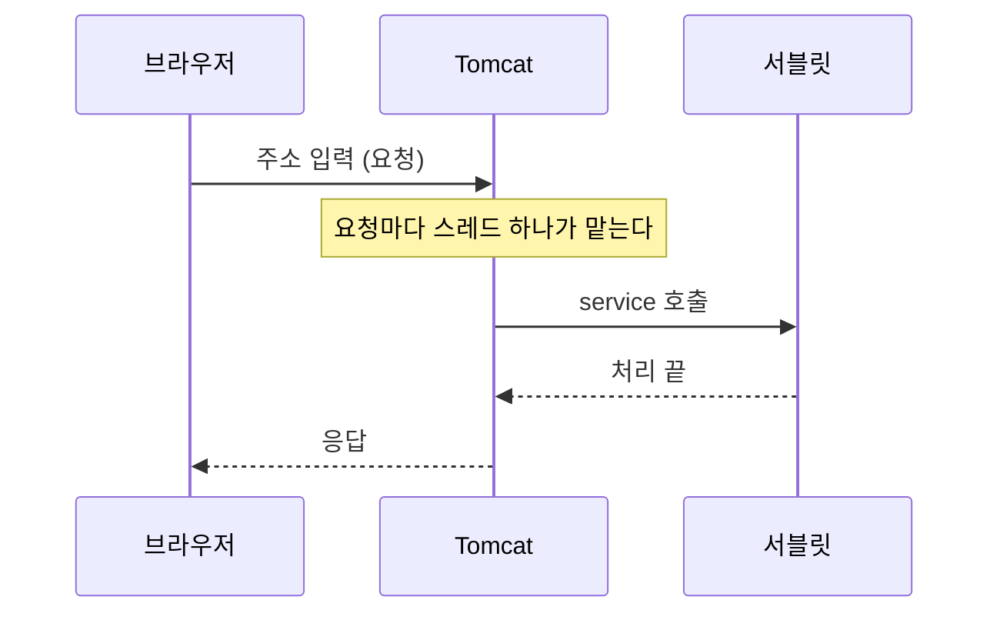

웹 서버는 만들어 둔 파일을 그대로 건네주고, Tomcat은 서블릿이라는 자바 프로그램을 실행해서 요청마다 결과를 새로 만들어 준다.

## 이게 없으면 뭐가 불편할까

쇼핑몰 화면을 떠올려 보자. 철수가 로그인하면 "철수님 안녕하세요"가 보이고, 영희가 로그인하면 "영희님 안녕하세요"가 보인다. 주소는 같은데 사람마다 화면이 다르다.

미리 만들어 둔 파일을 그대로 건네주는 방식으로는 이걸 할 수 없다. 요청이 올 때마다 프로그램이 실행되어서 화면을 **새로 만들어야** 한다.

그런데 그 프로그램이 브라우저와 대화하는 일까지 직접 만들려면 일이 너무 크다. 브라우저가 보낸 요청을 읽고, 결과를 알맞은 형식으로 보내는 일이다. 이 일을 대신 해 주는 것이 Tomcat이다.

## 한 문장으로 말하면

식당으로 비유해 보자. 손님이 주문을 하면 음식이 나온다. 이 식당에는 진열대 직원과 주방이 있다.

| 등장인물 | 식당에서는 | 웹에서는 |
|----------|------------|----------|
| 손님 | 주문하는 사람 | 브라우저 (주소를 입력하는 쪽) |
| 웹 서버 | 진열대에서 완성품을 꺼내 주는 직원 | 만들어 둔 파일(HTML, 이미지)을 그대로 전달한다 |
| 서블릿 | 요리사가 따라 하는 레시피 한 장 | 요청을 받아 결과를 만드는 자바 프로그램 하나 |
| Tomcat | 레시피를 보관하고 주문이 오면 요리하게 하는 주방 | 서블릿을 보관하고 실행해 주는 프로그램 |

정확한 이름을 붙여 보자. 아파치(Apache) 웹 서버 공식 문서는 **정적 콘텐츠(static content)** 를 HTML, 이미지, CSS처럼 파일 시스템에 있는 파일이라고 설명한다. **동적 콘텐츠(dynamic content)** 는 요청이 올 때 만들어지고 요청마다 달라질 수 있는 것이라고 한다.

**서블릿(servlet)** 은 동적 콘텐츠를 만드는 자바 클래스다. 공식 규격(Jakarta Servlet)은 서블릿을 "컨테이너가 관리하는 웹 구성요소"라고 설명한다. 서블릿은 혼자서는 실행되지 않고, 컨테이너가 불러서 실행한다.

**Tomcat**은 서블릿을 실행해 주는 서버, 즉 **서블릿 컨테이너(servlet container)** 다. Tomcat 공식 사이트는 Tomcat을 "Jakarta Servlet 같은 규격의 오픈 소스 구현"이라고 소개한다. 공식 규격에서는 컨테이너가 요청을 해독하고, 맞는 서블릿에 넘기고, 응답을 만들어 보내는 일을 맡는다고 설명한다.

그러면 Tomcat은 웹 서버일까, 아닐까? Tomcat 공식 문서(HTTP 커넥터)는 이 설정이 Tomcat을 "서블릿과 JSP 페이지를 실행하는 능력에 더해 **독립 웹 서버로도** 동작하게 한다"고 설명한다. 그래서 Tomcat은 서블릿 컨테이너이면서, 웹 서버 역할도 할 수 있다.

**WAS(Web Application Server)** 는 Tomcat 같은 서버를 흔히 부르는 이름이다. 다만 공식 문서에서 확인한 용어는 아니다. Tomcat 공식 사이트는 자신을 웹 서버나 애플리케이션 서버라고 부르지 않고, 규격의 구현이라고만 소개한다.

비유에는 한계가 있다. 식당에서는 진열대 직원과 주방이 나뉘어 있지만, Tomcat은 한 프로그램이 두 역할을 다 할 수 있다. 그래서 "웹 서버냐 WAS냐"를 칼로 자르듯 나누기보다, **파일을 그대로 건네주는 일**과 **프로그램을 실행해서 결과를 만드는 일**을 나누어 생각하는 편이 정확하다.

> 한 줄 요약: 웹 서버는 완성품을 건네주고, 서블릿은 레시피이고, Tomcat은 레시피대로 요리하는 주방이다.

## 그림으로 보기



브라우저의 요청은 Tomcat이 먼저 받고, Tomcat이 맞는 서블릿을 불러서 일을 시킨다. 서블릿은 브라우저와 직접 대화하지 않는다.

요청 하나가 처리되는 과정을 순서대로 풀어 보자.

1. 브라우저에 주소를 입력한다. 이 요청은 서버 컴퓨터의 **포트(port)** 로 들어간다. 포트는 건물의 호수 같은 번호다. Tomcat은 설정한 포트 번호에서 요청을 기다린다.
2. Tomcat이 요청을 받으면 **스레드(thread) 하나**가 그 요청을 맡는다. 스레드는 일을 하는 일꾼 한 명이라고 생각하면 된다. Tomcat 공식 문서는 비동기가 아닌 요청 하나가 끝나는 동안 스레드 하나가 필요하다고 설명한다. 스레드가 정확히 무엇인지는 다음 글에서 다룬다.
3. Tomcat이 주소를 보고 맡을 서블릿을 찾는다. 주소와 서블릿을 이어 주는 것이 `@WebServlet`이다.
4. 그 서블릿이 아직 없으면 Tomcat이 만들고 준비시킨다(`init`). 이미 있으면 이 단계는 건너뛴다.
5. Tomcat이 `service`를 부른다. 이때 요청 정보(`req`)와 응답을 담을 그릇(`resp`)을 같이 넘겨 준다.
6. 서블릿이 요청을 읽고 결과를 `resp`에 채운다.
7. Tomcat이 `resp`를 브라우저로 돌려보낸다.

## 직접 해보기

Tomcat을 설치하고 직접 만든 서블릿이다. 설명을 위해 주석은 줄였다.

```java
@WebServlet(value="/request-service")
public class ServiceMethodServlet extends HttpServlet {
    @Override
    protected void service(HttpServletRequest req, HttpServletResponse resp) throws ServletException, IOException {
        System.out.println("req = " + req);
        String httpMethod = req.getMethod();
        System.out.println("httpMethod = " + httpMethod);
    }

    @Override
    protected void doPost(HttpServletRequest req, HttpServletResponse resp) throws ServletException, IOException {
        System.out.println("POST 요청을 처리할 메소드 호출됨...");
    }

    @Override
    protected void doGet(HttpServletRequest req, HttpServletResponse resp) throws ServletException, IOException {
        System.out.println("GET 요청을 처리할 메소드 호출됨...");
    }
}
```

위에서부터 하나씩 읽어 보자.

1. `@WebServlet(value="/request-service")` 주소가 `/request-service`로 끝나는 요청은 이 서블릿이 맡는다는 표시다. 공식 문서에서는 서블릿을 선언하는 표시이고, `value`는 서블릿의 URL 패턴(주소 규칙)이라고 설명한다. 이 표시는 서버에 올릴 때 Tomcat이 읽는다.
2. `extends HttpServlet` 이 클래스를 서블릿으로 만드는 줄이다. 이유는 아래 "헷갈렸던 점" 1번에서 풀어 쓴다.
3. `service(HttpServletRequest req, HttpServletResponse resp)` 요청이 오면 Tomcat이 가장 먼저 부르는 칸이다. `req`는 손님이 낸 **주문서**(요청 정보)이고, `resp`는 손님에게 내보낼 **쟁반**(응답을 담는 그릇)이다.
4. `req.getMethod()` 요청이 `GET`인지 `POST`인지 알아낸다.
5. `doGet(...)`, `doPost(...)` `GET` 요청용 칸과 `POST` 요청용 칸이다.

브라우저 주소창에 이 서블릿의 주소를 입력해서 요청을 보내면, 코드를 따라 읽었을 때 Tomcat 콘솔에 `req = ...` 줄과 `httpMethod = GET` 줄이 찍힌다. 이 코드에는 브라우저 화면에 글자를 보내는 부분이 없다. 화면에는 보여 줄 글자가 오지 않고, 콘솔에만 출력한다.

`GET`과 `POST`를 둘 다 보내 보려면 아래처럼 HTML을 만들면 된다. 아래는 이해를 돕기 위한 예시 코드다. 주소의 앞부분은 환경에 따라 다를 수 있다.

```html
<a href="request-service">GET으로 보내기</a>

<form action="request-service" method="post">
    <button type="submit">POST로 보내기</button>
</form>
```

링크(`a` 태그)를 누르면 `GET`, 양식(`form`)을 `post`로 제출하면 `POST` 요청이 간다. 이때 콘솔에 찍히는 것은 아래와 같다. 코드를 읽고 정리한 것이다.

| 보낸 방식 | 지금 코드 | `super.service(req, resp)`를 추가하면 |
|-----------|-----------|----------------------------------------|
| GET | `httpMethod = GET` | `httpMethod = GET`, 그다음 `GET 요청을 처리할 메소드 호출됨...` |
| POST | `httpMethod = POST` | `httpMethod = POST`, 그다음 `POST 요청을 처리할 메소드 호출됨...` |

세 번째 열이 어떻게 나왔는지는 아래 "헷갈렸던 점" 2번에서 설명한다.

서블릿의 한살이도 알아 두면 좋다. 공식 튜토리얼에서는 서블릿의 생명주기를 컨테이너가 관리한다고 설명한다. 레시피로 비유하면 아래와 같다.

| 단계 | 언제 불리나 | 비유 |
|------|-------------|------|
| `init` | 서블릿이 처음 만들어질 때 한 번 | 레시피를 처음 꺼내 준비한다 |
| `service` | 요청이 올 때마다 | 주문이 올 때마다 요리한다 |
| `destroy` | 컨테이너가 서블릿을 없앨 때 | 레시피를 정리해서 치운다 |

이 서블릿에는 `init`과 `destroy`가 없다. 필요하면 `HttpServlet`에서 물려받은 것을 덮어써서 쓸 수 있다.

## 헷갈렸던 점

**1. 왜 `extends HttpServlet`이라고 쓸까?**

`extends`는 "물려받는다"는 뜻이다. `HttpServlet`이라는 클래스가 가진 것을 우리 클래스가 그대로 가져온다.

Tomcat이 서블릿을 실행하려면 서블릿이 지켜야 할 약속이 있다. 서블릿이 만들어질 때, 요청을 받을 때, 없어질 때 각각 불리는 칸이 정해져 있다. 이걸 처음부터 전부 만들면 할 일이 많다.

**`HttpServlet`은 이 약속을 웹 요청에 맞춰 이미 지켜 둔 뼈대**다. 공식 문서에서는 웹 사이트용 서블릿을 만들려고 물려받는 추상 클래스라고 설명한다. 그리고 `doGet`, `doPost` 같은 칸 중 하나 이상을 채워야 한다고 한다.

`@WebServlet`을 쓰려면 `extends HttpServlet`이 **필수**다. 공식 튜토리얼에서 `@WebServlet`을 붙인 클래스는 `HttpServlet`을 물려받아야 한다고 설명한다.

레시피 양식에 비유해 보자. 양식에는 "GET 주문이면 여기, POST 주문이면 여기"라는 빈칸이 있다. 우리는 필요한 칸만 채운다. `@Override`는 그 칸을 우리 내용으로 바꾼다는 표시다. 다만 레시피 양식은 빈 종이지만, `HttpServlet`에는 이미 동작하는 코드가 들어 있다.

| 역할 | 누가 |
|------|------|
| 서블릿을 보관하고 실행한다 | Tomcat |
| 요청이 오면 `GET`인지 `POST`인지 보고 알맞은 칸을 부른다 | `HttpServlet` (물려받은 뼈대) |
| 칸의 내용을 채운다 | 우리가 만든 `ServiceMethodServlet` |

> 한 줄 요약: `extends HttpServlet`은 웹 요청용 뼈대를 물려받아서, 필요한 칸만 채우겠다는 뜻이다.

**2. 왜 `doGet`과 `doPost`가 있는데 `service`가 따로 있을까?**

요청이 오면 `HttpServlet`의 `service`가 먼저 불리고, `service`가 요청 방식을 보고 `doGet`이나 `doPost`를 부른다. 공식 문서에서는 `service`가 요청을 `do` 시작하는 메서드로 나눠 준다고 설명한다. 그리고 이 메서드는 덮어쓸 필요가 없다고 한다.

이 코드는 `service`를 덮어썼다. 덮어쓴 `service` 안에는 `doGet`이나 `doPost`를 부르는 코드가 없다. 그래서 브라우저 요청이 와도 `doGet`의 "GET 요청을 처리할 메소드 호출됨..."은 찍히지 않고, `httpMethod` 줄만 찍힌다.

원래 하던 나눠 주는 일까지 하고 싶다면 `service` 안에서 물려받은 `service`를 불러야 한다. 아래는 이해를 돕기 위한 예시 코드다.

```java
@Override
protected void service(HttpServletRequest req, HttpServletResponse resp) throws ServletException, IOException {
    String httpMethod = req.getMethod();
    System.out.println("httpMethod = " + httpMethod);
    super.service(req, resp);   // 물려받은 service를 불러서 doGet, doPost로 나눠 준다
}
```

`super`는 "물려받은 쪽"을 가리키는 말이다. 수업 코드는 `service`가 가장 먼저 불린다는 것을 확인하는 용도로 보인다.

**3. `GET`과 `POST`는 뭐가 다를까?**

MDN은 `GET`을 "지정한 자료를 달라는 요청"이라고 설명한다. 데이터를 가져오기만 해야 하고 내용물을 실어 보내지 않는다. `POST`는 지정한 대상에 정보를 제출하는 요청이고, 서버에 변화가 생기기도 한다고 설명한다.

| 방식 | 쉽게 말하면 | 예 |
|------|-------------|----|
| `GET` | 정보를 달라고 한다 | 주소창에 입력, 링크(`a` 태그) 클릭 |
| `POST` | 정보를 보낸다 | 입력한 내용을 제출하는 양식 |

수업 코드의 주석에도 `a` 태그를 눌러 주소가 바뀌는 방식이 `GET`이라고 적혀 있다.

**4. 웹 서버와 Tomcat은 결국 뭐가 다를까?**

앞에서 Tomcat이 웹 서버 역할도 할 수 있다고 했다. 그래도 둘을 나누어 보는 이유가 있다. 아파치 웹 서버 공식 문서는 웹 서버가 요청받은 주소에 해당하는 파일이나 프로그램을 찾아 응답으로 보낸다고 설명한다. 서블릿을 실행하는 일은 Tomcat이 가진 능력이다.

| 질문 | 웹 서버(Apache HTTP Server) | Tomcat |
|------|-----------------------------|--------|
| 파일을 그대로 건네주나? | 한다 | 독립 웹 서버로도 동작할 수 있다 |
| 서블릿을 실행하나? | 설명에 나오지 않는다 | 한다 |
| 공식 소개 | 웹 서버 | Jakarta Servlet 같은 규격의 구현 |

이 표는 확인한 문서 범위 안에서만 쓴 것이다. 아파치 웹 서버가 서블릿을 못 한다는 뜻은 아니다. 문서에서 그 내용을 찾지 못했을 뿐이다.

**5. 요청이 동시에 여러 개 오면 어떻게 될까?**

Tomcat 공식 문서에서는 비동기가 아닌 요청 하나가 끝나는 동안 스레드 하나가 필요하다고 설명한다. 공식 튜토리얼에서도 웹 컨테이너가 보통 요청마다 스레드를 하나씩 만든다고 한다.

Tomcat은 동시에 일할 수 있는 스레드의 최대 개수를 정해 둔다. 공식 문서에서는 이 값을 정하지 않으면 200이라고 설명한다. 그래서 동시에 처리하는 요청이 늘어나면 일꾼이 부족해질 수 있다. 스레드가 무엇인지, 여러 스레드가 함께 일할 때 무슨 일이 생기는지는 다음 글에서 다룬다.

**6. 왜 `javax`가 아니라 `jakarta`로 시작할까?**

코드의 `import`가 `jakarta.servlet`으로 시작한다. Tomcat 공식 버전표에서는 Tomcat 10.0 이후 버전이 Jakarta EE 규격을 구현한다고 설명한다. 그래서 이 코드는 Tomcat 10 이후 버전에서 돌리는 것으로 보인다. 정확한 Tomcat 버전은 확인하지 못했다.

## 더 학습하면 좋은 개념

- **`HttpServletResponse`로 화면에 글자 보내기** — 지금 코드는 콘솔에만 출력하고 브라우저에는 아무것도 보내지 않는다. 응답을 쓰는 법을 알아야 "동적으로 화면을 만든다"는 말이 실제로 이해된다.
- **프로세스와 스레드** — Tomcat이 요청마다 스레드를 쓴다는 것을 이해하려면 스레드가 무엇인지부터 알아야 한다. 다음 글에서 다룬다.
- **서블릿 생명주기(`init`, `service`, `destroy`)를 직접 덮어쓰기** — 이 글에서는 표로만 봤다. 직접 `init`과 `destroy`를 덮어써서 콘솔에 찍어 보면 서블릿이 언제 만들어지고 없어지는지 눈으로 확인할 수 있다.
- **`GET`과 `POST`로 값 전달하기** — 지금은 방식만 구분했다. 브라우저에서 보낸 값을 서블릿이 어떻게 받는지 배워야 로그인 같은 기능을 만들 수 있다.
- **`web.xml`로 서블릿 연결하기** — 이 글에서는 `@WebServlet`으로 주소와 서블릿을 이었다. 같은 일을 설정 파일로 하는 방법이 따로 있는지 알아 두면 옛 자료를 읽을 때 도움이 된다.

## 참고 자료

- [Apache HTTP Server: Getting Started](https://httpd.apache.org/docs/2.4/getting-started.html)
- [Apache Tomcat](https://tomcat.apache.org/)
- [Apache Tomcat 10.1: The HTTP Connector](https://tomcat.apache.org/tomcat-10.1-doc/config/http.html)
- [Apache Tomcat: Which Version Do I Want?](https://tomcat.apache.org/whichversion.html)
- [Jakarta Servlet Specification 6.1](https://jakarta.ee/specifications/servlet/6.1/jakarta-servlet-spec-6.1)
- [Jakarta Servlet Technology (Jakarta EE Tutorial)](https://jakarta.ee/learn/jakartaee-tutorial/9.1/web/servlets/servlets.html)
- [HttpServlet (Jakarta Servlet 6.0 API)](https://jakarta.ee/specifications/servlet/6.0/apidocs/jakarta.servlet/jakarta/servlet/http/HttpServlet.html)
- [WebServlet (Jakarta Servlet 6.0 API)](https://jakarta.ee/specifications/servlet/6.0/apidocs/jakarta.servlet/jakarta/servlet/annotation/WebServlet.html)
- [HTTP request methods (MDN)](https://developer.mozilla.org/en-US/docs/Web/HTTP/Reference/Methods)
- [What is a web server? (MDN)](https://developer.mozilla.org/en-US/docs/Learn_web_development/Howto/Web_mechanics/What_is_a_web_server)
