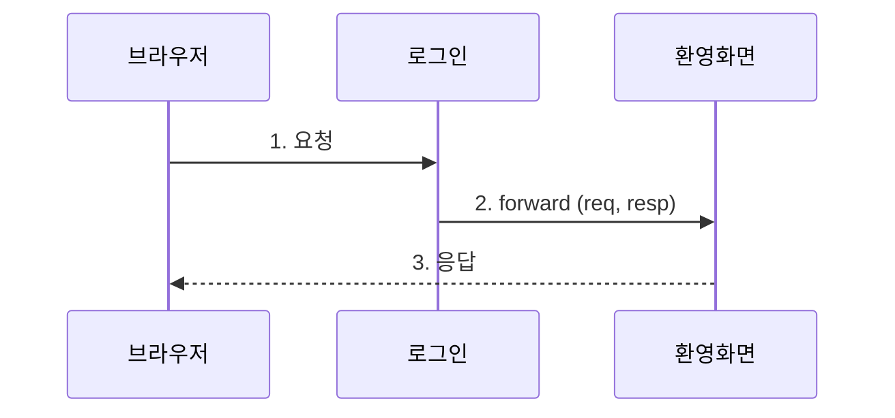
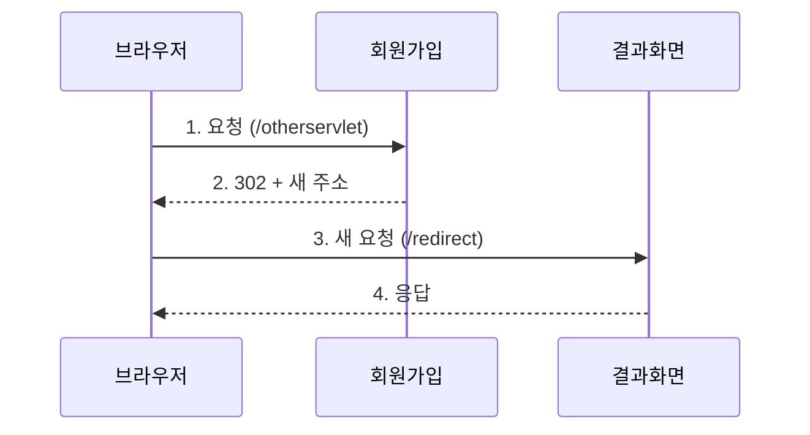

이 글은 서블릿이 브라우저에 HTML로 응답하는 방법과, 에러 페이지를 바꾸는 방법, 그리고 다른 곳으로 일을 넘기는 forward와 redirect의 차이를 정리한 글이다.

2026년 10월 22일 수업에서 진행한 내용을 정리했다.

## 이게 없으면 뭐가 불편할까

[앞의 글]({{ site.baseurl }})에서 만든 서블릿은 콘솔에만 글자를 찍었다. 브라우저 화면에는 아무것도 오지 않았다. 손님 주문은 받았는데 음식을 내보내지 않은 셈이다.

음식을 내보내는 것만으로도 끝이 아니다. 몇 가지 문제가 더 남는다.

- 없는 주소로 들어오면 Tomcat이 기본 에러 화면을 보여 준다. 이 화면은 투박하다. 수업 노트에도 "기본 404, 500 에러 페이지는 안 예쁘다"고 적혀 있다.
- 서블릿 하나가 로그인 처리도 하고, 환영 화면도 만들면 맡은 일이 너무 많아진다.
- 회원가입을 끝낸 화면에서 새로고침을 누르면, 가입이 한 번 더 될 수도 있다.

이 글에서는 이 문제들을 차례로 푼다.

## 먼저, 실습은 어떻게 준비했을까

수업 프로젝트의 첫 화면(`index.html`)에 실습 페이지로 가는 링크를 모아 두었다. 이번 글에서 쓰는 링크는 아래 네 개다.

| 링크 | 이동하는 곳 | 자바 패키지 |
|------|-------------|-------------|
| Response 확인하기! | `/d_response/response.html` | `d_response` |
| Exception 확인하기! | `/e_exception/exception.html` | `e_exception` |
| Forward 동작 확인하기! | `/f_forward/forward.html` | `f_forward` |
| Redirect 동작 확인하기! | `/g_redirect/redirect.html` | `g_redirect` |

각 HTML 파일에 버튼이나 링크가 있고, 그걸 누르면 서블릿이 요청을 받는다.

---

## 1. 서블릿은 어떻게 브라우저에 화면을 보낼까?

### 한 문장으로 말하면

식당에서 요리사가 접시에 음식을 담아 쟁반에 올리는 것과 비슷하다. 서블릿은 HTML 글자를 만들어서 **응답 객체(`resp`)** 에 담는다. 그러면 Tomcat이 그 쟁반을 브라우저까지 들고 간다.

비유에는 한계가 있다. 요리는 완성된 음식을 통째로 올리지만, 서블릿은 HTML을 **글자 한 줄씩** 이어 붙여서 만든다. 그래서 태그 하나만 빠져도 화면이 깨질 수 있다.

### 서블릿은 어떤 일을 할까?

수업 코드 주석에는 서블릿의 역할이 세 가지로 정리돼 있었다.

1. **요청 전달 받기** — GET인지 POST인지에 따라 요청을 받는다. 브라우저가 보낸 값(파라미터)을 꺼낼 수 있다.
2. **MVC 패턴에서 Controller 역할** — 받은 데이터를 Service 계층에 넘긴다.
3. **응답 전달하기** — 응답 객체로 사용자에게 결과를 보낸다.

2번의 **MVC 패턴**은 프로그램을 역할별로 나누는 방법이다. 식당으로 치면 주문 받는 직원(Controller), 요리하는 주방(Service), 손님에게 보이는 접시(View)를 나누는 것이다. 이 글에서는 서블릿이 "주문 받는 직원" 자리에 있다는 것만 기억하면 된다.

요청과 응답 객체는 쓰는 방향이 반대다.

| 객체 | 하는 일 | 주로 쓰는 메서드 |
|------|---------|------------------|
| `req` (요청) | 브라우저가 보낸 데이터를 **읽는다** | 값을 꺼내는 getter (`getParameter` 등) |
| `resp` (응답) | 브라우저에 보낼 결과를 **채운다** | 값을 넣는 setter (`setContentType` 등) |

### 직접 해보기

`response.html`에는 링크가 하나 있다.

```html
<li><a href="/response">응답해줘!!!</a> </li>
```

링크(`a` 태그)를 누르면 GET 요청이 간다. 그래서 이 요청은 서블릿의 `doGet` 메서드가 받는다. 수업 주석에는 "응답해줘를 클릭하는 순간 서블릿이 doGet 메서드로 낚아챈다"고 적혀 있다.

```java
@WebServlet("/response") // 이 클래스가 서블릿이라고 알린다
public class ResponseServlet extends HttpServlet {

    @Override
    protected void doGet(HttpServletRequest req, HttpServletResponse resp)
            throws ServletException, IOException {

        StringBuilder response = new StringBuilder();

        // append : 문자열을 뒤에 이어 붙인다
        response.append("<!doctype html>\n")
                .append("<html>\n")
                .append("<body>\n")
                .append("<h1>Servlet의 응답 결과!</h1>")
                .append("</body>\n")
                .append("</html>\n");

        System.out.println("response type : " + resp.getContentType());

        // 보낼 데이터가 HTML이고, 한글이 깨지지 않게 UTF-8로 보낸다
        resp.setContentType("text/html; charset=UTF-8");

        // 브라우저로 글자를 내보내는 통로
        PrintWriter out = resp.getWriter();
        out.print(response);
        out.flush();
        out.close();
    }
}
```

한 줄씩 읽어 보자.

1. **`StringBuilder`** 는 글자를 계속 이어 붙일 수 있는 메모장이다. `append`를 부를 때마다 뒤에 글자가 붙는다. 여기서는 HTML 문서 한 장을 글자로 만든다.
2. `resp.getContentType()`은 지금 응답에 정해진 형식을 알려 준다. 공식 API 문서에 따르면 아직 형식을 정하지 않았으면 `null`을 돌려준다. 이 줄은 `setContentType`보다 **앞에** 있다. 그래서 형식을 정하기 전 상태를 콘솔에 찍어 보는 코드다.
3. `resp.setContentType("text/html; charset=UTF-8")`은 "이건 HTML이고, 글자는 UTF-8 방식으로 적었다"고 브라우저에 알려 준다. UTF-8은 한글을 포함한 여러 나라 글자를 숫자로 바꾸는 규칙이다.
4. `resp.getWriter()`는 브라우저로 글자를 흘려보내는 **통로(`PrintWriter`)** 를 꺼낸다.
5. `out.print(response)`로 만든 HTML을 통로에 넣는다.
6. `out.flush()`는 통로에 남은 글자를 지금 바로 내보낸다. `out.close()`는 통로를 닫는다.

### 왜 setContentType을 getWriter보다 먼저 쓸까?

여기서 많이들 헷갈린다. 순서가 바뀌면 한글이 깨질 수 있다.

공식 API 문서에 따르면 `setContentType`에 적은 글자 방식(charset)은 `getWriter`를 부르기 **전에** 정해야 반영된다. 아무것도 정하지 않고 `getWriter`를 부르면 기본값으로 ISO-8859-1을 쓴다. ISO-8859-1은 영어권 글자만 담는 방식이라 한글을 표현하지 못한다.

수업 코드 주석에도 "이 코드는 응답할 때 항상 해 주어야 한글이 깨지지 않는다. 계속 반복되는 코드"라고 적혀 있다.

> 한 줄 요약: HTML을 글자로 만들고, 형식과 글자 방식을 먼저 정한 뒤, `getWriter`로 꺼낸 통로에 넣어 보낸다.

---

## 2. 에러 화면을 내가 만든 화면으로 바꿀 수 있을까?

### 한 문장으로 말하면

가게 문에 "오늘 휴무"라고 붙일 때, 매직으로 대충 쓴 종이 대신 예쁘게 만든 안내판을 붙이는 것과 비슷하다. **에러 페이지 설정**은 "이 에러가 나면 이 화면을 보여 줘"라고 서버에 미리 등록해 두는 것이다.

비유에는 한계가 있다. 안내판은 사람이 직접 바꿔 붙여야 한다. 에러 페이지는 한 번 등록해 두면 에러가 날 때마다 Tomcat이 알아서 그 화면으로 일을 넘긴다.

### 404와 500은 뭐가 다를까?

에러에는 번호가 붙는다. 이 번호를 **상태 코드(status code)** 라고 부른다. 응답이 어떻게 끝났는지 알려 주는 세 자리 숫자다.

| 상태 코드 | 뜻 | 수업에서 쓴 메시지 |
|-----------|----|--------------------|
| 404 | 요청한 페이지를 찾을 수 없다 | "페이지가 없습니다!" |
| 500 | 서버 안에서 문제가 났다 | "500번대 Error는 순전히 개발자의 잘못." |

400번대는 요청 쪽 문제이고, 500번대는 서버 쪽 문제다. 그래서 수업 메시지에 "500번대는 개발자의 잘못"이라고 적었다.

### 직접 해보기 — 일부러 에러 내기

먼저 `exception.html`에 링크 두 개를 만든다.

```html
<!DOCTYPE html>
<html lang="en">
<head>
    <meta charset="UTF-8">
    <title>Title</title>
</head>
<body>
    <h1>예외 핸들링</h1>
    <ul>
        <li><a href="/show404">404 Error</a></li>
        <li><a href="/show500">500 Error</a></li>
    </ul>
</body>
</html>
```

링크마다 서블릿을 하나씩 만든다. 링크는 GET 요청이라 `doGet`으로 받는다.

```java
@WebServlet("/show404")
public class Show404Servlet extends HttpServlet {
    // a 태그니까 doGet 메서드로!!!
    @Override
    protected void doGet(HttpServletRequest req, HttpServletResponse resp) throws ServletException, IOException {
        System.out.println("404 Servlet 호출됨...");
        // throw new Exception(); 에러 터진다는 가정

        resp.sendError(404, "페이지가 없습니다!");
    }
}
```

```java
@WebServlet("/show500")
public class Show500Servlet extends HttpServlet {
    // a 태그니까 doGet 메서드로!!!
    @Override
    protected void doGet(HttpServletRequest req, HttpServletResponse resp)
            throws ServletException, IOException {
        System.out.println("500 Servlet호출됨...");

        // throw new Exception(); 에러 터진다는 가정
        resp.sendError(500, "500번대 Error는 순전히 개발자의 잘못.");
    }
}
```

노션 노트에 붙여 넣은 `Show404Servlet`은 줄바꿈과 띄어쓰기가 사라져 있었다. 주석 줄 뒤에 `resp.sendError(...)`가 붙어 버려서, 그대로 보면 이 줄까지 주석처럼 읽혔다. 첨부한 프로젝트 파일에서 원래 코드를 확인해 위처럼 고쳐 적었다.

**`resp.sendError(상태 코드, 메시지)`** 는 "이 요청은 에러로 끝났다"고 알리는 메서드다. 공식 API 문서에 따르면 Tomcat은 보통 이 메시지를 넣은 기본 HTML 에러 화면을 만든다. 그런데 그 상태 코드에 맞는 에러 페이지가 등록돼 있으면, 기본 화면 대신 그 페이지를 보여 준다.

### 에러 페이지는 어디에 등록할까? — web.xml

`web.xml`은 웹 프로그램의 설정 파일이다. 여기에 "404나 500이 나면 `/showerrorpage`로 보내라"고 적는다.

```xml
<?xml version="1.0" encoding="UTF-8"?>
<web-app
    xmlns="https://jakarta.ee/xml/ns/jakartaee"
    xmlns:xsi="http://www.w3.org/2001/XMLSchema-instance"
    xsi:schemaLocation="https://jakarta.ee/xml/ns/jakartaee https://jakarta.ee/xml/ns/jakartaee/web-app_6_1.xsd"
    version="6.1">
    <error-page>
        <error-code>404</error-code>
        <location>/showerrorpage</location>
    </error-page>
    <error-page>
        <error-code>500</error-code>
        <location>/showerrorpage</location>
    </error-page>
</web-app>
```

- `<error-code>`는 어떤 에러일 때인지 적는 자리다.
- `<location>`은 그 에러가 나면 사용자를 보낼 목적지 주소다.

이렇게 적어 두면 404나 500이 날 때 Tomcat이 `/showerrorpage`로 일을 넘긴다. 서블릿 명세에 따르면 `sendError`를 부른 경우뿐 아니라, Tomcat이 스스로 404를 낼 때도 이 설정을 본다. 그래서 정말로 없는 주소를 입력해도 같은 화면이 나온다.

### 에러 화면을 그리는 서블릿

`/showerrorpage`를 맡을 서블릿을 만든다.

```java
import static java.lang.System.out;

@WebServlet("/showerrorpage")
public class ExceptionServlet extends HttpServlet {
    @Override
    protected void doGet(HttpServletRequest req, HttpServletResponse resp) throws ServletException, IOException {
        out.println("showerrorpage 서블릿 호출됨...");

        /* comment.
         *   이 서블릿은 web.xml 파일에 정의된 404, 500 에러 코드 발생 시 location 처리된 서블릿이다.
         *   이 개념은 forward의 개념으로 1개의 서블릿이 책임이 많아질 때,
         *   다른 서블릿을 만들어서 마치 요청을 받은 서블릿이 응답까지 하는 것처럼 보여주는 것이다.
         * */

        String forwardUrl = req.getAttribute("jakarta.servlet.forward.request_uri").toString();
        out.println("forwardUrl = " + forwardUrl);

        // 사용자에게 html로 응답 / 응답 시 에러코드, 메시지 전달
        int statusCode = (int) req.getAttribute("jakarta.servlet.error.status_code");
        String msg = req.getAttribute("jakarta.servlet.error.message").toString();

        StringBuilder responseBuilder = new StringBuilder();
        responseBuilder.append("<!doctype html>\n")
                .append("<html>\n")
                .append("<head>\n")
                .append("</head>\n")
                .append("<body>\n")
                .append("<h1>")
                .append(statusCode)
                .append(" - ")
                .append(msg)
                .append("</h1>")
                .append("</body>\n")
                .append("</html>\n");

        // 응답 시에 항상 해 주어야 한글이 깨지지 않는다 (계속 반복되는 코드)
        resp.setContentType("text/html; charset=UTF-8");

        PrintWriter out = resp.getWriter();
        out.print(responseBuilder);
        out.flush();
        out.close();
    }
}
```

`req.getAttribute("이름")`은 요청 객체에 붙어 있는 **메모**를 꺼내는 메서드다. 이런 메모를 **속성(attribute)** 이라고 부른다. 에러가 나면 Tomcat이 요청 객체에 에러 정보를 메모로 붙여 둔다. 서블릿 명세에서 정한 이름 중 이 코드가 쓴 것은 아래와 같다.

| 속성 이름 | 담긴 값 |
|-----------|---------|
| `jakarta.servlet.error.status_code` | 상태 코드 (404, 500) |
| `jakarta.servlet.error.message` | `sendError`에 적은 메시지 |
| `jakarta.servlet.forward.request_uri` | 처음에 사용자가 요청한 주소 |

그래서 화면에는 "500 - 500번대 Error는 순전히 개발자의 잘못."처럼 상태 코드와 메시지가 함께 나온다.

### 주소창은 왜 그대로일까?

서버를 실행하고 500 링크를 눌러 보면, 주소창에는 여전히 `/show500`이 보인다. 화면을 만든 건 `/showerrorpage` 서블릿인데, 마치 `/show500`이 응답한 것처럼 보인다.

이건 Tomcat이 서버 안에서 몰래 일을 넘겼기 때문이다. 이 방식을 **forward**라고 부른다. 다음 절에서 자세히 본다.

> 한 줄 요약: `sendError`로 에러를 알리고, `web.xml`에 목적지를 적어 두면, Tomcat이 내가 만든 에러 화면으로 일을 넘긴다.

---

## 3. forward — 서버 안에서 담당자를 바꿀 수 있을까?

### 왜 필요할까

로그인 버튼을 누르면 서블릿이 할 일이 두 가지다.

1. 아이디와 비밀번호를 확인한다. (로그인 처리)
2. "홍길동님 환영합니다" 화면을 만든다. (응답)

한 서블릿이 둘 다 하면 코드가 길어지고 맡은 일이 많아진다. 수업 주석에도 "응답은 내가 하는 게 너무 많으니 다른 서블릿에게 맡기고 싶다"고 적혀 있다.

### 한 문장으로 말하면

은행 창구에 전화로 문의했다고 해 보자. 직원이 "잠시만요" 하고, 전화를 끊지 않은 채 옆자리 담당자에게 서류를 넘긴다. 담당자가 답을 주고, 나는 처음 건 전화로 그 답을 듣는다. 나는 담당자가 바뀐 줄도 모른다.

**forward**는 서버 안에서 요청을 다른 서블릿에 넘기는 기술이다. 이때 요청 객체(`req`)와 응답 객체(`resp`)를 **그대로 들고** 넘어간다. 수업 노트에는 "서버 내부에서 몰래 담당자를 교체해 일을 넘겨주는 기술"이라고 적혀 있다.

비유에는 한계가 있다. 전화는 담당자가 바뀌면 "다른 분 바꿔 드릴게요"라고 들리기도 한다. forward는 브라우저에 아무 신호도 가지 않는다. 브라우저는 처음 요청한 곳에서 답이 왔다고만 안다.

### 그림으로 보기



로그인 처리 서블릿이 환영 화면 서블릿에 일을 넘긴다. 브라우저는 요청을 한 번만 보내고, 일을 넘기는 2번은 서버 안에서만 일어난다.

### forward를 쓰는 이유

수업 노트에 정리된 이유는 세 가지다.

| 이유 | 설명 |
|------|------|
| 주소창 URL이 바뀌지 않는다 | 사용자가 요청한 주소가 그대로 남는다. 화면만 다른 서블릿이 만든 것으로 바뀐다 |
| 요청 데이터(`req`)가 그대로 유지된다 | 같은 `req`를 넘기기 때문에, 앞 서블릿이 붙인 메모를 뒤 서블릿이 꺼낼 수 있다 |
| 책임을 나눌 수 있다 | 로직을 처리하는 서블릿과 화면을 만드는 서블릿을 분리한다 |

앞 절의 에러 페이지가 바로 이 경우였다. 서블릿 명세에 따르면 에러 페이지로 넘길 때 Tomcat은 forward를 한 것처럼 요청 경로와 속성을 맞춰 준다. 그래서 `ExceptionServlet`이 에러 정보를 꺼낼 수 있었고, 주소창은 `/show500`으로 남았다.

### 직접 해보기 — 로그인 후 환영 화면 넘기기

`forward.html`에 로그인 양식을 만든다. `method="post"`라서 POST 요청이 간다.

```html
<!DOCTYPE html>
<html lang="en">
<head>
    <meta charset="UTF-8">
    <title>Title</title>
</head>
<body>
    <h1>Forward 동작 확인하기!</h1>
    <form action="/forward" method="post">
        <table>
            <tr>
                <td>아이디: </td>
                <td><input type="text" name="userId"></td>
                <td rowspan="2"><button type="submit">로그인</button></td>
            </tr>
            <tr>
                <td>비밀번호: </td>
                <td><input type="password" name="password"></td>
            </tr>
        </table>
    </form>
</body>
</html>
```

첫 번째 서블릿은 로그인 처리만 맡는다.

```java
@WebServlet("/forward")
public class RequestInfoServlet extends HttpServlet {
    /* comment.
     * 이 서블릿의 역할
     * 1. 사용자의 로그인 요청을 전달 받는다.
     * 2. 요청 객체에서 값을 꺼내어 로그인 처리를 진행한다.
     * ---------------하지 않을 것
     * 1. 로그인 처리 완료 후 응답 HTML return (because -> 부하가 너무 큼)
     */
    @Override
    protected void doPost(HttpServletRequest req, HttpServletResponse resp)
            throws ServletException, IOException {
        // form 태그의 method를 post로 지정했으므로 doPost 메서드 재정의
        System.out.println("사용자의 로그인 요청을 처리하는 서블릿 호출됨....");

        // 사용자가 요청을 하면 req에 값이 담긴다
        String id = req.getParameter("userId");
        String pwd = req.getParameter("password");

        System.out.println("id = " + id);
        System.out.println("pwd = " + pwd);

        // 전달 받은 ID, PWD를 Service -> DAO -> MySQL로 전달
        // MemberService.login(id,pwd);
        System.out.println("로그인 성공!!!");

        // 로그인 성공 후 "홍길동님 환영합니다!"라는 HTML 응답을 해야 한다.
        // 응답까지 내가 하기엔 할 일이 너무 많으니 다른 서블릿에게 위임하고 싶다.

        // 다음 서블릿에 전달할 값을 요청 객체에 붙인다
        req.setAttribute("userId", id);
        // 다음 서블릿으로 가는 길을 찾는다
        RequestDispatcher rd = req.getRequestDispatcher("/print");
        rd.forward(req, resp);
    }
}
```

순서대로 보자.

1. `req.getParameter("userId")`로 양식에 입력한 아이디를 꺼낸다. `"userId"`는 HTML의 `name="userId"`와 같아야 한다.
2. 실제 로그인 확인은 주석으로만 적어 두었다. 원래는 Service를 거쳐 **DAO(Data Access Object)** 가 MySQL에 물어본다. DAO는 DB와 대화하는 일만 맡는 클래스다. 이번 실습에서는 로그인이 성공했다고 가정한다.
3. `req.setAttribute("userId", id)`로 요청 객체에 메모를 붙인다. 다음 서블릿이 이 메모를 읽는다.
4. `req.getRequestDispatcher("/print")`는 `/print`로 가는 **안내원(`RequestDispatcher`)** 을 데려온다.
5. `rd.forward(req, resp)`로 요청과 응답 객체를 그대로 들고 `/print`로 넘어간다.

주석의 "부하가 너무 큼"은 서버가 느려진다는 뜻이라기보다, 이 서블릿이 떠안는 일이 많아진다는 뜻으로 읽힌다. 바로 아래 주석에 "내가 하는 게 너무 많으니 위임하고 싶다"고 적혀 있기 때문이다.

두 번째 서블릿은 환영 화면만 만든다.

```java
@WebServlet("/print")
public class ResponseLoginServlet extends HttpServlet {
    /* comment.
     * 이 서블릿은 RequestInfoServlet으로부터 응답에 대한
     * 처리를 위임 받는 Servlet이다.
     * - req, resp 객체를 RequestInfoServlet으로부터 전달 받는다.
     * -----------
     * forward를 요청한 서블릿에서 처리하는 메서드가 get이면
     * forward를 받은 서블릿도 get 메서드를 오버라이딩 한다.
     */
    @Override
    protected void doPost(HttpServletRequest req, HttpServletResponse resp)
            throws ServletException, IOException {
        // 위임 요청했던 곳이 doPost였으므로 위임 받은 곳도 doPost로 작성해야 함!!!
        System.out.println("/print서비스 호출됨...");

        // 이전 서블릿이 전달해 준 id 꺼내기 (toString으로 문자열로 바꾼다)
        String id = req.getAttribute("userId").toString();

        StringBuilder responseText = new StringBuilder();
        responseText.append("<!doctype html>\n")
                .append("<html>\n")
                .append("<head>\n")
                .append("</head>\n")
                .append("<body>\n")
                .append("<h3 align=\"center\">")
                .append(id)
                .append("님 환영합니다.</h3>")
                .append("</body>\n")
                .append("</html>\n");

        resp.setContentType("text/html; charset=UTF-8");

        PrintWriter out = resp.getWriter();
        out.print(responseText.toString());
        out.flush();
        out.close();
    }
}
```

`req.getAttribute("userId")`로 앞 서블릿이 붙인 메모를 꺼낸다. 같은 `req`를 넘겨받았기 때문에 가능하다.

### 왜 받는 쪽도 doPost여야 할까?

forward는 요청 객체를 **그대로** 넘긴다. 처음 요청이 POST였다면 넘겨받은 요청도 여전히 POST다. 그래서 `/print` 서블릿에서도 `HttpServlet`이 POST용 칸인 `doPost`를 부른다. 받는 쪽에 `doGet`만 만들어 두면 맞는 칸이 없다.

수업 노트에는 이렇게 한 줄로 적혀 있다. "forward는 `rd`에서 지정한 경로로 향한다. 향하긴 향하는데 `req`, `resp`를 가지고 향한다."

> 한 줄 요약: forward는 서버 안에서 `req`와 `resp`를 들고 다른 서블릿으로 넘어간다. 주소창은 그대로고, 앞에서 붙인 메모도 그대로 읽을 수 있다.

---

## 4. redirect — 브라우저에게 "저쪽으로 다시 가세요"라고 할 수 있을까?

### 왜 필요할까

회원가입 버튼을 눌러서 DB에 회원 정보가 들어갔다고 해 보자. 그 화면에서 새로고침을 누르면 어떻게 될까? 브라우저는 방금 보낸 요청을 **다시** 보낸다. 가입 요청이 한 번 더 가면, 같은 회원이 두 번 들어갈 수도 있다.

가입이 끝나면 "결과 화면 주소로 새로 가세요"라고 알려 주면 된다. 그러면 새로고침을 눌러도 결과 화면만 다시 보인다.

### 한 문장으로 말하면

은행 창구에서 "이 업무는 저쪽 3번 창구로 가서 다시 번호표를 뽑으세요"라는 말을 듣는 것과 같다. 내가 직접 3번 창구로 걸어가서 처음부터 다시 요청한다. 앞 창구에서 한 이야기는 3번 창구 직원이 모른다.

**redirect**는 서버가 브라우저에게 "이 주소로 다시 요청하라"고 응답하는 것이다. 수업 노트에는 "요청을 받고, 응답할 때 어디로 재요청을 보내야 하는지 응답한다"고 적혀 있다.

비유에는 한계가 있다. 은행에서는 내가 걸어가야 하지만, redirect는 브라우저가 알아서 새 주소로 다시 요청한다. 사용자는 주소창이 바뀐 것만 보게 된다.

### 그림으로 보기



forward와 달리 브라우저가 요청을 **두 번** 보낸다. 3번은 완전히 새로운 요청이다.

### 직접 해보기

`redirect.html`에 링크를 만든다.

```html
<li><a href="/otherservlet">다른 서블릿으로 리다이렉트!</a></li>
```

첫 번째 서블릿은 회원가입을 했다고 가정하고, 브라우저에 새 주소를 알려 준다.

```java
@WebServlet("/otherservlet")
public class OtherServlet extends HttpServlet {
    @Override
    protected void doGet(HttpServletRequest req, HttpServletResponse resp) throws ServletException, IOException {
        System.out.println("/otherservlet 요청 됨...");

        // 회원가입 로직 동작..
        // memberService.signUp();   이 코드가 마무리되면 회원가입이 된다고 가정!!
        System.out.println("회원정보 DB 에 Insert 완료!");

        /* comment.
            Redirect는 요청을 수신하고 응답 시에 어디로 재요청을 보내야 된다고
            응답을 하게 된다.

            forward는 req, resp가 전달되기 때문에 다른 곳에 가도 값을 알 수 있는데,
            redirect는 url만 주기 때문에 전에 가지고 있던 정보는 알 수 없다.
         */
        resp.sendRedirect("/redirect");
    }
}
```

**`resp.sendRedirect("/redirect")`** 가 "`/redirect`로 다시 오세요"라는 응답이다. 공식 API 문서에 따르면 이 메서드는 상태 코드를 302로 정한다. MDN 문서에 따르면 302 응답에는 `Location`이라는 칸에 새 주소가 담기고, 브라우저는 그 주소로 자동으로 다시 요청한다.

이 서블릿은 HTML을 하나도 만들지 않는다. 그래도 "다른 곳으로 가라"는 응답을 보낸 것이다. 수업 코드에 "무응답도 응답임"이라는 주석이 달려 있었는데, 이 뜻으로 이해했다.

두 번째 서블릿이 실제 화면을 만든다.

```java
@WebServlet("/redirect")    // 무응답도 응답임.
public class RedirectServlet extends HttpServlet {
    /* comment.
        redirect 방식은 재요청 시 URL을 resp.sendRedirect("재요청경로")
        강제로 "재요청경로"로 변경한다.
        == URL 변경은 곧 a 태그를 누르는 것과 마찬가지의 효과를 가지기 때문에 get 방식이다.
        무조건 get 방식 사용!!!!!
     */
    @Override
    protected void doGet(HttpServletRequest req, HttpServletResponse resp) throws ServletException, IOException {
        System.out.println("/redirect 요청됨...");

        StringBuilder responseText = new StringBuilder();
        responseText.append("<!doctype html>\n")
                .append("<html>\n")
                .append("<head>\n")
                .append("</head>\n")
                .append("<body>\n")
                .append("<h3 align=\"center\">")
                .append("리다이렉트 성공!!!!!!!!!!!!!!</h3>")
                .append("</body>\n")
                .append("</html>\n");

        resp.setContentType("text/html; charset=UTF-8");

        PrintWriter out = resp.getWriter();
        out.print(responseText.toString());
        out.flush();
        out.close();

        /* comment.
            Redirect를 하게 되면, URL이 강제로 재정의된다.
            따라서 새로고침 시 재정의된 페이지에 대한 요청만 반복된다.
            즉, 이전 요청에 포함된 정보는 더이상 남아있지 않고,
            DML 구문 실행 시 반복 실행이 안된다.
            ------------------
            Redirect는 이전 요청을 아예 모른다가 장점이자 단점이 된다.
            이 단점을 극복하기 위해 나온 개념이 Cookie/Session이다.
            Cookie/Session은 Redirect를 하더라도 정보를 공유할 수 있게 해준다.
         */
    }
}
```

### 왜 받는 쪽은 doGet일까?

redirect를 받은 브라우저는 주소창에 새 주소를 넣고 들어가는 것처럼 다시 요청한다. 링크를 누르는 것과 같은 효과라서 GET 요청이 된다. 그래서 `/redirect` 서블릿은 `doGet`으로 받는다.

MDN 문서에 따르면 처음 요청이 POST였더라도, 302를 받은 브라우저는 새 요청을 GET으로 보낸다. forward는 처음 방식(POST)을 그대로 이어 갔던 것과 반대다.

### 새로고침을 눌러도 가입이 두 번 안 되는 이유

주석에 적힌 "DML 구문 실행 시 반복 실행이 안 된다"는 말을 풀어 보자. **DML**은 INSERT, UPDATE, DELETE처럼 DB의 데이터를 바꾸는 SQL이다.

redirect가 끝나면 주소창에는 `/redirect`가 들어 있다. 이 상태에서 새로고침을 누르면 브라우저는 `/redirect`만 다시 요청한다. 회원 정보를 넣는 `/otherservlet`은 다시 불리지 않는다. 그래서 INSERT가 반복되지 않는다.

MDN 문서에서도 데이터를 바꾸는 요청 뒤에 결과 주소로 redirect해 두면, 새로고침을 해도 그 요청이 다시 실행되지 않는다고 설명한다.

### 그럼 단점은 없을까?

있다. redirect는 **완전히 새 요청**이라서 앞 요청의 `req`가 사라진다. `/otherservlet`에서 `req.setAttribute`로 메모를 붙여도 `/redirect`에서는 꺼낼 수 없다.

수업 주석은 이걸 "이전 요청을 아예 모른다는 게 장점이자 단점"이라고 적었다. 새로고침 문제를 막아 주는 이유도, 정보를 넘기기 어려운 이유도 같은 데서 나온다. 이 단점을 풀기 위해 나온 것이 쿠키(Cookie)와 세션(Session)이다.

> 한 줄 요약: redirect는 브라우저에게 새 주소로 다시 요청하게 한다. 주소창이 바뀌고, 앞 요청의 정보는 남지 않는다.

---

## 5. forward와 redirect, 한눈에 비교하면?

수업 노트의 비교표를 정리했다.

| 구분 | forward | redirect |
|------|---------|----------|
| 누가 이동하나 | 서버 안에서 이동한다 | 브라우저가 새 주소로 다시 요청한다 |
| 브라우저가 보내는 요청 수 | 1번 | 2번 |
| 주소창 URL | 바뀌지 않는다 (처음 요청한 주소) | 새 주소로 바뀐다 |
| `req` 객체 | 그대로 유지된다 (값 전달 가능) | 새로 만들어진다 (앞 요청 정보 없음) |
| 받는 쪽 메서드 | 처음 요청과 같은 방식 (POST면 `doPost`) | 브라우저가 GET으로 다시 요청 (`doGet`) |
| 쓰는 코드 | `rd.forward(req, resp)` | `resp.sendRedirect("주소")` |
| 비유 | 직원이 담당자에게 서류를 넘겨 바로 처리해 준다 | "손님, 저쪽 창구로 다시 가서 문의하세요" |

수업 노트에는 이렇게도 적혀 있었다.

- forward = 전화를 끊지 않고, 이 내용을 아는 다른 곳에 다시 물어본 뒤 고객에게 답한다.
- redirect = "어디로 다시 연락하세요"라고 답한다.

> 한 줄 요약: 정보를 이어서 넘겨야 하면 forward, 새로고침으로 같은 작업이 반복되면 안 되면 redirect.

---

## 헷갈렸던 점

### 1. web.xml 에러 페이지는 redirect일까, forward일까?

노트에는 `web.xml`에 설정하면 서버가 사용자를 `/showerrorpage`로 "이동(리다이렉트/포워드)"시킨다고 적혀 있었다. 두 단어가 같이 적혀 있다.

정리해 보니 forward 쪽이다. 서블릿 명세에 따르면 에러 페이지로 넘길 때 Tomcat이 처음 요청 객체를 그대로 넘기고, forward를 한 것처럼 경로와 속성을 맞춘다. 실습에서도 주소창이 `/show500`으로 남았다. redirect였다면 주소창이 `/showerrorpage`로 바뀌었어야 한다.

### 2. getParameter와 getAttribute는 뭐가 다를까?

둘 다 `req`에서 값을 꺼내서 헷갈리기 쉽다.

| 메서드 | 누가 넣은 값인가 | 이 글의 예 |
|--------|------------------|------------|
| `getParameter("이름")` | **브라우저**가 보낸 값 (양식 입력, 주소 뒤 `?`) | 로그인 양식의 `userId` |
| `getAttribute("이름")` | **서버**가 요청 객체에 붙인 메모 | `setAttribute`로 붙인 `userId`, Tomcat이 붙인 에러 정보 |

`getParameter`는 글자(`String`)를 돌려준다. `getAttribute`는 어떤 객체든 담을 수 있어서 `Object`로 돌려준다. 그래서 수업 코드에서 `.toString()`이나 `(int)`로 바꿔서 썼다.

### 3. ExceptionServlet의 `out`은 하나일까, 둘일까?

`ExceptionServlet` 맨 위에 `import static java.lang.System.out;`이 있다. 이렇게 하면 `System.out.println` 대신 `out.println`이라고만 써도 된다. 그래서 위쪽의 `out.println("showerrorpage 서블릿 호출됨...")`은 **콘솔**에 찍힌다.

그런데 아래에서 `PrintWriter out = resp.getWriter();`로 같은 이름의 변수를 또 만든다. 자바 언어 명세(JLS)에 따르면 지역 변수는 선언한 줄부터 쓸 수 있다. 그래서 이 줄 아래의 `out.print(...)`는 **브라우저**로 가는 통로다.

이름은 같은데 위와 아래가 가리키는 대상이 다르다. 코드는 돌아가지만 읽을 때 헷갈린다. 다른 서블릿처럼 `System.out.println`을 그대로 쓰는 편이 읽기 쉽다.

### 4. forward.request_uri와 error.request_uri는 뭐가 다를까?

`ExceptionServlet`은 사용자가 처음 요청한 주소를 `jakarta.servlet.forward.request_uri`로 꺼냈다. 서블릿 명세에는 에러 페이지용 이름인 `jakarta.servlet.error.request_uri`도 따로 있다. 에러가 난 요청의 주소를 담는다.

명세에 따르면 에러 페이지로 넘길 때도 forward처럼 속성을 맞춘다고 했다. 그래서 수업 코드처럼 forward 쪽 이름으로도 꺼낼 수 있다. 다만 에러 페이지에서 쓰라고 정해 둔 이름은 `error` 쪽이다.

### 5. sendError의 메시지는 어디로 갈까?

에러 페이지를 등록하지 않으면, Tomcat이 기본 화면을 만들고 그 안에 메시지를 넣는다. 등록해 두면 기본 화면 대신 내 페이지가 나온다. 이때 메시지는 `jakarta.servlet.error.message` 속성으로 넘어온다. 그래서 `ExceptionServlet`이 메시지를 꺼내 직접 화면에 그렸다.

## 더 학습하면 좋은 개념

- **쿠키(Cookie)와 세션(Session)** — redirect는 앞 요청을 모른다. 로그인한 사람이 누군지 여러 요청에 걸쳐 기억하려면 이 두 개념이 꼭 필요하다. 수업 주석에서도 다음 개념으로 적어 두었다.
- **PRG(Post/Redirect/Get) 패턴** — POST로 데이터를 바꾼 뒤 redirect로 결과 화면을 GET하게 만드는 방법이다. 이 글의 회원가입 예시가 이 흐름이다. 실습은 GET으로 했기 때문에, POST로 바꿔 보면 차이를 확실히 느낄 수 있다.
- **HTTP 상태 코드(2xx, 3xx, 4xx, 5xx)** — 이 글에서 404, 500, 302를 봤다. 번호대마다 뜻이 정해져 있어서, 알면 에러 메시지를 훨씬 빨리 읽을 수 있다.
- **JSP** — 지금은 HTML을 `append`로 한 줄씩 이어 붙였다. 태그 하나만 빠져도 화면이 깨진다. HTML 안에 자바 값을 끼워 넣는 방식인 JSP를 알면 왜 이 불편함을 따로 풀었는지 이해할 수 있다.
- **MVC 패턴과 Service, DAO 계층** — 로그인 코드에서 `MemberService.login`은 주석으로만 남겼다. 서블릿이 받은 값을 어떻게 DB까지 보내는지 알아야 실제로 동작하는 로그인을 만들 수 있다.

## 참고 자료

- [Jakarta Servlet Specification 6.1](https://jakarta.ee/specifications/servlet/6.1/jakarta-servlet-spec-6.1.html) — 9.4 forward, 10.9 에러 처리
- [HttpServletResponse (Jakarta Servlet 6.0 API)](https://jakarta.ee/specifications/servlet/6.0/apidocs/jakarta.servlet/jakarta/servlet/http/HttpServletResponse.html)
- [ServletResponse (Jakarta Servlet 6.0 API)](https://jakarta.ee/specifications/servlet/6.0/apidocs/jakarta.servlet/jakarta/servlet/ServletResponse.html)
- [RequestDispatcher (Jakarta Servlet 6.0 API)](https://jakarta.ee/specifications/servlet/6.0/apidocs/jakarta.servlet/jakarta/servlet/RequestDispatcher.html)
- [Constant Field Values (Jakarta Servlet 6.0 API)](https://jakarta.ee/specifications/servlet/6.0/apidocs/constant-values.html)
- [302 Found (MDN)](https://developer.mozilla.org/en-US/docs/Web/HTTP/Reference/Status/302)
- [Redirections in HTTP (MDN)](https://developer.mozilla.org/en-US/docs/Web/HTTP/Guides/Redirections)
- [Java Language Specification — 6.3 Scope of a Declaration](https://docs.oracle.com/javase/specs/jls/se21/html/jls-6.html#jls-6.3)
