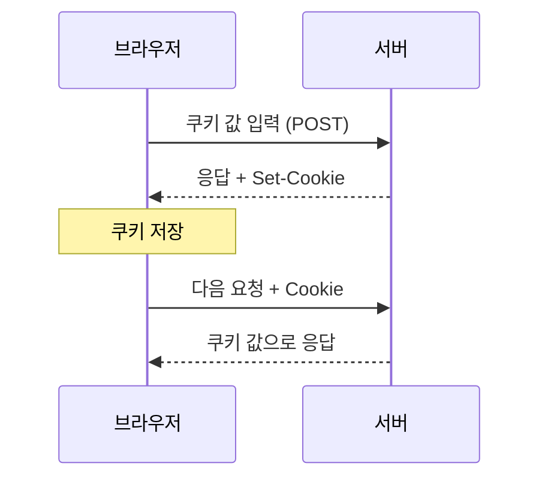
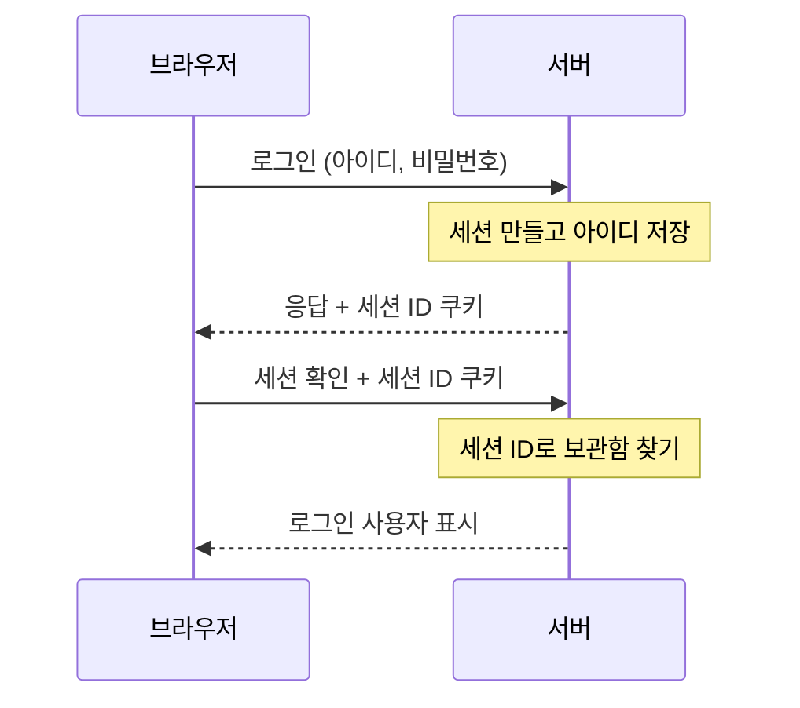
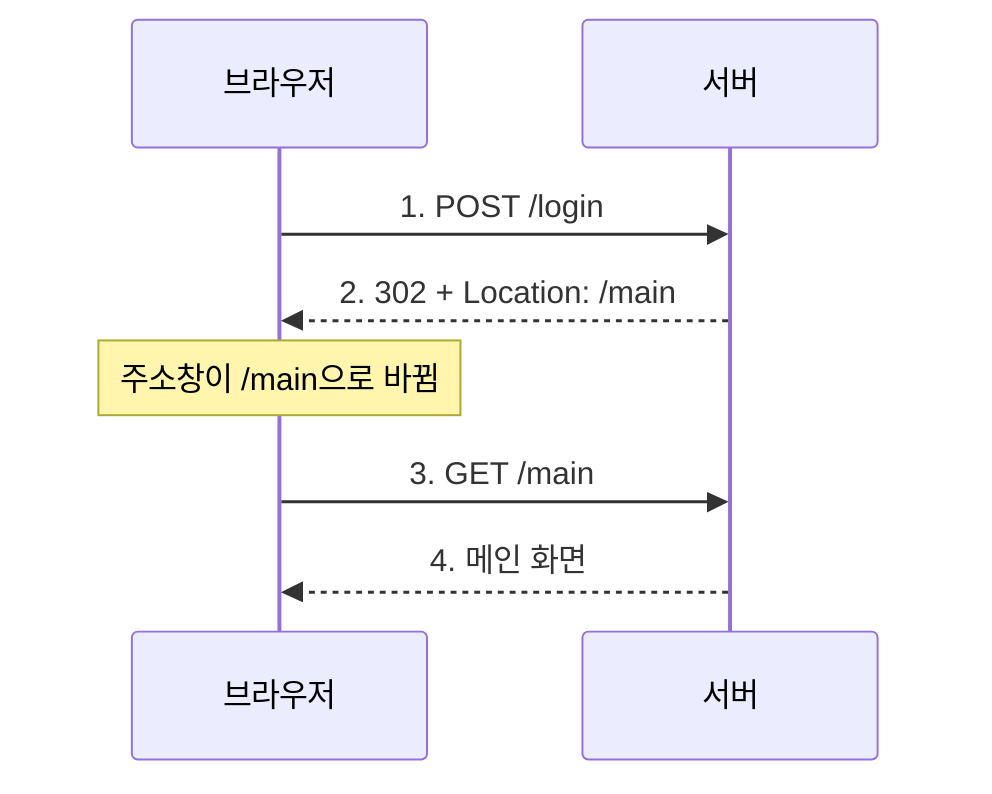
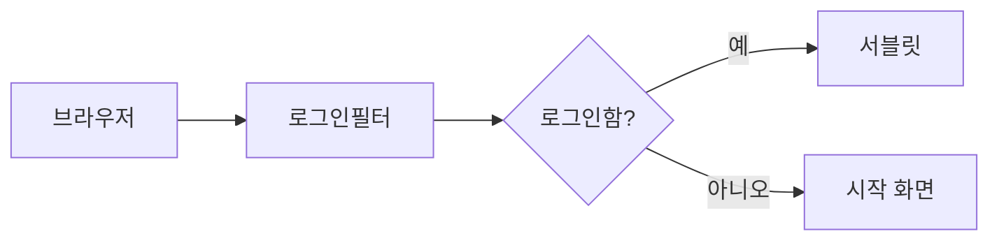

이 글은 서블릿으로 쿠키와 세션을 만들어 로그인 상태를 기억하고, JSP로 화면을 보여 주고, 필터로 공통 검사를 하는 방법을 정리한 글이다.

2026년 10월 23일 수업에서 진행한 내용을 정리했다.

## 이게 없으면 뭐가 불편할까

단골 카페에 갔는데 점원이 매번 나를 처음 보는 사람처럼 대한다고 해 보자. 방금 "아메리카노 주세요"라고 했는데, 1분 뒤 "샷 추가해 주세요"라고 하면 "누구시죠?"라고 되묻는다.

웹이 원래 이렇다. 브라우저와 서버가 주고받는 약속인 **HTTP**는 요청 하나하나를 따로 처리한다. 서버는 다음 요청이 와도 "아까 그 사람"을 저절로 기억하지 못한다. 서블릿 명세(Jakarta Servlet Specification)도 HTTP는 처음부터 상태를 기억하지 않도록 만든 프로토콜이라고 설명한다. 이 성질을 **무상태(stateless)** 라고 부른다.

그러면 로그인이 불가능하다. 로그인 화면에서 아이디를 넣어도, 다음 페이지로 넘어가는 순간 서버는 내가 누군지 잊는다. 그래서 "이 사람이 아까 그 사람"이라는 걸 이어 주는 장치가 필요하다. 그 장치가 **쿠키**와 **세션**이다.

## 먼저, 실습은 어떻게 준비했을까

[웹 서버, Tomcat, 서블릿 글]({{ site.baseurl }})에서 만든 서블릿 프로젝트에 이어서 실습했다. 서블릿은 요청을 받아 처리하는 자바 클래스다. 이번에 만든 파일은 이렇다.

| 파일 | 하는 일 |
|------|---------|
| `cookie.html` | 쿠키 값 입력 칸과 로그인 칸이 있는 시작 화면 |
| `CookieServlet` | 쿠키를 만들어 브라우저에 보내고, 다시 읽는다 |
| `cookie-result.jsp` | 쿠키 값을 화면에 보여 준다 |
| `SessionServlet` | 아이디와 비밀번호를 세션에 저장하고, 다시 꺼낸다 |
| `session-result.jsp` | 세션 값을 화면에 보여 준다 |
| `ExpireServlet` | 세션을 끝낸다 (로그아웃) |
| `AuthServlet`, `auth.jsp` | 로그인한 사람만 볼 수 있는 페이지 |
| `LoginFilter` | 로그인 안 한 사람을 시작 화면으로 돌려보낸다 |
| `Performance` | 요청마다 처리 시간을 잰다 |
| `EncodingFilter`, `web.xml` | 응답의 글자 인코딩을 한 번에 정한다 |

쿠키와 세션 실습은 `h_cookie_session` 패키지와 폴더에, 필터 실습은 `i_filter` 패키지와 폴더에 넣었다. 아래 코드에서는 `import` 줄을 생략했다.

---

## 1. 쿠키 — 브라우저에 메모를 남기려면?

### 한 문장으로 말하면

카페 쿠폰 도장 카드를 떠올려 보자. 카페가 카드를 만들어 주면, 손님은 지갑에 넣어 두었다가 다음에 올 때 내민다. 카페는 카드를 보고 "아, 도장 세 개 찍힌 손님이구나" 하고 안다.

**쿠키(cookie)** 는 서버가 브라우저에게 건네는 작은 메모다. 브라우저는 이 메모를 저장해 두었다가, 같은 서버에 다시 요청할 때 함께 보낸다. MDN에서도 쿠키를 서버가 보내고 브라우저가 저장했다가 이후 요청에 같이 돌려보내는 작은 데이터라고 설명한다.

비유에는 한계가 있다. 쿠폰 카드는 손님이 직접 꺼내 보여 주지만, 쿠키는 브라우저가 **알아서** 요청마다 붙여 보낸다. 그리고 카드는 손님 지갑에 있으니, 손님이 마음대로 고칠 수도 있다. 쿠키도 마찬가지로 사용자가 내용을 보고 바꿀 수 있다.

### 그림으로 보기



서버가 응답에 `Set-Cookie`로 메모를 실어 보내면, 브라우저는 그다음 요청부터 `Cookie`에 그 메모를 실어 보낸다.

### 직접 해보기 — 시작 화면

먼저 값을 입력할 화면을 만든다. 위쪽 양식은 쿠키 실습용이고, 아래쪽 양식은 3절의 세션 실습용이다.

```html
<!DOCTYPE html>
<html lang="en">
  <head>
    <meta charset="UTF-8">
    <title>Title</title>
  </head>
  <body>
    <h1>쿠키와 세션 테스트!!</h1>
    <hr>
    <h2>쿠키 테스트</h2>
    <form action="/cookie" method="post">
      <label>쿠키 값: <input type="text" name="cookieValue" placeholder="값 입력해주세요.."></label>
      <br>
      <button type="submit">쿠키에 값 넣기</button>
    </form>
    <hr>
    <h2>세션 테스트</h2>
    <form action="/session" method="post">
      <label>사용자id : <input type="text" name="userId" placeholder="값 입력해주세요.."></label>
      <br>
      <label>비밀번호: <input type="password" name="userPwd"></label>
      <button type="submit">로그인</button>
    </form>
    <p><a href="/session">세션 확인</a></p>
  </body>
</html>
```

"쿠키에 값 넣기"를 누르면 입력한 값이 `cookieValue`라는 이름으로 `/cookie`에 `POST` 요청으로 간다.

### 직접 해보기 — 쿠키를 만들고 읽는 서블릿

```java
@WebServlet("/cookie")
public class CookieServlet extends HttpServlet {
    @Override
    protected void doPost(HttpServletRequest req, HttpServletResponse resp) throws ServletException, IOException {
        //쿠키에 담을 사용자의 입력값 추출(사용자가 입력했던 abc는 req에 담겨있음)
        String cookieValue = req.getParameter("cookieValue");

        //쿠키 객체 생성!
        Cookie cookie = new Cookie("userValue", "cookieValue");

        //쿠키 만료 시간 설정
        cookie.setMaxAge(60 * 60);      // 60초를 60번 반복한다. (60*60*24) => 1시간 * 24 =하루
        //우리가 만든 쿠키를 브라우저에게 응답(response) /브라우저에게 보내줄 쿠키 add
        resp.addCookie(cookie);

        //아래에 있는 메서드를 호출
        doGet(req, resp);        //포워드 방식임
    }

    @Override
    protected void doGet(HttpServletRequest req, HttpServletResponse resp) throws ServletException, IOException {
        //해당 doGet()메서드는 doPost()요청 후 응답 시 사용되는 메서드
        resp.setContentType("text/html; charset=UTF-8");

        String savedValue = "없음!";

        Cookie[] cookies = req.getCookies();
        if (cookies != null) {
            for (Cookie cookie : cookies) {
                if ("userValue".equals(cookie.getName())) {
                    savedValue = cookie.getValue();
                    break;
                }
            }
        }

        req.setAttribute("savedValue", savedValue);

        //응답을 처리할 서블릿을 만들 것임.
        RequestDispatcher rd = req.getRequestDispatcher(
                "/h_cookie_session/cookie-result.jsp");

        rd.forward(req, resp);
    }
}
```

`doPost`가 하는 일부터 보자.

1. `req.getParameter("cookieValue")` 브라우저가 보낸 입력값을 꺼낸다. `req`는 브라우저가 보낸 요청을 담은 상자다.
2. `new Cookie("userValue", ...)` 이름이 `userValue`인 쿠키를 만든다. 쿠키는 "이름 = 값" 한 쌍이다.
3. `cookie.setMaxAge(60 * 60)` 쿠키를 얼마나 오래 둘지 **초 단위**로 정한다. 60초 × 60 = 3600초, 즉 1시간이다. 하루로 하려면 `60 * 60 * 24`로 쓴다.
4. `resp.addCookie(cookie)` 만든 쿠키를 응답에 싣는다. `resp`는 브라우저에게 돌려보낼 응답 상자다.

`doGet`은 반대로 쿠키를 읽는다. `req.getCookies()`로 브라우저가 보낸 쿠키를 모두 받아, 이름이 `userValue`인 것을 찾는다. 찾은 값은 `req.setAttribute`로 요청 상자에 넣고, JSP로 넘긴다.

`req.getCookies()` 결과를 `null`인지 먼저 확인하는 이유가 있다. API 문서에 따르면 브라우저가 쿠키를 하나도 보내지 않았으면 빈 배열이 아니라 `null`을 돌려준다. 확인 없이 `for`문을 돌리면 에러가 난다.

### 노트를 다시 보니 이상한 곳이 있다

**하나. 입력값이 쿠키에 들어가지 않는다.**

`new Cookie("userValue", "cookieValue")`에서 두 번째 값이 따옴표로 감싸져 있다. 그래서 변수 `cookieValue`가 아니라 **글자 그대로 `"cookieValue"`** 가 들어간다. 사용자가 무엇을 입력하든 쿠키 값은 항상 `cookieValue`다. 입력값을 넣으려면 따옴표를 빼야 한다. 아래는 고친 예시 코드다.

```java
Cookie cookie = new Cookie("userValue", cookieValue);
```

**둘. 방금 넣은 쿠키가 바로 읽히지 않는다.**

`doPost`에서 쿠키를 응답에 실은 뒤 곧바로 `doGet`을 불러 `req.getCookies()`로 읽는다. 그런데 `req`는 **이번에 브라우저가 보낸 요청**이다. 방금 만든 쿠키는 아직 브라우저에 도착하지도 않았다. 그래서 코드를 따라 읽어 보면, 처음 실행할 때는 "없음!"이 나오고 다음 요청부터 쿠키 값이 나온다.

**셋. `doGet(req, resp)` 호출은 포워드가 아니다.**

주석에 "포워드 방식임"이라고 적었는데, `doGet(req, resp)`은 같은 클래스의 메서드를 그냥 부르는 것이다. 포워드는 `doGet` 안의 `rd.forward(req, resp)`에서 일어난다. 포워드는 5절에서 자세히 본다.

### 직접 해보기 — 쿠키 값을 보여 주는 JSP

```jsp
<%@ page contentType="text/html;charset=UTF-8" language="java" %>
<html>
  <head>
    <title>Title</title>
  </head>
  <body>
    <h1> 쿠키에 저장 된 값 꺼내기! </h1>
    <h3> 쿠키에 저장 된 값: ${savedValue} </h3>
  </body>
</html>
```

`${savedValue}`는 서블릿이 `req.setAttribute("savedValue", ...)`로 넣어 둔 값을 꺼내 그 자리에 찍는다. JSP가 무엇인지는 바로 다음 절에서 본다.

| 메서드 | 언제 쓰나 |
|--------|-----------|
| `new Cookie("이름", "값")` | 브라우저에 보낼 쿠키를 만들 때 |
| `cookie.setMaxAge(초)` | 쿠키를 브라우저에 얼마나 둘지 정할 때 |
| `resp.addCookie(cookie)` | 만든 쿠키를 응답에 실어 보낼 때 |
| `req.getCookies()` | 브라우저가 요청에 함께 보낸 쿠키를 읽을 때 |

`setMaxAge`에는 숫자 말고도 알아 둘 것이 있다. API 문서에 따르면 0을 넣으면 쿠키가 지워지고, 음수를 넣으면 브라우저를 닫을 때 사라진다. 아무것도 정하지 않으면 기본값이 -1이라서 브라우저를 닫으면 사라진다.

> 한 줄 요약: 쿠키는 서버가 브라우저에 맡겨 두는 메모다. 브라우저가 다음 요청마다 알아서 들고 온다.

---

## 2. JSP — 화면은 왜 JSP로 만들까?

### 왜 필요할까

서블릿만으로 화면을 만들려면 HTML을 자바 문자열로 한 줄씩 이어 붙여야 한다. 수업에서 `append`로 HTML을 작성해 봤는데 매우 번거로웠다. 태그 하나, 따옴표 하나까지 전부 자바 문자열 안에 넣어야 하기 때문이다.

### 한 문장으로 말하면

청첩장 양식을 떠올려 보자. 디자인은 이미 다 되어 있고, "____ 님을 초대합니다"의 빈칸에 이름만 채우면 된다.

**JSP(Jakarta Server Pages)** 는 HTML 안에 자바 코드나 빈칸을 넣어 쓰는 파일이다. 서블릿이 "자바 안에 HTML"이라면, JSP는 "HTML 안에 자바"다.

여기서 많이들 헷갈린다. JSP는 HTML 파일처럼 보이지만 **사실 서블릿이다.** JSP 명세에 따르면 JSP 페이지는 실행될 때 서블릿 객체로 동작한다. 서버(Tomcat)가 JSP 파일을 자바 서블릿 클래스로 바꾼 뒤 실행하는 것이다. 노트에 "자바 소스 코드를 html화 시켜준다"고 적었는데, 방향은 반대다. 우리가 쓴 HTML 쪽을 서버가 자바 코드로 바꾼다. 그 덕분에 우리는 HTML을 편하게 쓰기만 하면 된다.

비유에는 한계가 있다. 청첩장 양식은 빈칸만 채울 수 있지만, JSP에는 `if`나 반복 같은 자바 코드도 넣을 수 있다.

### JSP에서 쓴 문법

| 문법 | 뜻 | 실습에서 쓴 곳 |
|------|----|----------------|
| `${이름}` | 저장해 둔 값을 꺼내 그 자리에 찍는다 | `cookie-result.jsp`, `session-result.jsp` |
| `<% 자바 코드 %>` | 자바 코드를 실행한다 | `auth.jsp` |
| `<%= 값 %>` | 자바 값을 그 자리에 찍는다 | `auth.jsp` |

`${}` 문법을 **EL(Expression Language)** 이라고 부른다. JSP 명세에 따르면 `${savedValue}`는 이름이 `savedValue`인 값을 page, request, session, application 순서로 찾아본다. 그래서 서블릿이 `req.setAttribute`로 넣은 값도, 세션에 넣은 값도 같은 문법으로 꺼낼 수 있다.

| 구분 | 서블릿 | JSP |
|------|--------|-----|
| 생김새 | 자바 코드 안에 HTML | HTML 안에 자바 |
| 잘하는 일 | 입력값 처리, 로그인 처리, DB 연동 같은 로직 | 처리된 결과를 화면으로 보여 주기 |
| 실습 예 | `CookieServlet`, `SessionServlet` | `cookie-result.jsp`, `session-result.jsp` |

그래서 실습에서는 서블릿이 일을 처리하고, 결과를 JSP에 넘겨 화면을 그리게 나눴다.

> 한 줄 요약: JSP는 화면 담당 서블릿이다. HTML처럼 쓰면 서버가 서블릿으로 바꿔 실행한다.

---

## 3. 세션 — 서버가 나를 기억하려면?

### 왜 쿠키만으로는 부족할까

쿠키는 브라우저에 있다. 사용자가 내용을 볼 수 있고, 바꿀 수도 있고, 누군가 훔쳐 갈 수도 있다. 노트에도 "쿠키는 브라우저에 있어서 탈취 가능하다. 그래서 세션이 훨씬 안정적이다"라고 적었다. MDN에서도 쿠키 값은 사용자가 보고 바꿀 수 있으니, 민감한 정보를 쿠키에 직접 넣지 말라고 한다.

"로그인한 사용자가 홍길동이다"라는 정보를 쿠키에 그대로 넣으면 어떻게 될까? 사용자가 값을 다른 이름으로 바꾸면 남인 척할 수 있다.

### 한 문장으로 말하면

공연장 옷 보관소를 떠올려 보자. 외투를 맡기면 번호표를 하나 준다. 외투는 보관소에 있고, 나는 번호표만 들고 다닌다. 나중에 번호표를 내밀면 내 외투를 돌려준다.

**세션(session)** 은 사용자 정보를 **서버 쪽에** 보관하는 공간이다. 브라우저에는 보관함 번호만 쿠키로 준다. 이 번호를 **세션 ID**라고 부른다. 서블릿 명세에 따르면 세션 ID를 담는 쿠키의 표준 이름은 `JSESSIONID`다.

비유에는 한계가 있다. 번호표를 남이 주우면 내 외투를 찾아갈 수 있다. 세션 ID도 누군가 훔치면 내 행세를 할 수 있다. 그래서 세션도 완벽하게 안전하지는 않다. 다만 진짜 정보는 서버에 있으니, 쿠키에 정보를 통째로 넣는 것보다는 낫다.

### 쿠키와 세션은 언제 쓸까

| 구분 | 쿠키 | 세션 |
|------|------|------|
| 저장 위치 | 브라우저 | 서버 메모리 |
| 담는 것 | 작은 글자 데이터 | 자바 객체 |
| 어떨 때 쓰나 | "아이디 저장", "오늘 하루 이 창 열지 않기"처럼 잃어버리거나 노출돼도 큰일 없는 데이터 | 로그인 사용자 정보, 권한 정보, 장바구니처럼 탈취되면 위험한 데이터 |

### 그림으로 보기



브라우저는 세션 ID만 들고 다니고, 진짜 정보는 서버가 세션 ID로 보관함을 찾아서 꺼낸다.

### 직접 해보기 — 세션에 저장하고 꺼내는 서블릿

로그인 버튼을 누르면 `doPost`가, "세션 확인" 링크를 누르면 `doGet`이 불린다.

```java
@WebServlet("/session")
public class SessionServlet extends HttpServlet {

    /* comment.
        doPost() : 사용자의 입력 id, pwd 를 세션에 저장 및 유효시간 지정
        doGet() : 세션에 저장 된 값을 꺼내고 응답 전용 JSP로 forward
     */

    @Override
    protected void doGet(HttpServletRequest req, HttpServletResponse resp) throws ServletException, IOException {
        // true : 세션 만든다.
        // false : 기존의 세션을 활용하며, 없다면 null 반환
        HttpSession session = req.getSession(false);

        String loggedInUser = null;
        String pwd = null;

        if(session != null) {
            loggedInUser = session.getAttribute("loggedInUser").toString();
            pwd = session.getAttribute("userPwd").toString();
        }

        req.setAttribute("loggedInUser", loggedInUser != null ? loggedInUser : "로그인 안됨!!!");
        req.setAttribute("pwd", pwd != null ? pwd : "비밀번호 없음...");

        // 응답을 잘하는 jsp 활용!!
        RequestDispatcher rd = req.getRequestDispatcher(
                "/h_cookie_session/session-result.jsp"
        );
    }

    @Override
    protected void doPost(HttpServletRequest req, HttpServletResponse resp) throws ServletException, IOException {
        // 사용자가 로그인 버튼을 눌렀을 때! 동작하게 만든다.
        // ID, PWD 를 req 에서 꺼내서 변수에 담기
        String userId = req.getParameter("userId");
        String userPwd = req.getParameter("userPwd");

        if(userId != null && !userPwd.isEmpty()) {
            // 사용자의 아이디와 비밀번호를 저장하기 위한 Session 객체 생성
            HttpSession session = req.getSession(true);
            // 동일한 사용자인지를 확인하기 위한 변수 생성.
            // String existUser = session.getAttribute("loggedInUser").toString();
            String existUser = (String) session.getAttribute("loggedInUser");

            if(existUser == null || existUser.equals(userId)) {
                session.setAttribute("loggedInUser", userId);
                if(userPwd != null && !userPwd.isEmpty()) {
                    session.setAttribute("userPwd", userPwd);
                }
                session.setMaxInactiveInterval(30); // session 의 유효 기간 설정 30초!
            } else {
                session.setAttribute("loggedInUser", userId);
                if(userPwd != null && !userPwd.isEmpty()) {
                    session.setAttribute("userPwd", userPwd);
                }
                session.setMaxInactiveInterval(30);
            }

            doGet(req, resp);
        }
    }
}
```

원래 코드에는 쓰지 않는 `import com.sun.net.httpserver.Request;` 줄이 있었다. 이 글에서는 다른 `import`와 함께 뺐다. 주석으로 막아 둔 `toString()` 줄의 긴 설명은 아래 "헷갈렸던 점" 1번으로 옮겼다.

`doPost`의 흐름을 따라가 보자.

1. 입력한 아이디와 비밀번호를 꺼낸다.
2. `req.getSession(true)` 이 사용자의 세션을 가져온다. 없으면 새로 만든다.
3. `session.getAttribute("loggedInUser")` 이미 로그인한 사용자가 있는지 꺼내 본다.
4. `session.setAttribute("loggedInUser", userId)` 세션 보관함에 "이름 = 값"으로 아이디를 넣는다.
5. `session.setMaxInactiveInterval(30)` 30초 동안 아무 요청이 없으면 세션이 끝나게 한다. 단위는 **초**다.
6. `doGet`을 불러 결과 화면으로 넘어간다.

`getSession`에 넣는 `true`와 `false`가 중요하다. API 문서에 따르면 `true`는 세션이 없으면 새로 만들고, `false`는 없으면 새로 만들지 않고 `null`을 돌려준다. 로그인할 때는 세션을 만들어야 하니 `true`를, 확인만 할 때는 `false`를 쓴다. 괄호 없이 `getSession()`이라고 쓰면 `true`와 같다.

`setMaxInactiveInterval`도 하나 더 알아 두자. API 문서에 따르면 0이나 음수를 넣으면 세션이 시간 때문에 끝나지 않는다.

### 노트를 다시 보니 이상한 곳이 있다

**하나. `doGet`이 화면을 보여 주지 않는다.**

`doGet`에서 `RequestDispatcher`를 만들기만 하고 `rd.forward(req, resp)`를 부르지 않는다. 코드를 따라 읽으면 JSP로 넘어가지 않아서, 브라우저에는 빈 화면만 나온다. `CookieServlet`처럼 마지막에 한 줄을 더해야 한다. 아래는 고친 예시 코드다.

```java
RequestDispatcher rd = req.getRequestDispatcher(
        "/h_cookie_session/session-result.jsp"
);
rd.forward(req, resp);
```

**둘. `if`와 `else`가 똑같은 일을 한다.**

"같은 사용자인지 확인"하려고 `existUser`를 꺼냈지만, `if` 쪽과 `else` 쪽 코드가 한 글자도 다르지 않다. 같은 사람이든 다른 사람이든 결과가 같다. 다른 사용자일 때 다르게 처리하려던 것으로 보이는데, 그 부분이 아직 비어 있다.

**셋. 검사하는 변수가 어긋나 있다.**

`if(userId != null && !userPwd.isEmpty())`는 `userId`가 `null`인지 보고, 비밀번호는 비었는지 본다. 비밀번호가 `null`이면 `.isEmpty()`에서 에러가 난다. 그런데 안쪽에서는 `userPwd != null`을 다시 검사한다. 바깥에서 이미 `userPwd.isEmpty()`를 불렀으니, 안쪽 검사는 늦다.

**넷. 비밀번호를 세션에 넣었다.**

실습에서는 값이 잘 저장되는지 보려고 비밀번호까지 세션에 넣고 화면에 찍었다. 세션은 서버에 있지만, 비밀번호 같은 정보는 꼭 필요한 곳에만 두는 편이 안전하다. 로그인 여부를 기억하려면 아이디 같은 사용자 식별 정보만으로 충분하다.

### 직접 해보기 — 세션 값을 보여 주는 JSP

```jsp
<%@ page contentType="text/html;charset=UTF-8" language="java" %>
<html>
  <head>
    <title>Title</title>
  </head>
  <body>
        <h1>세션 확인!</h1>
        <p>로그인 된 사용자 ID : ${loggedInUser}</p>
        <p>PWD : ${pwd}</p>
        <a href = "/expire"> 세션 만료 시키기 </a>
  </body>
</html>
```

`${키}`라고 쓰면 그 이름으로 저장된 값이 찍힌다. 아래 "세션 만료 시키기" 링크는 다음 절의 `ExpireServlet`으로 간다.

| 메서드 | 언제 쓰나 |
|--------|-----------|
| `req.getSession(true)` 또는 `req.getSession()` | 세션을 가져오고, 없으면 새로 만들 때. 로그인 성공 뒤에 쓴다 |
| `req.getSession(false)` | 있는 세션만 확인할 때. 없으면 `null`. 로그인 여부 검사에 알맞다 |
| `session.setAttribute("이름", 값)` | 기억할 값을 세션에 넣을 때 |
| `session.getAttribute("이름")` | 넣어 둔 값을 꺼낼 때. 없으면 `null` |
| `session.setMaxInactiveInterval(초)` | 일정 시간 요청이 없으면 세션이 끝나게 할 때 |
| `session.invalidate()` | 로그아웃처럼 세션을 끝낼 때 |

> 한 줄 요약: 세션은 서버에 둔 사용자 보관함이고, 브라우저는 그 번호표(세션 ID)만 쿠키로 들고 다닌다.

---

## 4. 세션 만료 — 로그아웃은 어떻게 할까?

### 한 문장으로 말하면

옷 보관소에서 외투를 찾고 나면 번호표는 쓸모가 없어진다. 보관소는 그 칸을 비운다.

로그아웃도 같다. 서버가 세션을 지우면, 브라우저가 예전 세션 ID를 들고 와도 찾을 보관함이 없다. 이렇게 세션을 끝내는 것을 **세션 무효화**라고 부른다.

비유에는 한계가 있다. 보관소는 손님이 직접 찾아가야 칸을 비우지만, 세션은 3절의 `setMaxInactiveInterval`처럼 시간이 지나면 서버가 알아서 끝내기도 한다.

### 직접 해보기

```java
@WebServlet("/expire")
public class ExpireServlet extends HttpServlet {
    @Override
    protected void doGet(HttpServletRequest req, HttpServletResponse resp)
            throws ServletException, IOException {
        HttpSession session = req.getSession(false);

        //기존에 세션이 존재한다면
        if (session != null) {
            session.invalidate(); //세션을 무효화 시키는 메서드
        }

        //세션 무효화 후 /session으로 리다이렉트
        resp.sendRedirect("/session");
    }
}
```

1. `req.getSession(false)` 있는 세션만 가져온다. 로그아웃하려는데 새 세션을 만들 필요는 없다.
2. `session.invalidate()` 세션을 끝낸다. API 문서에 따르면 세션 안에 넣어 둔 값도 모두 풀려난다.
3. `resp.sendRedirect("/session")` 브라우저에게 `/session`으로 다시 가라고 알린다.

코드를 따라 읽으면, 브라우저가 `/session`에 다시 오면 `getSession(false)`가 `null`을 돌려준다. 그래서 화면에는 "로그인 안됨!!!"과 "비밀번호 없음..."이 나온다.

하나 짚어 둘 것이 있다. API 문서에 따르면 `sendRedirect`에 `/`로 시작하는 주소를 주면 **서버의 맨 처음 주소** 기준으로 해석한다. 이 프로젝트처럼 앱이 서버 맨 앞 주소(`/`)에 올라가 있을 때는 잘 동작한다. 앱 주소 앞에 이름이 붙어 있다면(`/myapp/session`처럼) 주소를 고쳐야 한다. `cookie.html`의 `/cookie`, `/session`도 같다.

> 한 줄 요약: 로그아웃은 `session.invalidate()`로 서버의 보관함을 비우는 것이다.

---

## 5. 포워드와 리다이렉트 — 무엇이 다를까?

앞에서 `rd.forward(req, resp)`와 `resp.sendRedirect(...)`가 둘 다 나왔다. 둘 다 "다른 곳으로 넘긴다"는 점은 같은데, 넘기는 방식이 다르다.

### 한 문장으로 말하면

은행 창구를 떠올려 보자.

- **포워드(forward)** 1번 창구 직원이 서류를 들고 옆 2번 창구 담당자에게 가서 처리한 뒤 가져다준다. 손님은 가만히 앉아 있다. 그래서 주소창이 바뀌지 않는다.
- **리다이렉트(redirect)** 1번 창구 직원이 "손님, 이 업무는 2번 창구로 가셔서 다시 신청하세요"라고 안내한다. 손님이 직접 움직인다. 그래서 주소창이 바뀐다.

비유에는 한계가 있다. 은행에서는 "다시 신청"해도 손님이 서류를 들고 가지만, 리다이렉트는 **새 요청**이다. 처음 요청에 담겨 있던 값(`req.setAttribute`로 넣은 값)은 새 요청으로 따라가지 않는다. API 문서에서도 요청에 넣은 값은 그 요청을 처리하는 동안에만 남는다고 설명한다.

### 그림으로 보기 — 리다이렉트



서버는 `302` 응답과 함께 "이 주소로 가"라는 `Location`만 보내고, 브라우저가 그 주소로 새 요청을 보낸다.

이 그림은 수업 노트에 있던 예시다.

1. 브라우저가 서버로 요청을 보낸다.
2. 서버는 처리 후 `resp.sendRedirect("/main");`을 실행한다.
3. 서버는 상태 코드 `302 Found`와 함께 이동할 주소(`Location: /main`)를 응답으로 보낸다. API 문서에서도 `sendRedirect`는 302 응답을 보낸다고 설명한다.
4. 브라우저는 주소창을 `/main`으로 바꾸고 새 `GET` 요청을 보낸다. MDN에 따르면 `POST`에 대한 302 응답을 받으면 브라우저는 `GET`으로 다시 요청한다.

### 왜 포워드는 `req`, 리다이렉트는 `resp`일까?

| 구분 | `req` (`HttpServletRequest`) | `resp` (`HttpServletResponse`) |
|------|------------------------------|--------------------------------|
| 역할 | 브라우저가 들고 온 **요청 상자** | 서버가 내보내는 **응답 상자** |
| 내용물 | 입력값, 쿠키, 헤더 정보 | 내보낼 HTML, 쿠키 추가, 이동 지시 |

- 포워드(`req.getRequestDispatcher(...).forward(req, resp)`)는 서버 **안에서** 지금 요청 상자를 들고 JSP로 넘어간다. 지금 요청을 그대로 넘겨야 하니 `req`에서 꺼낸다.
- 리다이렉트(`resp.sendRedirect(...)`)는 브라우저에게 "다른 주소로 가"라는 **응답**을 보내는 일이다. 응답에 `302`와 `Location`을 실어야 하니 `resp`를 쓴다.

| | 포워드 | 리다이렉트 |
|--|--------|------------|
| 누가 움직이나 | 서버 안에서 넘긴다 | 브라우저가 새로 요청한다 |
| 주소창 | 그대로 | 바뀐다 |
| 요청 수 | 1번 | 2번 |
| `req.setAttribute` 값 | 다음 페이지에서 쓸 수 있다 | 사라진다 |
| 실습 예 | 서블릿 → 결과 JSP | 로그아웃 후 `/session`, 필터에서 시작 화면으로 |

> 한 줄 요약: 포워드는 서버가 안에서 대신 넘기고, 리다이렉트는 브라우저에게 "저기로 다시 가"라고 시킨다.

---

## 6. 필터 — 서블릿 앞에서 공통 검사를 하려면?

### 왜 필요할까

먼저 로그인한 사람만 들어올 수 있는 페이지를 만들었다.

```java
@WebServlet("/auth")
public class AuthServlet extends HttpServlet {
    @Override
    protected void doGet(HttpServletRequest req, HttpServletResponse resp)
            throws ServletException, IOException {
        HttpSession session = req.getSession(false);

        //기존에 로그인 유저 정보 세션에서 꺼내오기
        String existUser = (String)session.getAttribute("loggedInUser");
        session.setAttribute("loggedInUser", existUser);

        RequestDispatcher rd = req.getRequestDispatcher("/i_filter/auth.jsp");
        rd.forward(req,resp);
    }
}
```

```jsp
<%@ page contentType="text/html;charset=UTF-8" language="java" %>
<html>
  <head>
    <title>Title</title>
  </head>
  <body>
    <%
        //JSP 파일은 HTML 처럼 보이지만 실제로는 Java 로 이루어진 Servlet 이다.
        // 태그는 내부에서 Java 소스코드를 입력할 수 있다.
        String user = (String) session.getAttribute("loggedInUser");
     %>
     <h3> <%= user %> </h3>
  </body>
</html>
```

`auth.jsp`에서는 `session`을 만들지도 않았는데 바로 쓴다. JSP 명세에 따르면 JSP 안에는 `session`이라는 변수가 미리 준비되어 있고, 지금 사용자의 세션을 가리킨다.

그런데 `AuthServlet`에는 문제가 있다. 세션이 끝난 뒤(예를 들어 30초가 지나거나 로그아웃한 뒤) `/auth`에 들어가면 `getSession(false)`가 `null`을 돌려준다. 그 `null`에 `.getAttribute(...)`를 부르니 에러가 난다. 서버는 500번대 에러 화면을 보여 준다.

서블릿 안에서 검사하면 되지 않을까? 아래처럼 쓰면 된다. 노트에 있던 코드다.

```java
// 서블릿마다 계속 반복되는 중복 코드
HttpSession session = req.getSession(false);
if (session == null || session.getAttribute("loggedInUser") == null) {
    resp.sendRedirect("/login.jsp"); // 로그인 안 됐으면 튕겨냄
    return;
}
```

문제는 로그인이 필요한 페이지가 `/auth`, `/mypage`, `/admin`처럼 10개, 20개로 늘어날 때다. 서블릿마다 이 코드를 복사해서 붙여야 한다. 검사 방법을 바꾸려면 20군데를 다 고쳐야 한다.

### 한 문장으로 말하면

건물 입구의 보안 요원을 떠올려 보자. 사무실마다 출입증을 검사하지 않는다. 입구 한 곳에서 검사하면, 안쪽 사무실은 검사를 신경 쓰지 않아도 된다.

**필터(filter)** 는 요청이 서블릿에 도착하기 **전에**, 그리고 응답이 나갈 때 공통으로 거치는 검사대다. 필터 하나만 만들어 두면 여러 서블릿에 들어가기 전에 검사를 한 번에 끝낼 수 있다. API 문서에서도 필터를 쓰는 예로 인증, 로그 남기기, 압축 같은 것을 든다.

비유에는 한계가 있다. 보안 요원은 들어올 때만 검사하지만, 필터는 서블릿 일이 끝나고 **나갈 때도** 다시 거친다. 이 성질은 7절 성능 측정에서 쓴다.

### 그림으로 보기



`/auth`로 가는 요청은 먼저 필터를 지나고, 로그인한 사람만 `AuthServlet`까지 간다. 나머지는 시작 화면으로 돌려보낸다.

### 직접 해보기 — 로그인 필터

세션을 만료시킨 뒤 `/auth`에 들어갔을 때 `null` 에러 대신 시작 화면으로 보내는 필터다. 노트 그대로 옮긴 코드다.

```java
/* comment.
   Filter는 Http요청이 Servlet에 도달하기 전에 동작하는 생명주기를 갖는다.
   서블릿에게 도달하기 전에 동작함!!
   @WebFilter("필터가 동작하는 경로") 괄호 안에 있는 경로가 들어왔을 때만 필터가 동작함
*/
@WebFilter("/auth/*")
public class LoginFilter implements Filter {
    // 인터페이스는 강제로 무조건 구현되어야 함.
    @Override
    public void init(FilterConfig filterConfig) throws ServletException {
        System.out.println("로그인 관련 필터 초기화...");
    }

    @Override
    public void doFilter(ServletRequest request, ServletResponse response, FilterChain chain)
            throws IOException, ServletException {
        // 응답할 때도 필터를 거치기 때문에 response도 있음.
        // chain : 필터가 여러개일 수 있음(여러겹)
        System.out.println("로그인 필터가 호출됨...");

        // 자식이 가지고 있는 getSession()메서드를 사용하기 위해 클래스 형변환
        HttpServletRequest req = (HttpServletRequest) request;
        HttpServletResponse resp = (HttpServletResponse) response;

        /* comment.
           /auth로 시작하는 요청이 오면 동작하는 filter
           해당 필터는 session에 loggedInUser값이 없으면 null혹은 500에러를 발생시키는
           것이 아니라, 로그인 할 수 있는 페이지로 redirect시킬 것이다.
        */
        // 기존 세션 유무 확인!
        HttpSession session = req.getSession(false);

        if (session == null || session.getAttribute("loggedInUser") == null) {
            resp.sendRedirect("/h_cookie_session/cookie.html");
        } else {
            // else : 세션 존재하고, loggedInUser에 값이 있는 상태!
            // == 정상이기 때문에 Servlet으로 갈 수 있게 만들어보자!!!
            // 통과! 다음 필터 또는 목표 서블릿으로 요청을 넘깁니다.
            // 다음 필터가 없다면 그 요청을 처리한 서블릿으로 간다.chain.doFilter(req, resp);
        }
    }

    @Override
    public void destroy() {
        System.out.println("로그인 관련 필터 파괴됨...");
    }
}
```

1. `@WebFilter("/auth/*")` 주소가 `/auth`로 시작하는 요청에만 이 필터가 동작한다. 서블릿 명세의 예시에 따르면 `/auth/*` 규칙은 `/auth/어떤것`뿐 아니라 `/auth` 자체에도 맞는다. 그래서 `AuthServlet`(`/auth`) 앞에 이 필터가 선다.
2. `(HttpServletRequest) request` 받은 요청을 HTTP 전용 타입으로 바꾼다. `getSession()`은 HTTP 전용 타입에만 있기 때문이다. 이렇게 타입을 바꾸는 것을 **형변환(casting)** 이라고 부른다.
3. 세션이 없거나 `loggedInUser`가 없으면 `sendRedirect`로 시작 화면에 돌려보낸다.
4. 로그인한 상태라면 `chain.doFilter(req, resp)`로 다음 단계에 넘긴다.

여기서 노트와 코드가 어긋난다. 4번의 `chain.doFilter(req, resp);`가 **주석 줄 끝에 붙어 있다.** 노션에 옮기면서 줄바꿈이 사라진 것으로 보인다. 이대로라면 이 줄은 실행되지 않는 주석이다. 그러면 로그인한 사람도 서블릿에 가지 못하고 빈 화면을 본다. 실제로 동작하려면 이렇게 줄을 나눠야 한다. 아래는 고친 예시 코드다.

```java
} else {
    // 다음 필터가 없다면 그 요청을 처리할 서블릿으로 간다.
    chain.doFilter(req, resp);
}
```

### 필터는 언제 만들어지고 언제 사라질까?

| 메서드 | 언제 불리나 | 실습에서 한 일 |
|--------|-------------|----------------|
| `init(FilterConfig)` | 서버가 필터를 만든 뒤 한 번 | "초기화..." 출력 |
| `doFilter(...)` | 필터가 걸린 요청이 올 때마다 | 로그인 검사 |
| `destroy()` | 서버가 필터를 내릴 때 한 번 | "파괴됨..." 출력 |

이 흐름을 필터의 **생명주기**라고 부른다. [서블릿 글]({{ site.baseurl }})에서 본 서블릿의 `init`, `service`, `destroy`와 모양이 닮았다.

코드 주석에 "인터페이스는 강제로 무조건 구현되어야 함"이라고 적었는데, 정확히는 조금 다르다. API 문서에 따르면 `init`과 `destroy`는 이미 "아무것도 안 하는" 기본 내용이 들어 있다. 그래서 꼭 써야 하는 것은 `doFilter` 하나다. 실습에서는 생명주기를 눈으로 보려고 세 개를 다 덮어썼다.

> 한 줄 요약: 필터는 서블릿 앞의 검사대다. 통과시키려면 반드시 `chain.doFilter()`를 불러야 한다.

---

## 7. 성능 측정 필터 — 요청마다 시간이 얼마나 걸릴까?

### 한 문장으로 말하면

마라톤 대회에서 출발선과 결승선에 같은 기록 측정기가 있다고 해 보자. 출발할 때 시간을 찍고, 돌아왔을 때 다시 찍으면 걸린 시간이 나온다.

필터는 요청이 들어올 때와 응답이 나갈 때 **둘 다** 거친다. 그래서 `chain.doFilter()` 앞뒤로 시간을 재면, 그 사이에 서블릿과 JSP가 일한 시간이 나온다.

비유에는 한계가 있다. 마라톤은 출발선과 결승선이 다른 곳이지만, 필터는 **같은 메서드 안**에서 들어가고 돌아온다. `chain.doFilter()`를 부르면 뒤쪽 일이 다 끝날 때까지 기다렸다가, 그다음 줄부터 이어서 실행된다.

수업에서는 이 구조를 MVC(Model-View-Controller, 처리와 화면을 나누는 설계 방식)의 흐름과 함께 봤다. 요청이 처음 들어갈 때와 마지막으로 나갈 때 필터를 거친다는 점이 핵심이었다.

### 직접 해보기

```java
/* comment.
   해당 필터는 모든 요청에 동작하는 Filter
*/
@WebFilter("/*")
public class Performance implements Filter {
    @Override
    public void init(FilterConfig filterConfig) throws ServletException {
        System.out.println("Performance필터 생성됨..");
    }

    @Override
    public void doFilter(
            ServletRequest request,
            ServletResponse response,
            FilterChain chain
    ) throws IOException, ServletException {
        HttpServletRequest req = (HttpServletRequest) request;

        long startTime = System.currentTimeMillis(); // 현재 시간 측정 모든 요청이 들어올 때 시간 측정 스타트
        // 다음 서블릿 OR필터 호출
        chain.doFilter(request, response); // 서블릿이나 필터가 다 거치고 되돌아옴.
        long endTime = System.currentTimeMillis();

        System.out.println(
                "[" + req.getRequestURI() + "의 최종 수행 시간 : "
                        + (endTime - startTime) + "(ms)"
        );

        System.out.println("[요청 된 URL] : " + req.getRequestURI());
        // HttpRequest로 받으면 되는거 아니야?? -> 언젠가는 HTTP보다 훨씬 좋은 것이
        // 생길 수 있음. 따라서 부모로 받아버리면 괜찮으니까. ServletRequest로 작성.
    }

    @Override
    public void destroy() {
        System.out.println("Performance필터 파괴됨..");
    }
}
```

1. `@WebFilter("/*")` 모든 주소의 요청에 동작한다.
2. `System.currentTimeMillis()` 지금 시각을 밀리초(1000분의 1초) 단위 숫자로 돌려준다.
3. `chain.doFilter(...)` 앞에서 한 번, 뒤에서 한 번 시각을 잰다.
4. 두 시각의 차이가 이 요청을 처리하는 데 걸린 시간이다. `req.getRequestURI()`로 어떤 주소였는지도 함께 찍는다.

### 왜 `doFilter`는 `HttpServletRequest`가 아니라 `ServletRequest`를 받을까?

코드 마지막 주석에 이 질문이 있다. 수업에서는 "언젠가 HTTP보다 좋은 방식이 생겨도 쓸 수 있게 부모 타입으로 받는다"고 배웠다.

API 문서도 같은 방향으로 설명한다. `ServletRequest`는 특정 통신 방식에 묶이지 않은 기본 요청 타입이다. HTTP에만 있는 정보는 이것을 물려받은 `HttpServletRequest`가 더한다. 그래서 세션처럼 HTTP 전용 기능을 쓰려면 6절처럼 형변환을 해야 한다.

> 한 줄 요약: `chain.doFilter()` 앞은 "들어갈 때", 뒤는 "나올 때"다. 그 사이 시간을 재면 처리 시간이 나온다.

---

## 8. 인코딩 필터와 web.xml — 필터를 등록하는 다른 방법은?

### 왜 필요할까

서블릿마다 `resp.setContentType("text/html; charset=UTF-8")`를 적었다. 이 줄이 없으면 한글이 깨져 보일 수 있다. 이것도 서블릿마다 반복되는 코드다. 그래서 필터 하나로 모든 응답에 한 번에 걸기로 했다.

### 필터를 등록하는 두 가지 방법

| 방법 | 쓰는 곳 | 실습 예 |
|------|---------|---------|
| 어노테이션 | 클래스 위에 `@WebFilter("/주소")` | `LoginFilter`, `Performance` |
| XML | `web.xml` 설정 파일에 적기 | `EncodingFilter` |

어노테이션은 클래스 위에 붙이는 표시다. 수업에서는 XML 방식을 옛날 프로젝트에서 많이 쓰던 방식이라고 배웠다. 이번에는 XML 방식을 직접 해 봤다.

### 직접 해보기 — web.xml

`web.xml`은 이 웹 앱의 설정을 적는 파일이다. 서블릿 명세에서는 배포 설명자(deployment descriptor)라고 부른다.

```xml
<?xml version="1.0" encoding="UTF-8"?>
<web-app xmlns="https://jakarta.ee/xml/ns/jakartaee"
         xmlns:xsi="http://www.w3.org/2001/XMLSchema-instance"
         xsi:schemaLocation="https://jakarta.ee/xml/ns/jakartaee https://jakarta.ee/xml/ns/jakartaee/web-app_6_1.xsd"
         version="6.1">
    <error-page>
        <error-code>404</error-code>
        <location>/showerrorpage</location>
    </error-page>
    <error-page>
        <error-code>500</error-code>
        <location>/showerrorpage</location>
    </error-page>
    <filter>
        <filter-name>encoding</filter-name>
        <filter-class>com.wanted.servlet.i_filter.EncodingFilter</filter-class>
        <!--실제 구현체가 어디인지 작성-->
        <init-param>
            <!--위의 필터가 생성될 때 변수를 집어넣어줌-->
            <param-name>encoding-type</param-name>
            <param-value>text/html; charset=UTF-8</param-value>
        </init-param>
    </filter>
    <!--어느 url에서 동작하게 만들 것인지-->
    <filter-mapping>
        <filter-name>encoding</filter-name>
        <url-pattern>/*</url-pattern>
    </filter-mapping>
</web-app>
```

| 태그 | 뜻 |
|------|----|
| `<error-page>` | 404, 500 에러가 나면 `/showerrorpage`로 보낸다. 이전 수업에서 넣어 둔 설정이다 |
| `<filter>` | 필터에 `encoding`이라는 이름을 붙이고, 실제 클래스가 어디 있는지 적는다 |
| `<init-param>` | 필터가 만들어질 때 넘겨줄 설정값. 이름은 `encoding-type`, 값은 `text/html; charset=UTF-8` |
| `<filter-mapping>` | `encoding` 필터를 어느 주소에 걸지 적는다. `/*`는 모든 주소다 |

### 직접 해보기 — EncodingFilter

```java
/*  comment.
        Filter 를 등록하는 방법은 총 2가지이다.
        1. @WebFilter :  어노테이션 방식
        2. xml      -> 옛날 프로젝트 방식임
 */
public class EncodingFilter implements Filter {

    private String encodingType;

    @Override
    public void init(FilterConfig filterConfig) throws ServletException {
        System.out.println("인코딩 필터의 init() 호출됨...");
        encodingType = filterConfig.getInitParameter("encoding-type");
    }

    @Override
    public void doFilter(ServletRequest request, ServletResponse response, FilterChain chain) throws IOException, ServletException {
        response.setContentType(encodingType);
        chain.doFilter(request, response);
    }

    @Override
    public void destroy() {
        Filter.super.destroy();
    }
}
```

이 클래스에는 `@WebFilter`가 없다. `web.xml`에 등록했기 때문이다.

1. `init`에서 `filterConfig.getInitParameter("encoding-type")`으로 `web.xml`에 적은 값을 꺼내 변수에 담는다.
2. `doFilter`에서 그 값으로 응답의 글자 형식을 정하고, `chain.doFilter`로 넘긴다.
3. `destroy`의 `Filter.super.destroy()`는 `Filter`에 원래 들어 있는 기본 `destroy`를 부른다. 기본 내용은 아무 일도 하지 않는다.

여기서 하나 헷갈리기 쉽다. 이 필터는 **응답**의 인코딩만 정한다. 브라우저가 `POST`로 보낸 한글 입력값을 읽는 쪽은 따로다. API 문서에 따르면 요청 본문의 인코딩은 `request.setCharacterEncoding(...)`으로 정하고, 입력값을 읽기 전에 불러야 효과가 있다. 그리고 `setContentType`은 응답을 쓰기 시작하기 전에 불러야 글자 형식이 적용된다.

> 한 줄 요약: 필터는 `@WebFilter`로도, `web.xml`로도 등록할 수 있다. `web.xml`에서는 필터에 설정값을 넘겨줄 수 있다.

---

## 한 번에 보기 — 로그인 한 번에 무슨 일이 일어날까?

1. 브라우저가 아이디와 비밀번호를 서버에 보낸다.
2. **서블릿**이 값을 받아 로그인 처리를 한다.
3. 로그인이 됐다면 **세션**에 사용자 정보를 넣는다. 브라우저에는 세션 ID가 쿠키로 간다.
4. **JSP**가 결과 화면을 그린다.
5. 이후 다른 페이지에 들어갈 때 **필터**가 세션을 보고 로그인 여부를 검사한다.

| 메서드 | 언제 쓰나 |
|--------|-----------|
| `doGet()` | 페이지 조회나 링크 클릭처럼 `GET` 요청이 왔을 때 |
| `doPost()` | 로그인 양식 제출처럼 `POST` 요청으로 데이터를 보냈을 때 |
| `rd.forward(req, resp)` | 서버 안에서 JSP로 넘길 때. 주소는 그대로이고, 요청에 넣은 값을 JSP가 쓸 수 있다 |
| `resp.sendRedirect("주소")` | 브라우저에게 다른 주소로 다시 요청하라고 알릴 때. 주소가 바뀌고 새 요청이 생긴다 |
| 필터 `init()` | 필터가 처음 준비될 때 한 번 |
| 필터 `doFilter()` | 필터가 걸린 요청마다. 통과시키려면 `chain.doFilter()`를 부른다 |
| 필터 `destroy()` | 필터가 내려갈 때 정리할 일이 있으면 |

---

## 헷갈렸던 점

### 1. `.toString()`과 `(String)`은 뭐가 다를까?

`SessionServlet`의 `doPost`에서 처음에는 이렇게 썼다. 이 줄을 쓰면 500번대 에러가 났다.

```java
String existUser = session.getAttribute("loggedInUser").toString();
```

세션을 방금 만들었으니 `loggedInUser`에는 아직 아무것도 없다. API 문서에 따르면 `getAttribute`는 값이 없으면 `null`을 돌려준다. 여기에 `.`을 찍어 `toString()`을 부르면 "없는 것의 메서드를 불러라"가 된다. 그래서 `NullPointerException`이 난다. `.`은 "이 객체 안의 것을 쓴다"는 참조 연산이라, 객체가 없으면 쓸 수 없다.

그래서 이렇게 바꿨다.

```java
String existUser = (String) session.getAttribute("loggedInUser");
```

`(String)`은 **형변환 연산자**다. 메서드를 부르는 것이 아니라 "이 값을 `String`으로 다룬다"고 표시만 한다. 값이 `null`이면 `null`을 그대로 `String` 변수에 담는다. 에러가 나지 않는다.

노트에는 "아래 줄은 null **문자열**이 된다"고 적었는데, 이 부분은 바로잡아야 한다. `(String) null`의 결과는 글자 `"null"`이 아니라 **아무것도 가리키지 않는 `null` 그 자체**다. 그래서 바로 아래 `existUser == null` 검사가 참이 된다. 글자 `"null"`이었다면 이 검사는 거짓이 됐을 것이다.

| 쓰는 법 | 값이 `null`일 때 |
|---------|-------------------|
| `obj.toString()` | `NullPointerException` |
| `(String) obj` | `null`이 그대로 담긴다 |

노트의 결론처럼, `null`일 수 있는 값에는 `.`을 찍기 전에 먼저 `null`인지 확인한다.

같은 문제가 `doGet`에도 남아 있다. `session != null`만 확인하고 `session.getAttribute("loggedInUser").toString()`을 부른다. 세션은 있는데 `loggedInUser`가 없으면 여기서도 에러가 난다. 그런 일이 생길 수 있을까? JSP 명세에 따르면 JSP는 따로 정하지 않으면 세션에 참여하고, `session` 변수는 "지금 세션 또는 새 세션"을 가리킨다. 그래서 로그인 전에 `cookie-result.jsp` 같은 JSP를 한 번 열면, 로그인하지 않았어도 세션이 생길 수 있다. `doGet`도 `(String)` 형변환으로 바꾸는 편이 안전하다.

### 2. `chain.doFilter()`는 왜 꼭 불러야 할까?

필터는 이어달리기의 한 주자다. `chain.doFilter()`는 다음 주자에게 바통을 넘기는 동작이다. 다음 주자는 다른 필터일 수도 있고, 목표 서블릿일 수도 있다.

이 줄을 빠뜨리면 바통 전달이 멈춘다. 인코딩 필터라면 인코딩 설정까지는 끝냈지만, 사용자가 요청한 서블릿(로그인, 게시글 조회 등)은 실행되지 않는다. 브라우저는 제대로 된 응답을 받지 못해 흰 화면만 보게 된다. API 문서에서도 필터는 `chain.doFilter()`로 다음에 넘기거나, 부르지 않음으로써 요청을 막는다고 설명한다.

그래서 `LoginFilter`에서 로그인 안 한 사람을 막을 때는 `chain.doFilter()`를 부르지 않고 `sendRedirect`만 한 것이다. 반대로 통과시킬 때는 꼭 불러야 한다. 6절에서 본 것처럼 노트의 코드는 이 줄이 주석에 묻혀 있었다.

### 3. `web.xml`에 적은 값이 정말 `FilterConfig`에 담길까?

담긴다. `FilterConfig`는 서버(Tomcat 같은 서블릿 컨테이너)가 필터를 만들고 `init()`을 부를 때 넘겨주는 설정 상자다. `web.xml`의 `<init-param>`에 적은 값이 여기에 들어 있다. API 문서에서도 필터는 `init`에서 `FilterConfig`로 설정과 초기화 값을 읽는다고 설명한다.

흐름은 이렇다.

1. `web.xml`의 `<init-param>`에 `encoding-type = text/html; charset=UTF-8`을 적는다.
2. 서버가 시작하면서 `EncodingFilter`를 만들고, 이 값을 `FilterConfig`에 담아 `init()`에 넘긴다.
3. `filterConfig.getInitParameter("encoding-type")`으로 꺼내 쓴다.

`@WebFilter`로 등록할 때도 초기화 값을 줄 수 있다고 한다. 이 방법은 실습에서 써 보지 않았다.

### 4. 필터가 여러 개면 어떤 순서로 지나갈까?

이 실습에는 모든 주소에 걸린 필터가 둘(`Performance`, `EncodingFilter`), `/auth`에 걸린 필터가 하나(`LoginFilter`) 있다. `/auth`로 요청하면 세 필터를 모두 지난다.

서블릿 명세에 따르면 `web.xml`에 적은 필터는 적은 순서대로 이어진다. 하지만 어노테이션으로만 등록한 필터끼리는 **순서가 정해져 있지 않다.** 순서가 중요하다면 `web.xml`에 적어야 한다. 예를 들어 "로그인 검사보다 인코딩이 먼저"처럼 순서가 결과를 바꾸는 경우다.

### 5. 쿠키를 끄면 세션도 못 쓸까?

세션 ID는 보통 쿠키로 주고받는다. API 문서에 따르면 쿠키를 쓸 수 없는 브라우저를 위해 주소 뒤에 세션 ID를 붙이는 방법도 있다. `resp.encodeURL(...)`이 그 일을 한다. 이 실습에서는 다루지 않았다.

> 한 줄 요약: `null`일 수 있는 값에는 `.`을 찍지 않는다. 필터는 `chain.doFilter()`로 넘기고, 순서가 중요하면 `web.xml`에 적는다.

---

## 더 학습하면 좋은 개념

- **쿠키 보안 속성(HttpOnly, Secure, SameSite)** — 세션 ID 쿠키를 훔치면 남인 척할 수 있다. MDN은 세션 쿠키에 자바스크립트가 읽지 못하게 하는 `HttpOnly`를 붙이라고 권한다. 세션을 "안정적"으로 쓰려면 이 속성들이 무엇을 막는지 알아야 한다.
- **세션 고정 공격과 세션 ID 다시 발급하기** — MDN은 사용자가 로그인할 때마다 세션 ID를 새로 발급하라고 한다. 서블릿에서는 `req.changeSessionId()`라는 메서드가 있다. 이번 실습의 로그인은 세션을 새로 만들지 않고 그대로 썼기 때문에, 이 차이를 알아 둘 필요가 있다.
- **비밀번호 해시(hash)** — 실습에서는 비밀번호를 그대로 세션에 넣고 화면에 찍었다. 실제 로그인은 비밀번호를 그대로 보관하지 않는다. DB에 비밀번호를 어떻게 저장하고 비교하는지 알아야 로그인을 제대로 만들 수 있다.
- **MVC 패턴** — 이번 실습에서 서블릿은 처리, JSP는 화면으로 역할을 나눴다. 이렇게 나누는 설계를 MVC라고 부른다. 나중에 Spring을 배울 때 같은 구조가 그대로 나온다.
- **JSTL과 EL** — `auth.jsp`에서는 `<% %>` 안에 자바 코드를 직접 썼다. JSP 안의 자바 코드를 줄이고 `${}`와 태그로 화면을 만드는 방법이 있다. 화면 코드가 길어질수록 읽기 쉬워진다.

## 참고 자료

- [Jakarta Servlet Specification 6.0](https://jakarta.ee/specifications/servlet/6.0/jakarta-servlet-spec-6.0.pdf)
- [Cookie (Jakarta Servlet 6.0 API)](https://jakarta.ee/specifications/servlet/6.0/apidocs/jakarta.servlet/jakarta/servlet/http/Cookie.html)
- [HttpServletRequest (Jakarta Servlet 6.0 API)](https://jakarta.ee/specifications/servlet/6.0/apidocs/jakarta.servlet/jakarta/servlet/http/HttpServletRequest.html)
- [HttpServletResponse (Jakarta Servlet 6.0 API)](https://jakarta.ee/specifications/servlet/6.0/apidocs/jakarta.servlet/jakarta/servlet/http/HttpServletResponse.html)
- [HttpSession (Jakarta Servlet 6.0 API)](https://jakarta.ee/specifications/servlet/6.0/apidocs/jakarta.servlet/jakarta/servlet/http/HttpSession.html)
- [RequestDispatcher (Jakarta Servlet 6.0 API)](https://jakarta.ee/specifications/servlet/6.0/apidocs/jakarta.servlet/jakarta/servlet/RequestDispatcher.html)
- [Filter (Jakarta Servlet 6.0 API)](https://jakarta.ee/specifications/servlet/6.0/apidocs/jakarta.servlet/jakarta/servlet/Filter.html)
- [ServletRequest (Jakarta Servlet 6.0 API)](https://jakarta.ee/specifications/servlet/6.0/apidocs/jakarta.servlet/jakarta/servlet/ServletRequest.html)
- [ServletResponse (Jakarta Servlet 6.0 API)](https://jakarta.ee/specifications/servlet/6.0/apidocs/jakarta.servlet/jakarta/servlet/ServletResponse.html)
- [Jakarta Server Pages Specification 3.1](https://jakarta.ee/specifications/pages/3.1/jakarta-server-pages-spec-3.1.pdf)
- [Using HTTP cookies (MDN)](https://developer.mozilla.org/en-US/docs/Web/HTTP/Guides/Cookies)
- [302 Found (MDN)](https://developer.mozilla.org/en-US/docs/Web/HTTP/Reference/Status/302)
