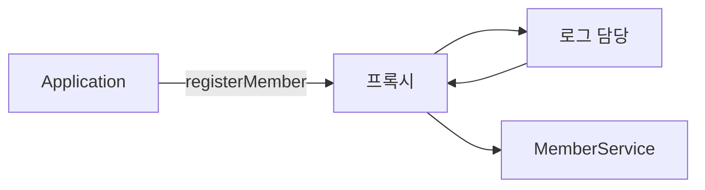
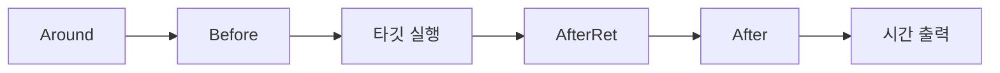

이 글은 메서드마다 반복되는 로그·성능 측정 코드를 한곳에 모아 두고, 필요한 순간에 옆에서 끼워 넣는 스프링 AOP를 정리한 글이다.

2026년 10월 27일 수업에서 진행한 내용을 정리했다.

## 이게 없으면 뭐가 불편할까

회원 관리 프로그램을 만든다고 해 보자. 기능은 네 개다. 회원가입, 회원조회, 비밀번호 변경, 탈퇴.

그런데 기능 말고도 해야 할 일이 있다. "어떤 메서드가 언제 시작하고 끝났는지" 기록하는 **로그**와, "얼마나 걸렸는지" 재는 **성능 측정**이다. 수업 코드에서는 이런 일을 **비기능**이라고 불렀다. 사용자가 원하는 기능은 아니지만 프로그램을 운영하려면 필요한 일이다.

문제는 이 비기능 코드를 네 메서드에 **똑같이** 넣어야 한다는 점이다. 로그 형식을 하나 바꾸려면 네 곳을 다 고쳐야 한다. 메서드가 100개라면 100곳이다.

그래서 "반복되는 코드는 한곳에 모아 두고, 필요한 순간에 알아서 끼워 넣어 주는 방법"이 필요하다. 그 방법이 **AOP**다.

## 먼저, 실습은 어떻게 준비했을까

수업에서는 IntelliJ로 새 자바 프로젝트를 만들었다.

1. 프로젝트 이름은 `chap03-aop`, 빌드 도구는 Gradle, Gradle DSL은 Groovy를 골랐다. Gradle은 필요한 라이브러리를 대신 내려받고 프로젝트를 빌드해 주는 도구다.
2. `src/main/java` 아래에 `com.wanted.aop.section01` 패키지를 만들었다.
3. Maven 저장소 검색 사이트([MVN Repository](https://mvnrepository.com/))에서 필요한 라이브러리를 찾아 `build.gradle`에 붙여 넣었다.

```groovy
dependencies {
    implementation 'org.springframework:spring-context:7.0.8'

    compileOnly 'org.projectlombok:lombok:1.18.46'
    annotationProcessor('org.projectlombok:lombok:1.18.46')

    implementation 'org.springframework:spring-aop:7.0.8'
    implementation 'org.aspectj:aspectjrt:1.9.25'
    implementation 'org.aspectj:aspectjweaver:1.9.25.1'
}
```

| 라이브러리 | 하는 일 |
|------------|---------|
| `spring-context` | 스프링 IoC 컨테이너(뒤에서 설명) |
| `lombok` | 게터·세터 같은 반복 코드를 대신 만들어 준다 |
| `spring-aop` | 스프링의 AOP 기능 |
| `aspectjrt`, `aspectjweaver` | `@Aspect`, `@Before` 같은 AOP 어노테이션과, 그것을 실제 코드에 엮어 주는 도구 |

사이트에서 복사한 코드 앞부분이 `runtimeOnly`로 되어 있는 것이 있었다. 이것을 `implementation`으로 바꾼 뒤, Gradle 새로고침 버튼(코끼리 모양)을 눌러 반영했다. `runtimeOnly`는 "실행할 때만 쓴다"는 뜻이라, 코드를 쓸 때 import가 되지 않을 수 있다.

---

## 0. 복습 — DI는 왜 필요했을까?

AOP로 들어가기 전에 전날 배운 DI를 짧게 복습했다. 스프링은 **유지보수하기 좋은 코드**를 만들기 좋은 도구다. 그 바탕에 DI가 있다.

### 구현체를 직접 `new`하면 뭐가 문제일까

아래는 수업 그림을 코드로 옮긴 예시 코드다.

```java
// 예시 코드
interface Network {
    void req();
    void res();
}

class Http implements Network {
    public void req() { /* 요청 관련 로직 */ }
    public void res() { /* 응답 관련 로직 */ }
}

class Logic {
    Http h = new Http();   // 구현체를 직접 만든다
    void run() {
        h.req();
    }
}
```

통신 방식을 Http에서 TCP로 바꾸고 싶다고 해 보자. `Logic` 안의 `new Http()`를 찾아서 전부 고쳐야 한다. 이런 코드가 여러 곳에 있으면 바꾸는 수고가 크다.

### 인터페이스와 `@Autowired`로 구현체를 숨기기

전날 실습 코드에서는 필드에 **인터페이스 타입**만 적어 두었다.

```java
@Service("field")
public class PaymentServiceField {

    @Autowired
    private PaymentInterface paymentInterface;
}
```

`@Autowired`는 "스프링 컨테이너에 있는 객체 중 맞는 것을 찾아 여기에 넣어 달라"는 표시다. 그러면 실제로 어떤 구현체(`NaverPayGateway` 등)가 들어오는지는 이 클래스가 몰라도 된다. 구현체를 숨겨 둔 셈이다. 이렇게 필요한 객체를 밖에서 넣어 주는 것을 **DI(Dependency Injection, 의존성 주입)** 라고 부른다.

### 생성자로 주입받기

같은 일을 생성자로도 할 수 있다. 필드에 인터페이스를 선언하고, 아래 생성자로 주입받는다.

```java
@Service("constructor")
public class PaymentServiceConstructor {

    private final PaymentInterface paymentInterface;

    public PaymentServiceConstructor(PaymentInterface paymentInterface) {
        this.paymentInterface = paymentInterface;
    }
}
```

수업 노트에는 생성자가 하나뿐이면 `@Autowired`를 생략해도 주입된다고 적혀 있었다. `final`을 붙일 수 있어서 한 번 들어온 객체가 바뀌지 않는다.

### IoC 컨테이너, ApplicationContext, BeanFactory

노트에 `IoC == Context == factory`라고 적어 두었다. 스프링이 객체를 만들고 보관하는 상자를 부르는 이름들이다. 이 상자를 **IoC 컨테이너**라고 하고, 코드에서는 `ApplicationContext`로 다룬다. 컨테이너가 보관하는 객체 하나하나를 **빈(Bean)** 이라고 부른다.

> 한 줄 요약: 구현체를 직접 `new`하지 않고 컨테이너가 넣어 주게 하면, 구현체를 바꿔도 쓰는 쪽 코드는 그대로다.

---

## 1. Lombok — DTO의 반복 코드를 줄일 수 있을까?

회원 정보를 담을 `MemberDTO`를 만들었다. **DTO(Data Transfer Object)** 는 행동이 아니라 **데이터를 담는 데 집중하는 객체**다. 수업에서는 "정보를 저장하는 역할로 책임을 분리하는 것"이라고 배웠다.

예전 방식대로라면 DTO에는 기본 생성자, 모든 필드를 받는 생성자, 게터·세터, `toString`을 직접 다 써야 했다. 필드 다섯 개짜리 클래스가 100줄 가까이 된다.

Lombok을 쓰면 어노테이션 몇 개로 끝난다.

```java
package com.wanted.aop.section01;

import lombok.*;

@NoArgsConstructor
@AllArgsConstructor
@Getter
@Setter
@ToString
public class MemberDTO {
    private String email;
    private String password;
    private String name;
    private String phone;
    private String role;
}
```

| 어노테이션 | 대신 만들어 주는 것 |
|------------|---------------------|
| `@NoArgsConstructor` | 기본 생성자 |
| `@AllArgsConstructor` | 모든 필드를 받는 생성자 |
| `@Getter`, `@Setter` | 게터, 세터 |
| `@ToString` | `toString()` |

실습에서는 직접 쓴 생성자·게터·세터·`toString`을 전부 주석 처리했다. 그래도 오류가 나지 않았다. Lombok이 컴파일할 때 같은 코드를 만들어 주기 때문이다.

> 한 줄 요약: Lombok은 DTO의 반복 코드를 어노테이션으로 대신 만들어 준다.

---

## 2. AOP 적용 전 — 코드는 어떻게 생겼을까?

수업에서 받은 `MemberService`의 회원가입 메서드다. `MemberService`는 회원 기능을 모아 둔 클래스이고, DB 대신 `HashMap`에 회원을 저장한다.

```java
public class MemberService {
    // DB역할을 대신하는 인메모리 데이터베이스
    private Map<String, MemberDTO> memberRepository = new HashMap<>();

    public void registerMember(MemberDTO member) {
        // 성능 측정 시작 - 횡단 관심사 #1
        long startTime = System.currentTimeMillis();

        try {
            // 로깅 - 횡단 관심사 #2
            System.out.println("[로그]회원 가입 시작: " + member.getEmail());

            // 트랜잭션 시작 (의사코드) - 횡단 관심사 #3
            // beginTransaction();

            // ----- 핵심 비즈니스 로직 시작 -----
            if (member.getEmail() == null || member.getEmail().isEmpty()) {
                throw new IllegalArgumentException("이메일은 필수입니다.");
            }
            if (member.getPassword() == null || member.getPassword().length() < 8) {
                throw new IllegalArgumentException("비밀번호는 8자 이상이어야 합니다.");
            }
            if (memberRepository.containsKey(member.getEmail())) {
                throw new IllegalArgumentException("이미 등록된 이메일입니다: " + member.getEmail());
            }
            memberRepository.put(member.getEmail(), member);
            System.out.println("회원 정보 저장 완료: " + member.getEmail());
            // ----- 핵심 비즈니스 로직 종료 -----

            // commitTransaction();
            System.out.println("[로그]회원 가입 성공: " + member.getEmail());
        } catch (Exception e) {
            // rollbackTransaction();
            System.out.println("[로그]회원 가입 실패: " + e.getMessage());
            throw e;
        } finally {
            // 성능 측정 종료 - 횡단 관심사 #1
            long endTime = System.currentTimeMillis();
            System.out.println("[성능]회원 가입 처리 시간: " + (endTime - startTime) + "ms");
        }
    }
}
```

정말 하고 싶은 일은 가운데 "핵심 비즈니스 로직" 부분뿐이다. 비즈니스 로직은 이 프로그램이 존재하는 이유, 즉 회원을 검사하고 저장하는 일이다. 그런데 그 위아래를 성능 측정, 로그, 트랜잭션 코드가 감싸고 있다. 트랜잭션 부분은 진짜 코드가 아니라 자리만 표시한 의사코드(주석)다.

회원조회, 비밀번호 변경, 탈퇴 메서드도 똑같은 모양이다. 가운데 로직만 다르고 위아래는 거의 복사해 붙인 코드다. 수업 노트에는 "코드가 짬뽕되어 있다"고 적었다.

### 어떤 문제가 생길까

수업 코드 주석에 정리된 문제점은 세 가지다.

| 문제 | 설명 |
|------|------|
| 코드의 중복 | 모든 메서드마다 로깅, 성능 측정, 트랜잭션 관리 코드가 반복된다 |
| 낮은 응집도 | 각 메서드가 핵심 비즈니스 로직 말고 다른 코드까지 실행한다 |
| 유지보수의 어려움 | 로그 형식이나 성능 측정 기준이 바뀌면 여러 메서드 안을 전부 고쳐야 한다 |

**응집도**는 한 클래스나 메서드가 "자기 일에 얼마나 집중하는가"를 뜻한다. 회원가입 메서드가 회원가입만 하면 응집도가 높다. **결합도**는 코드끼리 얼마나 얽혀 있는지다. 수업에서는 이걸 줄여서 "결낮응높(결합도는 낮게, 응집도는 높게)을 만들자"고 했다.

이렇게 여러 메서드에 가로로 걸쳐 반복되는 관심사를 **횡단 관심사(cross-cutting concern)** 라고 부른다. 위 코드 주석의 "횡단 관심사 #1, #2, #3"이 그것이다.

수업에서는 `Application` 클래스에서 다섯 가지 테스트를 돌렸다. 가입, 조회, 비밀번호 변경, 탈퇴, 그리고 일부러 예외를 내는 "탈퇴한 회원 다시 조회"다.

```java
MemberService service = new MemberService();

try {
    System.out.println("[테스트 1]회원 가입");
    MemberDTO member = new MemberDTO("user@example.com", "pass0123", "홍길동", "010-1111-1111", "USER");
    service.registerMember(member);

    System.out.println("[테스트 2]회원 조회");
    MemberDTO foundMember = service.getMember("user@example.com");
    System.out.println("조회 된 회원 = " + foundMember);

    System.out.println("[테스트 3]비밀번호 변경");
    service.updatePassword("user@example.com", "pass0123", "pass0234");

    System.out.println("[테스트 4]회원 탈퇴");
    service.deleteMember("user@example.com");

    // 일부러 예외를 발생
    System.out.println("[테스트 5]존재하지 않는 회원 조회");
    service.getMember("user@example.com");
} catch (Exception e) {
    System.out.println("예외 발생!! : " + e.getMessage());
}
```

(구분선 출력문은 줄였다.) 4번에서 이미 탈퇴했기 때문에 5번 조회는 "존재하지 않는 회원입니다" 예외를 던진다.

> 한 줄 요약: 핵심 로직보다 로그·성능 측정 코드가 더 많고, 그게 모든 메서드에 반복된다. 이게 AOP가 풀려는 문제다.

---

## 3. AOP란 무엇일까?

### 한 문장으로 말하면

공연장 무대를 떠올려 보자. 배우는 연기만 한다. 조명을 켜고, 막을 올리고, 공연 시간을 재는 일은 무대 **옆**에 있는 스태프가 한다. 배우는 스태프가 있는지 몰라도 연기할 수 있다.

**AOP(Aspect Oriented Programming, 관점 지향 프로그래밍)** 는 이렇게 반복되는 부가 작업을 핵심 코드 밖으로 빼내서, 필요한 순간에 옆에서 끼워 넣는 방식이다. 수업 노트에는 "위에서 밑으로 내려가는 게 아니라 옆에서 치고 들어온다"고 적었다.

비유에는 한계가 있다. 스태프는 배우가 언제 무대에 오를지 눈치껏 맞춘다. AOP는 눈치가 없다. "이 메서드가 실행되기 전에", "끝난 뒤에"처럼 **언제, 어디에** 끼어들지를 개발자가 정확히 적어 줘야 한다.

### AOP 용어는 무엇이 있을까

여기서 용어가 한꺼번에 쏟아져서 많이들 헷갈린다. 무대 비유로 하나씩 맞춰 보자.

| 용어 | 수업에서 배운 뜻 | 무대 비유 |
|------|------------------|-----------|
| Aspect(애스펙트) | 반복해서 동작하는 코드를 모아 둔 클래스 | 조명팀, 시간 측정팀 |
| Advice(어드바이스) | 반복 코드가 **어느 시점에** 동작할지 정한 것 | "막이 오르기 전에", "공연이 끝난 뒤에" |
| Pointcut(포인트컷) | 반복 코드가 **어디에** 적용될지 정한 것 | "주연 배우가 나오는 장면에만" |
| JoinPoint(조인포인트) | 적용될 위치와 그 객체의 정보 | 지금 막 시작하는 장면의 정보 |
| Weaving(위빙) | 반복 코드가 적용될 위치에 전달되는 행위 | 스태프를 실제 장면에 배치하는 일 |

공식 문서에서는 조인포인트를 "프로그램 실행 중의 한 지점"이라고 설명한다. 그리고 **스프링 AOP에서 조인포인트는 언제나 메서드 실행**이라고 못 박는다. 그래서 이 글에서 "조인포인트"는 "지금 실행되는 메서드"라고 읽으면 된다.

공식 문서에는 용어가 두 개 더 있다.

- **타깃(Target)** — AOP가 끼어드는 대상 객체. 이 글에서는 `MemberService`다.
- **AOP 프록시(Proxy)** — 스프링이 타깃 대신 만들어 세워 두는 대리 객체. 바깥에서 메서드를 부르면 프록시가 먼저 받아서 어드바이스를 실행하고, 타깃을 부른다.

> 한 줄 요약: 애스펙트는 "누가", 어드바이스는 "언제", 포인트컷은 "어디에"를 정한다.

---

## 4. section02 — AOP를 쓸 준비는 어떻게 할까?

section01 파일을 복사해서 `section02` 패키지에 붙여 넣고 고쳐 나갔다.

### MemberService를 빈으로 만들기

```java
@Service
public class MemberService {
    ...
}
```

`@Service`는 "핵심 비즈니스 로직을 처리하는 빈이다"라는 표식이다. 이 표식이 있어야 스프링이 이 클래스를 찾아 컨테이너에 넣는다.

### 설정 클래스 만들기

```java
package com.wanted.aop.section02.config;

import org.springframework.context.annotation.ComponentScan;
import org.springframework.context.annotation.Configuration;
import org.springframework.context.annotation.EnableAspectJAutoProxy;

@Configuration
@ComponentScan("com.wanted.aop.section02")
@EnableAspectJAutoProxy
public class AppConfig {
}
```

| 어노테이션 | 뜻 |
|------------|----|
| `@Configuration` | 환경 설정을 담은 클래스라는 표시 |
| `@ComponentScan("...")` | 이 패키지 안에서만 빈을 찾아 모은다 (범위 설정) |
| `@EnableAspectJAutoProxy` | `@Aspect` 클래스를 찾아 AOP를 켜 준다 |

`@EnableAspectJAutoProxy`를 수업 코드 주석에서는 "사용자의 권위를 낚아챌 권리를 준다"고 표현했다. 공식 문서 설명으로 바꾸면 이렇다. 어떤 빈에 적용할 애스펙트가 있으면, 스프링이 그 빈의 **프록시를 자동으로 만들어** 메서드 호출을 가로채고 어드바이스를 실행한다. 메서드 호출을 중간에서 낚아채는 셈이다.

공식 문서에 따르면 이 기능을 쓰려면 `aspectjweaver` 라이브러리가 클래스패스에 있어야 한다. 앞에서 `build.gradle`에 넣은 이유다.

### Application에서 컨테이너 꺼내 쓰기

```java
public class Application {
    public static void main(String[] args) {
        // Spring은 new 쓰는 것 지양함. 따라서 주석처리!!!
        // MemberService service = new MemberService();

        // 위에 대신 IoC 컨테이너를 생성한다.
        ApplicationContext context = new AnnotationConfigApplicationContext(AppConfig.class);
        MemberService service = context.getBean(MemberService.class);   // 꺼내서 담아둠

        // ... 테스트 1~5는 section01과 같다
    }
}
```

`new MemberService()`로 직접 만들면 스프링이 끼어들 틈이 없다. 컨테이너에서 꺼낸 `service`는 스프링이 준비한 객체라서, AOP가 적용된다.

노트 중간 단계에는 `new AnnotationConfigApplicationContext()`처럼 괄호 안을 비워 둔 코드가 있었다. 그다음 단계에서 `AppConfig.class`를 넣었다. 설정 클래스를 넘겨줘야 컨테이너가 `@ComponentScan` 범위를 알고 빈을 모은다.

### 애스펙트 클래스 두 개 만들기

`section02.aspect` 패키지에 두 클래스를 만들었다.

- `LoggingAspect` — 로그를 담당한다
- `PerformanceAspect` — 성능 측정을 담당한다

### 그림으로 보기



`Application`은 `MemberService`를 부른다고 생각하지만, 실제로는 프록시가 먼저 받아 로그 애스펙트를 실행한 뒤 진짜 `MemberService`를 부른다.

> 한 줄 요약: `@Service`로 빈을 만들고, `@EnableAspectJAutoProxy`로 AOP를 켜고, 컨테이너에서 빈을 꺼내 써야 AOP가 동작한다.

---

## 5. @Before — 메서드가 시작되기 전에 끼어들려면?

### 한 문장으로 말하면

공연 시작 전에 "곧 공연이 시작됩니다" 안내 방송을 하는 것과 같다. **`@Before`** 는 타깃 메서드가 **실행되기 전에** 동작하는 어드바이스다.

비유와 다른 점이 있다. 안내 방송은 공연을 멈출 수 없지만, `@Before`에서 예외를 던지면 타깃 메서드는 실행되지 않는다.

### 직접 해보기

```java
package com.wanted.aop.section02.aspect;

import org.aspectj.lang.JoinPoint;
import org.aspectj.lang.annotation.*;
import org.springframework.stereotype.Component;

@Component
@Aspect
public class LoggingAspect {

    // 타겟 메서드 동작 전 실행 될 Log 메서드 (호출되기 전 실행)
    @Before("execution(* com.wanted.aop.section02.MemberService.*(..))")
    public void logBefore(JoinPoint joinPoint) {
        // JoinPoint 란? Advice 메서드가 적용되는 지점에 대한 정보를 제공하는 객체이다.
        String methodName = joinPoint.getSignature().getName();
        Object[] args = joinPoint.getArgs();

        StringBuilder argStr = new StringBuilder();
        for (Object arg : args) {
            argStr.append(arg).append(" , ");
        }

        System.out.println("[Before 로그] " + methodName + " " +
                "메서드 실행 시작 됨, 매개변수 : " + argStr);
    }
}
```

하나씩 보자.

- `@Component` + `@Aspect` — 이 클래스가 빈이면서 애스펙트라는 표시다.
- `@Before("execution(...)")` — 괄호 안이 포인트컷이다. 여기서는 "`MemberService`의 모든 메서드"를 뜻한다. 문법은 아래 11절에서 자세히 본다.
- `JoinPoint joinPoint` — 어드바이스 메서드의 매개변수에 적어 두면, 스프링이 "지금 실행되려는 메서드"의 정보를 넣어 준다.
- `getSignature().getName()` — 실행되는 메서드 이름 (`registerMember` 등)
- `getArgs()` — 그 메서드에 넘어온 인자들

수업 그림에서는 흐름을 이렇게 그렸다. ① `Application`이 `registerMember(member)`를 부른다. ② 그 호출이 먼저 `LoggingAspect`의 `@Before` 메서드로 간다. ③ 로그를 찍은 뒤 `MemberService`로 넘어간다. ④ 그제야 회원가입 로직이 실행된다.

### 왜 인자를 `Object[]`에 담을까?

여기서 많이들 멈칫한다. `MemberService`의 메서드마다 받는 인자가 다르기 때문이다.

| 메서드 | 받는 인자 |
|--------|-----------|
| `registerMember(MemberDTO member)` | `MemberDTO` 1개 |
| `getMember(String email)` | `String` 1개 |
| `updatePassword(String, String, String)` | `String` 3개 |

`@Before` 하나가 이 모든 메서드에 공통으로 걸린다. 그래서 개수도 타입도 제각각인 인자를 한 번에 받을 그릇이 필요하다. 자바에서 `Object`는 **모든 클래스의 최상위 부모**다. 그래서 무엇이든 담을 수 있는 `Object[]` 배열로 받는다.

### 이제 MemberService의 로그 코드를 지운다

`LoggingAspect`가 로그를 대신 찍어 주니까, `MemberService` 안에 있던 `[로그]` 출력문을 주석 처리했다. 노트에 첨부한 중간 단계 `MemberService`를 보면, 로그 출력문은 주석이 되고 성능 측정 코드는 아직 남아 있다.

> 한 줄 요약: `@Before`는 타깃 메서드 직전에 실행되고, `JoinPoint`로 메서드 이름과 인자를 꺼낼 수 있다.

---

## 6. @After — 메서드가 끝난 뒤에 끼어들려면?

### 한 문장으로 말하면

공연이 성공했든 중간에 사고가 났든, 끝나면 반드시 무대 조명을 끈다. **`@After`** 는 타깃 메서드가 **끝나면 무조건** 실행되는 어드바이스다.

수업 코드 주석에는 언제 쓰는지도 적혀 있다. 타이머 종료, 종료 로그, 자원 정리다.

### 직접 해보기

```java
@After("execution(* com.wanted.aop.section02.MemberService.*(..))")
public void logAfter(JoinPoint joinPoint) {
    String methodName = joinPoint.getSignature().getName();
    System.out.println("[After 로그] " + methodName + " 메서드 실행 완료!");
}
```

공식 문서에서는 `@After`를 "after (finally)" 어드바이스라고 부른다. 정상적으로 끝나든 예외가 나든 **어떤 결과든** 실행된다는 뜻이다. 자바의 `finally` 블록과 같다.

비유에는 한계가 있다. `@After`는 공연이 어떻게 끝났는지 모른다. 반환값이나 예외를 받지 않는다. 그걸 알고 싶으면 다음 두 어드바이스를 쓴다.

> 한 줄 요약: `@After`는 성공이든 실패든 메서드가 끝나면 항상 실행된다.

---

## 7. @AfterReturning — 정상 종료와 반환값을 보려면?

### 한 문장으로 말하면

공연이 **무사히** 끝났을 때만 관객 수를 기록하는 것과 같다. **`@AfterReturning`** 은 타깃 메서드가 예외 없이 정상적으로 끝나고 값을 반환한 뒤 실행된다.

### 직접 해보기

```java
@AfterReturning(
        pointcut = "execution(* com.wanted.aop.section02.MemberService.*(..))",
        returning = "result"
)
public void logAfterReturning(JoinPoint joinPoint, Object result) {
    String methodName = joinPoint.getSignature().getName();
    System.out.println("[AfterReturn 로그] " + methodName + " 메소드 정상 종료, 종료 시 반환값 : " + result);
}
```

`returning = "result"`는 "메서드의 반환값을 `result`라는 이름의 매개변수로 받겠다"는 뜻이다. 공식 문서에 따르면 이 이름은 어드바이스 메서드의 매개변수 이름과 **똑같아야** 한다. 여기서 이름을 다르게 쓰면 연결되지 않는다.

`void` 메서드(`registerMember` 등)는 돌려줄 값이 없으니 `result`가 `null`로 찍힌다. `getMember`처럼 값을 돌려주는 메서드일 때 쓸모가 있다. 수업 주석에는 "반환값을 확인하거나 값을 변환할 때 쓸 수 있다"고 적었다.

> 한 줄 요약: `@AfterReturning`은 정상 종료했을 때만 실행되고, `returning`으로 반환값을 받는다.

---

## 8. @AfterThrowing — 예외가 났을 때만 끼어들려면?

### 한 문장으로 말하면

공연 중 사고가 났을 때만 사고 보고서를 쓰는 것과 같다. **`@AfterThrowing`** 은 타깃 메서드 실행 중 **예외가 발생했을 때** 동작한다.

### 직접 해보기

```java
@AfterThrowing(
        pointcut = "execution(* com.wanted.aop.section02.MemberService.*(..))",
        throwing = "exception"
)
public void logAfterThrowing(JoinPoint joinPoint, Exception exception) {
    String methodName = joinPoint.getSignature().getName();
    System.out.println("[AfterThrowing 로그] " + methodName + " 메소드 실행 중 예외 발생 : " + exception.getMessage());
}
```

`returning`과 짝을 이루는 것이 `throwing`이다. `throwing = "exception"`은 발생한 예외를 `exception`이라는 매개변수로 받겠다는 뜻이다. 그래서 예외가 매개변수에 들어가 있다.

테스트 5번(탈퇴한 회원 조회)이 예외를 던지므로, 이 어드바이스가 동작하는 것을 볼 수 있다.

수업 주석에는 예외 흐름을 복구하는 데도 쓸 수 있지만, 더 좋은 예외 처리 방법을 쓰는 편이 낫다고 적혀 있다. 공식 문서도 `@AfterThrowing`은 일반적인 예외 처리 콜백이 아니라고 말한다. 예외를 기록하는 데 쓰고, 예외를 삼켜서 없던 일로 만들지는 않는다.

| 어드바이스 | 실행 시점 | 받을 수 있는 것 |
|------------|-----------|-----------------|
| `@Before` | 메서드 실행 전 | `JoinPoint` |
| `@After` | 메서드가 끝난 뒤 (성공·실패 무관) | `JoinPoint` |
| `@AfterReturning` | 정상 반환 직후 | `JoinPoint`, 반환값 |
| `@AfterThrowing` | 예외 발생 직후 | `JoinPoint`, 예외 |

> 한 줄 요약: 예외 기록은 `@AfterThrowing`, `throwing`으로 예외를 받는다.

---

## 9. @Around — 앞과 뒤를 한 번에 감싸려면?

### 한 문장으로 말하면

선물 포장을 떠올려 보자. 포장지는 선물을 **앞뒤로 감싼다**. 포장을 뜯어야 선물이 나온다. **`@Around`** 는 타깃 메서드의 앞과 뒤를 모두 감싸는 어드바이스다. 수업에서는 "어드바이스 중 가장 강력한 어노테이션"이라고 배웠다.

비유와 다른 점이 있다. 포장지는 선물을 꺼낼지 말지 정할 수 없다. `@Around`는 타깃 메서드를 **실행할지 말지까지** 직접 정한다. 그래서 강력하고, 그만큼 실수하기도 쉽다.

### 직접 해보기 — 성능 측정

```java
package com.wanted.aop.section02.aspect;

import org.aspectj.lang.ProceedingJoinPoint;
import org.aspectj.lang.annotation.Around;
import org.aspectj.lang.annotation.Aspect;
import org.springframework.core.annotation.Order;
import org.springframework.stereotype.Component;

@Component
@Aspect
@Order(1)
public class PerformanceAspect {

    @Around("execution(* com.wanted.aop.section02.MemberService.*(..))")
    public Object performance(ProceedingJoinPoint joinPoint) {

        // 시작 시간 측정
        long startTime = System.currentTimeMillis();

        try {
            Object result = joinPoint.proceed();    // 얘가 있어야 다음으로 넘어감
            return result;
        } catch (Throwable e) {
            throw new RuntimeException(e);
        } finally { // 예외가 발생하더라도 종료 시간 측정과 성능 측정을 해야 하므로 finally에 배치
            long endTime = System.currentTimeMillis();

            String methodName = joinPoint.getSignature().getName();
            System.out.println("[Around 성능 측정] " + methodName + " 메서드 실행 시간 : " + (endTime - startTime)
                    + "(ms)");
        }
    }
}
```

흐름을 순서대로 보면 이렇다.

1. 타깃 메서드가 실행되기 직전에 현재 시간을 밀리초(ms) 단위로 기록한다.
2. `joinPoint.proceed()`로 진짜 `MemberService` 메서드를 실행한다.
3. 정상 종료되면 결과값을 그대로 돌려준다.
4. 실행 중 예외가 나면 잡아서 밖으로 다시 던진다.
5. `finally`에서 끝난 시간을 재고, 걸린 시간을 출력한다. 성공이든 예외든 무조건 실행된다.

### ProceedingJoinPoint와 proceed()는 무엇일까?

`@Around`는 `JoinPoint`가 아니라 **`ProceedingJoinPoint`** 를 받는다. `JoinPoint`를 물려받은 인터페이스로, 타깃 메서드의 실행을 **직접 제어**할 수 있다.

`proceed()`는 "이제 다음으로 넘어가라"는 버튼이다. 다음에 다른 애스펙트가 있으면 그쪽으로, 없으면 진짜 메서드로 넘어간다. 여기서 많이들 놓친다. `proceed()`를 부르지 않으면 **타깃 메서드가 아예 실행되지 않는다.**

공식 문서에 따르면 `@Around` 메서드는 반환 타입이 `Object`여야 하고, 첫 매개변수가 `ProceedingJoinPoint`여야 한다. 그리고 `@Around`가 돌려준 값이 호출한 쪽이 받는 값이 된다. 그래서 `return result;`를 빠뜨리면 `getMember`의 결과가 사라진다.

`proceed()`는 `Throwable`을 던질 수 있다고 선언돼 있다. 타깃을 감싸고 있으니, 타깃이 예외를 던지면 이쪽도 받을 준비를 해야 한다. 그래서 `try-catch`가 필수다.

### 성능 측정 코드도 지운다

`PerformanceAspect`가 시간을 재 주니, `MemberService` 안의 성능 측정 코드도 지웠다. 이제 `MemberService`에는 핵심 비즈니스 로직만 남는다. 이 결과는 아래 12절에서 비교한다.

> 한 줄 요약: `@Around`는 타깃을 앞뒤로 감싸고, `proceed()`를 불러야 타깃이 실행된다. 성능 측정에 딱 맞다.

---

## 10. 애스펙트가 여러 개면 어떤 순서로 실행될까?

### 왜 순서가 문제일까

이제 `MemberService` 메서드 하나에 `LoggingAspect`와 `PerformanceAspect`가 동시에 걸린다. 어느 쪽이 먼저 실행될까?

### @Order로 순서 정하기

`PerformanceAspect`에 `@Order(1)`을 붙였다. 공식 문서에 따르면 두 애스펙트 중 **숫자가 작은 쪽이 우선순위가 높다.**

양파 껍질을 떠올리면 쉽다. 우선순위가 높을수록 **바깥 껍질**이다.

```text
[요청 시작]
┌ PerformanceAspect 시작   ← @Order(1), 바깥
│ ┌ LoggingAspect 시작     ← 안쪽
│ │   진짜 MemberService 실행
│ └ LoggingAspect 종료
└ PerformanceAspect 종료
[요청 끝]
```

| 방향 | 순서 |
|------|------|
| 들어갈 때 | 우선순위 높은 것부터. `@Order(1)` → 안쪽 애스펙트 → 타깃 메서드 |
| 나올 때 | 안쪽부터 끝나므로 **역순**. 타깃 메서드 → 안쪽 애스펙트 → `@Order(1)` |

공식 문서도 들어갈 때는 우선순위가 가장 높은 어드바이스가 먼저, 나올 때는 가장 나중에 실행된다고 설명한다.

수업 코드에서 `LoggingAspect`에는 `@Order`를 붙이지 않았다. `@Order`의 기본값은 가장 낮은 우선순위(`Ordered.LOWEST_PRECEDENCE`)라서, `LoggingAspect`가 안쪽에 들어간다.

### 0이나 음수도 넣을 수 있을까?

수업 중에 이 질문이 나왔다. 넣을 수 있다. `@Order` 값은 `int`라서 0이나 -1, -2 같은 음수도 된다. 스프링 API 문서를 보면 가장 높은 우선순위(`HIGHEST_PRECEDENCE`)가 `Integer.MIN_VALUE`, 가장 낮은 우선순위(`LOWEST_PRECEDENCE`)가 `Integer.MAX_VALUE`다. 같은 값끼리는 순서가 정해지지 않는다.

### 그래서 출력 순서는 어떻게 될까?

수업 노트에는 이렇게 적었다. "`@Order(1)` 때문에 `@Around`가 제일 먼저 실행된다. `joinPoint.proceed()` 때문에 다음으로 넘어간다. 그런데 `proceed()` 위에 출력문이 있다면 `@Before`보다 `@Around` 출력문이 제일 먼저 나온다."

여기서 많이들 헷갈린다. 지금 `PerformanceAspect`는 `proceed()` **전에는 아무것도 출력하지 않는다.** 시간만 기록한다. 출력은 `finally`에서, 즉 타깃이 끝난 뒤에 한다. 그래서 화면에는 `[Before 로그]`가 먼저 보이고, `[Around 성능 측정]`은 맨 마지막에 보인다. 실행은 `@Around`가 가장 먼저 시작했는데도 말이다.

공식 문서의 규칙을 따라가 보면, 정상 종료하는 메서드 하나에서 실행 순서는 아래와 같다.



`Around`에서 시간을 기록하고 `proceed()`로 넘어간다. 안쪽 `LoggingAspect`의 어드바이스와 타깃이 다 끝난 뒤에, `@Around`의 `finally`(`시간 출력`)에서 성능 측정 결과를 출력한다. `AfterRet`는 `@AfterReturning`을 줄인 것이다.

같은 애스펙트 안에서 `@After`가 `@AfterReturning`보다 뒤에 오는 이유는 아래 "헷갈렸던 점"에 정리했다.

> 한 줄 요약: `@Order` 숫자가 작을수록 바깥 껍질이다. 들어갈 때는 먼저, 나올 때는 나중에 실행된다.

---

## 11. Pointcut은 어떻게 쓸까?

### 한 문장으로 말하면

택배 주소를 적는 것과 같다. "서울시 OO구 OO동 아무 집"처럼 범위를 넓게 쓸 수도, 한 집만 콕 집을 수도 있다. **포인트컷 표현식**은 어드바이스가 실행될 메서드를 고르는 주소다.

### 기본 모양

```text
execution(접근제어자 반환타입 패키지.클래스.메서드(파라미터))
```

수업에서 쓴 표현식을 쪼개 보면 이렇다.

```text
execution(* com.wanted.aop.section02.MemberService.*(..))
          │  └──────── 패키지.클래스 ────────────┘ │ └ 매개변수: 0개 이상
          │                                       └ 메서드 이름: 아무거나
          └ 반환 타입: 아무거나 (접근제어자는 생략)
```

| 표기 | 뜻 |
|------|----|
| `*` 또는 생략 | 아무거나 상관없다 |
| `클래스.*(..)` | 그 클래스 안의 모든 메서드 |
| `(..)` | 매개변수 0개 이상 |
| `()` | 매개변수가 없는 메서드 |
| `(String)` | 매개변수가 `String` 1개인 메서드 |
| `(String, ..)` | 첫 번째 매개변수는 `String`, 나머지는 상관없음 |

공식 문서에 따르면 반환 타입, 메서드 이름, 매개변수 부분은 꼭 써야 하고, 접근제어자 등은 생략할 수 있다. 수업 노트에는 "역순으로 생각"이라고 메모해 뒀다. 괄호 안을 뒤에서부터(매개변수 → 메서드 → 클래스 → 패키지) 읽으면 주소처럼 좁혀 들어가기 쉽다.

### 특정 메서드만 고르고 싶다면?

포인트컷 문구만 바꾸면 적용 대상을 자유롭게 조절할 수 있다.

```java
// MemberService 안에서 regist로 시작하는 메서드만
@Around("execution(* com.wanted.aop.section02.MemberService.regist*(..))")

// section02 패키지(와 그 하위 패키지) 안의 모든 클래스, 모든 메서드
@Around("execution(* com.wanted.aop.section02..*.*(..))")
```

메서드 이름 자리의 `regist*`는 "regist로 시작하는 이름"이라는 뜻이다. 패키지 뒤의 `..`는 공식 문서에 따르면 "그 패키지와 모든 하위 패키지"를 뜻한다.

`MemberService.*(..)` 덕분에 메서드가 10개든 100개든 하나하나 지정할 필요가 없다. 한 줄로 전체 메서드에 한꺼번에 적용된다.

> 한 줄 요약: `execution(반환타입 패키지.클래스.메서드(매개변수))`. `*`는 아무거나, `(..)`는 매개변수 아무거나다.

---

## 12. section01과 section02의 MemberService는 얼마나 달라졌을까?

애스펙트 두 개를 다 만든 뒤, `section02`의 `MemberService` 내용을 다 지우고 핵심 로직만 남은 코드로 바꿨다.

```java
@Service
public class MemberService {
    // DB 역할을 대신하는 인메모리 데이터베이스
    private Map<String, MemberDTO> memberRepository = new HashMap<>();

    public void registerMember(MemberDTO member) {
        // ----- 핵심 비즈니스 로직 시작 -----
        if (member.getEmail() == null || member.getEmail().isEmpty()) {
            throw new IllegalArgumentException("이메일은 필수입니다.");
        }
        if (member.getPassword() == null || member.getPassword().length() < 8) {
            throw new IllegalArgumentException("비밀번호는 8자 이상이어야 합니다.");
        }
        if (memberRepository.containsKey(member.getEmail())) {
            throw new IllegalArgumentException("이미 등록된 이메일입니다: " + member.getEmail());
        }
        memberRepository.put(member.getEmail(), member);
        System.out.println("회원 정보 저장 완료: " + member.getEmail());
        // ----- 핵심 비즈니스 로직 종료 -----
    }

    public MemberDTO getMember(String email) {
        if (email == null || email.isEmpty()) {
            throw new IllegalArgumentException("이메일은 필수입니다.");
        }
        MemberDTO member = memberRepository.get(email);
        if (member == null) {
            throw new IllegalArgumentException("존재하지 않는 회원입니다: " + email);
        }
        return member;
    }

    // updatePassword, deleteMember도 같은 방식으로 핵심 로직만 남겼다
}
```

| | section01 | section02 |
|--|-----------|-----------|
| 객체 만들기 | `new MemberService()` | 컨테이너에서 `getBean()` |
| 로그 코드 | 메서드마다 직접 출력 | `LoggingAspect` 한곳에 |
| 성능 측정 코드 | 메서드마다 `try-finally` | `PerformanceAspect` 한곳에 |
| `MemberService` 안 | 핵심 로직 + 부가 코드 | 핵심 로직만 |

앞에서 본 세 가지 문제가 이렇게 풀렸다.

- **코드의 중복** — 로그·성능 측정 코드가 애스펙트 한곳에만 있다.
- **낮은 응집도** — `MemberService`는 회원 일만 한다.
- **유지보수의 어려움** — 로그 형식을 바꾸려면 `LoggingAspect` 하나만 고치면 된다.

> 한 줄 요약: AOP를 적용하자 `MemberService`에는 핵심 로직만 남고, 부가 기능은 애스펙트가 맡았다.

---

## 헷갈렸던 점

### 1. Weaving은 코드 어디에 있는 걸까?

`@Aspect`, `@Before` 같은 코드는 보이는데, "위빙(엮기)"을 하는 코드는 따로 보이지 않았다.

수업 노트에는 이렇게 정리했다. `@Configuration`과 `@ComponentScan` 두 개로 빈을 모으고, 그걸 바탕으로 `@EnableAspectJAutoProxy`가 엮어 준다. 위빙은 우리가 직접 쓰는 코드가 아니라, **이 어노테이션을 켜면 스프링이 대신 하는 일**이다.

공식 문서에 따르면 위빙은 컴파일할 때, 클래스를 불러올 때, 실행 중일 때 할 수 있다. 스프링 AOP는 **실행 중(runtime)** 에 한다. 컨테이너가 빈을 만들 때 프록시를 만들어 애스펙트를 엮는 방식이다.

### 2. `@Aspect`만 붙이면 될까?

안 된다. 수업 코드에서도 `@Component`와 `@Aspect`를 함께 붙였다.

공식 문서에 따르면 `@Aspect`만으로는 컴포넌트 스캔이 이 클래스를 찾지 못한다. 빈으로 등록되려면 `@Component`가 따로 필요하다. `@Aspect`는 "나는 애스펙트다"라는 표시이고, `@Component`는 "나를 빈으로 등록해 줘"라는 표시다.

그리고 노트의 최종 코드에는 `@Aspect` 옆에 "의존성 받지 않아서 오류나기 때문에 아직은 주석처리 해 줌"이라는 주석이 남아 있다. 처음에 AOP 라이브러리를 넣기 전에는 `//@Aspect`로 막아 뒀다가, `build.gradle`에 의존성을 넣은 뒤 주석을 풀었다. 지금은 주석을 풀었으니 이 설명은 더 이상 맞지 않는다.

### 3. 애스펙트 순서는 원래 알파벳 순서일까?

수업 노트에는 "원래 빈의 실행 순서는 알파벳 순서"라고 적었다. 실습 화면에서도 `LoggingAspect`가 `PerformanceAspect`보다 먼저 실행되는 것처럼 보였다. 알파벳으로도 L이 P보다 앞이다.

그런데 공식 문서는 다르게 말한다. 순서를 따로 정하지 않으면 실행 순서는 **정해져 있지 않다(undefined)**. 알파벳 순서처럼 보였더라도 그건 보장된 규칙이 아니다. 순서가 중요하면 반드시 `@Order`로 정해야 한다.

### 4. 같은 애스펙트 안에서 @After는 @AfterReturning보다 먼저일까?

`@After`라는 이름 때문에 "끝나자마자 제일 먼저 실행된다"고 생각하기 쉽다.

공식 문서에 따르면 같은 애스펙트 안의 어드바이스는 `@Around`, `@Before`, `@After`, `@AfterReturning`, `@AfterThrowing` 순으로 우선순위가 높다. 그런데 나올 때는 우선순위가 높은 것이 나중에 실행된다. 그래서 문서에서도 `@After`는 같은 애스펙트의 `@AfterReturning`이나 `@AfterThrowing`보다 **뒤에** 실행된다고 설명한다. `finally`가 맨 마지막에 도는 것과 같다.

### 5. @Around에서 예외를 감싸면 메시지가 달라질까?

`PerformanceAspect`는 예외를 잡아서 `throw new RuntimeException(e);`로 다시 던진다. 원래 예외를 `RuntimeException`이라는 새 상자에 넣어서 던지는 셈이다.

`Application`의 `catch`는 이 새 상자를 받는다. 자바 API 문서에 따르면 `RuntimeException(Throwable cause)`로 만든 예외의 메시지는 원래 예외의 `toString()` 값이 된다. 그래서 `e.getMessage()`에는 "존재하지 않는 회원입니다" 앞에 원래 예외의 클래스 이름이 붙어서 나온다.

`proceed()`가 `Throwable`을 던지기 때문에 `try-catch`는 필요하다. 다만 원래 예외를 그대로 내보내고 싶다면 감싸지 않는 방법도 있다. 공식 문서 예시처럼 메서드 선언에 `throws Throwable`을 붙이고 `catch` 없이 `try-finally`만 쓰는 것이다. 아래는 그렇게 바꿔 본 예시 코드다.

```java
// 예시 코드
@Around("execution(* com.wanted.aop.section02.MemberService.*(..))")
public Object performance(ProceedingJoinPoint joinPoint) throws Throwable {
    long startTime = System.currentTimeMillis();
    try {
        return joinPoint.proceed();
    } finally {
        long endTime = System.currentTimeMillis();
        System.out.println("[Around 성능 측정] " + joinPoint.getSignature().getName()
                + " 메서드 실행 시간 : " + (endTime - startTime) + "(ms)");
    }
}
```

### 6. 노트 코드에서 정리하며 고친 것

- 첫 `Application` 코드에 `import java.lang.reflect.Member;`가 있었다. 쓰이지 않는 import라서 글에서는 뺐다.
- 첨부한 최종 `LoggingAspect`에는 `methodName + "" + "메서드 실행..."`처럼 공백이 빠져 있었다. 노트 본문 코드에는 `" "`로 되어 있어서 글에서는 공백이 있는 쪽을 따랐다.
- 노트 설명에는 `registMember`라고 적힌 곳이 있지만, 실제 메서드 이름은 `registerMember`다.

> 한 줄 요약: 위빙은 `@EnableAspectJAutoProxy`가 실행 중에 대신 한다. 순서는 `@Order`로 정해야 보장되고, `@Around`에서 예외를 감싸면 메시지가 바뀐다.

---

## 더 학습하면 좋은 개념

- **JDK 동적 프록시와 CGLIB 프록시** — 공식 문서에 따르면 스프링 AOP 프록시는 이 두 가지 중 하나다. `MemberService`처럼 인터페이스가 없는 클래스에 프록시가 어떻게 만들어지는지 알면, AOP가 "옆에서 치고 들어오는" 원리가 보인다.
- **자기 호출(self-invocation) 문제** — 프록시 방식이라서, 같은 클래스 안에서 메서드가 자기 메서드를 부르면 어드바이스가 걸리지 않는다. AOP를 쓰다 "왜 로그가 안 찍히지?" 하고 막히는 대표적인 지점이다.
- **`@Pointcut`으로 포인트컷 재사용하기** — 이 글에서는 같은 `execution(...)` 문자열을 다섯 번 반복했다. `@Pointcut`으로 이름을 붙이고 `&&`, `||`, `!`로 조합하면 포인트컷 자체의 중복도 줄일 수 있다.
- **`@Transactional`** — 수업 코드에서 의사코드로 남겨 둔 트랜잭션 시작·커밋·롤백을 스프링이 AOP로 대신 해 주는 기능이다. [MySQL 트랜잭션 글]({{ site.baseurl }})에서 직접 했던 COMMIT과 ROLLBACK이 자바 코드에서 어떻게 자동화되는지 이어진다.
- **생성자 주입과 필드 주입의 차이** — 복습에서 짧게 본 DI 방식이다. 애스펙트도 빈이라서, 다른 빈을 주입받아 쓰려면 이 차이를 알아야 한다.

## 참고 자료

- [Spring Framework Reference — AOP Concepts](https://docs.spring.io/spring-framework/reference/core/aop/introduction-defn.html)
- [Spring Framework Reference — Enabling @AspectJ Support](https://docs.spring.io/spring-framework/reference/core/aop/ataspectj/aspectj-support.html)
- [Spring Framework Reference — Declaring an Aspect](https://docs.spring.io/spring-framework/reference/core/aop/ataspectj/at-aspectj.html)
- [Spring Framework Reference — Declaring a Pointcut](https://docs.spring.io/spring-framework/reference/core/aop/ataspectj/pointcuts.html)
- [Spring Framework Reference — Declaring Advice](https://docs.spring.io/spring-framework/reference/core/aop/ataspectj/advice.html)
- [Spring Framework API — Ordered](https://docs.spring.io/spring-framework/docs/current/javadoc-api/org/springframework/core/Ordered.html)
- [Java SE API — RuntimeException](https://docs.oracle.com/en/java/javase/21/docs/api/java.base/java/lang/RuntimeException.html)
- [Project Lombok — Features](https://projectlombok.org/features/)
