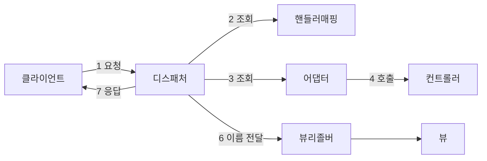
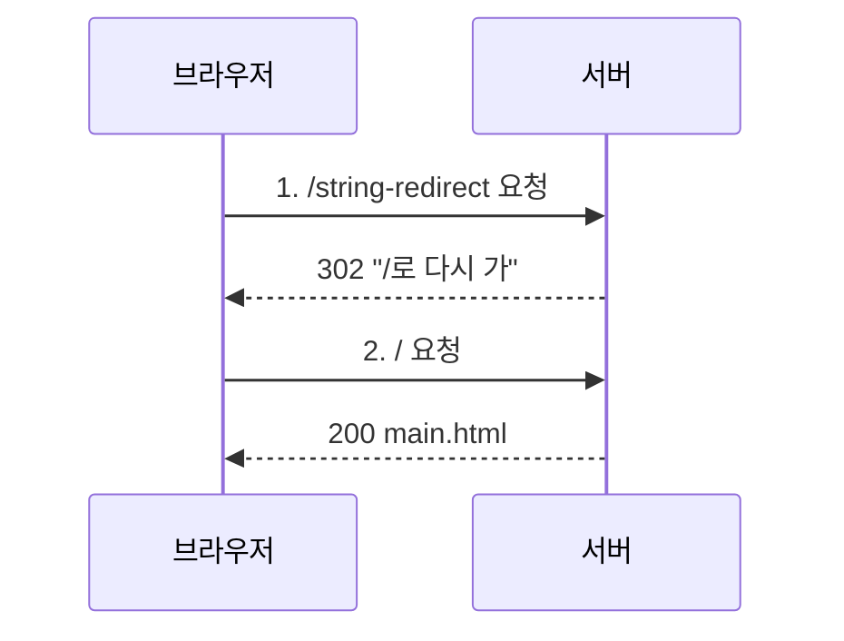
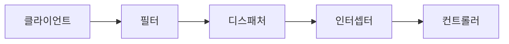

이 글은 스프링이 컨트롤러의 반환값으로 화면을 찾는 방법(ViewResolver), redirect와 값 유지, ModelAndView, 예외 처리(@ExceptionHandler, @ControllerAdvice), 인터셉터를 한 번에 정리한 글이다.

2026년 10월 29일 수업에서 진행한 내용을 정리했다.

## 이게 없으면 뭐가 불편할까

식당에서 손님이 "김치찌개 주세요"라고 주문했다고 해 보자. 주방장이 찌개를 끓여도, 그걸 어떤 그릇에 담아 어느 테이블로 가져갈지 정해 주는 사람이 없으면 손님은 음식을 받지 못한다.

웹도 비슷하다. 컨트롤러가 일을 끝내도 "이제 어떤 화면을 보여 줄지"를 찾아 주는 장치가 필요하다. 일을 하다가 문제가 생기면 "죄송합니다" 화면을 보여 주는 장치도 필요하다. 모든 주문 앞뒤에서 시간을 재는 것처럼, 여러 요청에 공통으로 해야 하는 일을 맡는 장치도 있으면 좋다.

이번 수업에서는 이 세 가지를 차례로 배웠다.

| 하고 싶은 일 | 스프링이 주는 도구 |
|--------------|---------------------|
| 컨트롤러가 돌려준 이름으로 화면 찾기 | ViewResolver |
| 에러가 났을 때 보여 줄 화면 정하기 | `@ExceptionHandler`, `@ControllerAdvice` |
| 컨트롤러 앞뒤에서 공통 작업하기 | 인터셉터(`HandlerInterceptor`) |

## 먼저, 실습은 어떻게 준비했을까

주제마다 IntelliJ에서 Spring Boot 프로젝트를 새로 만들었다. 설정은 세 프로젝트 모두 같았다.

| 항목 | 값 |
|------|----|
| 언어 | Java |
| 빌드 도구(타입) | Gradle - Groovy |
| JDK / Java 버전 | Temurin 21 / 21 |
| 패키지 생성 | Jar |
| 설정 파일 형식(구성) | YAML |
| 추가한 의존성 | Spring Web, Thymeleaf |

**의존성**은 내 프로젝트가 가져다 쓰는 외부 라이브러리다. Spring Web은 웹 요청을 받는 기능을, Thymeleaf(타임리프)는 HTML에 서버 데이터를 끼워 넣는 기능을 준다.

| 프로젝트 이름 | 다룬 내용 |
|---------------|-----------|
| `chap03-view-resolver` | 뷰 이름 반환, redirect, flash attribute, ModelAndView |
| `chap04-exception-handler` | `@ExceptionHandler`, 사용자 정의 예외, `@ControllerAdvice` |
| `chap05-interceptor` | 인터셉터로 핸들러 메서드 실행 시간 재기 |

---

## 1. static과 templates — 왜 main.html은 404가 났을까?

### 어제 배운 것부터 다시 보기

어제는 `resources/static` 폴더 안에 `index.html`을 넣었다. 그랬더니 서버를 실행하자마자 `localhost:8080`에서 그 화면이 바로 떴다.

이렇게 주소에 아무 경로도 안 붙였을 때 처음 보여 주는 화면을 **웰컴 페이지(welcome page)** 라고 부른다. 가게 문을 열면 처음 보이는 안내판 같은 것이다.

### index.html 말고 main.html을 첫 화면으로 쓰고 싶다면?

이번에는 `index.html` 대신 `main.html`을 첫 화면으로 쓰고 싶었다. 그래서 `resources/templates` 폴더에 `main.html`을 만들었다.

```html
<!DOCTYPE html>
<html lang="en">
<head>
    <meta charset="UTF-8">
    <title>Title</title>
</head>
<body>
    <h1>어플리케이션 Main 페이지!</h1>
</body>
</html>
```

그런데 실행하고 `localhost:8080`에 들어가니 에러 화면이 나왔다.

```text
Whitelabel Error Page
This application has no explicit mapping for /error, so you are seeing this as a fallback.
There was an unexpected error (type=Not Found, status=404).
```

404는 "찾는 페이지가 없다"는 뜻이다. `/`라는 주소로 들어왔을 때 `main.html`을 보여 달라고 **경로를 지정해 주지 않았기** 때문이다. 스프링은 `main`이라는 이름을 알아서 첫 화면으로 삼지 않는다.

### 경로를 직접 연결해 주기 — MainController

그래서 `/`와 `/main` 요청을 받아 `main.html`을 보여 주는 컨트롤러를 만들었다. 컨트롤러는 "이 주소로 요청이 오면 이 메서드를 실행해"라고 정해 두는 클래스다.

```java
@Controller
public class MainController {
    // {} 내부에는 여러 경로를, 기준으로 작성할 수 있다.
    @RequestMapping(value={"/", "/main"})   // 중괄호 작성하면 여러 개 가능
    public String mainPage() {
        System.out.println("main 페이지 핸들러메서드 동작함..");
        return "main";
    }
}
```

`@RequestMapping`의 `value`에 중괄호로 경로를 여러 개 적으면, 그중 어느 주소로 들어와도 같은 메서드가 실행된다.

`index.html`은 웰컴 페이지라서 경로가 `/`로 생략되어 있는 셈이다. `main.html`은 그런 특별 대우가 없으니 이렇게 `"/"`를 직접 적어 줘야 한다.

### static과 templates는 무엇이 다를까?

| 폴더 | 성격 | 할 수 있는 것 |
|------|------|---------------|
| `static` | 정적인 파일. 미리 만들어 둔 그대로 보낸다 | 서버가 데이터베이스에서 꺼낸 값을 넣을 수 없다 |
| `templates` | 동적인 파일. 서버가 값을 채워 넣은 뒤 보낸다 | 데이터베이스에서 꺼낸 값을 화면에 넣을 수 있다. 예: 공지사항 띄우기 |

인쇄된 전단지와 빈칸이 있는 양식에 비유할 수 있다. 전단지(`static`)는 누가 받든 내용이 똑같다. 양식(`templates`)은 서버가 빈칸을 채워서 건네주니 사람마다, 때마다 내용이 달라질 수 있다.

비유에는 한계가 있다. 양식은 사람이 손으로 채우지만, 템플릿은 타임리프 같은 템플릿 엔진이 자동으로 채운다.

수업 그림에서는 컨트롤러가 `static` 폴더의 파일을 뷰로 돌려주는 쪽에 X 표시가 되어 있었다. 컨트롤러가 이름을 돌려주면 찾는 곳은 `templates`라는 뜻이다. 이 부분은 2절에서 이어진다.

> 한 줄 요약: `static/index.html`은 경로 없이도 첫 화면이 되지만, `templates`의 다른 파일은 컨트롤러로 경로를 직접 연결해야 한다.

---

## 2. DispatcherServlet과 ViewResolver — 요청은 어떻게 화면이 될까?

### 한 문장으로 말하면

큰 회사의 안내 데스크를 떠올려 보자. 손님은 담당자를 직접 찾지 않는다. 안내 데스크가 "이 일은 3층 담당자에게"라고 연결해 주고, 결과물도 안내 데스크를 거쳐 손님에게 간다.

스프링 MVC에서 이 안내 데스크가 **DispatcherServlet(디스패처 서블릿)** 이다. 공식 문서는 이것을 프런트 컨트롤러(front controller)라고 부른다. 모든 요청을 한곳에서 받고, 실제 일은 다른 구성 요소에게 나눠 준다는 뜻이다.

그 구성 요소 중 하나가 **ViewResolver(뷰 리졸버)** 다. 컨트롤러가 돌려준 `"result"` 같은 **논리적인 뷰 이름**을 실제 화면 파일로 바꿔 준다. 공식 문서에서도 ViewResolver는 뷰 이름과 실제 뷰를 연결해 주는 역할이라고 설명한다.

비유의 한계도 있다. 안내 데스크 직원은 눈에 보이지만, DispatcherServlet과 ViewResolver는 스프링이 알아서 만들어 두기 때문에 내 코드에는 한 줄도 등장하지 않는다.

### 그림으로 보기



요청은 디스패처 서블릿을 중심으로 핸들러 매핑, 어댑터, 컨트롤러, 뷰 리졸버를 차례로 거친 뒤 다시 클라이언트로 돌아간다.

### 단계별로 보면

수업 자료의 흐름을 내 말로 정리하면 이렇다.

1. **요청 받기** — 브라우저가 보낸 HTTP 요청은 가장 먼저 DispatcherServlet에 도착한다.
2. **핸들러 찾기** — DispatcherServlet은 `HandlerMapping`(주소와 메서드를 짝지어 둔 목록)을 뒤져서, 요청 주소와 HTTP 메서드(GET, POST 등)에 맞는 컨트롤러 메서드를 찾는다. 이 메서드를 **핸들러**라고 부른다.
3. **어댑터 찾기** — 찾은 핸들러를 실제로 실행해 줄 `HandlerAdapter`를 고른다. 핸들러 종류에 따라 맞는 어댑터가 다르다.
4. **핸들러 호출** — 어댑터가 컨트롤러 메서드를 실행한다. 이때 비즈니스 로직이 돌고, 화면에 넘길 데이터(모델)가 만들어진다.
5. **결과 돌려주기** — 어댑터가 결과를 DispatcherServlet에 돌려준다. 결과는 두 가지 중 하나다.
   - 템플릿 기반 응답: 화면 이름과 데이터를 `ModelAndView`로 감싸서 돌려준다.
   - 데이터 기반 응답: 객체를 그대로 돌려준다.
6. **응답 만들기**
   - 템플릿 기반이면 ViewResolver가 뷰 이름에 맞는 실제 `View`를 찾고, `View`가 모델 데이터를 채워 HTML을 만든다.
   - 데이터 기반이면 `HttpMessageConverter`가 객체를 JSON, XML 같은 형태로 바꿔 응답 본문에 넣는다.
7. **응답 보내기** — 완성된 HTML이나 JSON을 클라이언트에게 돌려준다.

이 글에서 다루는 예제는 모두 6번의 템플릿 기반 응답이다.

> 한 줄 요약: 요청은 DispatcherServlet이 받아서 나눠 주고, 컨트롤러가 돌려준 뷰 이름은 ViewResolver가 실제 화면으로 바꾼다.

---

## 3. 문자열로 뷰 이름 반환하기 — 컨트롤러는 화면을 어떻게 고를까?

### 먼저 버튼부터 만들었다

`main.html`을 이렇게 바꿨다. 버튼을 누르면 `location.href`로 해당 주소에 요청을 보낸다.

```html
<body>
<hr>
<h3>문자열로 뷰 이름 반환하기</h3>
<button onclick="location.href='string'">문자열로 뷰 반환</button>
<hr>
<h3>문자열로 redirect 하기</h3>
<button onclick="location.href='string-redirect'">문자열로 뷰 반환하면서 redirect</button>
<hr>
<h3>문자열로 redirect 하면서 값을 유지하기!</h3>
<button onclick="location.href='string-redirect-attr'">문자열로 뷰 반환하면서 redirect && flashAttribute</button>
</body>
```

첫 번째 버튼을 누르니 `localhost:8080/string`에서 다시 404가 났다. `/string` 요청을 처리할 컨트롤러가 아직 없기 때문이다.

### 컨트롤러가 맡는 일

`ResolverController`를 새로 만들고, 맨 위에 수업에서 배운 내용을 주석으로 정리했다.

```java
@Controller
public class ResolverController {

    /* comment.
        Spring 에서 @Controller 는 View 를 반환해야 하는 책임을 가지고 있다.
        -----
        Controller 의 책임
        1. 사용자의 요청 수락 2. 비즈니스 로직 수락 3. 요청 쪽에 어떤 화면을 보여줘야 할까
        ------
        View 를 반환하는 방법은 3가지가 있다.
        1. 반환타입 void : 사용자가 요청한 url이 곧 view 의 경로가 된다.
        2. 반환타입 String : 문자열 리턴값이 곧 view 의 경로가 된다.
        3. 반환타입 ModelAndView : setViewName("문자열"); 문자열이 곧 view 경로가 된다.
     */
```

컨트롤러는 식당의 주문 담당과 비슷하다. 주문을 받고(요청 수락), 주방에 넘기고(비즈니스 로직), 어떤 그릇에 담아 낼지 정한다(화면 선택).

뷰를 정하는 방법 세 가지 중 이번에 직접 해 본 것은 `String`과 `ModelAndView`다. `void`는 주석으로만 배웠다. 공식 문서를 보면 `void`를 쓰고 응답을 직접 쓰지 않은 HTML 컨트롤러는 요청 주소로 기본 뷰 이름을 정한다고 설명한다. 주석의 "요청한 url이 곧 view의 경로"와 같은 이야기다.

### 직접 해보기 — String으로 뷰 이름 돌려주기

```java
    @GetMapping("/string")
    public String stringView(Model model) {

        model.addAttribute("forwardMessage", "문자열로 View 반환");

        // ViewResolver 객체는 우리 눈에는 보이지 않는다.
        // 접두사로 resources/templates
        // 접미사로 .html 을 붙여주게 된다.
        // resources/templates/result.html -> 최종구조가 이렇게 된다.
        return "result";
    }
```

여기서 새로 나온 것이 두 개다.

- **Model** — 컨트롤러가 화면에 넘길 데이터를 담는 바구니다. `addAttribute("이름", 값)`으로 담는다.
- **접두사와 접미사** — ViewResolver는 `"result"` 앞에 `templates/` 경로를, 뒤에 `.html`을 붙인다. 그래서 실제로 찾는 파일은 `resources/templates/result.html`이 된다.

Spring Boot 공식 문서에서도 타임리프 같은 템플릿 엔진을 기본 설정으로 쓰면 템플릿을 `src/main/resources/templates`에서 자동으로 찾는다고 설명한다.

이제 `templates`에 `result.html`을 만들고, 서버가 보낸 값을 보여 준다.

```html
<body>
    <h3 th:text="${forwardMessage}">wefefwfe</h3>
</body>
```

`th:text`는 타임리프 문법이다. `${forwardMessage}`는 "Model에 `forwardMessage`라는 이름으로 담긴 값을 꺼내라"는 뜻이다.

### 여기서 많이들 헷갈린다 — 태그 안에 쓴 글자는 어디로 갔을까?

위 코드에서 `<h3>` 안에 `wefefwfe`라고 적어 두었다. 그런데 화면에는 이 글자가 보이지 않고 "문자열로 View 반환"만 보인다.

타임리프 공식 문서에 따르면 `th:text`는 계산한 값을 그 태그의 내용으로 넣으면서 원래 있던 내용을 **바꿔치기**한다. 그래서 한 줄에 타임리프 문법을 쓰면, 시작 태그 안에 쓴 `th:text`의 값만 나온다.

> 한 줄 요약: 컨트롤러가 `"result"`를 돌려주면 ViewResolver가 `templates/result.html`을 찾고, `th:text`가 Model의 값으로 태그 내용을 바꾼다.

---

## 4. redirect — 왜 굳이 다시 요청하게 만들까?

### 한 문장으로 말하면

택배를 보내려고 우체국에 갔는데, 직원이 "택배는 옆 건물 창구로 가세요"라고 알려 준다고 해 보자. 나는 옆 건물로 **다시 가서** 새로 접수한다.

**redirect(리다이렉트)** 가 이렇다. 서버가 브라우저에게 "이 주소로 다시 요청해"라고 답하고, 브라우저가 그 주소로 새 요청을 보낸다.

반대로 지금까지 한 방식은 직원이 내 택배를 받아서 안에서 알아서 처리해 주는 것과 비슷하다. 나는 창구를 한 번만 들른다. 수업에서는 이것을 **forward(포워드)** 방식이라고 불렀다.

비유의 한계도 있다. 사람은 "옆 건물로 가세요"를 듣고 안 갈 수도 있다. 브라우저는 redirect 응답을 받으면 사용자가 아무것도 안 해도 자동으로 새 주소에 요청한다.

### 직접 해보기

```java
    @GetMapping("/string-redirect")
    public String redirect() {
        /* comment.
            Spring 에서 view 리턴 시 기본 방식은
            forward 방식이다.
            만약 redirect 가 필요하다면 문자열에 접두사로 redirect:{보낼 URL} 을 붙여주어야 한다.
         */

        return "redirect:/";
    }
```

`redirect:` 뒤에 적은 주소가 브라우저가 다시 찾아갈 주소다. 여기서는 `/`라서 `MainController`가 다시 `main.html`을 보여 준다. 그래서 버튼을 누르면 다른 화면으로 가지 않고 메인 화면으로 돌아온 것처럼 보였다. 노트에는 "리다이렉트는 마지막에 쓴 url로 다시 돌아온다"고 적어 두었다.

공식 문서에서도 뷰 이름이 `redirect:`로 시작하면 redirect가 필요하다는 신호로 알아듣고, 나머지 부분을 redirect할 주소로 쓴다고 설명한다.

### 개발자 도구로 확인해 보기

브라우저 개발자 도구의 Network 탭에서 버튼을 눌러 보았다.

| 이름 | 상태 코드 | 종류 |
|------|-----------|------|
| `string-redirect` | 302 | document / Redirect |
| `localhost` | 200 | document |

요청이 **두 번** 일어났다. 첫 번째 `string-redirect` 요청에는 302가 돌아왔다. 302는 "다른 주소로 다시 가 봐"라는 뜻의 상태 코드다. 그다음 브라우저가 스스로 `/`(localhost)에 두 번째 요청을 보내 200(성공)을 받았다.

### forward와 redirect는 로그에서 어떻게 달랐을까?

차이를 확인하려고 두 메서드에 "회원가입을 했다"고 가정한 코드를 넣었다.

```java
    @GetMapping("/string")
    public String stringView(Model model) {

        model.addAttribute("forwardMessage", "문자열로 View 반환");

        /* 가정 1. 해당 메서드 내부에서 회원가입이 로직 수행 */
        // service.registMember(); insert
        System.out.println("회원가입 완료!!!!!");

        return "result";
    }

    @GetMapping("/string-redirect")
    public String redirect() {

        /* 가정 1. 해당 메서드 내부에서 회원가입이 로직 수행 */
        // service.registMember(); insert
        System.out.println("회원가입 완료!!!!!");

        return "redirect:/";
    }
```

결과는 이랬다.

- **forward 방식(`/string`)** — 로그에 "회원가입 완료"가 계속 찍혔다. 결과 화면을 보는 동안에도 주소창은 `/string` 그대로다. 그래서 같은 요청이 다시 가면(예를 들어 새로고침) 회원가입 코드도 다시 실행된다.
- **redirect 방식(`/string-redirect`)** — 한 번 요청에 로그가 한 번만 찍혔다. 마지막 주소가 `/`(메인)로 바뀌었기 때문이다. 버튼을 누를 때마다 로그가 나오는 것은 버튼을 누를 때마다 새로 요청했기 때문이다.

회원가입이나 주문처럼 데이터를 바꾸는 요청은 끝난 뒤 redirect로 다른 주소에 보내는 편이 안전하다. 같은 요청이 실수로 두 번 가서 회원이 두 번 등록되는 일을 막을 수 있기 때문이다.



redirect는 브라우저와 서버가 요청과 응답을 두 번 주고받는다.

> 한 줄 요약: forward는 요청 한 번으로 서버 안에서 화면을 만들고, redirect는 `redirect:주소`로 브라우저가 그 주소에 다시 요청하게 한다.

---

## 5. addFlashAttribute — redirect 하면서 값을 유지하려면?

### 왜 필요할까

redirect는 요청이 두 번 일어난다. 수업 그림은 이 문제를 이렇게 보여 줬다.

1. `string-redirect` 요청에서 `model.addAttribute("Test", "test")`로 값을 담는다.
2. `return "redirect:/"`로 응답이 한 번 끝난다.
3. 브라우저가 `/`로 **새 요청**을 보낸다.

Model은 요청 한 번 동안만 살아 있는 바구니다. 1번 요청에서 담은 값은 3번 요청에서 쓸 수 없다. 택배 창구에서 받은 번호표를 옆 건물 창구는 모르는 것과 같다.

### 한 문장으로 말하면

**flash attribute(플래시 속성)** 는 redirect 다음 요청 딱 한 번만 쓰고 사라지는 값이다. 카메라 플래시처럼 한 번 번쩍하고 끝난다고 생각하면 된다.

공식 문서에 따르면 flash attribute는 redirect 직전에 보통 세션에 잠깐 저장된다. 세션은 서버가 사용자별로 값을 기억해 두는 공간이다. redirect 뒤 요청에서 그 값을 Model에 넣어 준 다음, 바로 지운다.

비유의 한계도 있다. 플래시는 누구나 보지만, flash attribute는 redirect로 도착한 그 요청에서만 꺼낼 수 있다.

### 직접 해보기

```java
    @GetMapping("/string-redirect")
    public String redirect(RedirectAttributes rttr) {

        /* 가정 1. 해당 메서드 내부에서 회원가입이 로직 수행 */
        // service.registMember(); insert
        System.out.println("회원가입 완료!!!!!");

        /* comment.
            redirect 시에는 2번의 요청이 발생한다.
            그렇기 때문에 최초에 model 에 담아둔 값은 재요청 시 소멸이 되며 / 요청에서는 사용할 수 없게 된다.
            따라서 redirect 시 전달해 줄 값이 있다면 Servlet 개념인 session 과 cookie 를 사용해야 한다.
            Spring 에서는 RedirectAttributes 라는 객체를 통해서 redirect 시 값을 저장할 수 있는 방법을 제공해준다.
         */

        //model.addAttribute("forwardMessage","문자열로 View 반환");  -> 리다이렉트 시에는 의미가 없음.
        // session 처럼 값을 저장할 수 있지만, 금방 소멸시켜버림
        rttr.addFlashAttribute("flashMessage", "리다이렉트된 페이지에서도 유지되는 값");

        return "redirect:/";
    }
```

메서드 매개변수로 `RedirectAttributes`를 받고, `addFlashAttribute("이름", 값)`으로 담는다. 공식 문서에서도 이렇게 담은 값은 redirect 뒤 컨트롤러의 Model에 자동으로 들어간다고 설명한다.

### 노트에서 맞지 않는 부분

정리하면서 다시 보니 노트 안에서 서로 맞지 않는 곳이 있었다.

- `main.html`의 세 번째 버튼은 `string-redirect-attr`로 요청한다. 그런데 `RedirectAttributes`를 쓴 메서드의 주소는 `/string-redirect`로 되어 있다. 앞에서 만든 `redirect()` 메서드를 고친 것으로 보인다. 버튼과 연결하려면 주소를 `/string-redirect-attr`로 바꿔야 한다.
- 노트의 `main.html`에는 `${forwardMessage}`를 보여 주는 줄만 있고, `${flashMessage}`를 꺼내 보여 주는 코드는 없다. flash 값을 화면에서 확인하려면 `main.html`에 그 값을 보여 주는 태그가 따로 필요하다.

> 한 줄 요약: redirect하면 Model 값은 사라진다. 다음 요청까지 값을 넘기려면 `RedirectAttributes.addFlashAttribute()`를 쓴다.

---

## 6. ModelAndView — 데이터와 화면을 한 번에 담으려면?

### 한 문장으로 말하면

도시락을 떠올려 보자. 반찬(데이터)과 도시락통(화면)을 따로 들고 가는 대신, 반찬을 통에 담아 하나로 들고 간다.

**ModelAndView**는 Model(데이터)과 View(화면 이름)를 하나의 객체에 함께 담는 방법이다. 공식 문서에서도 ModelAndView는 사용할 뷰와 모델 데이터를 함께 담는 반환 타입이라고 설명한다.

비유의 한계도 있다. 도시락통은 실제 그릇이지만, ModelAndView에 담는 것은 화면 파일 자체가 아니라 `"result"` 같은 **이름**이다. 실제 파일은 여전히 ViewResolver가 찾는다.

### 직접 해보기

`main.html`에 버튼을 하나 더 추가했다.

```html
<h3>ModelAndView 객체로 화면 지정하기</h3>
<button onclick="location.href='modelAndView'">ModelAndView </button>

<h3 th:text="${forwardMessage}"></h3>
```

```java
    @GetMapping("modelAndView")     //데이터 집어넣고, 화면도 집어넣는다 -> ModelAndView /
    // 데이터 집어넣고, 화면 집어넣을 것 없다? void
    public ModelAndView modelAndView(ModelAndView mv) {
        //값을 집어넣을 때는 addObject 로 집어넣음.
        mv.addObject("forwardMessage", "MV 활용 뷰와 데이터");
        mv.setViewName("result");       //뷰 이름 설정

        return mv;
    }
```

- `addObject("이름", 값)` — Model의 `addAttribute`처럼 데이터를 담는다.
- `setViewName("result")` — 보여 줄 화면 이름을 정한다. 이것도 `templates/result.html`이 된다.

`result.html`은 3절에서 만든 것을 그대로 쓴다. 이번에는 `forwardMessage`에 "MV 활용 뷰와 데이터"가 담겨 간다.

### forward, redirect, ModelAndView는 무엇이 다를까?

노트에 복습 포인트로 적어 둔 부분이다. 세 가지는 같은 종류가 아니라서 헷갈리기 쉽다. forward와 redirect는 **화면으로 가는 방식**이고, ModelAndView는 **뷰를 돌려주는 반환 타입**이다.

| 구분 | 쓰는 코드 | 요청 횟수 | Model 값 | 이 글의 예 |
|------|-----------|-----------|----------|------------|
| forward (String 반환) | `return "result";` | 1번 | 화면에서 쓸 수 있다 | `/string` |
| redirect | `return "redirect:/";` | 2번 | 사라진다. flash attribute로 넘긴다 | `/string-redirect` |
| ModelAndView | `mv.setViewName("result");` | 1번 (forward와 같다) | `addObject`로 담은 값을 쓸 수 있다 | `/modelAndView` |

ModelAndView도 뷰 이름에 `redirect:`를 붙이면 redirect가 된다. 이 부분은 수업에서 직접 해 보지는 않았다.

> 한 줄 요약: ModelAndView는 데이터와 뷰 이름을 한 객체에 담아 돌려주는 방법이다. forward·redirect는 화면으로 가는 방식이라 서로 비교하는 축이 다르다.

---

## 7. @ExceptionHandler — 에러가 나면 어떤 화면을 보여 줄까?

### 왜 필요할까

코드에서 예외가 터지면 스프링은 기본으로 흰 바탕의 에러 화면(Whitelabel Error Page)을 보여 준다. 사용자 입장에서는 영어로 된 에러 메시지만 보이니 당황스럽다.

**예외**는 프로그램이 실행 중에 만난 예상 못 한 문제다. 예외가 났을 때 "많이 놀라셨죠? 죄송합니다" 같은 친절한 화면을 보여 주고 싶다. 이것을 **예외 처리**라고 부른다.

### 실습 준비

`chap04-exception-handler` 프로젝트의 `static/index.html`에 버튼을 만들었다.

```html
<body>
    <h1>Exception Handler</h1>
    <hr>
    <h3>@ExceptionHandler 어노테이션 활용!</h3>
    <button onclick="location.href='nullpointer'">NullPointer 발생 시 예외처리하기!</button>
    <button onclick="location.href='userexception'">사용자 정의의 예외 발생 시 예외처리하기!</button><hr>
    <h3>@ControllerAdvice 어노테이션 활용</h3>
    <button onclick="location.href='global-nullpointer'">전역 - NullPointer 발생 시 예외처리하기!</button>
    <button onclick="location.href='global-userexception'">전역 - 사용자 정의의 예외 발생 시 예외처리하기!</button><hr>
    <button onclick="location.href='global-default'">전역 Default 예외 처리!</button><hr>
</body>
```

### 일부러 예외 만들기

예외를 테스트할 `ExceptionTestController`를 만들고, 일부러 NullPointerException을 냈다. **NullPointerException**은 비어 있는 값(`null`)으로 무언가를 하려고 할 때 나는 예외다. 빈 상자에서 물건을 꺼내려는 것과 같다.

```java
@Controller
public class ExceptionTestController {

    @GetMapping("nullpointer")
    public String nullPointer() {

        // 고의적으로 에러를 발생시킴
        String str = null;
        System.out.println(str.toLowerCase(Locale.ROOT));

        // 위 16번 줄이 실행되면 NullPointerException 줄이 실행된다.

        return "/";
    }
```

`str`이 `null`인데 `toLowerCase()`를 부르니 이 줄에서 예외가 난다. 그래서 `return "/"`까지 가지 못한다.

### 한 문장으로 말하면

119 신고 전화를 떠올려 보자. "불이 났다"는 종류의 사고가 생기면 정해진 소방서로 연결된다.

**`@ExceptionHandler`** 는 "이 종류의 예외가 나면 이 메서드가 처리한다"고 정해 두는 어노테이션이다. 괄호 안에 처리할 예외 클래스를 적는다.

비유의 한계도 있다. 119는 전국 어디서 걸어도 연결되지만, 컨트롤러 안에 만든 `@ExceptionHandler`는 **그 컨트롤러 안에서 난 예외만** 받는다. 이 차이가 9절의 핵심이다.

### 직접 해보기

```java
    //예외가 발생했을 때 어떤 식으로 처리할까
    @ExceptionHandler(NullPointerException.class)
    public String nullHandler(Model model, NullPointerException e) {
        model.addAttribute("key", e.getMessage());

        return "error/nullPointer";
    }
```

- 매개변수 `NullPointerException e`로 실제 난 예외 객체를 받는다.
- `e.getMessage()`는 예외에 담긴 설명 글이다. 이것을 Model에 `key`라는 이름으로 담았다.
- `"error/nullPointer"`를 돌려주면 ViewResolver가 `templates/error/nullPointer.html`을 찾는다. 2절의 규칙이 그대로 적용된다.

`templates` 안에 `error` 폴더를 만들고 `nullPointer.html`을 작성했다.

```html
<body>
    <h3>많이 놀라셨죠?</h3>
    <h4>죄송합니다.</h4>
    <h4 th:text="${key}"></h4>
</body>
```

> 한 줄 요약: `@ExceptionHandler(예외.class)`를 붙인 메서드는 그 예외가 났을 때 대신 실행되어 에러 화면을 정해 준다.

---

## 8. 사용자 정의 예외 — 내가 만든 예외도 처리할 수 있을까?

### 왜 필요할까

자바가 미리 만들어 둔 예외만으로는 "회원을 못 찾았다" 같은 우리 서비스만의 상황을 표현하기 어렵다. 그래서 예외 클래스를 직접 만든다. 이것을 **사용자 정의 예외**라고 부른다.

### 직접 해보기

먼저 예외 클래스를 만들었다.

```java
public class MemberNotFoundException extends Throwable {
    public MemberNotFoundException(String 아프지_말자_우리) {
        super(아프지_말자_우리);
    }
}
```

`super(...)`로 넘긴 글자가 나중에 `e.getMessage()`로 꺼내지는 메시지가 된다. 노트에서는 매개변수 이름이 한글(`아프지_말자_우리`)로 되어 있다. 자바는 한글 변수 이름도 허용하지만, 보통은 `message`처럼 짓는다.

컨트롤러에서는 이 예외를 일부러 던진다. **throw**는 예외를 직접 발생시키는 키워드다.

```java
    @GetMapping("userexception")
    public String userException() throws MemberNotFoundException {
        boolean check = true;
        if(check) {
            throw new MemberNotFoundException("아프지 말자 우리");
        }

        return "/";
    }

    //MemberNotFoundException 이 발생하면 처리할 핸들러 메서드 생성
    @ExceptionHandler(MemberNotFoundException.class)
    public String userException(Model model, MemberNotFoundException e) {
        model.addAttribute("key", e.getMessage());

        return "error/nullPointer";
    }
```

메서드 선언에 `throws MemberNotFoundException`을 붙였다. 이 예외는 "이 메서드가 던질 수 있다"고 미리 알려 줘야 하는 종류라서, 이것이 없으면 컴파일 에러가 난다.

처리하는 화면은 새로 만들지 않고 앞에서 만든 `error/nullPointer.html`을 다시 썼다. 그래서 화면에는 "아프지 말자 우리"가 `${key}` 자리에 나온다.

### 여기서 많이들 헷갈린다 — Throwable과 Exception

노트의 예외 클래스는 `Throwable`을 상속했다. `Throwable`은 자바의 모든 예외와 에러의 맨 위 부모다. 그 아래로 `Exception`(프로그램에서 처리할 수 있는 예외)과 `Error`(메모리 부족처럼 프로그램이 손쓰기 어려운 심각한 문제)가 나뉜다.

[자바 공식 튜토리얼](https://docs.oracle.com/javase/tutorial/essential/exceptions/definition.html)도 직접 만드는 예외는 보통 `Exception`을 상속하는 쪽으로 설명한다. `Throwable`을 바로 상속하면 10절의 `@ExceptionHandler(Exception.class)`에도 걸리지 않는다. `Exception`의 자식이 아니기 때문이다. 아래는 이해를 돕기 위한 예시 코드다.

```java
// 예시 코드
public class MemberNotFoundException extends Exception {
    public MemberNotFoundException(String message) {
        super(message);
    }
}
```

> 한 줄 요약: 예외 클래스를 직접 만들어 `throw`로 던지고, `@ExceptionHandler`로 받아서 처리할 수 있다.

---

## 9. @ControllerAdvice — 다른 컨트롤러에서도 예외 처리를 쓰려면?

### 다른 컨트롤러에서는 예외 처리가 될까?

이번에는 `GlobalTestController`를 새로 만들어서 똑같이 NullPointerException을 냈다. 일부러 이 클래스 안에는 예외 처리 메서드를 만들지 않았다.

```java
@Controller
public class GlobalTestController {

    /* comment.
        ExceptionTestController에서 작성해둔 null-pointer예외처리 핸들러가 동작하지 않는다.
        -----
        why?
        : 이 클래스는 다른 클래스에 있는 메서드를 모름. 알려줘야 알 수 있다.
        == 다른 클래스 내부에 있는 메서드는 알 수 없다.
     */
    @GetMapping("global-nullpointer")
    public String globalNull() {
        String str = null;
        System.out.println(str.toLowerCase(Locale.ROOT));
        return "/";
    }
}
```

실행해 보니 예외 처리 화면이 아니라 이 화면이 나왔다.

```text
Whitelabel Error Page
There was an unexpected error (type=Internal Server Error, status=500).
```

500은 "서버 안에서 처리하지 못한 문제가 났다"는 뜻이다. `ExceptionTestController`에 만든 `@ExceptionHandler`가 **전역으로 적용되지 않았다.**

공식 문서에서도 `@ExceptionHandler` 메서드는 원래 그 메서드를 선언한 컨트롤러 클래스 안에서만 적용된다고 설명한다. 7절의 119 비유에서 말한 한계가 이것이다.

### 한 문장으로 말하면

반마다 담임 선생님이 있지만, 어느 반에서 다쳐도 갈 수 있는 보건실도 있다.

**`@ControllerAdvice`** 는 이 보건실 같은 클래스다. 여기에 모아 둔 `@ExceptionHandler`는 모든 컨트롤러에 적용된다. 이렇게 앱 전체에 적용되는 것을 **전역**이라고 부르고, 한 클래스 안에서만 적용되는 것을 **지역**이라고 부른다.

비유의 한계도 있다. 보건실은 학생이 직접 찾아가야 하지만, `@ControllerAdvice`는 예외가 나면 스프링이 알아서 연결해 준다.

### 직접 해보기

`GlobalExceptionHandler` 클래스를 만들었다. 여기에는 예외 처리 핸들러 메서드만 모아 둔다.

```java
/* comment.
    Advice 는 AOP 챕터에서 반복적으로 동작해야 하는 코드를 뭉쳐둔
    메서드를 지칭하는 단어였다.
    @ControllerAdvice 공통으로 발생할 수 있는
    예외처리 핸들러를 묶어둔 클래스를 지칭한다.
 */

// 컨트롤러에서 예외가 발생했을 때 얘가 조언을 해 줌. (대신 처리)
@ControllerAdvice
public class GlobalExceptionHandler {

    //예외가 발생했을 때 어떤 식으로 처리할까
    @ExceptionHandler(NullPointerException.class)
    public String nullHandler(Model model, NullPointerException e) {
        System.out.println("전역 예외처리 핸들러 동작");
        model.addAttribute("key", e.getMessage());

        return "error/nullPointer";
    }
}
```

`ExceptionTestController`에 있던 null 처리 메서드를 그대로 가져와 `println` 한 줄을 더했다. 이제 `GlobalTestController`에서 난 NullPointerException도 여기서 처리된다.

### 지역과 전역이 둘 다 있으면 누가 먼저일까?

`ExceptionTestController`에는 지역 핸들러가, `GlobalExceptionHandler`에는 전역 핸들러가 둘 다 있다. 노트에 이렇게 적었다.

```java
/*comment. 예외처리 핸들러는 우선순위가 존재한다.
  같은 클래스 내부에 있는 핸들러 > 전역 핸들러
  == 지역이 훨씬 우선순위 높음!!!! */
```

공식 문서도 같은 내용이다. `@ControllerAdvice`의 전역 `@ExceptionHandler`는 컨트롤러 안의 지역 핸들러 **다음에** 적용된다고 설명한다. 담임 선생님이 먼저 보고, 담임 선에서 해결이 안 될 때 보건실로 가는 셈이다.

여기서 하나 헷갈리기 쉽다. 노트에는 "지역 변수"라고 적은 곳이 있다. 메서드 안의 지역 변수를 말한 것이 아니라 "같은 클래스 안에 있는 핸들러"라는 뜻으로 쓴 말이다.

### 노트에서 빠진 부분

`index.html`에는 `global-userexception` 버튼이 있다. 그런데 노트에는 이 주소를 받는 컨트롤러 메서드와, 전역에서 `MemberNotFoundException`을 처리하는 코드가 없다. 실습 중에 빠졌거나 따로 다루지 않은 것으로 보인다.

> 한 줄 요약: `@ExceptionHandler`는 원래 자기 클래스 안에서만 동작한다. `@ControllerAdvice` 클래스에 모아 두면 전역이 되고, 지역 핸들러가 있으면 지역이 먼저다.

---

## 10. 부모 예외로 나머지 받기 — 예외마다 메서드를 다 만들어야 할까?

### 왜 필요할까

예외 종류는 아주 많다. 종류마다 핸들러 메서드를 하나씩 만들 수는 없다. 그래서 따로 처리하고 싶은 예외만 구체적으로 만들고, 나머지는 한꺼번에 받는 그물을 친다.

### 직접 해보기

전역 핸들러에 `Exception.class`를 받는 메서드를 추가했다. `Exception`은 대부분 예외의 부모 클래스다.

```java
    @ExceptionHandler(Exception.class)
    public String defaultException(Model model, Exception e) {
        model.addAttribute("class", e.getClass());
        model.addAttribute("message", e.getMessage());

        return "error/default";
    }
```

- `e.getClass()` — 어떤 예외 클래스가 났는지 담는다.
- `e.getMessage()` — 예외의 설명 글을 담는다.

예외가 나면 보여 줄 `templates/error/default.html`도 만들었다.

```html
<body>
    <h1>Default 예외 페이지!</h1>
    <h3 th:text="|${class} 에러 발생! |"></h3>  <!-- |~~~| -> | 는 문자열 합치기 기능이다. -->
</body>
```

`|...|`는 타임리프의 **리터럴 치환** 문법이다. 글자와 `${...}` 값을 `+` 없이 한 줄에 섞어 쓸 수 있다. 노트에는 Model에 `message`도 담았지만, `default.html`에서는 `class`만 보여 주고 있다.

이제 아무 예외나 내는 메서드를 `GlobalTestController`에 만들었다.

```java
    @GetMapping("global-default")
    public String anyException() {
        int[] iarr = new int[0];
        System.out.println(iarr[1]);

        return "/";
    }
```

길이가 0인 배열에서 1번 칸을 꺼내려 하니 `ArrayIndexOutOfBoundsException`이 난다. 이 예외를 위한 핸들러는 따로 없다. 그래서 부모인 `Exception.class` 핸들러가 받는다.

### 구체적인 예외와 부모 예외가 둘 다 맞으면?

NullPointerException도 `Exception`의 자식이다. 그러면 NullPointerException이 났을 때 `nullHandler`와 `defaultException` 중 누가 받을까?

공식 문서에 따르면 여러 핸들러가 맞을 때는 실제로 난 예외 타입과 **더 가까운 쪽**을 고른다. 그래서 NullPointerException은 `nullHandler`가, 나머지 예외는 `defaultException`이 받는다. 노트에는 이렇게 적어 두었다.

> 구체화할 예외는 구체화하고, 다른 것들은 부모한테 걸리도록 설정!

> 한 줄 요약: `@ExceptionHandler(Exception.class)`로 나머지 예외를 한꺼번에 받는다. 더 구체적인 핸들러가 있으면 그쪽이 먼저 고른다.

---

## 11. 인터셉터 — 모든 요청의 앞뒤에서 같은 일을 하려면?

### 왜 필요할까

핸들러 메서드마다 "실행 시간이 얼마나 걸렸는지"를 재고 싶다고 해 보자. 메서드마다 시작 시간과 끝 시간을 재는 코드를 넣으면 같은 코드가 수십 번 반복된다.

### 한 문장으로 말하면

공연장 입구의 검표원을 떠올려 보자. 관객이 공연장(컨트롤러)에 들어가기 전에 표를 확인하고, 나올 때 다시 한번 확인한다. 공연 내용은 몰라도 된다.

**인터셉터(interceptor)** 는 DispatcherServlet과 컨트롤러 사이에서 핸들러 메서드 **전과 후에** 끼어들어 공통 작업을 하는 장치다. 노트에는 "IoC 컨테이너 안에서 디스패처 서블릿과 컨트롤러 사이에 있는 필터 느낌"이라고 적었다.

비유의 한계도 있다. 검표원은 사람마다 따로 서 있지만, 인터셉터는 한 번 등록해 두면 정해 둔 주소의 모든 요청에 똑같이 동작한다.

### 필터와 인터셉터는 어디에 있을까?

수업 그림은 구역을 두 개로 나눴다.

1. **서블릿 컨테이너** — 웹 서버(Tomcat)의 영역이다. **필터(filter)** 는 스프링으로 들어가기 전, 웹 애플리케이션의 맨 앞 입구에 있다. 인코딩 변환이나 보안처럼 웹 요청 전체에 대한 공통 처리를 맡는다. 스프링 기능(빈 주입 등)을 바로 쓰기는 어렵다.
2. **스프링 IoC 컨테이너** — 내가 만든 Controller, Service 같은 스프링 빈이 사는 영역이다. 빈(Bean)은 스프링이 만들어서 관리해 주는 객체다.
   - DispatcherServlet은 두 컨테이너의 경계에 걸쳐서 모든 요청을 받는 중앙 창구다.
   - 인터셉터는 스프링 컨테이너 안에 있고, DispatcherServlet과 내가 만든 컨트롤러 메서드 사이에 있다.



요청은 필터를 먼저 지나고, DispatcherServlet을 거친 뒤 인터셉터를 지나 컨트롤러에 도착한다.

Tomcat과 서블릿이 처음이라면 [웹 서버, Tomcat, 서블릿 글]({{ site.baseurl }})을 먼저 보면 좋다.

| 구분 | 필터 (Filter) | 인터셉터 (Interceptor) |
|------|---------------|------------------------|
| 위치 | 서블릿 컨테이너 (스프링 밖) | 스프링 IoC 컨테이너 (스프링 안) |
| 동작 시점 | DispatcherServlet 이전 | DispatcherServlet 이후, 컨트롤러 바로 전 |
| 주로 하는 일 | 요청·응답 변환, UTF-8 인코딩, CORS 설정 등 웹 전반 처리 | 로그인·권한 확인, 컨트롤러에 넘길 데이터 가공 |
| 스프링 빈 사용 | 기본적으로 제한적 | `@Autowired` 등으로 자유롭게 사용 |
| 누구 것인가 | 서블릿 것 | 스프링 것 (그래서 빈으로 만든다) |

### 시간 재기는 왜 인터셉터로 할까?

노트에는 이렇게 적었다.

- 필터로 재면 네트워크마다 사용자의 시간이 달라진다.
- 인터셉터로 재면 순수한 코드 성능을 잴 수 있다. 네트워크 영역이 없기 때문이다.

정리하면서 조금 더 정확히 고쳐 두면 이렇다. 필터도 서버 안에서 동작하므로, 브라우저와 서버 사이의 네트워크 전송 시간을 직접 재지는 않는다. 다만 필터는 DispatcherServlet이 하는 일까지 포함한 넓은 구간을 잰다. 인터셉터는 컨트롤러 핸들러 메서드 바로 앞뒤에서 재기 때문에 **핸들러 메서드가 걸린 시간에 더 가깝다.**

> 한 줄 요약: 필터는 스프링 밖 맨 앞 입구, 인터셉터는 스프링 안에서 컨트롤러 바로 앞뒤에 있다.

---

## 12. 인터셉터 직접 만들기 — 핸들러 메서드 실행 시간 재기

### 1단계: 시간이 걸리는 핸들러 메서드

`chap05-interceptor` 프로젝트에 `InterceptorController`를 만들었다. 일부러 2초 동안 멈추게 했다.

```java
@Controller
public class InterceptorController {

    @GetMapping("stopwatch")
    public String handle() throws InterruptedException {
        System.out.println("stopwatch 요청을 처리하는 핸들러 메서드 동작...");

        //2초간 정지
        Thread.sleep(2000);

        return "result";
    }
}
```

`Thread.sleep(2000)`은 2000밀리초, 즉 2초 동안 실행을 멈춘다.

### 2단계: 인터셉터 클래스

`TimerInterceptor`를 만들고 `HandlerInterceptor` 인터페이스를 구현했다. IntelliJ의 "재정의/구현할 메서드 선택"에서 세 메서드가 보였다.

| 메서드 | 언제 실행될까 |
|--------|---------------|
| `preHandle()` | 핸들러 메서드 실행 **전** |
| `postHandle()` | 핸들러 메서드 실행 **후** |
| `afterCompletion()` | 요청 처리가 **모두 끝난 뒤** |

실습에서는 마지막 `afterCompletion()`은 지우고 두 개만 썼다.

```java
@Component
public class TimerInterceptor implements HandlerInterceptor {
    //사용자의 요청을 처리하는 핸들러 메서드

    // Interceptor 는 Controller 의 핸들러 메서드 전과 후에 동작한다.

    //컨트롤러 도달 전에 동작함
    @Override
    public boolean preHandle(HttpServletRequest request, HttpServletResponse response, Object handler) throws Exception {
        System.out.println("preHandle() 동작함..");

        long startTime = System.currentTimeMillis();
        request.setAttribute("startTime", startTime);   // 얘를 사용하기 위해서 request 에 담아놓음

        // true : 다음 인터셉터가 있다면 호출 / 없다면 컨트롤러의 핸들러 메서드 호출
        return true;
    }

    // 컨트롤러 핸들러메서드 실행 후
    @Override
    public void postHandle(HttpServletRequest request, HttpServletResponse response, Object handler, @Nullable ModelAndView modelAndView) throws Exception {
        System.out.println("postHandler() 호출됨..");
        long endTime = System.currentTimeMillis();

        long startTime = (long) request.getAttribute("startTime");

        // 컨트롤러의 마지막 동작이 뷰를 보여주는 것. 따라서 인터셉트도 ModelAndView 를 알고 있음.
        modelAndView.addObject("interval", endTime - startTime);
    }
}
```

하나씩 보면 이렇다.

- **`@Component`** — 이 클래스를 스프링 빈으로 등록한다. 인터셉터는 스프링 것이라서 빈으로 만든다. 필터는 서블릿 것이다.
- **`preHandle()`** — 시작 시간을 재서 `request`에 `startTime`으로 담는다. `preHandle()`과 `postHandle()`은 서로 다른 메서드라 지역 변수를 함께 쓸 수 없다. 그래서 요청 객체에 잠깐 맡겨 둔다.
- **`return true`** — 공식 문서에 따르면 `true`면 다음 단계로 계속 가고, `false`면 나머지를 건너뛰어 핸들러 메서드가 실행되지 않는다.
- **`postHandle()`** — 끝 시간에서 시작 시간을 빼서 걸린 시간을 구하고, `ModelAndView`에 `interval`로 담는다.

`postHandle()`의 `ModelAndView` 앞에 `@Nullable`이 붙어 있다. 값이 `null`일 수도 있다는 표시다. 화면 없이 데이터만 돌려주는 메서드라면 `modelAndView`가 없을 수 있다. 이 실습은 `"result"` 화면을 돌려주니 괜찮다.

### 3단계: 결과 화면

`templates/result.html`에 걸린 시간을 보여 준다.

```html
<body>
    <h3 th:text="| 핸들러메서드 호출 수행 시간 : ${interval} |"></h3>
</body>
```

10절에서 본 리터럴 치환 `|...|`를 다시 썼다.

### 그런데 결과가 안 뜬다?

여기까지 만들고 실행했는데 결과가 나오지 않았다. 인터셉터는 클래스를 만드는 것만으로는 동작하지 않는다. **어느 주소에 이 인터셉터를 끼울지 등록하는 설정**이 하나 더 필요하다.

### 4단계: WebConfig에 인터셉터 등록하기

`WebConfig` 클래스를 만들고 `WebMvcConfigurer`를 구현했다. IntelliJ의 메서드 선택 창에서 `addInterceptors()`를 골랐다.

```java
/* comment.
    WebMvcConfigurer
    원래는 MVC(Model/View/Controller) 였는데, 인터셉트라는 이상한 놈이 낌;;
    Spring MVC 패턴의 기본설정은 유지하며 추가적인 커스터마이징이 필요할 때 구현하는 인터페이스
    ex) 인터셉트 추가, CORS 설정, 정적 리소스 핸들링 등등
 */
@Configuration
public class WebConfig implements WebMvcConfigurer {
    // 등록할 인터셉터 객체
    private final TimerInterceptor timerInterceptor;

    //생성자를 통한 Bean 간의 의존성 주입
    @Autowired
    public WebConfig(TimerInterceptor timerInterceptor) {
        this.timerInterceptor = timerInterceptor;
    }

    @Override
    public void addInterceptors(InterceptorRegistry registry) {
        // 만들어둔 인터셉터 등록
        registry.addInterceptor(timerInterceptor)
                // 인터셉터가 동작하게 만들 URL 경로 추가 (모든 요청에 동작하게 만든다)
                .addPathPatterns("/*")
                // 인터셉터 동작 시 정적인 요소 제외
                // /** : 모든 하위 경로까지 포함하는 패턴
                .excludePathPatterns("/css/**")
                .excludePathPatterns("/images/**")
                .excludePathPatterns("/js/**")
                .excludePathPatterns("/video/**");
    }
}
```

- **`@Configuration`** — 스프링 설정을 담은 클래스라는 표시다.
- **생성자 주입** — 스프링이 빈으로 만들어 둔 `TimerInterceptor`를 생성자로 받아 온다. 직접 `new`로 만들지 않는다.
- **`addPathPatterns()`** — 인터셉터가 동작할 주소를 정한다.
- **`excludePathPatterns()`** — CSS, 이미지, JS, 영상 같은 정적 파일 요청은 시간을 잴 필요가 없으니 뺀다.

### 직접 해보기 — 실행 순서

등록한 뒤 `/stopwatch`로 요청하니 콘솔에 이 순서로 찍혔다.

```text
preHandle() 동작함..
stopwatch 요청을 처리하는 핸들러 메서드 동작...
postHandler() 호출됨..
```

인터셉터의 `preHandle()` → 컨트롤러의 핸들러 메서드 → 인터셉터의 `postHandle()` 순서다. 11절 그림의 "컨트롤러 바로 앞뒤"가 실제로 확인됐다.

### 여기서 많이들 헷갈린다 — `/*`와 `/**`

주석에는 `"/*"`를 "모든 요청에 동작하게 만든다"고 적었다. 그런데 스프링 공식 문서의 경로 패턴 규칙을 보면 둘은 다르다.

| 패턴 | 뜻 | `/stopwatch` | `/admin/stopwatch` |
|------|----|--------------|--------------------|
| `/*` | 경로 **한 칸** 안의 아무 글자 | 걸린다 | 걸리지 않는다 |
| `/**` | 그 아래 **모든 하위 경로** | 걸린다 | 걸린다 |

이 실습의 `/stopwatch`는 한 칸짜리 주소라서 `/*`로도 동작했다. 하지만 정말 모든 요청에 걸고 싶다면 `/**`를 써야 한다. 아래 `excludePathPatterns("/css/**")`에서 `/**`를 쓴 것도 하위 폴더까지 다 빼기 위해서다.

> 한 줄 요약: 인터셉터는 `HandlerInterceptor`를 구현해 빈으로 만들고, `WebMvcConfigurer.addInterceptors()`로 주소와 함께 등록해야 동작한다.

---

## 헷갈렸던 점

### 1. 웰컴 페이지는 정말 static에만 둘 수 있을까?

노트에는 "무조건 static 폴더 안에 있어야 index.html이 실행하자마자 뜬다"고 적었다.

Spring Boot 공식 문서를 보면 조금 다르다. 스프링 부트는 정적 웰컴 페이지와 템플릿 웰컴 페이지를 둘 다 지원한다. 먼저 정적 폴더에서 `index.html`을 찾고, 없으면 `index`라는 이름의 템플릿을 찾는다.

| 상황 | 결과 |
|------|------|
| `static/index.html`이 있다 | 첫 화면으로 쓴다 |
| `static`에는 없고 `templates/index.html`이 있다 | 템플릿 웰컴 페이지로 쓴다 |
| `templates/main.html`만 있다 | 이름이 `index`가 아니라서 자동으로 안 뜬다. 1절처럼 404 |

그러니 "static에만"이 아니라 "**`index`라는 이름**이어야 자동으로 뜬다"가 더 정확하다. 1절에서 `main.html`이 404가 난 이유도 폴더보다 이름 때문이다.

### 2. Model에 담았는데 왜 redirect 뒤에는 값이 없을까?

Model은 요청 한 번 동안만 살아 있다. redirect는 요청이 두 번이라 첫 요청에서 담은 값은 두 번째 요청에 없다. 그래서 `addFlashAttribute()`를 쓴다.

| 담는 곳 | 살아 있는 기간 | 쓰는 상황 |
|---------|----------------|-----------|
| `Model` | 요청 한 번 | forward, ModelAndView |
| flash attribute | redirect 다음 요청 한 번 | redirect 뒤에 값 한 번 보여 주기 |
| 세션 | 사용자가 접속해 있는 동안 | 로그인 정보처럼 오래 기억할 값 |

### 3. 예외 처리를 만들었는데 왜 다른 컨트롤러에서는 안 될까?

`@ExceptionHandler`는 기본이 지역이다. 그 메서드가 있는 컨트롤러 안의 예외만 받는다. 다른 컨트롤러에서도 쓰려면 `@ControllerAdvice` 클래스로 옮겨야 한다. 지역과 전역이 둘 다 있으면 지역이 먼저다.

### 4. 인터셉터 클래스를 만들었는데 왜 아무 일도 안 일어날까?

`@Component`로 빈 등록만 했다고 끝이 아니다. `WebMvcConfigurer`의 `addInterceptors()`에서 `registry.addInterceptor()`로 등록하고, 어느 주소에 걸지 정해야 동작한다.

> 한 줄 요약: 웰컴 페이지는 이름이 중요하고, Model은 요청 한 번만 살고, `@ExceptionHandler`는 기본이 지역이며, 인터셉터는 등록까지 해야 동작한다.

---

## 더 학습하면 좋은 개념

- **PRG 패턴(Post-Redirect-Get)** — 4절에서 redirect를 쓰면 회원가입 로그가 한 번만 찍혔다. 데이터를 바꾸는 요청 뒤에 redirect를 하는 이 방식에는 이름이 있다. 중복 등록을 막는 이유를 더 정확히 알 수 있다.
- **`@ResponseBody`와 `@RestController`** — 이 글은 모두 HTML 화면을 돌려줬다. 2절의 "데이터 기반 응답(HttpMessageConverter)"은 JSON을 돌려줄 때 쓰인다. 화면 없이 데이터만 주고받는 API를 만들려면 필요하다.
- **`ResponseEntity`와 HTTP 상태 코드** — 예외가 났을 때 화면 대신 404, 500 같은 상태 코드와 메시지를 직접 정해 보내는 방법이다. API에서 예외 처리를 할 때 쓴다.
- **인터셉터의 `afterCompletion()`** — 이번에는 지웠지만, 예외가 나도 요청이 끝나면 호출된다. 자원 정리나 로그 남기기에 어떻게 쓰는지 알면 인터셉터 세 메서드를 다 이해할 수 있다.
- **AOP(관점 지향 프로그래밍)** — `@ControllerAdvice`의 Advice가 AOP에서 온 말이다. "여러 곳에 반복되는 코드를 한곳에 모은다"는 생각이 예외 처리와 인터셉터 모두에 깔려 있다.

## 참고 자료

- [Spring Framework Reference — DispatcherServlet](https://docs.spring.io/spring-framework/reference/web/webmvc/mvc-servlet.html)
- [Spring Framework Reference — View Resolution](https://docs.spring.io/spring-framework/reference/web/webmvc/mvc-servlet/viewresolver.html)
- [Spring Framework Reference — Return Values](https://docs.spring.io/spring-framework/reference/web/webmvc/mvc-controller/ann-methods/return-types.html)
- [Spring Framework Reference — Flash Attributes](https://docs.spring.io/spring-framework/reference/web/webmvc/mvc-controller/ann-methods/flash-attributes.html)
- [Spring Framework Reference — Exceptions (@ExceptionHandler)](https://docs.spring.io/spring-framework/reference/web/webmvc/mvc-controller/ann-exceptionhandler.html)
- [Spring Framework Reference — Controller Advice](https://docs.spring.io/spring-framework/reference/web/webmvc/mvc-controller/ann-advice.html)
- [Spring Framework Reference — Interception](https://docs.spring.io/spring-framework/reference/web/webmvc/mvc-servlet/handlermapping-interceptor.html)
- [Spring Framework Javadoc — PathPattern](https://docs.spring.io/spring-framework/docs/current/javadoc-api/org/springframework/web/util/pattern/PathPattern.html)
- [Spring Boot Reference — Servlet Web Applications (Welcome Page, Template Engines)](https://docs.spring.io/spring-boot/reference/web/servlet.html)
- [Thymeleaf 3.1 — Using Thymeleaf](https://www.thymeleaf.org/doc/tutorials/3.1/usingthymeleaf.html)
- [The Java Tutorials — What Is an Exception?](https://docs.oracle.com/javase/tutorial/essential/exceptions/definition.html)
