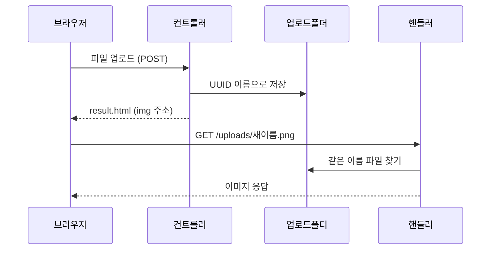

이 글은 디스패처 서블릿과 AOP를 복습하고, Spring Boot에서 파일을 올리고(업로드) 저장하고 화면에 다시 보여 주는 과정, 그리고 타임리프의 `th:text`·`th:utext`와 프래그먼트까지 정리한 글이다.

2026년 10월 30일 수업에서 진행한 내용을 정리했다.

## 이게 없으면 뭐가 불편할까

회원가입 화면에서 프로필 사진을 올린다고 해 보자. 지금까지 배운 폼은 아이디, 이름 같은 **글자**만 서버로 보냈다. 사진은 글자가 아니다.

사진을 서버로 보내는 방법을 몰라도 문제고, 받은 다음도 문제다.

- 여러 사람이 똑같이 `test.jpg`라는 이름으로 올리면 어떻게 될까? 먼저 올린 사진이 덮어써진다.
- 서버에 저장한 사진을 브라우저가 어떻게 다시 불러올까? 서버 폴더는 그냥은 밖에서 열 수 없다.
- 사진 자체를 DB(데이터베이스)에 넣어도 될까?

이 글은 이 세 가지 질문에 답하는 순서로 정리했다. 그 전에 전날 배운 내용을 먼저 복습한다.

---

## 0. 실습은 어떻게 준비했을까

IntelliJ에서 새 프로젝트를 만들 때 Spring Boot를 골랐다. 설정은 이렇다.

| 항목 | 값 |
|------|----|
| 이름 | `chap06-file-upload` |
| 언어 / 타입 | Java / Gradle - Groovy |
| 패키지 이름 | `com.wanted.fileupload` |
| Java | 21 |
| 패키지 생성 | Jar |
| 구성 | YAML |
| 추가한 의존성 | Spring Web, Thymeleaf, Lombok |

의존성(dependency)은 내 프로젝트가 가져다 쓰는 외부 라이브러리다. Spring Web은 웹 요청을 받게 해 주고, Thymeleaf(타임리프)는 HTML 화면에 서버 값을 채워 준다. Lombok(롬복)은 getter, 생성자 같은 반복 코드를 어노테이션 한 줄로 대신 만들어 준다.

---

## 1. 디스패처 서블릿 — 요청은 누가 제일 먼저 받을까?

### 한 문장으로 말하면

큰 회사 건물 1층의 안내 데스크를 떠올려 보자. 손님은 어느 부서든 일단 안내 데스크로 간다. 안내 데스크는 "그 일은 3층 회계팀이에요" 하고 담당 부서로 연결해 준다.

**DispatcherServlet(디스패처 서블릿)** 은 모든 웹 요청을 가장 먼저 받아서, 그 요청을 맡을 컨트롤러로 연결해 주는 통합 창구다. 수업에서는 "디스패처 서블릿 == Front Controller(프론트 컨트롤러)"라고 배웠다.

비유에는 한계가 있다. 안내 데스크 직원은 일을 연결만 하고 끝이다. 디스패처 서블릿은 컨트롤러가 일을 마친 뒤 돌려준 결과를 받아, 어떤 화면을 보여 줄지까지 이어서 챙긴다.

### 왜 "프론트" 컨트롤러라고 부를까?

디스패처 서블릿이 없던 때에는 `/login` 요청용 서블릿, `/board` 요청용 서블릿처럼 **요청마다 서블릿을 따로 만들고 연결**해야 했다. 서블릿은 자바로 웹 요청을 받아 처리하는 프로그램이다. 자세한 내용은 [웹 서버, Tomcat, 서블릿 글]({{ site.baseurl }})에 정리해 두었다.

디스패처 서블릿은 맨 앞에 딱 하나만 있으면서 모든 요청을 혼자 받는다. 맨 앞(front)에서 요청을 도맡는 구조라서 Front Controller라고 부른다. Spring 공식 문서에서도 Spring MVC가 프론트 컨트롤러 패턴으로 설계됐고, 그 중심 서블릿이 DispatcherServlet이라고 설명한다.

### 어떻게 컨트롤러 메서드를 다 알고 있을까?

스프링은 실행될 때 컨트롤러에 붙은 `@GetMapping("/test")`, `@PostMapping("/login")` 같은 어노테이션을 모두 읽는다. 그리고 "이 주소는 이 메서드가 담당"이라는 주소록을 만들어 둔다. 이 주소록 역할을 하는 것을 **핸들러 매핑(Handler Mapping)** 이라고 부른다.

`/test` 요청이 들어오면 디스패처 서블릿은 주소록을 보고 "`TestController`의 `testMethod()`가 맡는구나" 하고 알아챈다. 그다음 그 메서드에 일을 넘긴다.

> 한 줄 요약: 디스패처 서블릿은 모든 요청을 먼저 받아 담당 컨트롤러로 연결해 주는 안내 데스크다.

---

## 2. AOP — 모든 메서드에 똑같이 필요한 일은 어떻게 할까?

### 왜 필요할까

회원 관리, 게시판, 결제 기능은 각자 코드가 따로 있다. 그런데 모든 메서드에 똑같이 필요한 일이 있다.

- 실행 시간 측정
- 로그 남기기
- 트랜잭션 처리 (DB 작업을 커밋하거나 롤백하는 일)
- 보안 검사

이걸 모든 메서드에 복사해서 붙여 넣으면 코드가 지저분해진다. 나중에 로그 형식을 바꾸려면 수십 군데를 고쳐야 한다.

### 한 문장으로 말하면

학교 방송실을 떠올려 보자. 각 반 선생님이 직접 종을 치지 않아도, 방송실이 정해진 시각마다 모든 교실에 종소리를 넣어 준다.

**AOP(Aspect-Oriented Programming, 관점 지향 프로그래밍)** 는 여러 곳에 공통으로 필요한 일을 따로 떼어 내 관리하는 방법이다. 내가 메서드 안에 코드를 직접 쓰지 않아도, 정해 둔 시점(예: Service 메서드가 실행될 때)의 앞이나 뒤에 공통 코드를 자동으로 끼워 넣어 실행한다.

수업 그림에서는 AOP가 Controller, Service, DAO를 가로지르는 화살표로 그려져 있었다. 여러 층을 가로질러 공통으로 적용된다는 뜻이다.

비유에는 한계가 있다. 방송실은 모든 교실에 똑같이 종을 울린다. AOP는 "Service의 메서드에만", "이름이 `save`로 시작하는 메서드에만"처럼 끼워 넣을 곳을 골라서 정할 수 있다.

### Filter, Interceptor, AOP는 뭐가 다를까?

셋 다 "중간에 가로채서 무언가를 한다"는 점이 같아서 헷갈리기 쉽다. 수업에서는 어느 위치에서 가로채는지로 구분했다.

| 구분 | 위치 | 주로 하는 일 | 비유 |
|------|------|--------------|------|
| Filter | 서블릿 컨테이너 (스프링 바깥) | 스프링에 들어오기 전, 웹 요청 전반 (인코딩, CORS 설정) | 건물 정문 보안요원 |
| Interceptor | 스프링 컨테이너 (디스패처 서블릿 바로 뒤) | 컨트롤러 호출 직전·직후 (로그인 여부, 권한) | 사무실 층 입구 |
| AOP | 스프링 컨테이너 (메서드 단위) | Service, DAO 같은 메서드의 앞뒤 (트랜잭션, 로그) | 직원 옆의 전담 보조원 |

> 한 줄 요약: AOP는 시간 측정, 트랜잭션처럼 여기저기 필요한 공통 기능을 메서드 앞뒤에 뺐다 꼈다 할 수 있게 해 준다.

---

## 3. 파일 업로드 폼 — 파일은 어떻게 서버로 보낼까?

### 먼저 화면부터 만들기

`src/main/resources/templates` 아래에 `main.html`을 만들었다. 타임리프는 이 `templates` 폴더에서 화면 파일을 찾는다.

파일을 만들어도 아직 브라우저에서 보이지 않는다. `/` 주소로 들어오면 `main.html`을 보여 주도록 컨트롤러를 하나 만들었다.

```java
package com.wanted.fileupload;

import org.springframework.stereotype.Controller;
import org.springframework.web.bind.annotation.GetMapping;

@Controller
public class MainController {

    @GetMapping("/")
    public String main() {
        return "main";
    }
}
```

`return "main"`은 "`templates/main.html`을 보여 줘"라는 뜻이다. `.html`은 빼고 쓴다.

### 업로드 폼 작성

`main.html`의 내용은 수업 자료(슬랙)에서 붙여 넣었다. 단일 파일 폼과 다중 파일 폼이 하나씩 있다.

```html
<body>
    <h1>파일 업로드 하기!</h1>
    <pre>
        chap06 에서 진행하는 파일관련 처리는 추후에는 권장하지 않는
        방식이다. 다만, 현재 우리의 기술 스택 관련에서는 최선의 방식이니
        이 부분만 알고 넘어가자!
    </pre>
    <hr>
    <h3>single-file 업로드하기(단일파일)</h3>
    <form action="single-file" method="post" enctype="multipart/form-data">
        <!--
            encoding 을 보내줄 때 맞춰주어야 spring 에서도 알맞은 타입으로
            전달 받을 수 있다.
        -->
        파일 : <input type="file" name="singleFile"> <br>
        파일 설명 : <input type="text" name="description"><br>
        <input type="submit">
    </form>
    <hr>
    <h3>multi-file 업로드하기(다중파일)</h3>
    <form action="multi-file" method="post" enctype="multipart/form-data">
        파일 : <input type="file" name="multiFile" multiple> <br>
        파일 설명 : <input type="text" name="description"><br>
        <input type="submit">
    </form>
</body>
```

페이지 안의 안내문처럼, 이번 실습에서 파일을 다루는 방식은 나중에는 권장하지 않는 방식이라고 배웠다. 지금 배운 기술 범위에서는 최선이라서 이 방식으로 익힌다.

### `enctype="multipart/form-data"`는 왜 꼭 붙여야 할까?

택배를 떠올려 보자. 편지만 보낼 때는 봉투 하나면 된다. 그런데 편지와 액자를 같이 보내려면 상자 안에 칸막이를 넣고, 칸마다 따로 담아야 한다.

`enctype`은 폼 데이터를 어떤 모양으로 포장해서 보낼지 정하는 속성이다. 아무것도 적지 않으면 기본값은 `application/x-www-form-urlencoded`다. 이 방식은 `name=홍길동&age=20`처럼 글자만 한 줄로 이어서 보낸다. 사진 같은 **이진 데이터(binary data)**, 즉 글자가 아닌 0과 1 덩어리는 이 방식으로 제대로 보낼 수 없다.

`multipart/form-data`는 이름 그대로 요청 본문을 **여러 조각(multi-part)** 으로 나눈다. 글자 데이터와 파일 데이터를 구분선(boundary)으로 칸막이처럼 나눠서 한 번에 보낸다.

비유에는 한계가 있다. 택배 상자는 칸막이 개수가 정해져 있지만, multipart는 폼의 입력칸 수만큼 조각을 자유롭게 만든다.

MDN 문서에서도 폼에 `type="file"`인 입력칸이 있으면 `multipart/form-data`를 쓰라고 설명한다. 그리고 `enctype`은 `method="post"`일 때만 의미가 있다. 그래서 파일 폼에는 두 가지를 같이 적는다.

```html
<!-- 파일 업로드 폼 작성 예시 -->
<form action="/upload" method="post" enctype="multipart/form-data">
    <input type="text" name="singleFileDescription" placeholder="파일 설명">
    <input type="file" name="singleFile">
    <button type="submit">업로드</button>
</form>
```

위 코드는 수업 중 정리한 사용 예시다. 실제 실습 폼은 앞의 `main.html`이다.

> 한 줄 요약: 파일을 보내는 폼에는 `method="post"`와 `enctype="multipart/form-data"`를 반드시 같이 적는다.

---

## 4. 컨트롤러는 파일을 어떻게 받을까?

### 한 문장으로 말하면

택배 상자를 받으면 칸마다 꺼내서 확인한다. 컨트롤러도 multipart 요청에서 파일 칸과 글자 칸을 따로 꺼낸다.

**MultipartFile**은 스프링이 업로드된 파일 하나를 담아 주는 타입이다. 파일 이름, 크기, 내용을 꺼내 볼 수 있다.

### 직접 해보기

`FileController`를 만들고, 단일 파일 폼이 보내는 `single-file` 요청을 받는 메서드를 작성했다.

```java
@Controller
public class FileController {

    /* comment. 파일 관련 진행 순서
        1. 사용자가 업로드한 파일/설명 확인
        2. 파일 저장 경로 확인 및 파일 저장
        3. 원본 파일명을 UUID 기반의 새로운 이름으로 변경
        4. 생성 된 경로에 파일 저장
        5. 결과 메세지와 파일 저장 위치 URL을 Model 에 담아 응답
     */

    @PostMapping("single-file")
    public ModelAndView single(@RequestParam MultipartFile singleFile,
                               @RequestParam String description,
                               ModelAndView mv) {
        //MultipartFile 타입으로 파일 관련된 타입들을 받을 수 있음.

        System.out.println("singleFile = " + singleFile);
        System.out.println("description = " + description);

        //서버측에서 파일 저장 시 이름 변수
        String savedName = save(singleFile);

        return mv;
    }
}
```

`@RequestParam MultipartFile singleFile`은 폼에서 `name="singleFile"`로 보낸 파일 칸을 받는다. 변수 이름과 폼의 `name`이 같아서 이름을 따로 적지 않았다. `description`도 같은 방식으로 글자 칸을 받는다.

주석에 적힌 다섯 단계가 이 컨트롤러가 할 일의 순서다. 이 중 2~4단계를 `save()` 메서드에 따로 모았다.

> 한 줄 요약: 업로드된 파일은 `MultipartFile`로 받는다. 폼의 `name`과 변수 이름을 맞춘다.

---

## 5. 파일은 어떤 이름으로, 어디에 저장할까?

### 원본 이름을 그대로 쓰면 왜 안 될까?

도서관 사물함을 떠올려 보자. 사람마다 자기 이름표를 붙이게 하면, 홍길동이 두 명일 때 사물함이 겹친다. 그래서 도서관은 1번, 2번처럼 겹치지 않는 번호를 붙인다.

파일도 같다. 여러 사람이 `test.jpg`로 올리면 나중 파일이 앞 파일을 덮어쓴다. 그래서 서버에 저장할 때는 **UUID**로 이름을 바꾼다. UUID는 거의 겹치지 않도록 무작위로 만든 긴 식별 문자열이다. 예를 들어 `a8f3b29d-1234-5678...` 같은 모양이다.

비유에는 한계가 있다. 사물함 번호는 1, 2, 3처럼 순서대로 붙지만, UUID는 순서 없이 무작위로 만든다. 그래서 이름만 보고는 몇 번째로 올린 파일인지 알 수 없다.

### 원본 이름과 확장자 떼어 내기

`save()`의 앞부분이다.

```java
// 파일을 저장하고, 저장 된 파일의 이름을 반환한다.
private String save(MultipartFile file) {

    // 파일의 원본 이름 추출 // test.png
    String originName = file.getOriginalFilename();
    System.out.println("originName = " + originName);

    // 파일의 확장자 분리       // test / .png / 대문자를 소문자로 변경
    // 뒤에서부터 오다가 .을 만나는 순간 잘라버리겠다.
    String ext = originName.substring(originName.lastIndexOf(".")).toLowerCase();

    // 중복되는 파일명 방지를 위한 UUID
    // 하나의 식별자 => 랜덤한 값을 줌
    // ex) 스크린샷.png => 3324124342435.png
    // 따라서 파일명이 중복되는 현상이 사라짐. 뒤에다가는 떼어놓은 확장자를 붙여놓음(ext)
    String savedName =
        UUID.randomUUID().toString() + ext;  // 저장시 사용할 이름
}
```

한 줄씩 보면 이렇다.

1. `getOriginalFilename()` — 사용자가 올린 원래 파일 이름을 꺼낸다. 예: `test.png`
2. `lastIndexOf(".")` — 이름의 **마지막** `.`이 몇 번째 글자인지 찾는다. `my.photo.png`처럼 점이 여러 개여도 마지막 점을 찾기 때문에 확장자만 정확히 떼어 낸다.
3. `substring(...)` — 그 위치부터 끝까지 잘라 낸다. 결과는 `.png`다.
4. `toLowerCase()` — `.PNG`처럼 대문자로 온 확장자를 소문자로 맞춘다.
5. `UUID.randomUUID().toString() + ext` — 무작위 이름 뒤에 확장자를 붙인다. 확장자가 있어야 서버와 브라우저가 이 파일이 이미지라는 걸 알 수 있다.

### 저장할 폴더는 어디에 적어 둘까? — application.yaml

저장 폴더 경로를 코드에 직접 박아 두면, 폴더를 바꿀 때마다 자바 코드를 고쳐야 한다. 그래서 설정 파일인 `application.yaml`에 적어 둔다.

```yaml
spring:
  application:
    name: chap06-file-upload
  servlet:    # 밑에 친구들은 서블릿 내부에 있는 것들이다(요청과 관련-서블릿에서 판단하고 적절하지 않으면 뱉어버림)
    multipart:
      # 파일 1개의 최대 크기 지정
      max-file-size: 200MB
      # 1개의 요청 시 여러 파일의 최대 합계 크기 지정
      max-request-size: 100MB

# 파일을 우리 프로젝트 중에 어느 폴더에 저장할지 경로 지정할 수 있음
file:
  upload-dir: ./uploads
  # 내가 지정한 키 값: 폴더 경로
```

위쪽 `spring.servlet.multipart`는 스프링이 미리 정해 둔 설정이다. 너무 큰 파일이 오면 요청을 거절한다. Spring Boot 공식 문서에 따르면 아무것도 적지 않을 때 기본값은 파일 하나당 1MB, 요청 하나당 10MB다. 사진 몇 장만 올려도 넘길 수 있어서 직접 늘려 둔 것이다.

아래쪽 `file.upload-dir`은 스프링이 정한 이름이 아니다. 내가 직접 만든 키다. "키: 값" 모양으로 이름을 정하고, 값에 폴더 경로를 적었다. `./uploads`는 프로젝트 폴더 바로 아래의 `uploads` 폴더라는 뜻이다.

### 설정값을 자바 코드로 가져오기 — @Value

```java
@Controller
public class FileController {

    // .yaml 에 지정한 설정값 불러오기
    @Value("${file.upload-dir}")
    private String uploadDir;
```

`@Value("${file.upload-dir}")`는 "yaml에서 `file.upload-dir` 키의 값을 찾아 이 필드에 넣어 줘"라는 뜻이다. 그래서 `uploadDir`에는 `./uploads`가 들어간다. 수업 노트 주석에는 "환경변수"라고 적었는데, 정확히는 설정 파일에 적어 둔 **설정값(프로퍼티)** 이다.

### 폴더 만들고 저장하기

`save()`의 나머지 부분이다.

```java
// 파일을 저장하고, 저장 된 파일의 이름을 반환한다.
private String save(MultipartFile file) throws IOException {

    // ... 앞에서 본 originName, ext, savedName 코드 ...

    //파일을 저장할 폴더 생성
    File dir = new File(uploadDir).getAbsoluteFile();     //경로 전달(yaml 에서 가져옴)
    dir.mkdirs();

    // 업로드 파일을 변환 할 준비
    // 업로드한 파일을 생성한 디렉터리에 저장할 이름으로 변환 후 저장
    file.transferTo(new File(dir, savedName));

    return savedName;
}
```

- `new File(uploadDir).getAbsoluteFile()` — `./uploads`를 `C:/.../chap06-file-upload/uploads`처럼 처음부터 끝까지 다 적힌 **절대 경로**로 바꾼다.
- `dir.mkdirs()` — 폴더가 없으면 만든다. 이미 있으면 아무 일도 하지 않는다.
- `file.transferTo(new File(dir, savedName))` — 업로드된 파일을 그 폴더에 새 이름으로 저장한다.

절대 경로로 바꾸는 이유가 있다. Spring 공식 문서(MultipartFile)에 따르면 `transferTo()`에 상대 경로를 주면, 기준 폴더가 서버(서블릿 컨테이너)마다 다를 수 있다. 그래서 공식 문서도 절대 경로를 권한다.

### `throws IOException`은 왜 붙었을까?

`transferTo()`는 파일을 쓰다가 문제가 생기면 `IOException`을 던진다. 디스크가 꽉 찼거나 폴더에 쓰기 권한이 없을 때가 그렇다.

`save()`에 `throws IOException`을 붙이면 "이 예외는 여기서 처리하지 않고, 나를 부른 쪽에 넘길게"라는 뜻이 된다. 예외를 던졌으므로, `save()`를 부른 쪽에서는 **반드시** 예외를 처리해야 한다. 그래서 `single()`을 try-catch로 감쌌다.

```java
@PostMapping("single-file")
public ModelAndView single(@RequestParam MultipartFile singleFile,
                           @RequestParam String description,
                           ModelAndView mv) {
    //MultipartFile 타입으로 파일 관련된 타입들을 받을 수 있음.

    System.out.println("singleFile = " + singleFile);
    System.out.println("description = " + description);

    //서버측에서 파일 저장 시 이름 변수
    try {
        String savedName = save(singleFile);
        mv.addObject("message", "파일 업로드 성공!!!!");
        mv.addObject("files", "/uploads/" + savedName);
    } catch (IOException e) {
        mv.addObject("message", "파일 업로드 실패. " + e.getMessage());
    }

    mv.setViewName("result");

    return mv;
}
```

성공하면 성공 메시지와 파일 주소(`/uploads/새이름.png`)를 담고, 실패하면 실패 메시지를 담는다. 어느 쪽이든 마지막에 `result` 화면을 보여 준다.

`ModelAndView`는 "화면에 넘길 값"과 "보여 줄 화면 이름"을 한 번에 담는 상자다. `addObject()`로 값을 넣고, `setViewName()`으로 화면을 정한다.

> 한 줄 요약: 원본 이름에서 확장자만 떼어 UUID 이름 뒤에 붙이고, yaml에 적은 폴더에 `transferTo()`로 저장한다.

---

## 6. 저장한 결과는 어떻게 보여 줄까? — result.html

`templates` 아래에 `result.html`을 만들었다.

```html
<!DOCTYPE html>
<html lang="en">
<head>
    <meta charset="UTF-8">
    <title>Title</title>
</head>
<body>
    <h3 th:text="${message}"></h3>

    <!-- th:each 는 java 의 for 문이라고 생각하면 좋다.-->
    <!-- 향상된 for 문 => 뒤에 있는 것만큼, 앞에 생성한 변수로 들어가게 됨 -->
    <div th:each="file : ${files}">
        
    </div>
</body>
</html>
```

- `th:text="${message}"` — 컨트롤러가 담은 `message` 값을 `<h3>` 안에 글자로 넣는다.
- `th:each="file : ${files}"` — 자바의 향상된 for 문 `for (String file : files)`과 같다. `files`에 든 값을 하나씩 꺼내 `file`에 담고, 그만큼 `<div>`를 반복한다.
- `th:src="${file}"` — 꺼낸 주소를 ``의 `src`에 넣는다.

`` 태그로 보여 주기 때문에 이 화면에서는 **이미지 파일만** 제대로 보인다. PDF 같은 파일을 올리면 저장은 되지만 화면에는 깨진 그림으로 나온다.

그런데 이대로 업로드하면 사진이 안 보인다. 다음 절에서 이유를 본다.

> 한 줄 요약: `result.html`은 메시지를 보여 주고, `th:each`로 파일 주소를 하나씩 꺼내 ``에 넣는다.

---

## 7. 정적 리소스 핸들링 — 저장한 사진을 브라우저가 어떻게 가져갈까?

### 왜 필요할까

`result.html`의 ``를 만나면, 브라우저는 서버에 "`/uploads/abc.png` 주세요"라는 요청을 따로 보낸다. 수업 코드 주석에는 이걸 "이미지 내놔!!!"라고 적어 두었다.

하지만 스프링은 아직 `/uploads/...` 주소를 어디서 찾아야 하는지 모른다. 스프링이 기본으로 내보내는 폴더는 `resources/static` 같은 곳이다. 프로젝트 바로 아래의 `uploads` 폴더는 기본 대상이 아니다.

### 한 문장으로 말하면

우편물의 주소 변경 신청을 떠올려 보자. "옛 주소로 온 우편물은 새 주소로 보내 주세요"라고 우체국에 등록해 둔다.

**리소스 핸들러(resource handler)** 는 "이 URL로 요청이 오면, 이 폴더에서 파일을 찾아 줘"라고 스프링에 등록해 두는 설정이다. 이미지, CSS처럼 서버가 가공하지 않고 그대로 내보내는 파일을 **정적 리소스(static resource)** 라고 부른다.

비유에는 한계가 있다. 주소 변경은 우편물을 새 주소로 옮겨 보내지만, 리소스 핸들러는 파일을 옮기지 않는다. 요청 주소와 실제 폴더를 짝지어 둘 뿐이다.

### 직접 해보기

`WebMvcConfigurer`를 구현한 `WebConfig` 클래스를 만들었다. `WebMvcConfigurer`는 Spring MVC 설정을 바꾸고 싶을 때 쓰는 인터페이스다. 이 인터페이스에는 `addFormatters`, `addInterceptors`, `addResourceHandlers`, `addCorsMappings` 같은 메서드가 있다. 수업 코드 주석에는 이 인터페이스로 "인터셉터 등록, 정적인 리소스 핸들링!"을 한다고 적었다. 이번에 쓴 것은 `addResourceHandlers`다.

```java
/* comment.
 *  WebMvcConfigurer
 *  -> 인터셉터 등록, 정적인 리소스 핸들링!
 */
@Configuration
public class WebConfig implements WebMvcConfigurer {
    @Value("${file.upload-dir}")
    private String uploadDir;


    @Override
    public void addResourceHandlers(ResourceHandlerRegistry registry) {
        WebMvcConfigurer.super.addResourceHandlers(registry);

        /* comment.
             브라우저에서 src 경로에 대한
            요청이 일어나고 있다. == 이미지 내놔!!!
            /uploads/abc.png : 요청 url
            저장 폴더 경로를 연결한다.
         */

        registry.addResourceHandler("/uploads/**")         //하위 경로의 요청이 들어오면??
                .addResourceLocations("file:" + uploadDir + "/");   //어디로 위치시킬거냐??
    }
}
```

- `addResourceHandler("/uploads/**")` — `/uploads/`로 시작하는 모든 요청을 맡는다. `**`는 "그 아래 어떤 경로든"이라는 뜻이다.
- `addResourceLocations("file:" + uploadDir + "/")` — 실제 파일은 `file:./uploads/` 폴더에서 찾는다. `file:`은 "프로젝트 안의 classpath가 아니라 컴퓨터의 폴더"라는 표시다.

이제 `/uploads/bab4151b-....png` 요청이 오면 스프링은 `uploads` 폴더에서 `bab4151b-....png`를 찾아 내려 준다. Spring 공식 문서에서도 요청 주소의 앞부분을 떼고, 남은 경로로 등록한 위치에서 파일을 찾는다고 설명한다.

### 그림으로 보기



업로드는 컨트롤러가 받아 폴더에 저장하고, 이미지를 다시 보여 줄 때는 리소스 핸들러가 같은 폴더에서 꺼내 준다.

### 주의할 점

수업에서는 이렇게 **서버 안의 폴더에 파일을 직접 쌓는 방식은 서버에 부하가 생길 수 있다**고 배웠다. 업로드한 파일이 쌓일수록 서버 컴퓨터의 저장 공간을 쓰고, 이미지 요청도 모두 이 서버가 처리해야 하기 때문이다. 3절 `main.html` 안내문에서 "추후에는 권장하지 않는 방식"이라고 한 것과 같은 이야기다.

> 한 줄 요약: `addResourceHandlers`로 `/uploads/**` 주소와 실제 `uploads` 폴더를 연결해야 브라우저가 저장된 사진을 볼 수 있다.

---

## 8. 사진을 DB에 그대로 저장해도 될까?

수업에서 받은 질문이다. 답은 **아니다**.

사진 원본은 백엔드 서버의 폴더(`/uploads/adb.png`)에 저장한다. DB 서버에는 그 사진이 어디 있는지 알려 주는 **경로 문자열**(`/uploads/adb.png`)만 저장한다.

도서관에 비유하면, 책은 서가에 꽂아 두고 도서 목록 카드에는 "3층 B서가"라는 위치만 적는 것과 같다. 목록 카드에 책을 통째로 붙이지 않는다.

이렇게 하면 DB 서버의 부하가 적다. 수업에서는 이것이 곧 비용을 아끼는 방법이라고 배웠다.

비유에는 한계가 있다. 도서 목록은 책이 없어지면 사서가 알아채지만, DB는 폴더의 파일이 지워져도 모른다. 경로만 남고 파일은 없는 상황이 생길 수 있다.

> 한 줄 요약: 파일은 서버 폴더에, DB에는 파일이 있는 경로만 저장한다.

---

## 9. 파일 여러 개는 어떻게 한 번에 올릴까?

### `multiple` 속성

`main.html`의 다중 파일 폼에는 `multiple`이 붙어 있다.

```html
파일 : <input type="file" name="multiFile" multiple> <br>
```

이 한 단어를 적으면 파일 선택 창에서 여러 파일을 한꺼번에 고를 수 있다.

### 파일 하나의 정보를 담을 상자 — FileDTO

파일이 여러 개면 파일마다 원본 이름, 저장 이름, 경로, 설명을 묶어서 다뤄야 한다. 이렇게 값을 묶어 나르는 클래스를 **DTO(Data Transfer Object)** 라고 부른다. `FileDTO`를 만들고 롬복 어노테이션을 붙였다.

```java
package com.wanted.fileupload;

import lombok.*;

@AllArgsConstructor
@NoArgsConstructor
@Setter
@Getter
@ToString
public class FileDTO {
//원본 파일이름/저장시 파일 이름/경로

    private String originFileName;
    private String savedName;
    private String filePath;
    private String description;
}
```

`@AllArgsConstructor`는 모든 필드를 받는 생성자를, `@NoArgsConstructor`는 빈 생성자를 대신 만들어 준다. `@Getter`, `@Setter`, `@ToString`도 이름 그대로의 메서드를 만들어 준다.

### 파일을 만들 때 중요한 세 가지

| 항목 | 역할 | 왜 필요할까 |
|------|------|-------------|
| 원본 파일명 (`originName`) | 사용자가 내 컴퓨터에서 올릴 때의 실제 이름. 예: `내프로필사진.jpg` | 화면에 "무슨 파일을 올렸는지" 보여 주거나, 나중에 다운로드할 때 원래 이름으로 받게 하려고 DB에 저장해 둔다. 확장자를 떼어 낼 때도 필요하다 |
| 저장용 파일명 (`savedName`) | 서버 폴더에 실제로 저장되는 바뀐 이름. 예: `a8f3b29d-1234-5678...jpg` | **중복 방지**: 같은 이름 파일이 덮어써지는 일을 막는다. **한글 깨짐 방지**: 한글이나 특수문자 이름은 서버 운영체제에 따라 오류나 깨진 이미지를 만들 수 있다 |
| 저장 경로 (`uploadDir` / URL) | 실제 경로: 서버 디스크 어디에 저장할까 (예: `./uploads`). URL 경로: 브라우저가 이미지를 요청할 주소 (예: `/uploads/a8f3...jpg`) | 서버는 폴더를 만들고(`dir.mkdirs()`) 저장할(`transferTo()`) 위치가 필요하다. 브라우저는 리소스 핸들러(`WebMvcConfigurer`)로 그 폴더에 접근해야 이미지를 볼 수 있다 |

수업에서 정리한 비유는 이렇다.

1. **원본 이름**: 손님한테 보여 줄 이름
2. **저장 이름**: 서버 창고에 안 겹치게 보관할 이름
3. **저장 경로**: 서버 창고 위치이자 브라우저가 찾아올 주소

### 직접 해보기 — 여러 파일 받기

`FileController`에 다중 파일용 메서드를 추가했다. 이것도 수업 자료(슬랙)에서 붙여 넣었다.

```java
@PostMapping("multi-file")
public ModelAndView multiFileUpload(@RequestParam("multiFile") List<MultipartFile> multipartFile,
                                    String description, ModelAndView mv) {

    System.out.println("multipartFile = " + multipartFile);
    System.out.println("description = " + description);

    // 여러 개의 파일을 처리하기 위한 DTO 객체 활용
    List<FileDTO> files = new ArrayList<>();
    // 화면에서 접근할 URL 저장용
    List<String> savedFiles = new ArrayList<>();

    try {
        // 전달 받은 여러 개의 파일을 반복
        for (MultipartFile file : multipartFile) {
            String savedName = save(file);
            files.add(new FileDTO(file.getOriginalFilename(), savedName, uploadDir, description));
            savedFiles.add("/uploads/" + savedName);
        }

        mv.addObject("message", "멀티 파일 업로드 성공!");
        mv.addObject("files", savedFiles);
    } catch (Exception e) {

        // 예를 들어 5개 파일을 넣었는데
        // 4개는 정상적으로 저장되고, 1개만 안되면?
        // ex) Transaction 의 rollback 처럼 동작하게 만들 것이다.
        // 실패 시에 이전에 저장된 파일을 삭제
        for (FileDTO file : files) {
            new File(new File(uploadDir).getAbsoluteFile(), file.getSavedName()).delete();
        }
        mv.addObject("message", "멀티 파일 업로드 실패!");
    }

    mv.setViewName("result");

    return mv;
}
```

- `@RequestParam("multiFile") List<MultipartFile>` — 폼에서 `name="multiFile"`로 온 파일 여러 개를 리스트로 받는다. Spring 공식 문서에서도 같은 이름으로 온 여러 파일은 `List<MultipartFile>`로 받을 수 있다고 설명한다.
- 반복문 안에서 파일마다 `save()`로 저장하고, 정보는 `files`(FileDTO 목록)에, 화면용 주소는 `savedFiles`에 모은다.
- 성공하면 `savedFiles` 리스트를 `files`라는 이름으로 화면에 넘긴다. `result.html`의 `th:each`가 이 리스트를 하나씩 꺼내 이미지를 여러 장 보여 준다.

### catch에서 파일을 지우는 이유

5개를 올렸는데 4개는 저장되고 1개에서 실패했다고 해 보자. 사용자는 "업로드 실패"를 보는데, 서버 폴더에는 4개가 남는다. 아무도 쓰지 않는 파일이 쌓인다.

그래서 실패하면 그때까지 저장한 파일을 `files` 목록에서 꺼내 모두 지운다. [MySQL 글의 트랜잭션]({{ site.baseurl }})에서 배운 ROLLBACK처럼 "전부 성공 아니면 전부 취소"를 흉내 낸 것이다. 다만 DB가 알아서 되돌려 주는 진짜 ROLLBACK과 달리, 여기서는 지우는 코드를 직접 써야 한다.

> 한 줄 요약: `multiple`로 여러 파일을 고르고, `List<MultipartFile>`로 받아 하나씩 저장한다. 중간에 실패하면 이미 저장한 파일을 지운다.

---

## 10. 타임리프 — `th:text`와 `th:utext`는 뭐가 다를까?

### 한 문장으로 말하면

친구가 보낸 메시지에 `<b>안녕</b>`이 적혀 있다고 해 보자. 그대로 읽어 주면 "꺾쇠 b 꺾쇠 안녕…"이 되고, 적힌 대로 해석하면 굵은 "**안녕**"이 된다.

둘의 차이는 **HTML 태그를 해석하느냐**다.

| 속성 | 하는 일 | 결과 |
|------|---------|------|
| `th:text` | 값 안의 HTML 태그를 그냥 글자로 취급한다. `<`는 `&lt;`, `>`는 `&gt;`로 바꿔서 출력한다. 이렇게 바꾸는 것을 **이스케이프(escape)** 라고 부른다 | 화면에 `<b>안녕</b>`이 글자 그대로 보인다 |
| `th:utext` | 이름의 u(Unescaped)처럼 바꾸지 않고 태그를 그대로 적용한다 | 화면에 굵은 "안녕"이 보인다 |

아래는 이해를 돕기 위한 예시 코드다. 컨트롤러가 `msg`에 `"<b>안녕</b>"`을 담았다고 가정한다.

```html
<p th:text="${msg}"></p>   <!-- <b>안녕</b> 이 글자로 보인다 -->
<p th:utext="${msg}"></p>  <!-- 굵은 '안녕'이 보인다 -->
```

### 왜 보통은 `th:text`를 쓸까?

`th:text`는 보안 때문에 기본으로 가장 많이 쓴다. 누군가 게시글 내용에 `<script>` 같은 실행 코드를 넣었다고 해 보자. `th:utext`로 출력하면 그 코드가 다른 사람 브라우저에서 실행된다. 이런 공격을 **XSS(Cross-Site Scripting)** 라고 부른다. `th:text`는 태그를 글자로 바꿔 버리니 실행되지 않는다.

비유에는 한계가 있다. 친구 메시지는 내가 읽는 방식을 고르지만, 웹에서는 개발자가 고른 방식이 모든 방문자에게 똑같이 적용된다. 그래서 믿을 수 없는 값에는 `th:utext`를 쓰지 않는다.

> 한 줄 요약: `th:text`는 태그를 글자로 보여 주고, `th:utext`는 태그를 실제로 적용한다. 보안 때문에 기본은 `th:text`다.

---

## 11. 프래그먼트 — 매 화면에 똑같은 머리말과 꼬리말을 어떻게 넣을까?

### 왜 필요할까

사이트의 모든 페이지에는 위쪽 메뉴(header)와 아래쪽 정보(footer)가 똑같이 들어간다. 페이지마다 복사해 두면, 메뉴 하나를 바꿀 때 모든 페이지를 고쳐야 한다.

### 한 문장으로 말하면

공문서의 회사 로고 도장을 떠올려 보자. 로고를 매번 손으로 그리지 않고, 도장 하나를 만들어 필요한 곳마다 찍는다.

**프래그먼트(fragment)** 는 여러 화면에서 같이 쓰도록 따로 떼어 둔 HTML 조각이다. 쓰는 방법은 이렇다.

```text
~{ 템플릿 경로 :: Fragment 이름 }
```

- 템플릿 경로는 `templates` 폴더 기준이고, `.html`은 뺀다. 예를 들어 `common/header`는 `templates/common/header.html`이다.
- 수업에서는 경로 앞에 `/`를 붙이면 jar로 배포했을 때 템플릿을 못 찾을 수 있으니 붙이지 않는다고 배웠다.

비유에는 한계가 있다. 도장은 찍을 때마다 같은 모양만 나오지만, 프래그먼트는 끼워 넣는 방식(`th:insert`, `th:replace`)에 따라 바깥 태그가 남기도 하고 사라지기도 한다.

### 직접 해보기

수업 노트에는 조각 파일 코드가 없어서, 아래는 노트의 결과를 바탕으로 만든 예시 코드다. `templates/common/footer.html`과 `templates/common/header.html`에 조각을 정의한다. `th:fragment`로 조각에 이름을 붙인다.

```html
<!-- templates/common/footer.html (예시 코드) -->
<footer class="footer" th:fragment="footer"><h1> footer Fragment</h1></footer>

<!-- templates/common/header.html (예시 코드) -->
<header class="header" th:fragment="header"><h1> header Fragment</h1></header>
```

이 조각을 다른 화면에서 불러온다.

```html
<!-- 예시 코드 -->
<footer th:insert="~{common/footer :: footer}">나는 footer</footer>
<header th:replace="~{common/header :: header}">나는 header</header>
```

### `th:insert`와 `th:replace`는 뭐가 다를까?

**`th:insert`** 는 `th:insert`를 적은 태그는 그대로 두고, 그 **안쪽 내용만** 불러온 프래그먼트(태그 포함)로 바꾼다.

```html
<footer><footer class="footer"><h1> footer Fragment</h1></footer></footer>
```

'나는 footer'는 사라지고, 바깥 `<footer>` 안에 `footer.html`의 `<footer>` 태그가 통째로 들어간다. 그래서 `<footer>`가 두 겹이 된다.

**`th:replace`** 는 `th:replace`를 적은 태그 **자체**(안쪽 내용 포함)를 지우고, 불러온 프래그먼트로 바꾼다.

```html
<header class="header"><h1> header Fragment</h1></header>
```

'나는 header'도, 원래 있던 바깥 `<header>`도 사라지고 `header.html`의 `<header>` 태그로 바뀐다.

| 속성 | 원래 태그 | 결과 |
|------|-----------|------|
| `th:insert` | 남는다 | 원래 태그 **안에** 조각이 들어간다 |
| `th:replace` | 사라진다 | 원래 태그 **자리를** 조각이 차지한다 |

타임리프 공식 문서의 footer 예시도 같은 결과를 보여 준다. `th:insert`는 원래 `<div>` 안에 `<footer>`가 들어가고, `th:replace`는 `<div>` 자리에 `<footer>`만 남는다.

> 한 줄 요약: `th:replace`는 태그까지 통째로 교체하고, `th:insert`는 태그는 그대로 두고 안쪽에 넣는다.

---

## 헷갈렸던 점

### 1. yaml의 크기 설정, 숫자가 이상하지 않을까?

실습 yaml은 파일 하나 최대 크기(`max-file-size`)가 200MB이고, 요청 하나 최대 크기(`max-request-size`)가 100MB였다. 정리하면서 보니 순서가 뒤집혀 있었다.

파일 하나가 요청 안에 담겨 가기 때문에, 요청 전체가 100MB를 넘을 수 없다면 파일 하나도 사실상 100MB를 넘을 수 없다. 200MB짜리 파일 설정은 의미가 없어진다. 보통은 요청 크기를 파일 크기보다 크거나 같게 잡는다. 실습 숫자는 그대로 옮겨 두고, 나중에 직접 설정할 때는 이 관계를 확인하려고 한다.

### 2. 단일 업로드에서는 `files`가 문자열 하나인데 `th:each`가 돌아갈까?

`single()`은 `mv.addObject("files", "/uploads/" + savedName)`으로 **문자열 하나**를 넘긴다. 그런데 `result.html`은 `th:each="file : ${files}"`로 반복한다. 리스트가 아닌데 반복이 될까 의문이 들었다.

타임리프 공식 문서에 따르면 `th:each`는 리스트, 배열, Map 같은 것을 반복한다. 그 밖의 값은 **그 값 하나만 든 리스트처럼** 다룬다. 그래서 문자열 하나를 넘겨도 한 번 반복하며 이미지 한 장을 보여 준다. 덕분에 단일·다중 업로드가 같은 `result.html`을 같이 쓸 수 있다.

### 3. 확장자가 없는 파일을 올리면 어떻게 될까?

`originName.lastIndexOf(".")`는 `.`이 없으면 -1을 돌려준다. 그러면 `substring(-1)`이 되는데, 자바의 `substring`은 시작 위치가 음수면 `StringIndexOutOfBoundsException`을 던진다.

이 예외는 `IOException`이 아니다. 그래서 `single()`의 `catch (IOException e)`에 걸리지 않는다. 수업 코드는 이미지처럼 확장자가 있는 파일을 올린다고 보고 짠 코드라는 점을 알아 두면 좋다.

### 4. 노트의 이름과 DTO 필드 이름이 다르다

"파일을 만들 때 중요한 세 가지"에서는 `originName`, `savedName`, `uploadDir`이라고 불렀다. 그런데 `FileDTO`의 필드는 `originFileName`, `savedName`, `filePath`다. 컨트롤러에서는 `filePath` 자리에 `uploadDir` 값을 넣는다.

같은 것을 가리키는데 이름이 섞여 있어서 처음에 헷갈렸다. 정리하면 `originName` = `originFileName`(원본 이름), `uploadDir` = `filePath`(저장 폴더 경로)다.

### 5. 다중 업로드에서는 `description`에 `@RequestParam`이 없다

`single()`에서는 `@RequestParam String description`이라고 적었는데, `multiFileUpload()`에서는 그냥 `String description`이다. 빠뜨린 게 아닐까 싶었다.

Spring 공식 문서에 따르면 `String`, `int` 같은 단순한 타입의 매개변수는 `@RequestParam`을 생략해도 붙인 것처럼 다룬다. 그래서 두 방식 모두 폼의 `description` 값을 받는다. 다만 파일 쪽은 변수 이름(`multipartFile`)과 폼 이름(`multiFile`)이 달라서 `@RequestParam("multiFile")`로 이름을 꼭 적어 줘야 한다.

### 6. `getOriginalFilename()`을 믿어도 될까?

Spring 공식 문서에 따르면 이 값은 **사용자 쪽에서 보내 준 이름**이라 그대로 믿으면 안 된다. 브라우저에 따라 경로가 섞여 올 수 있고, `..` 같은 글자가 들어 있을 수도 있다. 공식 문서도 저장할 때는 고유한 이름을 새로 만들고, 원본 이름은 참고용으로만 저장하라고 권한다. 이 실습에서 UUID로 이름을 바꾼 것이 이 권고와 맞는다.

> 한 줄 요약: 요청 크기는 파일 크기보다 커야 하고, `th:each`는 값 하나도 반복하며, 원본 파일명은 참고용으로만 쓴다.

---

## 더 학습하면 좋은 개념

- **인터셉터(Interceptor)와 필터(Filter) 직접 만들어 보기** — 2절 표로 차이만 봤다. `WebMvcConfigurer`의 `addInterceptors`로 직접 등록해 보면 "디스패처 서블릿 바로 뒤"라는 위치가 실감 난다.
- **Spring AOP의 `@Aspect`, `@Around`** — 이번에는 개념만 배웠다. 실행 시간 측정 같은 공통 코드를 실제로 메서드 앞뒤에 끼워 보면 AOP가 왜 코드를 깔끔하게 하는지 알 수 있다.
- **파일 다운로드와 원본 이름 돌려주기** — 원본 파일명을 DB에 저장하는 이유 중 하나가 다운로드였다. 저장 이름(UUID)으로 찾아서 원본 이름으로 내려 주는 과정을 해 보면 세 가지 이름의 역할이 완성된다.
- **업로드 파일 검증(확장자, 크기 제한)** — 지금 코드는 확장자 없는 파일에서 예외가 나고, 아무 파일이나 받는다. 안전한 업로드를 만들려면 허용할 확장자와 예외 처리를 정해야 한다.
- **타임리프 레이아웃(layout)** — 프래그먼트로 header, footer를 끼우는 것에서 한 단계 나아가, 화면 전체의 뼈대를 하나로 관리하는 방법이다. 페이지가 많아질수록 필요하다.

## 참고 자료

- [Spring Framework — DispatcherServlet](https://docs.spring.io/spring-framework/reference/web/webmvc/mvc-servlet.html)
- [Spring Framework — Aspect Oriented Programming with Spring](https://docs.spring.io/spring-framework/reference/core/aop.html)
- [MDN — form 요소의 enctype 속성](https://developer.mozilla.org/en-US/docs/Web/HTML/Reference/Elements/form)
- [Spring Framework — Multipart (List&lt;MultipartFile&gt;)](https://docs.spring.io/spring-framework/reference/web/webmvc/mvc-controller/ann-methods/multipart-forms.html)
- [Spring Framework — @RequestParam](https://docs.spring.io/spring-framework/reference/web/webmvc/mvc-controller/ann-methods/requestparam.html)
- [Spring Framework Javadoc — MultipartFile](https://docs.spring.io/spring-framework/docs/current/javadoc-api/org/springframework/web/multipart/MultipartFile.html)
- [Spring Boot Javadoc — MultipartProperties (기본 크기 제한)](https://docs.spring.io/spring-boot/api/java/org/springframework/boot/servlet/autoconfigure/MultipartProperties.html)
- [Spring Framework — Static Resources](https://docs.spring.io/spring-framework/reference/web/webmvc/mvc-config/static-resources.html)
- [Thymeleaf 3.1 — Using Thymeleaf (th:text, th:utext, th:each, 프래그먼트)](https://www.thymeleaf.org/doc/tutorials/3.1/usingthymeleaf.html)
