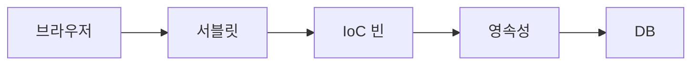
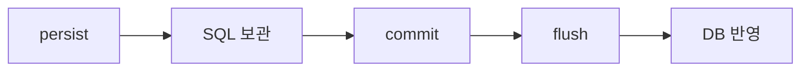
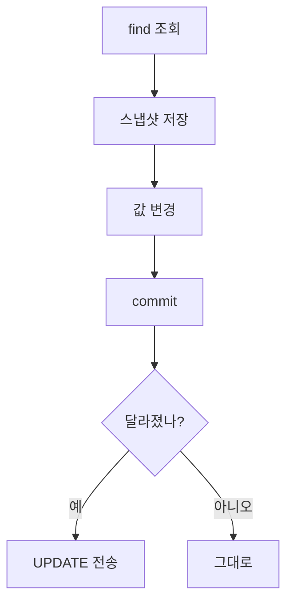

이 글은 JDBC로 DB를 다룰 때 생기는 네 가지 불편함과, JPA가 엔티티·영속성 컨텍스트·엔티티 매니저로 그 불편함을 푸는 방법을 정리한 글이다.

2026년 11월 2일 수업에서 진행한 내용을 정리했다.

## 이게 없으면 뭐가 불편할까

[JDBC 글]({{ site.baseurl }})에서는 자바에서 DB에 SQL을 직접 보냈다. 메뉴 하나를 조회하려면 이런 일을 매번 했다.

1. DB와 연결(Connection)을 연다.
2. SQL 문장을 직접 문자열로 쓴다.
3. 결과 표(ResultSet)를 한 칸씩 읽어서 자바 객체에 옮겨 담는다.
4. 연결을 닫는다.

메뉴 조회, 카테고리 조회, 메뉴 등록… 기능이 늘 때마다 이 네 단계를 또 쓴다. 요구사항이 조금만 바뀌어도 SQL, 객체, 옮겨 담는 코드를 줄줄이 고쳐야 한다.

수업에서는 이 불편함을 네 가지로 정리했다. 그리고 이걸 푸는 기술로 **JPA**를 배웠다. 한 줄로 먼저 말하면 이렇다.

> JPA는 JDBC의 불편한 점을 개선한 기술이다.

---

## 먼저, 실습은 어떻게 준비했을까

수업에서는 인텔리제이(IntelliJ)로 스프링 부트(Spring Boot) 프로젝트를 만들었다. 스프링 부트는 스프링 프로젝트를 설정 없이 빠르게 시작하게 도와주는 도구다.

### 어떤 라이브러리를 넣었을까?

프로젝트를 만들 때 필요한 라이브러리를 골랐다. 이렇게 프로젝트가 가져다 쓰는 라이브러리를 **의존성(dependency)** 이라고 부른다. JPA와 함께 데이터베이스 의존성(MySQL)도 추가했다.

```groovy
dependencies {
    implementation 'org.springframework.boot:spring-boot-starter-data-jpa'
    compileOnly 'org.projectlombok:lombok'
    runtimeOnly 'com.mysql:mysql-connector-j'
    annotationProcessor 'org.projectlombok:lombok'
}
```

| 의존성 | 하는 일 |
|--------|---------|
| `spring-boot-starter-data-jpa` | JPA와 그 구현체인 Hibernate를 함께 가져온다 |
| `mysql-connector-j` | 자바가 MySQL과 대화하게 해 주는 드라이버 |
| `lombok` | `@Getter`, `@ToString` 같은 어노테이션으로 반복 코드를 줄여 준다 |

프로젝트를 만든 뒤에는 실행 설정의 "구성 편집"을 눌러서, 실행할 클래스 경로가 맞는지 확인했다.

### 실행하자마자 에러가 난 이유는?

애플리케이션을 실행하자마자 에러가 났다. 스프링이 묻는 말은 하나였다. "어떤 데이터베이스를 쓸 건데?"

MySQL 의존성을 넣었으니 스프링은 DB에 연결하려고 한다. 그런데 어디에, 누구로 접속할지 모르니 실행이 멈춘다. 그래서 `application.yaml`에 DB 정보를 적어야 한다. yaml은 설정을 들여쓰기로 적는 파일 형식이다.

```yaml
spring:
  application:
    name: chap01-jpa-intro

  # mysql 의존성을 추가하면 yaml 파일에
  # 데이터베이스 관련 정보를 작성해주어야
  # 어플리케이션이 실행된다.
  datasource:
    driver-class-name: com.mysql.cj.jdbc.Driver
    url: jdbc:mysql://localhost:3306/menudb
    username: your_username   # 본인 계정으로 바꾼다
    password: your_password   # 본인 비밀번호로 바꾼다

  jpa:
    # jpa 가 알아서 생성해주는 sql 구문 보는 설정
    show-sql: true
    hibernate:
      ddl-auto: none
    properties:
      hibernate:
        # sql 구문을 보기 좋게 포맷팅
        format_sql: true
```

계정과 비밀번호는 글에 올리지 않으려고 자리 표시로 바꿨다.

JPA 관련 설정은 세 가지를 넣었다.

| 설정 | 뜻 |
|------|----|
| `show-sql: true` | JPA가 대신 만든 SQL을 콘솔에 보여 준다 |
| `format_sql: true` | 그 SQL을 줄을 나눠 보기 좋게 찍는다 |
| `ddl-auto` | 실행할 때 테이블을 어떻게 다룰지 정한다 |

`ddl-auto` 값은 수업에서 네 가지를 배웠다. DDL은 `CREATE TABLE`처럼 테이블 구조를 만드는 SQL을 부르는 말이다.

| 값 | 뜻 |
|----|----|
| `create` | 실행할 때 테이블을 새로 만든다 |
| `create-drop` | 실행할 때 만들고, 종료할 때 지운다 |
| `update` | 개발 중에 바뀐 엔티티 구조를 테이블에 반영한다 |
| `none` | 테이블을 건드리지 않는다. 미리 만들어 둔 테이블을 그대로 쓴다 |

수업에서는 `none`을 썼다. 테이블은 MySQL에 이미 만들어 두었기 때문이다. 스프링 부트 공식 문서에는 `validate`(엔티티와 테이블 구조가 맞는지 검사만 한다)도 있다. 또 MySQL처럼 내장 DB가 아니면 기본값이 `none`이라고 설명한다.

`create`와 `create-drop`은 기존 테이블을 지우고 다시 만든다. 실습 데이터가 날아갈 수 있으니 값을 바꿀 때 조심해야 한다.

마지막으로 인텔리제이의 데이터베이스 창에 `menudb`를 연결했다. 실습 코드는 수업에서 받은 코드를 붙여 넣고 따라 쳤다.

> 한 줄 요약: JPA와 MySQL 의존성을 넣으면, yaml에 DB 접속 정보를 적어야 실행된다.

---

## 1. JDBC로만 하면 무엇이 문제일까?

수업에서는 `JdbcProblem` 클래스로 JDBC의 문제를 하나씩 확인했다. 크게 네 가지다.

| 번호 | 문제 | 한 줄 설명 |
|------|------|------------|
| 1 | 반복 코드 | 연결 열기·SQL·옮겨 담기·닫기를 조회마다 다시 쓴다 |
| 2 | SQL에 의존하는 개발 | 요구사항이 바뀌면 SQL → 객체 → 옮겨 담는 코드가 줄줄이 바뀐다 |
| 3 | 패러다임 불일치 | 테이블은 "값"으로 연결되고, 객체는 "객체"로 연결된다 |
| 4 | 동일성 보장 문제 | 같은 행을 두 번 꺼내면 서로 다른 객체가 된다 |

### 문제 1. 같은 코드를 왜 계속 쓰게 될까?

메뉴 전체를 조회하는 코드다. 수업에서 받은 코드를 그대로 옮겼다.

```java
public void findAllMenu() {

    String query = "SELECT menu_code, menu_name, menu_price, category_code, orderable_status FROM tbl_menu";

    List<Menu> menuList = new ArrayList<>();

    // try-with-resources : try 블럭이 끝나면 Connection, Statement, ResultSet 을 자동으로 반납한다.
    try (Connection con = dataSource.getConnection();
         Statement stmt = con.createStatement();
         ResultSet rset = stmt.executeQuery(query)) {

        while (rset.next()) {
            // 조회 결과(행) 1개를 객체 1개로 직접 옮겨 담는다.
            Menu menu = new Menu();
            menu.setMenuCode(rset.getInt("menu_code"));
            menu.setMenuName(rset.getString("menu_name"));
            menu.setMenuPrice(rset.getInt("menu_price"));
            menu.setCategoryCode(rset.getInt("category_code"));
            menu.setOrderableStatus(rset.getString("orderable_status"));

            menuList.add(menu);
        }

    } catch (SQLException e) {
        throw new RuntimeException(e);
    }

    menuList.forEach(menu -> System.out.println(menu));
}
```

`dataSource`는 스프링이 미리 만들어 둔 **커넥션 풀**이다. 커넥션 풀은 DB 연결을 여러 개 만들어 두고 빌려주는 곳이다. 스프링은 연결만 빌려줄 뿐이다. SQL 작성, 실행, 결과를 객체로 옮기는 일은 전부 개발자가 한다.

`while` 안을 보자. 열 다섯 개를 하나씩 꺼내서 `set...`으로 옮겨 담는다. 이 코드는 메뉴를 조회하는 메서드마다 거의 똑같이 반복된다. 그래서 개발 시간이 늘고, 고칠 곳도 늘어난다.

### 문제 2. 요구사항이 바뀌면 어디를 고쳐야 할까?

손님이 이렇게 요청했다고 하자. "메뉴 목록을 볼 때 카테고리 이름도 같이 보여 주세요."

`tbl_menu`에는 카테고리 **코드**만 있다. 이름은 `tbl_category`에 있다. 그래서 세 군데를 고쳐야 한다.

1. SQL을 두 테이블을 붙이는 `JOIN` 문으로 바꾼다.
2. 카테고리 이름을 담을 새 클래스 `MenuCategoryDTO`를 만든다.
3. 결과를 옮겨 담는 코드를 다시 쓴다.

```java
String query = "SELECT m.menu_code, m.menu_name, m.menu_price, c.category_name, m.orderable_status " +
               "FROM tbl_menu m " +
               "JOIN tbl_category c ON m.category_code = c.category_code " +
               "ORDER BY m.menu_code";
```

```java
/* comment.
 *   "메뉴 조회 시 카테고리 이름도 보여주세요" 라는 요구사항 때문에 새로 만든 클래스
 *   - JOIN 결과(메뉴 + 카테고리명)를 담을 객체가 기존에 없기 때문에
 *   - SQL 이 바뀔 때마다 이런 클래스가 계속 늘어나게 된다.
 *  */
public class MenuCategoryDTO {

    private int menuCode;
    private String menuName;
    private int menuPrice;
    private String categoryName;
    private String orderableStatus;

}
```

DTO(Data Transfer Object)는 데이터를 담아 옮기는 용도의 클래스다. SQL이 바뀔 때마다 이런 클래스가 하나씩 늘어난다.

이렇게 되면 객체를 중심으로 생각하지 못한다. SQL과 테이블을 먼저 생각하고, 객체를 거기에 맞춰 만들게 된다. 수업에서는 이것을 **SQL에 의존적인 개발**이라고 불렀다.

### 문제 3. 테이블과 객체는 왜 서로 안 맞을까?

메뉴 하나는 카테고리 하나에 속한다. 이 관계를 테이블과 자바는 다르게 표현한다.

| | 관계를 어떻게 표현하나 | 예 |
|--|------------------------|----|
| 테이블 | 상대 테이블의 키 **값**을 열로 가진다. 이 열을 외래키(FK)라고 부른다 | `tbl_menu.category_code = 4` |
| 자바 객체 | 상대 **객체**를 필드로 가진다 | `menu.getCategory()` |

그런데 JDBC 실습의 `Menu`는 테이블 모양에 맞춰 만들었다. 카테고리를 객체가 아니라 `int categoryCode` 값으로 갖고 있다.

```java
public class Menu {

    private int menuCode;
    private String menuName;
    private int menuPrice;
    private int categoryCode;
    private String orderableStatus;

}
```

그래서 메뉴의 카테고리가 필요하면 `menu.getCategory()`로 바로 꺼낼 수 없다. 그 코드로 SQL을 한 번 더 실행하고, 결과를 직접 조립해야 한다.

```java
Menu menu = findMenuByMenuCode(menuCode);

// menu.getCategory() 처럼 객체를 탐색할 수 없다.
// categoryCode 값으로 카테고리를 다시 조회해야 한다.
Category category = findCategoryByCategoryCode(menu.getCategoryCode());
```

테이블과 객체가 세상을 보는 방식이 달라서 생기는 문제다. 이것을 **패러다임 불일치**라고 부른다.

카테고리를 조회하는 코드에는 `rset.getObject("ref_category_code", Integer.class)`도 나온다. `ref_category_code`에는 NULL이 들어갈 수 있어서 `getInt` 대신 쓴 것이다. 이 내용은 [JDBC getFloat와 NULL 글]({{ site.baseurl }})에서 다뤘다.

### 문제 4. 같은 메뉴를 두 번 꺼내면 같은 객체일까?

같은 메뉴 코드로 두 번 조회해서 비교해 봤다.

```java
public void compareSameMenu(int menuCode) {

    Menu menu1 = findMenuByMenuCode(menuCode);
    Menu menu2 = findMenuByMenuCode(menuCode);

    if (menu1 == null) {
        System.out.println(menuCode + "번 메뉴가 존재하지 않습니다.");
        return;
    }

    System.out.println("menu1 = " + menu1.hashCode());
    System.out.println("menu2 = " + menu2.hashCode());
    System.out.println("menu1 == menu2 : " + (menu1 == menu2));

    menu1.setMenuName("이름 변경 테스트");

    System.out.println("menu1 의 메뉴 이름만 변경한 후");
    System.out.println("menu1.getMenuName() = " + menu1.getMenuName());
    System.out.println("menu2.getMenuName() = " + menu2.getMenuName());
}
```

`findMenuByMenuCode`는 부를 때마다 `new Menu()`로 새 객체를 만든다. 그래서 DB의 같은 행을 꺼냈는데도 `menu1`과 `menu2`는 서로 다른 객체다.

수업 코드 주석에는 "중요!!"라고 적혀 있었다. 같은 데이터인데 객체가 둘이면, 한쪽을 고쳐도 다른 쪽은 그 사실을 모른다. `menu1`의 이름만 바꾸면 `menu2`는 예전 이름 그대로다.

같은 사람의 신분증을 두 장 복사해 둔 것과 비슷하다. 한 장에 주소를 고쳐 적어도 다른 한 장은 옛 주소 그대로다. 이것을 **동일성 보장 문제**라고 부른다.

> 한 줄 요약: JDBC만 쓰면 반복 코드, SQL 의존, 패러다임 불일치, 동일성 문제가 생긴다.

---

## 2. JPA는 무엇이고, 무엇을 대신해 줄까?

### 한 문장으로 말하면

한국어만 하는 손님과 영어만 하는 가게 주인 사이에 통역사가 있다고 해 보자. 손님은 "이 메뉴 주세요"라고 한국어로만 말한다. 통역사가 알아서 영어로 바꿔 전하고, 돌아온 답도 한국어로 바꿔 준다.

JPA는 자바 객체와 DB 사이의 통역사다. 수업에서는 이렇게 배웠다.

```java
/* comment.
    JPA 란?
    자바 진영의 ORM (Object Relational Mapping) 기술 표준이다.
    Java 객체를 Database 와 매핑한다.
 */
```

**ORM(Object Relational Mapping)** 은 객체와 테이블을 짝지어 주는 기술이다. 짝지어 주는 것을 **매핑**이라고 부른다. JPA는 원래 Java Persistence API의 줄임말이었고, 지금은 이름이 Jakarta Persistence로 바뀌었다.

JPA는 "이렇게 동작해야 한다"는 **규칙(표준)** 이다. 실제로 일하는 프로그램은 따로 있다. 이것을 구현체라고 부르고, 수업에서 쓴 구현체는 **Hibernate**다. yaml 설정에 `hibernate:`가 나온 이유가 이것이다.

비유에는 한계가 있다. 통역사는 사람이라 상황을 보고 알아서 판단한다. JPA는 우리가 붙인 어노테이션 정보대로만 SQL을 만든다. 매핑 정보를 잘못 적으면 엉뚱한 SQL이 나간다.

### JDBC는 이제 안 쓰는 걸까?

여기서 많이들 헷갈린다. JPA를 쓰면 JDBC가 사라지는 게 아니다. **JDBC는 JPA 안에 숨어서 내부적으로 동작한다.** JPA가 SQL을 만들고, 그 SQL을 DB에 보내는 일은 여전히 JDBC가 한다. 우리가 JDBC 코드를 직접 쓰지 않을 뿐이다.

### 엔티티 — 테이블과 짝지은 클래스

JPA에게 "이 클래스는 저 테이블이야"라고 알려 줘야 한다. 이렇게 테이블과 매핑한 클래스를 **엔티티(Entity)** 라고 부른다. 클래스명은 테이블 이름과, 필드는 컬럼과 매칭한다.

```java
/* comment.
    @Entity : JPA 가 관리하는 객체라는 것을 명시!!!!
    @Table : 해당 엔티티 객체와 매핑이 될 테이블 이름을 지정
 */
@Entity
@Table(name="tbl_menu")
@NoArgsConstructor
@AllArgsConstructor
@Getter
@ToString
public class Menu {
    @Id
    @Column(name="menu_code")
    private int menuCode;

    @Column(name="menu_name")
    private String menuName;

    @Column(name="menu_price")
    private int menuPrice;

    @Column(name="category_code")
    private int categoryCode;

    @Column(name="orderable_status")
    private String orderableStatus;
}
```

| 어노테이션 | 뜻 |
|------------|----|
| `@Entity` | JPA가 관리하는 객체라고 표시한다 |
| `@Table(name="tbl_menu")` | 이 엔티티와 짝지을 테이블 이름 |
| `@Id` | 기본키(PK, Primary Key) 필드. 행마다 하나뿐인 대표 번호다 |
| `@Column(name="menu_name")` | 이 필드와 짝지을 컬럼 이름 |

`categoryCode` 부분은 다음 절에서 바꾼다. 처음에는 JDBC 때처럼 `int`로 두었다.

### 직접 해보기 — 메뉴 하나 조회

엔티티를 다루는 일은 **엔티티 매니저(EntityManager)** 가 한다. `JpaSolution` 클래스를 만들고 메서드를 작성했다.

```java
@Component          //빈으로 등록함
public class JpaSolution {

    @PersistenceContext
    private EntityManager manager;

    /* comment.
        1. JDBC -> JPA 해결 포인트
        SQL 작성, JDBC 코드, DB 데이터 <-> Java 객체 매핑 코드
        위 3가지 내용은 JPA 를 사용했을 때 자동으로 수행해준다.
     */
    public void findMenu(int menuCode) {

        // 엔티티 매니저가 관리하는 엔티티를 find(조회)
        Menu foundMenu = manager.find(Menu.class, menuCode);

        System.out.println(foundMenu);
    }
}
```

`@Component`는 이 클래스를 스프링이 관리하는 객체(빈, Bean)로 등록하라는 표시다. `@PersistenceContext`는 엔티티 매니저를 넣어 달라는 표시다.

`manager.find(Menu.class, menuCode)` 한 줄이 문제 1의 긴 코드를 대신한다. "Menu 엔티티 중에 기본키가 `menuCode`인 것을 찾아 줘"라는 뜻이다. `show-sql`을 켜 두었기 때문에, JPA가 만든 SELECT 문이 콘솔에 찍힌다.

JPA가 대신해 주는 것은 세 가지다.

| JDBC에서 내가 하던 일 | JPA에서는 |
|-----------------------|-----------|
| SQL 작성 | 엔티티 정보를 보고 JPA가 만든다 |
| JDBC 코드 (연결 열기·실행·닫기) | JPA가 내부에서 한다 |
| DB 데이터 ↔ 자바 객체 옮겨 담기 | JPA가 매핑 정보대로 채운다 |

> 한 줄 요약: JPA는 객체와 테이블을 짝지어 주는 표준이다. SQL 작성, JDBC 코드, 매핑 코드를 대신해 준다.

---

## 3. 메뉴와 카테고리를 객체로 연결하려면? — `@ManyToOne`

### 왜 필요할까

"2번 메뉴를 조회하면 메뉴의 모든 정보와 카테고리 정보도 같이 나왔으면 좋겠다." 수업에서 받은 요구사항이다.

JDBC였다면 문제 3처럼 SQL을 한 번 더 쓰고 직접 조립해야 했다. JPA에서는 카테고리도 엔티티로 만들고, 메뉴가 카테고리 **객체**를 갖게 하면 된다.

### 한 문장으로 말하면

학생증에 "3반"이라고 숫자만 적혀 있으면, 담임 선생님이 누군지 알려면 교무실에 다시 가서 물어야 한다. 학생증에 담임 선생님 연락처가 바로 붙어 있으면 그 자리에서 알 수 있다.

**연관관계 매핑**은 엔티티가 다른 엔티티를 필드로 갖게 하는 것이다. 메뉴 여러 개가 카테고리 하나에 속하니까, 메뉴 쪽에서 보면 "다(Many) 대 일(One)"이다. 그래서 `@ManyToOne`을 쓴다.

비유에는 한계가 있다. 학생증에 연락처를 붙이면 정보가 실제로 두 곳에 적힌다. JPA에서는 테이블에 여전히 `category_code` 값 하나만 있다. 객체로 보이게 해 주는 것은 JPA가 조회할 때 하는 일이다.

### 직접 해보기

먼저 `Category` 엔티티를 만든다.

```java
@Entity
@Table(name="tbl_category")
@NoArgsConstructor
@AllArgsConstructor
@Getter
@ToString
public class Category {

    @Id
    @Column(name="category_code")
    private int categoryCode;

    @Column(name="category_name")
    private String categoryName;

    @Column(name="ref_category_code")
    private Integer refCategoryCode;
}
```

그다음 `Menu`의 `categoryCode` 변수를 `Category` 객체로 바꾼다.

```java
/* comment.
    categoryCode 필드는 실제로는 Category 테이블의
    fk 를 지칭한다.
    Java 객체로 해당 연관관계를 표현하는 방법은
    Category 엔티티를 Menu 엔티티에서 필드로 가지고 있으면 된다.
 */
@ManyToOne
@JoinColumn(name="category_code")
//private int categoryCode;
private Category category;      //카테고리 코드를 카테고리 객체로 바꿈
```

`@JoinColumn(name="category_code")`은 "두 엔티티를 이을 때 `tbl_menu`의 `category_code` 컬럼을 써라"라는 뜻이다. 외래키 컬럼을 알려 주는 것이다.

`JpaSolution`의 메서드는 조회 코드가 1번과 똑같다.

```java
/* comment.
    2. 2번 메뉴 조회 시 해당 메뉴의 모든 정보와 카테고리 정보를 조회.
    -------
    데이터베이스와 Java 객체간의 패러다임 불일치 문제를 연관관계를
    통해서 해결할 수 있게됨.
 */
public void findMenuAndCategory(int menuCode) {
    Menu foundMenu = manager.find(Menu.class, menuCode);
    System.out.println(foundMenu);
}
```

코드는 그대로인데 결과가 달라진다. `Menu`에 `@ToString`이 붙어 있고, 그 안의 `category` 필드도 함께 출력된다. 메뉴 정보 끝에 `Category(...)`가 같이 나온다. SQL을 더 쓰지 않았는데 `foundMenu.getCategory()`로 카테고리를 바로 꺼낼 수 있다.

> 한 줄 요약: `@ManyToOne`으로 메뉴가 카테고리 객체를 갖게 하면, 테이블의 "값" 연결이 자바의 "객체" 연결로 바뀐다.

---

## 4. 세 가지 컨테이너 — 영속성 컨텍스트는 어디에 있을까?

수업 노트에는 스프링 웹 애플리케이션에 나오는 컨테이너 세 개가 함께 정리돼 있었다. 컨테이너는 "어떤 것들을 담아 두고 대신 관리해 주는 곳"이다. 셋 다 이름에 컨테이너 느낌이 있어서 헷갈리기 쉽다.

| 컨테이너 | 한 줄 설명 | 관리하는 것 |
|----------|-----------|-------------|
| 서블릿 컨테이너 | 웹 요청을 받고 응답을 보내는 통신 중개자 | 서블릿 |
| IoC 컨테이너 | 애플리케이션 객체들을 관리하는 공장 | 빈(Bean) |
| 영속성 컨텍스트 | 애플리케이션과 DB 사이의 임시 보관 공간 | 엔티티 |

### 서블릿 컨테이너

식당 입구의 안내 직원과 비슷하다. 손님(브라우저)을 맞이하고, 주문을 주방에 넘기고, 나온 음식을 손님에게 가져다준다.

**서블릿 컨테이너**는 브라우저의 HTTP 요청을 받아 자바 서블릿을 실행하고, 결과를 HTTP 응답으로 바꿔 돌려준다. 대표적인 것이 Tomcat이다. 자세한 내용은 [웹 서버, Tomcat, 서블릿 글]({{ site.baseurl }})에 정리했다.

- **네트워크 통신을 대신한다.** 포트를 열고 요청을 기다린다. 개발자가 통신 코드를 직접 쓰지 않아도 된다.
- **서블릿의 일생을 관리한다.** 만들기, 초기화(`init`), 실행(`service`), 소멸(`destroy`)을 맡는다.
- **스레드를 나눠 준다.** 요청이 들어오면 스레드 풀에서 스레드를 하나 꺼내 맡긴다. 그래서 요청 여러 개를 동시에 처리한다. 스레드는 [프로세스와 스레드 글]({{ site.baseurl }})에서 다뤘다.

스프링의 `DispatcherServlet`도 서블릿 컨테이너 위에서 동작하는 서블릿 하나다. 요청이 가장 먼저 도착하는 곳이 서블릿 컨테이너다.

### IoC 컨테이너

**IoC(Inversion of Control, 제어의 역전)** 는 객체를 만드는 주도권이 개발자에서 스프링으로 넘어간다는 뜻이다. 개발자가 `new`로 직접 만들지 않는다. 스프링이 설정(어노테이션 등)을 보고 대신 만든다.

- **의존성 주입(DI, Dependency Injection)** — 객체가 필요로 하는 다른 객체를 스프링이 넣어 준다. 컨트롤러에 서비스 객체를 넣어 주는 식이다.
- **싱글톤 관리** — 빈은 기본적으로 하나만 만들어서 여러 곳이 같이 쓴다. 싱글톤은 "객체를 딱 하나만 만든다"는 뜻이다.
- 대표 인터페이스는 `BeanFactory`와, 이를 확장한 `ApplicationContext`다.

실습 코드의 `main`에서도 이걸 볼 수 있다.

```java
ConfigurableApplicationContext context = SpringApplication.run(Section02Application.class, args);

JpaSolution jpaSolution = context.getBean(JpaSolution.class);
```

`SpringApplication.run()`이 IoC 컨테이너를 만든다. 이때 yaml의 DB 정보를 읽어 커넥션 풀도 빈으로 등록한다. `@Component`를 붙인 `JpaSolution`은 `new` 없이 `getBean`으로 꺼내 쓴다.

실습 코드 주석에는 이런 내용도 있었다. `@SpringBootApplication`이 붙은 클래스의 패키지 아래만 살펴보고 빈을 등록한다. 그래서 섹션마다 실행 클래스를 따로 두면, 다른 섹션의 클래스와 섞이지 않는다.

### 영속성 컨텍스트

**영속성 컨텍스트(Persistence Context)** 는 엔티티를 담아 두고 관리하는 공간이다. 수업 코드 주석은 이렇게 설명했다.

```java
/* comment.
    PersistenceContext 는 Entity 객체를 관리하는 컨테이너이다.
    Application 에서 만든 Entity 객체를 EntityManager 를 통해서
    PersistenceContext 에 넣을 수도 있고, 조회할 수도 있다.
 */
```

영속성은 "프로그램이 꺼져도 데이터가 남는 성질"이다. 영속성 컨텍스트는 엔티티를 DB에 영구 저장하기 전에 머무는 곳이다. 우리는 엔티티 매니저를 거쳐서만 이 공간에 접근한다.

택배 회사의 물류 창고를 떠올려 보자. 물건을 바로 집으로 보내지 않고, 창고에 모아 두었다가 한 번에 출발시킨다. 이미 창고에 있는 물건은 다시 공장에 주문하지 않고 창고에서 꺼낸다.

비유에는 한계가 있다. 물류 창고는 계속 그 자리에 있다. 영속성 컨텍스트는 보통 트랜잭션 하나, 또는 엔티티 매니저 하나가 살아 있는 동안만 존재한다. 끝나면 비워진다. 트랜잭션은 "모두 성공하거나 모두 취소되는 작업 묶음"이다.

노트에 정리한 영속성 컨텍스트의 장점은 다섯 가지다. 각각은 이 글 뒤에서 코드로 확인한다.

| 장점 | 뜻 | 확인하는 곳 |
|------|----|------------|
| 1차 캐시 | 조회한 엔티티를 보관해 두고, 다시 찾으면 DB에 가지 않고 꺼내 준다 | 5절 |
| 동일성 보장 | 같은 트랜잭션 안에서 같은 ID로 찾은 엔티티는 같은 객체다 | 5절 |
| 쓰기 지연 | INSERT·UPDATE·DELETE SQL을 모아 두었다가 커밋할 때 DB로 보낸다 | 6절 |
| 변경 감지 | 엔티티 값을 바꾸면 커밋할 때 알아서 UPDATE를 만든다 | 7절 |
| 지연 로딩 | 연관된 객체를 실제로 쓰는 순간에 조회한다 | 헷갈렸던 점 |

### 세 컨테이너는 어떤 순서로 일할까?



요청은 서블릿 컨테이너 → IoC 컨테이너의 빈 → 영속성 컨텍스트 → DB 순서로 흘러간다.

1. 사용자가 브라우저에서 버튼을 누르면 HTTP 요청이 서버로 간다.
2. **서블릿 컨테이너**(Tomcat)가 요청을 받아 스레드를 주고, `DispatcherServlet`에 넘긴다.
3. `DispatcherServlet`은 **IoC 컨테이너**에 등록된 컨트롤러 빈을 찾아 요청을 맡긴다. 이어서 서비스 빈이 업무 로직을 실행한다.
4. DB가 필요하면 서비스가 리포지토리를 부른다. 이때 **영속성 컨텍스트**가 일을 시작한다.
5. 영속성 컨텍스트는 1차 캐시와 변경 감지 등을 써서 DB와 SQL을 주고받는다.

이번 실습은 웹 요청 없이 콘솔에서 `main`을 실행했다. 그래서 2~3번 대신 `getBean`으로 빈을 직접 꺼냈다.

> 한 줄 요약: 서블릿 컨테이너는 요청을, IoC 컨테이너는 객체를, 영속성 컨텍스트는 엔티티를 관리한다.

---

## 5. 같은 메뉴를 두 번 꺼내면? — 동일성 보장

### 직접 해보기

JDBC 문제 4와 같은 실험을 JPA로 했다.

```java
/* comment.
    3. 동일성 보장 문제 해결
    @Transactional 어노테이션을 메서드에 달게 되면 해당 메서드가 실행될 때
    트랜잭션이 시작된다.
    또한 해당 메서드가 끝나게 된다면,
     => 에러가 발생하지 않으면 commit / 에러가 발생하면 rollback 을 자동 처리해준다.
     ----
     단, readOnly 조건은 조회 전용 트랜잭션이다.
     ----
     동일한 트랜잭션 내부에서 같은 PK 값으로 조회 한 엔티티는 항상 같은 객체를 반환한다.
 */
@Transactional(readOnly = true) //조회이기 때문에 readOnly=true 로 작성(읽기 전용!!!!!!)
public void compareSameMenu(int menuCode) {
    System.out.println("=============1번째 조회=============");
    Menu menu1 = manager.find(Menu.class, menuCode);    // 메뉴 엔티티를 조회
    System.out.println("=============2번째 조회=============");
    Menu menu2 = manager.find(Menu.class, menuCode);

    System.out.println("menu1 = " + menu1.hashCode());
    System.out.println("menu2 = " + menu2.hashCode());
    System.out.println("menu1 == menu2 : " + (menu1==menu2));

    // 1번 메뉴 이름 변경 메소드 생성.
    menu1.changeMenuName("테스트!");
    System.out.println("menu1 = " + menu1.getMenuName());
    System.out.println("menu2 = " + menu2.getMenuName());
}
```

이름을 바꾸는 메서드는 `Menu` 엔티티에 새로 만들었다.

```java
public void changeMenuName(String s) {
    this.menuName=s;
}
```

결과는 JDBC 때와 반대였다. 두 해시코드가 같고, `menu1 == menu2`는 `true`다. `menu1`의 이름만 바꿨는데 `menu2`의 이름도 똑같이 바뀌어 나온다.

### 왜 같은 값이 나올까?

JPA는 같은 데이터를 조회할 때마다 새 객체를 만들지 않는다. 흐름을 단계별로 보면 이렇다.

1. **트랜잭션 시작** — `@Transactional`이 붙어 있어서, 메서드가 도는 동안 영속성 컨텍스트 하나가 유지된다.
2. **첫 번째 조회** — `manager.find`가 DB에서 메뉴를 읽어 객체를 만들고, **1차 캐시**에 넣어 둔다. 1차 캐시는 영속성 컨텍스트 안의 보관함이다.
3. **두 번째 조회** — 같은 `menuCode`로 다시 찾으면 DB에 가지 않는다. 1차 캐시에 있는 바로 그 객체를 돌려준다.

그래서 `menu1`과 `menu2`는 같은 객체 하나를 가리킨다. 이름이 하나라서 한쪽을 바꾸면 다른 쪽도 바뀐 것처럼 보인다. 사실은 처음부터 한 객체였다.

콘솔을 보면 차이가 더 잘 보인다. `show-sql`을 켜 두었으니, SELECT 문이 "1번째 조회" 뒤에만 찍히는지 확인해 보면 된다. 두 번째 조회는 1차 캐시에서 꺼내므로 SQL이 나가지 않아야 한다.

수업에서 정리한 문장은 이것이다.

> 동일한 트랜잭션 내부에서 같은 PK 값으로 조회한 엔티티는 항상 같은 객체를 반환한다.

JDBC의 신분증 복사본 비유로 다시 말하면, JPA는 복사본을 만들지 않는다. "그 신분증은 이미 여기 있어요" 하고 원본을 그대로 건넨다.

### 첫 실행 때 에러가 나면 어떻게 될까?

`@Transactional`이 여기서 역할을 한다. 메서드 안에서 런타임 예외가 나면, 스프링은 진행 중이던 트랜잭션을 취소(롤백)한다. 트랜잭션이 끝나면서 영속성 컨텍스트와 1차 캐시도 함께 비워진다.

스프링 공식 문서에 따르면 기본 설정에서 롤백하는 예외는 `RuntimeException`과 그 하위 예외, 그리고 `Error`다. `Exception`을 직접 상속한 체크 예외는 기본으로는 롤백하지 않는다. 체크 예외도 롤백하려면 `rollbackFor`를 따로 적는다.

### 메뉴가 아예 없다면?

DB 연결은 멀쩡한데, 그 `menuCode`에 맞는 메뉴가 없을 수도 있다. Jakarta Persistence API 문서에 따르면 이때 `find()`는 에러 대신 `null`을 돌려준다.

여기서 노트에 서로 맞지 않는 부분이 있었다. 노트에는 "코드가 끝까지 정상 실행되고, 1차 캐시가 `null`을 기억해서 `menu1 == menu2`가 `true`로 나온다"고 적혀 있었다.

하지만 위 JPA 코드에는 JDBC 때와 달리 `if (menu1 == null)` 검사가 없다. `menu1`이 `null`이면 바로 다음 `menu1.hashCode()`에서 `NullPointerException`이 난다. 그래서 `menu1 == menu2` 줄까지 가지 못한다. 이 예외도 런타임 예외라서 앞에서 말한 롤백이 일어난다.

"1차 캐시가 `null`을 기억한다"는 설명도 공식 문서에서 확인하지 못했다. 그래서 이 부분은 확실한 내용으로 적지 않는다. 직접 확인하려면 없는 코드로 실행해서 SELECT가 몇 번 찍히는지 보면 된다.

> 한 줄 요약: 같은 트랜잭션 안에서 같은 PK로 찾으면 1차 캐시의 같은 객체가 돌아온다. 그래서 동일성이 보장된다.

---

## 6. 엔티티 매니저로 CRUD하기 — 등록과 쓰기 지연

두 번째 실습 프로젝트(`chap02-persistence-context`)에서는 엔티티 매니저로 CRUD를 했다. CRUD는 Create(등록), Read(조회), Update(수정), Delete(삭제)의 앞글자다.

### 무엇을 준비했을까?

전 프로젝트의 `Menu` 클래스를 복사해서 붙여 넣었다. 이번 프로젝트에는 `Category` 엔티티가 없다. 그래서 `category` 필드를 다시 기본 자료형 `int categoryCode`로 바꿨다. 값을 바꿔야 해서 `@Setter`도 붙였다.

```java
@Entity
@Table(name="tbl_menu")
@NoArgsConstructor
@AllArgsConstructor
@Getter
@Setter
@ToString
public class Menu {
    @Id
    @Column(name="menu_code")
    private int menuCode;

    @Column(name="menu_name")
    private String menuName;

    @Column(name="menu_price")
    private int menuPrice;

    @Column(name="category_code")
    private int categoryCode;

    @Column(name="orderable_status")
    private String orderableStatus;
}
```

그리고 `EntityManagerCRUD` 클래스를 빈으로 등록하고, 기능마다 메서드를 만들었다.

### 엔티티 매니저를 왜 메서드마다 만들까?

첫 번째 실습의 `JpaSolution`은 `@PersistenceContext`로 엔티티 매니저를 필드에 받았다. 이번에는 그 코드를 주석 처리하고, **엔티티 매니저 팩토리(EntityManagerFactory)** 를 받았다.

```java
@Component
public class EntityManagerCRUD {

    /* comment.
        엔티티 매니저는 기능 1개당 1개의 매니저를
        별도로 생성해야 한다.
        즉 필드에서 매니저를 공유하는 것이 아닌,
        1개의 요청 시 1개의 매니저만 존재해야 한다.
     */
//    @PersistenceContext
//    private EntityManager manager;
    private final EntityManagerFactory factory;

    public EntityManagerCRUD(EntityManagerFactory factory) {
        this.factory = factory;
    }
}
```

팩토리는 이름 그대로 엔티티 매니저를 찍어 내는 공장이다. 공장은 하나만 두고, 엔티티 매니저는 요청마다 새로 만들고 다 쓰면 닫는다.

정수기와 종이컵을 떠올리면 쉽다. 정수기(팩토리)는 사무실에 하나 두고 다 같이 쓴다. 종이컵(엔티티 매니저)은 한 사람이 한 번 쓰고 버린다. 컵 하나를 여러 사람이 돌려 쓰면 위생 문제가 생긴다.

비유에는 한계가 있다. 종이컵은 쓰고 버리면 끝이다. 엔티티 매니저는 닫을 때 그 안의 영속성 컨텍스트도 함께 사라진다. 그래서 닫은 뒤에는 1차 캐시도 쓸 수 없다.

스프링 공식 문서에 따르면 엔티티 매니저 팩토리는 여러 스레드가 같이 써도 안전하지만, 엔티티 매니저는 그렇지 않다. 이 부분은 헷갈렸던 점에서 다시 다룬다.

### 직접 해보기 — 조회

```java
public void findMenuByMenuCode(int menuCode) {
    //조회: find(엔티티 타입,PK 값)

    // manager는 1회 요청 시 인스턴스를 생성하며
    // 요청이 종료되면 없앤다.
    EntityManager manager = factory.createEntityManager();

    Menu foundMenu = manager.find(Menu.class, menuCode);
    System.out.println("foundMenu = " + foundMenu);
    manager.close();
}
```

`createEntityManager()`로 만들고, `find()`로 찾고, `close()`로 닫는다.

### 직접 해보기 — 등록

등록은 `persist()`로 한다. 엔티티를 영속성 컨텍스트에 넣는 메서드다.

```java
/* comment.
    Create : 엔티티 객체를 Persistence Context에 등록
    persist();
 */
public void registMenu(Menu menu) {
    EntityManager manager = factory.createEntityManager();
    // DML (Insert, Update, Delete)의 경우
    // 트랜잭션이 매우 중요하다.
    // DML 중 오류가 발생하면 롤백이 반드시 필요하다

    EntityTransaction transaction = manager.getTransaction();
    // 해당 코드 아래부터는 트랜잭션이 적용된다.
    transaction.begin();

    // 영속성 컨텍스트에 저장하는 메서드
    try{
        // 엔티티 매니저는 cud 작업 시 SQL 을 DB에 바로 반영하지 않는다.
        // "쓰기 지연 SQL 저장소" 에 SQL 을 보내준다.
        // flush() 시점에 DB 로 SQL 을 보내준다.
        manager.persist(menu);
        // commit() 메서드가 호출되면 flush 가 자동 실행된다.
        transaction.commit();
        System.out.println("등록 된 메뉴 : " + menu);
    } catch(Exception e){
        transaction.rollback();
    } finally {
        manager.close();
    }
}
```

DML은 INSERT·UPDATE·DELETE처럼 데이터를 바꾸는 SQL이다. 데이터를 바꾸는 작업은 중간에 실패하면 되돌려야 하므로 트랜잭션이 꼭 필요하다. `begin()`으로 시작하고, 성공하면 `commit()`, 예외가 나면 `rollback()`한다.

이번에는 `@Transactional` 대신 `EntityTransaction`으로 트랜잭션을 직접 열고 닫았다. 스프링이 대신 해 주던 일을 손으로 하는 셈이다.

### 쓰기 지연 — persist를 불렀는데 왜 바로 저장되지 않을까?

`persist()`를 불러도 INSERT가 바로 DB로 가지 않는다. SQL은 먼저 **쓰기 지연 SQL 저장소**에 쌓인다. 그러다 **flush** 순간에 DB로 보내진다. flush는 "쌓아 둔 SQL을 DB로 내보낸다"는 뜻이다. `commit()`을 부르면 flush가 자동으로 실행된다.



`persist`로 만든 SQL은 저장소에 머물다가, `commit`이 flush를 부를 때 DB로 간다.

### 쓰기 지연은 무엇이 좋을까?

마트에서 물건 하나 살 때마다 계산대에 가는 것과, 장바구니에 다 담고 한 번에 계산하는 것의 차이다.

SQL을 만들 때마다 DB로 보내면, 그때마다 네트워크를 오간다. 쓰기 지연을 쓰면 SQL을 모아 두었다가 커밋할 때 보낸다. 노트에는 "네트워크 반복이 최소화된다"고 적었다.

그런데 여기서 한 가지 조심할 점이 있다. 이 부분은 "헷갈렸던 점"에서 다시 정리한다.

> 한 줄 요약: `persist()`는 SQL을 저장소에 모아 두기만 한다. 실제로 DB에 가는 건 `commit()`이 flush를 부를 때다.

---

## 7. 수정 메서드는 왜 없을까? — 변경 감지

### 한 문장으로 말하면

시험지를 걷기 전에 선생님이 처음 나눠 준 시험지 사진을 찍어 두었다고 해 보자. 시험이 끝나면 사진과 지금 시험지를 비교해서, 달라진 칸만 채점한다.

JPA에는 `update()` 같은 수정 메서드가 없다. 수업 노트에는 이렇게 적혀 있다.

```java
/* comment.
    Update : update 관련 메서드는 존재하지 않는다.
    - 영속성 컨텍스트는 엔티티를 처음 조회(find) 하는 순간
      엔티티의 상태(스냅샷)을 보관하고 있다.
    - 보관 된 스냅샷과 commit 시점의 엔티티를 비교해서 변경 된 부분이 있다면
      UPDATE 쿼리문을 만들어서 쓰기 지연 저장소에 등록 후 DB에 전송한다.
      ---
    - 위 과정을 변경 감지(Dirty Checking) 라고 한다.
 */
```

**스냅샷**은 엔티티를 처음 가져온 순간의 모습을 찍어 둔 사본이다. 커밋할 때 스냅샷과 지금 엔티티를 비교한다. 바뀐 게 있으면 UPDATE를 만든다. 이것을 **변경 감지(Dirty Checking)** 라고 부른다.

비유에는 한계가 있다. 선생님은 사진을 볼 때 사람 눈으로 대충 볼 수도 있다. JPA는 영속성 컨텍스트가 관리하는 엔티티만, 필드 값을 하나하나 비교한다. 영속성 컨텍스트 밖의 객체는 아무리 바꿔도 감지하지 않는다.



조회할 때 찍어 둔 스냅샷과 커밋 순간의 엔티티를 비교해, 달라졌을 때만 UPDATE를 보낸다.

### 직접 해보기

```java
public void modifyMenuName(int menuCode, String menuName) {
    EntityManager manager = factory.createEntityManager();
    Menu foundMenu = manager.find(Menu.class, menuCode);

    System.out.println("수정 전 메뉴 : " + foundMenu);

    EntityTransaction transaction = manager.getTransaction();
    transaction.begin();

    //에러가 발생하면 rollback 시키기 위해 try-catch 문 작성
    try {
        // setter 메서드를 사용해서 값 변경
        foundMenu.setMenuName(menuName);
        System.out.println("=============commit 하기 전============");
        transaction.commit();

    } catch (Exception e) {
        transaction.rollback();
    }

    System.out.println("수정 후 메뉴 : " + manager.find(Menu.class, menuCode));
    manager.close();
}
```

`setMenuName()`으로 값만 바꿨다. SQL도, `update()`도 없다. 그런데 `commit()`을 부르면 JPA가 스냅샷과 비교해서 UPDATE 문을 만든다. 콘솔에서 "commit 하기 전" 줄 **뒤에** UPDATE가 찍히는지 보면 쓰기 지연까지 함께 확인할 수 있다.

> 한 줄 요약: 엔티티 값을 바꾸기만 하면 된다. 커밋할 때 JPA가 스냅샷과 비교해서 UPDATE를 대신 만든다.

---

## 8. 삭제는 어떻게 할까? — `remove()`

수업 노트의 정리는 이렇다.

```java
/* comment.
    Delete : remove(엔티티); 메서드 -> 삭제하고자하는 엔티티 개체를 넣어주면 된다.
    - 삭제할 엔티티는 먼저 조회 후 영속성 컨텍스트가
    - 관리하고 있는 상태에서 삭제가 가능하다.
    - remove(); 메서드를 호출해도 commit() 이 되는 시점에 delete 쿼리문이 DB로 전송된다.
 */
```

핵심은 두 가지다.

1. **먼저 조회해야 한다.** 영속성 컨텍스트가 관리하고 있는 엔티티만 지울 수 있다. Jakarta Persistence API 문서에 따르면, 관리 중이 아닌 객체를 넘기면 `IllegalArgumentException`이 난다.
2. **DELETE도 커밋할 때 나간다.** `remove()`는 쓰기 지연 저장소에 DELETE를 넣어 둘 뿐이다.

도서관에 책을 반납하려면 내가 빌린 책이어야 하는 것과 비슷하다. 도서관 목록에 없는 책은 반납 처리를 할 수 없다. 다만 도서관은 반납하는 순간 처리하지만, JPA는 커밋할 때까지 미뤄 둔다.

### 직접 해보기

```java
public void removeMenu(int menuCode) {
    EntityManager manager = factory.createEntityManager();
    manager.find(Menu.class, menuCode);

    // 삭제 할 엔티티 객체 find(찾아온 entity 객체를 삭제할 공간에 담아줌)
    Menu removeMenu = manager.find(Menu.class, menuCode);

    // DML 수행 전 트랜잭션 시작!
    EntityTransaction transaction = manager.getTransaction();
    transaction.begin();

    try {
        manager.remove(removeMenu);
        transaction.commit();
    } catch (Exception e) {
        transaction.rollback();
    }

    //삭제 여부 확인!!
    Menu removedMenu = manager.find(Menu.class, menuCode);
    System.out.println("removedMenu = " + removedMenu);

    manager.close();
}
```

삭제가 실제로 실행되는 지점은 `transaction.commit()` 코드를 만나고 나서부터다. 삭제가 됐다면 마지막 `find()`는 `null`을 돌려준다. 그래서 `removedMenu = null`이 찍혀야 한다.

코드를 다시 보니 `manager.find(Menu.class, menuCode);`가 두 번 있다. 첫 줄은 결과를 변수에 담지 않아서 필요 없는 줄이다. 그래도 결과는 같다. 두 번째 `find()`는 5절에서 본 것처럼 1차 캐시에서 꺼내므로 SQL이 한 번 더 나가지는 않는다.

> 한 줄 요약: 지울 엔티티를 먼저 `find()`로 가져오고 `remove()`한다. DELETE는 커밋할 때 나간다.

---

## 헷갈렸던 점

### 1. `@PersistenceContext`로 받은 매니저는 공유해서 위험한 걸까?

두 번째 실습 코드 주석에는 "필드에서 매니저를 공유하지 말고, 요청마다 하나씩 만들어야 한다"고 적혀 있다. 그런데 첫 번째 실습의 `JpaSolution`은 `@PersistenceContext`로 필드에 받아서 썼다. 둘 중 하나가 틀린 걸까?

여기서 많이들 헷갈린다. 스프링 공식 문서에 따르면 `@PersistenceContext`로 받는 것은 진짜 엔티티 매니저가 아니다. 여러 스레드가 같이 써도 안전한 **대리인(proxy)** 이다. 이 대리인은 지금 진행 중인 트랜잭션에 맞는 진짜 엔티티 매니저를 찾아서 일을 넘긴다.

| 방식 | 누가 매니저를 만들고 닫나 | 트랜잭션 |
|------|---------------------------|----------|
| `@PersistenceContext` (첫 번째 실습) | 스프링이 트랜잭션마다 알아서 | `@Transactional`로 스프링이 관리 |
| `factory.createEntityManager()` (두 번째 실습) | 내가 직접 만들고 `close()` | `EntityTransaction`으로 내가 직접 |

두 번째 실습처럼 팩토리에서 직접 만든 매니저는 스프링이 관리하지 않는다. 이런 매니저는 정말로 스레드끼리 공유하면 안 된다. 그래서 메서드마다 만들고 닫은 것이다. 주석의 규칙은 "직접 만든 매니저"에 해당하는 말로 이해하면 맞다.

### 2. `readOnly = true`인데 이름을 바꿨다. DB도 바뀌었을까?

5절에서 `@Transactional(readOnly = true)` 메서드 안에서 `changeMenuName("테스트!")`을 불렀다. 출력에서는 이름이 바뀌어 보였다.

하지만 출력은 **자바 객체**의 값이다. DB에 UPDATE가 나갔다는 뜻이 아니다. 스프링 공식 문서에 따르면 `readOnly`는 "이 트랜잭션은 읽기만 한다"는 힌트다. 실행 환경이 그에 맞춰 최적화할 수 있다.

DB가 실제로 바뀌었는지는 콘솔에 UPDATE 문이 찍혔는지, 또는 MySQL에서 다시 조회해서 확인해야 한다. 이 실습의 목적은 "같은 객체인가"를 보는 것이었지 저장이 아니었다.

### 3. 쓰기 지연이면 SQL이 네트워크 한 번에 다 가는 걸까?

노트에는 "쓰기 지연을 하면 네트워크 반복이 최소화된다"고 적었다. 반은 맞다.

쓰기 지연은 SQL을 보내는 **시점**을 커밋 때로 모아 준다. 그런데 모은 SQL을 **한 번의 요청으로 묶어서** 보내려면 JDBC 배치라는 기능이 켜져 있어야 한다. Hibernate 사용자 가이드에 따르면 JDBC 배치는 기본으로 꺼져 있다. `hibernate.jdbc.batch_size` 설정으로 켠다.

| | 쓰기 지연만 | 쓰기 지연 + JDBC 배치 |
|--|-------------|----------------------|
| SQL을 보내는 시점 | 커밋(flush) 때 모아서 | 커밋(flush) 때 모아서 |
| 네트워크 왕복 | SQL 하나당 한 번 | 여러 SQL을 묶어서 한 번 |

### 4. 수정 후 다시 `find()`해서 바뀐 값이 나오면 DB가 바뀐 걸까?

7절 `modifyMenuName`은 커밋 뒤에 `manager.find()`로 "수정 후 메뉴"를 출력한다. 이 값을 보고 "DB가 바뀌었다"고 생각하기 쉽다.

그런데 같은 엔티티 매니저에서 같은 PK로 찾았다. 그러면 5절처럼 1차 캐시의 객체가 그대로 돌아온다. 이미 `setMenuName()`으로 바꾼 바로 그 객체다. 그래서 이 출력만으로는 DB 반영을 확인할 수 없다. `show-sql`로 찍힌 UPDATE 문을 보는 것이 더 정확한 확인 방법이다.

### 5. 지연 로딩이라면서 `@ManyToOne`은 처음부터 카테고리를 가져온다?

4절 표에 영속성 컨텍스트의 장점으로 **지연 로딩(Lazy Loading)** 을 적었다. 연관된 객체를 미리 가져오지 않고, 실제로 쓰는 순간에 조회하는 방식이다.

그런데 Jakarta Persistence API 문서에 따르면 `@ManyToOne`의 기본 조회 방식은 **즉시 로딩(EAGER)** 이다. 메뉴를 가져올 때 카테고리도 함께 가져온다는 뜻이다. 3절에서 `find()` 한 번에 카테고리까지 출력된 것도 이 때문이다. 지연 로딩을 쓰려면 `@ManyToOne(fetch = FetchType.LAZY)`처럼 직접 적어야 한다.

### 6. 해시코드가 같으면 같은 객체일까?

수업 코드에는 "해시코드 == 주민번호"라는 주석이 있었다. 이 실습에서는 맞다. `Menu`에 `equals`·`hashCode`를 따로 만들지 않아서, 객체마다 기본 해시코드를 쓰기 때문이다.

하지만 해시코드는 서로 다른 객체끼리도 같을 수 있다. `hashCode`를 직접 고쳐 쓴 클래스라면 더 그렇다. "같은 객체인가"의 정확한 확인은 `==`이다. 그래서 수업 코드도 해시코드와 함께 `menu1 == menu2`를 출력했다.

### 7. 새 메뉴를 등록할 때 메뉴 코드는 누가 정할까?

두 번째 실습의 등록 화면은 메뉴 이름, 가격, 카테고리 코드, 주문 가능 여부만 입력받는다. `menuCode`는 입력하지 않는다. 그리고 `Menu`의 `@Id`에는 번호를 자동으로 매기는 설정이 없다.

그래서 `menuCode`는 `int`의 기본값 `0`인 채로 `persist()`된다. DB가 이 0을 어떻게 받아들일지는 테이블 설정에 달려 있다. 노트에는 이 부분의 설명이 없어서 직접 확인이 필요하다. 번호를 JPA와 DB가 알아서 매기게 하는 방법은 `@GeneratedValue`로 따로 배운다.

> 한 줄 요약: 화면에 보이는 값은 자바 객체의 값이다. DB가 정말 바뀌었는지는 콘솔의 SQL로 확인한다.

---

## 더 학습하면 좋은 개념

- **엔티티의 생명주기(비영속·영속·준영속·삭제)** — `persist`, `remove`, `close`를 할 때마다 엔티티의 상태가 바뀐다. 왜 `remove()` 전에 `find()`가 필요한지, 닫은 뒤에는 왜 변경 감지가 안 되는지 이 상태로 설명할 수 있다.
- **flush와 플러시 모드** — 이 글에서는 "commit하면 flush된다"까지만 봤다. 커밋 말고도 flush가 일어나는 때가 있어서, SQL이 언제 나가는지 정확히 알려면 필요하다.
- **즉시 로딩과 지연 로딩(`FetchType.EAGER`·`LAZY`)** — `@ManyToOne`은 기본이 즉시 로딩이다. 메뉴 목록을 조회할 때 카테고리 SELECT가 몇 번 더 나가는지와 이어지는 내용이다.
- **기본키 자동 생성(`@GeneratedValue`)** — 등록 실습에서 메뉴 코드를 정하지 않았다. 번호를 누가, 언제 매기는지 알아야 등록 결과를 제대로 이해할 수 있다.
- **Spring Data JPA** — 지금은 엔티티 매니저를 직접 다뤘다. 서비스와 리포지토리 구조에서는 `find`, `persist` 같은 코드를 더 줄여 주는 도구를 쓴다. 4절 흐름에 나온 "리포지토리"가 이것과 이어진다.

## 참고 자료

- [Jakarta Persistence API — EntityManager (Open Liberty Jakarta EE 10 Javadoc)](https://openliberty.io/docs/modules/reference/liberty-jakartaee10-javadoc/jakarta/persistence/EntityManager.html)
- [Jakarta Persistence API — ManyToOne (Open Liberty Jakarta EE 10 Javadoc)](https://openliberty.io/docs/modules/reference/liberty-jakartaee10-javadoc/jakarta/persistence/ManyToOne.html)
- [Spring Framework Reference — JPA](https://docs.spring.io/spring-framework/reference/data-access/orm/jpa.html)
- [Spring Framework Reference — Rolling Back a Declarative Transaction](https://docs.spring.io/spring-framework/reference/data-access/transaction/declarative/rolling-back.html)
- [Spring Framework Javadoc — @Transactional](https://docs.spring.io/spring-framework/docs/current/javadoc-api/org/springframework/transaction/annotation/Transactional.html)
- [Spring Boot How-to — Database Initialization](https://docs.spring.io/spring-boot/how-to/data-initialization.html)
- [Hibernate ORM 5.2 User Guide — Batching](https://docs.jboss.org/hibernate/orm/5.2/userguide/html_single/chapters/batch/Batching.html)
- [Hibernate ORM 6.6 User Guide](https://docs.hibernate.org/orm/6.6/userguide/html_single/Hibernate_User_Guide.html)
