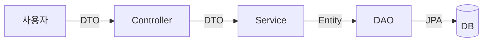

이 글은 JPA로 자바 클래스를 데이터베이스 테이블로 만들고(엔티티 매핑), `@Transactional`로 회원 등록 작업을 한 덩어리로 묶는 과정을 정리한 글이다.

2026년 11월 3일 수업에서 진행한 내용을 정리했다.

## 이게 없으면 뭐가 불편할까

지금까지는 순서가 정해져 있었다. 먼저 MySQL에서 `CREATE TABLE`로 테이블을 만든다. 그다음 그 테이블 모양에 맞춰 자바 클래스를 짠다.

이 순서에는 불편한 점이 있다. 열 하나를 추가하려면 SQL도 고치고, 자바 코드도 고쳐야 한다. 둘 중 하나만 고치면 프로그램이 깨진다. 그래서 테이블 설계가 처음부터 완벽해야 했다.

트랜잭션도 불편했다. 트랜잭션은 여러 작업을 "전부 성공 아니면 전부 취소"로 묶는 것이다. [MySQL 글]({{ site.baseurl }})에서는 `START TRANSACTION`, `COMMIT`, `ROLLBACK`을 직접 쳤다. 자바 코드에서도 메서드마다 `begin()`, `commit()`, `rollback()`을 직접 적어야 했다.

오늘 배운 두 가지가 이 불편을 줄여 준다.

- **엔티티 매핑** — 자바 클래스를 먼저 만들면, JPA가 그 클래스를 보고 테이블을 만든다.
- **`@Transactional`** — 메서드 위에 한 줄만 붙이면, 스프링이 트랜잭션 시작과 끝을 대신 해 준다.

> 한 줄 요약: 테이블을 먼저 만들던 순서가 뒤집히고, 반복되던 트랜잭션 코드가 한 줄로 줄어든다.

---

## 먼저, 어제 배운 것을 짧게 돌아보면

수업은 스프링 전체 그림으로 복습하며 시작했다.

- 사용자의 요청은 **서블릿 컨테이너**를 지나 **IoC 컨테이너**로 들어간다. IoC 컨테이너는 스프링이 객체를 대신 만들고 관리해 주는 공간이다. 여기서 관리하는 객체를 **빈(Bean)** 이라고 부른다.
- IoC 컨테이너 안에는 Controller, Service, DAO가 빈으로 들어 있다. DAO(Data Access Object)는 DB에 접근하는 일만 맡는 객체다.
- DAO 쪽에서 **JPA(Jakarta Persistence)** 가 JDBC를 감싸고 DB와 이야기한다. JPA는 자바 객체를 DB 테이블에 저장하고 꺼내는 방법을 정한 표준이다.
- JPA는 **영속성 컨텍스트(Persistence Context)** 라는 공간에 엔티티를 보관하며 관리한다. 자세한 내용은 어제 글에서 다룬다.

그림 아래에는 "JPA는 DB에 의존적인 개발을 방지한다"라고 적혀 있었다. 오늘 실습이 바로 이 말을 직접 확인하는 시간이었다.

---

## 실습은 어떻게 준비했을까

### 새 프로젝트 만들기

IntelliJ에서 Spring Boot 프로젝트를 새로 만들었다.

| 항목 | 값 |
|------|-----|
| 이름 | `chap03-entity-mapping` |
| 언어 / 타입 | Java / Gradle - Groovy |
| Java | 21 |
| 구성 파일 | YAML |
| Spring Boot | 4.1.2 |
| 의존성 | Lombok, MySQL Driver, Spring Data JPA |

의존성(dependency)은 내 프로젝트가 가져다 쓰는 남의 라이브러리다. Lombok은 getter나 생성자 같은 반복 코드를 어노테이션 한 줄로 만들어 준다. MySQL Driver는 자바가 MySQL과 대화할 수 있게 해 주는 통역사다. Spring Data JPA는 스프링에서 JPA를 쓰게 해 준다.

### application.yaml 가져오기

`application.yaml`은 프로그램 설정을 적는 파일이다. 어제 프로젝트(`chap02-persistence-context`)의 설정을 그대로 복사해서 새 프로젝트에 붙여 넣었다. 아이디와 비밀번호는 자리 표시로 바꿔 적었다.

```yaml
spring:
  application:
    name: chap03-entity-mapping
  datasource:
    driver-class-name: com.mysql.cj.jdbc.Driver
    url: jdbc:mysql://localhost:3306/menudb
    username: your_username
    password: your_password

  jpa:
    # jpa 가 알아서 생성해주는 sql 구문 보는 설정
    show-sql: true
    # jpa 구현체
    hibernate:
      # create - Application 실행 시 테이블 새로 생성한다.
      # create-drop - Application 실행 시 테이블 생성, 종료 시 삭제
      # update - 개발 중 변경 된 테이블 구조 반영
      # none - 미리 읽혀둔 ddl-script 로만 진행
      ddl-auto: create

    properties:
      hibernate:
        # sql 구문을 보기 좋게 포멧팅
        format_sql: true
```

`datasource`는 "어느 DB에, 누구로 접속할지"다. `jpa` 아래는 JPA가 어떻게 동작할지 정한다. 하이버네이트(Hibernate)는 JPA라는 표준을 실제로 구현한 라이브러리다. 그래서 주석에 "jpa 구현체"라고 적혀 있다.

### 왜 ddl-auto를 none에서 create로 바꿨을까?

어제 설정은 `ddl-auto: none`이었다. 오늘은 이것을 `create`로 바꿨다. 이 한 줄이 오늘 실습의 출발점이다.

DDL(Data Definition Language)은 `CREATE TABLE`, `DROP TABLE`처럼 테이블 구조를 만드는 SQL이다. `ddl-auto`는 "프로그램이 켜질 때 하이버네이트가 테이블 구조를 어떻게 다룰지"를 정한다.

| 값 | 하는 일 |
|----|---------|
| `create` | 실행할 때 테이블을 새로 만든다 |
| `create-drop` | 실행할 때 만들고, 종료할 때 지운다 |
| `update` | 클래스에서 바뀐 구조를 테이블에 반영한다 |
| `validate` | 클래스와 테이블이 맞는지 검사만 한다 |
| `none` | 테이블에 손대지 않는다 |

`validate`는 수업 노트에는 없었다. 스프링 부트 공식 문서에서 허용 값으로 함께 소개하고 있어서 표에 넣었다.

노트에는 `none`을 "미리 읽혀둔 ddl-script로만 진행"이라고 적었다. 정확히 말하면 `none`은 하이버네이트가 테이블을 건드리지 않는다는 뜻이다. 그래서 테이블은 미리 만들어 둔 SQL 스크립트 같은 다른 방법으로 준비해야 한다. 어제까지 MySQL에서 테이블을 직접 만들어 둔 것이 바로 그 방법이었다.

공식 문서에 따르면 `ddl-auto`를 적지 않을 때 기본값은 DB에 따라 다르다. H2 같은 내장 DB면 `create-drop`, MySQL 같은 일반 DB면 `none`이다.

> 한 줄 요약: `ddl-auto: create`로 바꾸면, 프로그램이 켜질 때 하이버네이트가 클래스를 보고 테이블을 만든다.

---

## 1. @SpringBootApplication — 이 한 줄은 꼭 써야 할까?

### 직접 해보기

`entitymapping` 패키지 아래에 `section01` 패키지를 만들고, 그 안에 `Section01Application` 클래스를 만들었다. 패키지는 클래스를 담는 폴더다.

```java
package com.wanted.entitymapping.section01;

import org.springframework.boot.autoconfigure.SpringBootApplication;

@SpringBootApplication
public class Section01Application {

}
```

클래스 위에 `@SpringBootApplication`을 직접 적었다. 여기서 "이 한 줄을 꼭 적어야 할까?"라는 질문이 생겼다.

### 한 문장으로 말하면

가게 문을 여는 열쇠와 비슷하다. 열쇠를 돌리면 불이 켜지고, 간판이 켜지고, 직원들이 각자 자리에 선다. `@SpringBootApplication`은 "여기가 프로그램의 출발점이니, 필요한 준비를 한 번에 해 줘"라는 표시다.

스프링 부트 공식 문서에서는 이 어노테이션이 세 가지 기능을 한 번에 켠다고 설명한다.

| 기능 | 하는 일 |
|------|---------|
| `@SpringBootConfiguration` | 이 클래스를 설정 클래스로 쓴다. 출발점 역할을 한다 |
| `@EnableAutoConfiguration` | **자동 설정**. 추가한 라이브러리(Tomcat, JPA, DB 연결 등)를 보고 필요한 설정을 알아서 해 준다 |
| `@ComponentScan` | **부품 찾기**. 이 클래스가 있는 패키지와 그 아래 패키지를 뒤져서 `@Controller`, `@Component` 같은 클래스를 빈으로 등록한다 |

비유에는 한계가 있다. 열쇠는 하나뿐이지만, 이 어노테이션은 세 기능을 묶어 놓은 것이다. 공식 문서에서도 셋 중 필요한 것만 골라서 따로 붙여도 된다고 설명한다.

### 지우면 어떻게 될까?

자동 설정과 부품 찾기가 둘 다 일어나지 않는다. 그러면 뒤에서 만들 `MemberController`가 빈으로 등록되지 않는다. 컨테이너에서 꺼내려 해도 찾을 수가 없다. 그래서 메인 클래스 위에는 꼭 적는다.

여기서 하나 헷갈리기 쉽다. 부품 찾기는 **이 클래스가 있는 패키지부터 아래쪽**만 뒤진다. 그래서 `MemberController`, `MemberService` 같은 클래스를 모두 `section01` 패키지 안에 만들었다.

> 한 줄 요약: `@SpringBootApplication`은 설정, 자동 설정, 부품 찾기를 한 번에 켜는 출발점 표시다.

---

## 2. 회원 등록 프로그램의 뼈대는 어떻게 생겼을까?

수업에서 받은 코드를 `Section01Application`에 붙여 넣었다. 콘솔에서 번호를 입력받아 회원을 등록하거나 조회하는 프로그램이다.

```java
@SpringBootApplication
public class Section01Application {
    public static void main(String[] args) {

        ConfigurableApplicationContext context = SpringApplication.run(Section01Application.class, args);

        MemberController memberController = context.getBean(MemberController.class);

        Scanner sc = new Scanner(System.in);

        while (true) {
            System.out.println();
            System.out.println("========== section01. 엔티티 매핑 ==========");
            System.out.println("1. 회원 등록");
            System.out.println("2. 회원 번호로 회원 조회");
            System.out.println("9. 프로그램 종료");
            System.out.print("메뉴 번호를 입력하세요 : ");
            String no = sc.nextLine();

            try {
                switch (no) {
                    case "1":
                        memberController.registMember(inputMember(sc));
                        break;
                    case "2":
                        System.out.print("조회할 회원 번호 : ");
                        memberController.findMember(Integer.parseInt(sc.nextLine()));
                        // ... 노트 캡처는 여기까지
```

`SpringApplication.run(...)`이 스프링을 켜고, 빈이 담긴 컨테이너(`context`)를 돌려준다. `context.getBean(MemberController.class)`는 그 컨테이너에서 `MemberController` 빈을 꺼낸다. 내가 `new MemberController()`를 하지 않았다는 점이 중요하다. 객체는 스프링이 만들어 두었다.

노트에 남은 캡처는 `case "2"`까지다. `inputMember(sc)` 메서드와 나머지 부분은 캡처에 없어서 적지 않았다.

### MemberController — 요청을 받는 입구

`MemberController` 클래스를 만들었다. 처음에는 메서드 껍데기만 있었다.

```java
@Controller
public class MemberController {
    public void registMember(MemberRegistDTO memberRegistDTO) {
    }

    public void findMember(int i) {
    }
}
```

이어서 Service를 주입받는 코드를 추가했다.

```java
@Controller
public class MemberController {

    private final MemberService memberService;      //탑다운 방식(뷰에서부터 감)

    // Controller 에서 Service Bean 을 주입(의존)
    @Autowired      //의존성을 주입받음
    public MemberController(MemberService memberService) {
        this.memberService = memberService;
    }

    public void registMember(MemberRegistDTO memberRegistDTO) {
        int memberNo = memberService.registMember(memberRegistDTO);
    }

    public void findMember(int i) {
    }
}
```

**의존성 주입**은 내가 필요한 객체를 직접 만들지 않고, 스프링이 넣어 주게 하는 것이다. 식당 주방장이 재료를 직접 사러 가지 않고, 매일 아침 배달받는 것과 비슷하다. 다만 배달과 달리, 스프링은 생성자의 매개변수 타입을 보고 컨테이너에 있는 빈 중 맞는 것을 골라 넣어 준다.

주석의 "탑다운 방식"은 화면(뷰)에 가까운 Controller부터 만들고, 안쪽으로 들어가며 Service, DAO 순서로 만든다는 뜻이다.

### MemberRegistDTO — 회원 정보를 담는 상자

슬랙에서 받은 코드를 붙여 넣었다. **DTO(Data Transfer Object)** 는 계층 사이에서 데이터를 옮기는 상자다. 이 블로그의 [JDBC 글]({{ site.baseurl }})에서도 다뤘다.

```java
package com.wanted.entitymapping.section01;

import lombok.*;

import java.time.LocalDateTime;

@NoArgsConstructor
@AllArgsConstructor
@Getter
@Setter
@ToString
public class MemberRegistDTO {
    private String memberId;
    private String memberPwd;
    private String memberName;
    private String phone;
    private String address;
    private LocalDateTime enrollDate;
    private MemberRole memberRole;
    private String status;
}
```

Lombok 어노테이션이 반복 코드를 대신 만들어 준다.

| 어노테이션 | 만들어 주는 것 |
|------------|----------------|
| `@NoArgsConstructor` | 매개변수 없는 생성자 |
| `@AllArgsConstructor` | 모든 필드를 받는 생성자 |
| `@Getter`, `@Setter` | 필드마다 get, set 메서드 |
| `@ToString` | 객체 내용을 문자열로 보여 주는 `toString()` |

나중에 이 DTO에는 4개 필드만 받는 생성자도 추가했다.

```java
public MemberRegistDTO(String memberId, String memberPwd, String memberName, String phone) {
    this.memberId = memberId;
    this.memberPwd = memberPwd;
    this.memberName = memberName;
    this.phone = phone;
}
```

> 한 줄 요약: 메인 클래스는 스프링을 켜고 Controller를 꺼내 쓴다. Controller는 Service를 주입받고, 데이터는 DTO에 담겨 이동한다.

---

## 3. enum — 왜 정해진 값만 쓰게 할까?

### 왜 필요할까

DTO에 `MemberRole memberRole`이라는 필드가 있다. 회원 권한이다. 이 프로젝트에서 회원 권한은 "일반 회원"과 "관리자" 두 가지뿐이다.

권한을 `String`으로 받으면 어떻게 될까? 누군가 `"admin"`, `"ADMIN"`, `"관리자"`처럼 제각각 넣을 수 있다. 오타가 나도 프로그램은 모른다.

### 한 문장으로 말하면

자판기 버튼을 떠올려 보자. 자판기에는 정해진 음료 버튼만 있다. 없는 음료 이름을 말해도 나오지 않는다. **enum(열거형)** 은 쓸 수 있는 값을 미리 정해 두고, 그 값만 쓰게 강제하는 특별한 클래스다.

비유에는 한계가 있다. 자판기 버튼은 나중에 바꿔 끼울 수 있지만, enum 값은 코드에 적혀 있다. 값을 추가하려면 코드를 고쳐서 다시 실행해야 한다.

### 직접 해보기

DTO에서 `MemberRole`에 빨간 줄이 생겼을 때, IntelliJ의 빠른 수정 메뉴에서 "열거형 'MemberRole' 생성"을 골랐다. 그리고 내용을 채웠다.

```java
package com.wanted.entitymapping.section01;

/* comment. enum(열거형)
    enum 타입은 시스템 정책 상 정해져 있는 값
    즉, 제한 된 값만 사용하기 위해 강제화 할 수 있는 역할의 클래스이다.
    ex) 성별, 권한 등등 정해져 있는 값
 */
public enum MemberRole {
    // 우리 프로젝트에서 회원의 권한은 2개로 고정! 2개밖에 없다!!! 고정
    ROLE_MEMBER , ROLE_ADMIN;
}
```

이제 `memberRole`에는 `MemberRole.ROLE_MEMBER`나 `MemberRole.ROLE_ADMIN`만 넣을 수 있다. 다른 값을 넣으면 컴파일 단계에서 에러가 난다. 실행하기 전에 실수를 잡아 준다.

> 한 줄 요약: enum은 "이 값들 중에서만 골라"라고 강제하는 클래스다. 성별, 권한처럼 정해진 값에 쓴다.

---

## 4. Controller, Service, DAO — DTO와 Entity는 어디서 바뀔까?

### 그림으로 보기

수업 그림을 옮기면 이렇다.



Controller와 Service 사이에서는 DTO가 오가고, Service가 DTO를 Entity로 바꿔서 DAO에 넘긴다.

**엔티티(Entity)** 는 DB 테이블과 연결된 자바 클래스다. DTO가 "택배 상자"라면, 엔티티는 "창고 선반에 맞춘 규격 상자"다. 창고(DB)에 넣으려면 규격 상자로 옮겨 담아야 한다. 다만 실제 창고와 달리, JPA는 엔티티가 바뀐 것을 스스로 알아채고 DB에 반영하기도 한다. 이것이 어제 배운 영속성 컨텍스트의 역할이다.

| | DTO | Entity |
|--|-----|--------|
| 역할 | 계층 사이에서 데이터를 옮긴다 | DB 테이블과 1:1로 연결된다 |
| 주로 쓰는 곳 | Controller ↔ Service | Service ↔ DAO ↔ DB |
| JPA가 관리하나 | 아니다 | 그렇다 |

### Service는 무슨 일을 할까?

`MemberService`의 주석에 Service의 역할이 정리돼 있다.

1. 비즈니스 로직을 작성한다. 비즈니스 로직은 "아이디는 중복될 수 없다" 같은 시스템의 규칙이다.
2. DAO의 메서드를 부른다.
3. **트랜잭션을 관리한다.** 수업에서 가장 강조한 부분이다. Service는 여러 DAO의 기능을 조합하는 경우가 많다. 그래서 그중 하나라도 실패하면 전부 되돌리는 일이 아주 중요하다.

> 한 줄 요약: DTO는 Controller와 Service 사이를, Entity는 Service와 DB 사이를 오간다. 둘을 바꿔 담는 곳은 Service다.

---

## 5. @Transactional — begin, commit, rollback을 왜 직접 안 써도 될까?

### 왜 필요할까

회원 등록 메서드가 DAO의 메서드 두 개를 부른다고 해 보자. 첫 번째는 성공하고 두 번째가 실패하면, 데이터가 반쯤만 저장된다.

JDBC로 직접 막으려면 메서드마다 이렇게 감싸야 했다. 아래는 흐름을 보여 주는 예시 코드다.

```java
// 예시 코드: 트랜잭션을 직접 다룰 때의 모양
transaction.begin();
try {
    dao.save(member);
    dao.saveLog(member);
    transaction.commit();
} catch (Exception e) {
    transaction.rollback();
}
```

메서드가 10개면 이 껍데기를 10번 써야 한다. 정작 중요한 로직은 두 줄인데 말이다.

### 한 문장으로 말하면

은행 창구 직원을 떠올려 보자. 손님은 "이체해 주세요"라고만 말한다. 장부를 펼치고, 문제가 없으면 도장을 찍고, 문제가 있으면 전부 지우는 일은 직원이 알아서 한다.

**`@Transactional`** 은 메서드 위에 붙이면, 스프링이 그 메서드를 트랜잭션으로 감싸 주는 어노테이션이다.

수업 그림에서는 흐름을 세 단계로 그렸다.

1. 메서드가 시작될 때 트랜잭션을 시작한다 (`begin`).
2. 메서드 안의 코드를 순서대로 실행한다.
3. 끝까지 문제없이 끝나면 `commit`, 중간에 예외가 나면 `rollback`한다.

그림에는 `@Transactional`에서 **AOP**로 화살표가 그려져 있었다. AOP(Aspect Oriented Programming)는 여러 메서드에 공통으로 필요한 일을 따로 떼어 내서, 메서드 앞뒤에 끼워 넣는 방식이다. 스프링 공식 문서에서도 선언적 트랜잭션이 AOP 프록시로 동작한다고 설명한다. 프록시는 진짜 객체 앞에 서 있는 대리인이다.

비유에는 한계가 있다. 창구 직원은 손님 말을 듣고 판단하지만, 스프링은 판단하지 않는다. **어떤 종류의 예외가 났는지**만 보고 기계적으로 되돌릴지 정한다. 이 부분은 바로 아래에서 다룬다.

### 직접 해보기

`MemberService`를 만들고 `@Transactional`을 붙였다. 자동 완성 목록에 `Transactional`이 두 개 나왔다.

| 패키지 | 고른 것 |
|--------|---------|
| `jakarta.transaction.Transactional` | |
| `org.springframework.transaction.annotation.Transactional` | 이것을 골랐다 |

```java
package com.wanted.entitymapping.section01;

import org.springframework.stereotype.Component;
import org.springframework.transaction.annotation.Transactional;

@Component
public class MemberService {

    /* comment. Service 클래스
        1. 비즈니스 로직 작성(시스템 정책)
        2. DAO 데이터베이스 접근 객체의 메서드를 호출한다.
        3. 트랜잭션 관리 -> 핵심!!!! 멤버 서비스 쪽에서 다른 클래스에 있는 것을 조합하는 경우가 많음.
        - 여러 시스템 비즈니스 로직이 섞이게 되며
        - 1개라도 실패 시 rollback 작업이 매우 중요하다!!!
     */

    // 메서드 실행 시 begin()
    // 메서드 종료 시 - 정상 종료 : commit() , 예외 발생 : rollback();
    // 블로그 작성 키워드
    // 1. Checked 예외 / UnChecked 예외 의 Transactional 동작 방식
    // 2. Transactional 의 전파
    @Transactional
    public int registMember(MemberRegistDTO memberRegistDTO) {
        // 1. DTO->Entity
        // 2. 변환 된 Entity 를 JPA 를 사용하는 DAO 계층에 전달한다.
    }
}
```

주석에 "블로그 작성 키워드"로 두 가지를 적어 두었다. 첫 번째는 바로 아래에서 정리한다. 두 번째인 전파는 아직 배우지 않아서 "더 학습하면 좋은 개념"으로 넘긴다.

### 어떤 예외가 나야 rollback될까? — Checked와 Unchecked

여기서 많이들 헷갈린다. "예외가 나면 무조건 rollback"이 아니다.

자바의 예외는 크게 두 종류다.

- **Unchecked 예외**: `RuntimeException`을 상속한 예외다. `NullPointerException`, `IllegalArgumentException` 등이 있다. 컴파일러가 처리를 강제하지 않는다.
- **Checked 예외**: `Exception`을 상속했지만 `RuntimeException`은 아닌 예외다. `IOException`, `SQLException` 등이 있다. 컴파일러가 `try-catch`나 `throws`를 강제한다.

| 예외 종류 | 기본 동작 | 이유 |
|-----------|-----------|------|
| Unchecked (`RuntimeException` 계열) | **rollback한다** | 개발자가 예상하지 못한 오류로 보고, 안전하게 되돌린다 |
| `Error` | rollback한다 | 공식 문서 기준, 시스템 수준의 심각한 문제다 |
| Checked (`Exception` 중 `RuntimeException`이 아닌 것) | **rollback하지 않고 commit한다** | 개발자가 `try-catch`로 대처할 수 있는 예외로 본다 |

스프링 공식 문서에서도 기본 설정에서는 Checked 예외가 나도 rollback하지 않는다고 설명한다. Checked 예외에도 rollback하고 싶다면 옵션을 직접 적는다.

```java
@Transactional(rollbackFor = Exception.class)
```

`rollbackFor = Exception.class`는 "`Exception`과 그 하위 예외가 나면 모두 rollback해"라는 뜻이다.

> 한 줄 요약: `@Transactional`은 메서드를 begin과 commit/rollback으로 감싸 준다. 기본으로는 Unchecked 예외에만 rollback한다.

---

## 6. @Entity — 클래스를 어떻게 테이블로 만들까?

### 직접 해보기 — 빈 엔티티 만들기

`Member` 클래스를 만들고 어노테이션을 붙였다.

```java
package com.wanted.entitymapping.section01;

import jakarta.persistence.Entity;
import jakarta.persistence.Table;
import lombok.AllArgsConstructor;
import lombok.Getter;
import lombok.NoArgsConstructor;
import lombok.ToString;

@NoArgsConstructor
@AllArgsConstructor
@Getter
@ToString
@Entity
@Table(name="tbl_member")
public class Member {

}
```

- `@Entity` — "이 클래스는 엔티티다. JPA가 관리해라"라는 표시다.
- `@Table(name="tbl_member")` — 이 엔티티와 연결할 테이블 이름을 정한다. 적지 않으면 클래스 이름을 쓴다.

DTO와 달리 `@Setter`는 붙이지 않았다. 엔티티는 DB와 바로 연결된 객체라서, 아무 데서나 값을 바꿀 수 없게 하려는 것으로 보인다. 수업에서 이유를 따로 설명하지는 않아서 확인이 필요하다.

### 기본키는 어떻게 만들까? — @Id와 @GeneratedValue

슬랙에서 받은 필드 코드를 붙여 넣었다. 그중 기본키 부분은 이렇다. 기본키(PK, Primary Key)는 행마다 하나뿐인 대표 번호다.

```java
import jakarta.persistence.*;

@NoArgsConstructor
@AllArgsConstructor
@Getter
@ToString
@Entity
@Table(name="tbl_member")
public class Member {
    /* comment.
     *   @GeneratedValue : PK 값을 자동으로 생성하는 전략
     *   - IDENTITY : PK 생성을 DB 에 위임한다. (MySQL 의 AUTO_INCREMENT)
     *                INSERT 를 실행해야 PK 를 알 수 있으므로 persist() 시점에 바로 INSERT 가 실행
     *   - SEQUENCE : DB 의 시퀀스 객체를 사용한다. (Oracle, PostgreSQL 등)
     *                persist() 시점에 시퀀스에서 PK 만 먼저 가져오고, INSERT 는 flush 시점에 실행
     *   - TABLE    : 키 생성 전용 테이블을 만들어 사용한다.
     *   - AUTO     : DB 에 맞춰 자동으로 선택한다. (기본값)
     * */
    @Id
    @Column(name = "member_no")
    @GeneratedValue(strategy = GenerationType.IDENTITY)
    private int memberNo;
```

`import jakarta.persistence.*;`는 `jakarta.persistence` 패키지의 클래스를 한꺼번에 가져온다. `@Id`, `@Column`, `@GeneratedValue`를 하나씩 import하지 않아도 된다.

| 어노테이션 | 하는 일 |
|------------|---------|
| `@Id` | 이 필드가 기본키다 |
| `@Column(name = "member_no")` | 이 필드와 연결할 열 이름을 정한다 |
| `@GeneratedValue` | 기본키 값을 자동으로 만든다. 어떻게 만들지는 `strategy`로 정한다 |

번호표 기계를 떠올려 보자. 은행에 들어가면 번호표를 뽑는다. 손님이 번호를 직접 정하지 않는다. `@GeneratedValue`도 기본키 번호를 내가 정하지 않고 자동으로 받게 한다. 다만 번호표 기계는 하나지만, 기본키를 만드는 방법(전략)은 여러 가지다.

| 전략 | 번호를 누가 만드나 | 주로 쓰는 DB |
|------|-------------------|--------------|
| `IDENTITY` | DB가 행을 넣을 때 만든다 (`AUTO_INCREMENT`) | MySQL |
| `SEQUENCE` | DB의 시퀀스(번호 생성기)에서 미리 받아 온다 | Oracle, PostgreSQL |
| `TABLE` | 번호만 관리하는 테이블을 따로 둔다 | 어느 DB든 |
| `AUTO` | JPA 구현체가 DB를 보고 고른다. **기본값** | |

여기서 헷갈리기 쉬운 점이 있다. `IDENTITY`는 DB가 행을 넣는 순간에 번호를 만든다. 그래서 JPA는 번호를 알려면 **INSERT를 먼저 실행해야** 한다. 노트 주석처럼 `persist()`를 부르는 시점에 바로 INSERT가 나간다. 원래 JPA는 INSERT를 모아 두었다가 나중에 한꺼번에 보내는데(flush), `IDENTITY`에서는 그럴 수 없다.

Jakarta Persistence API 문서에서도 `AUTO`가 기본값이고, 구현체가 TABLE, SEQUENCE, IDENTITY 중에서 고를 수 있다고 설명한다.

### 나머지 필드와 생성자

`Member`의 나머지 필드는 DTO와 같다. 생성자 생성 창에 나온 필드 목록으로 확인했다.

| 필드 | 타입 |
|------|------|
| `memberNo` | `int` |
| `memberId` | `String` |
| `memberPwd` | `String` |
| `memberName` | `String` |
| `phone` | `String` |
| `address` | `String` |
| `enrollDate` | `LocalDateTime` |
| `memberRole` | `MemberRole` |
| `status` | `String` |

각 필드에 붙인 어노테이션은 노트 캡처에 남아 있지 않다. 다만 실행할 때 콘솔에 찍힌 테이블 생성 SQL 일부에 `default 'Y'`와 `enum ('ROLE_ADMIN','ROLE_MEMBER')`가 보였다. `status` 열의 기본값과 `memberRole` 열의 enum 타입이 필드 설정대로 만들어졌다는 뜻이다.

그다음 IntelliJ의 생성자 생성 기능으로 **`memberNo`만 빼고** 나머지 8개 필드를 받는 생성자를 만들었다. `memberNo`는 `IDENTITY` 전략으로 DB가 만들어 주는 값이라, 객체를 만들 때 넣을 필요가 없기 때문이다.

> 한 줄 요약: `@Entity`와 `@Table`로 클래스를 테이블에 연결하고, `@Id`와 `@GeneratedValue`로 기본키를 자동으로 만든다.

---

## 7. 실행하면 정말 테이블이 생길까?

### DB 연결하기

IntelliJ 오른쪽의 Database 창에서 MySQL을 연결했다.

1. 데이터 소스를 추가하고 드라이버로 MySQL을 고른다.
2. 호스트 `localhost`, 포트 `3306`을 확인한다.
3. 인증 방식을 "사용자 및 비밀번호"로 두고, 실습용 계정 아이디와 비밀번호를 넣는다.
4. 적용, 확인을 누른다.

### 실행하고 새로고침하기

`Section01Application`을 실행한 뒤, Database 창에서 새로고침 버튼을 눌렀다. `menudb`의 테이블 목록에 `tbl_member`가 새로 들어와 있었다.

MySQL에서 `CREATE TABLE`을 한 줄도 쓰지 않았다. `ddl-auto: create` 설정 덕분에 하이버네이트가 `Member` 클래스를 보고 테이블을 만든 것이다. `show-sql: true`와 `format_sql: true` 덕분에 그 SQL이 콘솔에 보기 좋게 찍혔다.

### 이게 왜 "주객전도"일까?

노트에 이렇게 적었다. "그 전에는 코드가 완벽해야만 데이터베이스를 짤 수 있었는데, 지금은 테이블을 유동적으로 만들 수 있음(주객전도)."

원래는 DB가 주인이고 자바 코드가 따라갔다. 이제는 자바 클래스가 주인이 되고, 테이블이 클래스를 따라온다. 수업에서는 이것을 **JPA가 추구하는 방향**이라고 소개했다.

- DB에 의존하지 않는 개발을 한다.
- 애플리케이션에서 엔티티 클래스를 바꾸면 바로 DB에 반영된다.
- DB 스크립트에 기대지 않고, 자바 객체인 엔티티를 바꿔 가며 개발할 수 있다.

### 그런데 create는 조심해야 한다

여기서 많이들 놓친다. 하이버네이트 문서에 따르면 `create`는 테이블을 만들기 전에 **기존 테이블을 먼저 지운다**. 프로그램을 다시 실행할 때마다 `tbl_member`가 지워지고 새로 만들어진다. 그 안에 넣어 둔 데이터도 함께 사라진다.

그래서 연습할 때는 편하지만, 지켜야 할 데이터가 있는 DB에는 쓰면 안 된다. 스프링 부트 공식 문서에서도 테이블을 만드는 방법은 하나로 정해서 쓰라고 권한다.

> 한 줄 요약: `ddl-auto: create`로 실행하면 클래스대로 테이블이 생긴다. 대신 실행할 때마다 테이블을 지우고 다시 만든다.

---

## 8. DTO를 Entity로 어떻게 바꿀까?

### 직접 해보기

`MemberService`의 `registMember`에 DTO를 엔티티로 바꾸는 코드를 채웠다. 앞에서 만든 8개짜리 생성자를 쓴다.

```java
@Transactional
public int registMember(MemberRegistDTO memberRegistDTO) {
    // 1. DTO->Entity
    Member member = new Member(
            dto.getMemberId(),
            dto.getMemberPwd(),
            dto.getMemberName(),
            dto.getPhone(),
            dto.getAddress(),
            dto.getEnrollDate(),
            dto.getMemberRole(),
            dto.getStatus()
    );
    // 2. 변환 된 Entity 를 JPA 를 사용하는 DAO 계층에 전달한다.

    return 0;
}
```

DTO 상자에서 값을 하나씩 꺼내서 엔티티 상자에 옮겨 담는 모양이다.

노트 코드에서 고칠 점이 하나 있다. 매개변수 이름은 `memberRegistDTO`인데, 본문에서는 `dto.getMemberId()`처럼 `dto`를 쓰고 있다. 캡처에도 에러 표시가 떠 있었다. 둘 중 하나로 이름을 맞춰야 컴파일된다. `return 0;`도 아직 DAO를 만들기 전이라 임시로 넣은 값이다.

### MemberRepository — 아직 작성 중인 DAO

DAO 역할을 할 `MemberRepository`를 만들기 시작했다. 먼저 `MemberService`에 필드를 추가했다.

```java
@Component
public class MemberService {
    private final MemberRepository memberRepository;
```

`MemberRepository`에는 저장(`save`)과 번호로 찾기(`findByMemberNo`) 메서드를 만들었다. 노트에 남은 `findByMemberNo`는 이렇다.

```java
public Member findByMemberNo(int memberNo) {
    //찾아 온 회원 1명을 return
    // 1. 영속성 컨텍스트에서 PK 엔티티 find(PK);
    manager.find(Member.class, memberNo);

    // 2. Entity 객체를 DTO로 변환
    MemberRegistDTO findMember = new MemberRegistDTO(
            foundMember.getMemberId(),
            foundMember.getMemberPwd(),
            foundMember.getMemberMemberName(),
            foundMember.getMemberPhone()
    );

    return foundMember;
}
```

`manager.find(Member.class, memberNo)`는 "기본키가 `memberNo`인 `Member` 엔티티를 찾아 줘"라는 뜻이다. 어제 배운 대로, 먼저 영속성 컨텍스트에서 찾고 없으면 DB에서 가져온다.

이 코드는 수업 중에 작성하다 멈춘 상태라 그대로는 컴파일되지 않는다. 캡처에도 에러가 5개 표시돼 있었다. 정리하면서 보니 맞춰야 할 곳이 보였다.

- `manager.find(...)`의 결과를 변수에 담지 않았다. 그런데 아래에서는 `foundMember`를 쓴다.
- 변환한 DTO 변수 이름은 `findMember`인데, 돌려주는 것은 `foundMember`다.
- `Member`에는 `getMemberMemberName()`, `getMemberPhone()`이 없다. Lombok이 만드는 이름은 `getMemberName()`, `getPhone()`이다.
- 주석에는 "Entity를 DTO로 변환"이라고 적었는데, 반환 타입은 `Member`(엔티티)다. 어느 계층에서 DTO로 바꿀지 정해야 한다.
- `manager`가 어떻게 선언됐는지는 캡처에 없다. 어제 쓴 `EntityManager`로 보이지만 확인이 필요하다.
- `MemberService`의 `final` 필드 `memberRepository`도 아직 생성자에서 값을 받지 않아서 에러가 난다.

앞의 네 가지만 고치면 이런 모양이 된다. 아래는 이해를 돕기 위한 예시 코드다.

```java
// 예시 코드: 변수 이름과 메서드 이름만 맞춘 모양
public Member findByMemberNo(int memberNo) {
    Member foundMember = manager.find(Member.class, memberNo);
    return foundMember;
}
```

DTO로 바꾸는 일은 Service에서 하는 것이 앞의 그림과 맞다. 다음 수업에서 이어서 완성할 부분이다.

> 한 줄 요약: Service에서 DTO 값을 꺼내 엔티티 생성자에 넣는다. Repository는 엔티티를 저장하고 찾는 일을 맡는다.

---

## 헷갈렸던 점

### 1. Transactional이 두 개인데 아무거나 골라도 될까?

자동 완성에 `jakarta.transaction.Transactional`과 `org.springframework.transaction.annotation.Transactional`이 함께 나온다. 수업에서는 스프링 것을 골랐다.

스프링 공식 문서에서는 스프링의 `@Transactional`을 기준으로 `rollbackFor` 같은 옵션을 설명한다. 이 글에서 정리한 rollback 규칙과 옵션도 스프링 것을 기준으로 한 내용이다. 그래서 import 줄이 `org.springframework.transaction.annotation`인지 확인하는 습관이 필요하다.

### 2. 예외가 났는데 왜 DB에 저장돼 있을까?

"예외 = rollback"이라고 생각하기 쉽다. 하지만 기본 설정에서는 Checked 예외(`IOException` 등)가 나면 rollback하지 않고 commit한다. 예외가 났는데 데이터가 남아 있다면, 어떤 종류의 예외였는지부터 확인한다.

| 상황 | 결과 |
|------|------|
| `RuntimeException` 계열이 메서드 밖으로 나감 | rollback |
| Checked 예외가 메서드 밖으로 나감 | commit |
| `@Transactional(rollbackFor = Exception.class)`에서 Checked 예외 | rollback |

### 3. DTO가 있는데 Entity를 왜 또 만들까?

필드가 거의 똑같아서 같은 클래스를 두 번 만드는 것처럼 보인다. 하지만 하는 일이 다르다. 엔티티는 JPA가 관리하고 DB와 바로 이어져 있다. 그래서 화면이나 Controller까지 엔티티를 들고 다니지 않고, 계층 사이에서는 DTO를 쓴다. 바꿔 담는 일은 Service가 맡는다.

### 4. Service인데 왜 @Component를 붙였을까?

실습 코드의 `MemberService`에는 `@Component`가 붙어 있다. 스프링에는 `@Service`라는 어노테이션도 있다. 스프링 공식 문서에 따르면 `@Service`는 `@Component`를 특별한 용도로 이름 붙인 것이다. 빈으로 등록된다는 점은 같고, 이 클래스가 Service 계층이라는 것이 이름으로 드러난다는 점이 다르다.

> 한 줄 요약: import할 `@Transactional`의 패키지, 예외 종류에 따른 rollback 여부, DTO와 Entity의 역할 차이를 구분해야 한다.

---

## 더 학습하면 좋은 개념

- **트랜잭션 전파(propagation)** — 노트의 "블로그 작성 키워드" 두 번째다. `@Transactional` 메서드가 다른 `@Transactional` 메서드를 부를 때, 트랜잭션을 하나로 합칠지 새로 만들지를 정한다. Service가 여러 기능을 조합하기 시작하면 꼭 부딪힌다.
- **스프링 AOP와 프록시** — `@Transactional`은 프록시가 메서드 앞뒤를 감싸는 방식으로 동작한다. 같은 클래스 안에서 메서드끼리 부르면 프록시를 거치지 않는 경우가 있어서, 원리를 알아야 "왜 rollback이 안 되지?"를 풀 수 있다.
- **@Enumerated와 enum 저장 방식** — `MemberRole` 같은 enum을 DB에 숫자(순서)로 저장할지, 이름 문자열로 저장할지 정하는 어노테이션이다. 잘못 고르면 enum 순서를 바꿨을 때 데이터 뜻이 달라진다.
- **Spring Data JPA의 Repository 인터페이스(`JpaRepository`)** — 지금은 `MemberRepository`에 `find`, `save`를 직접 만들고 있다. 의존성으로 추가한 Spring Data JPA는 이런 메서드를 인터페이스만으로 만들어 준다.
- **flush와 쓰기 지연** — `IDENTITY` 전략에서 "persist() 시점에 바로 INSERT"가 왜 특별한지 이해하려면, JPA가 원래 INSERT를 모았다가 flush 때 보낸다는 것을 알아야 한다.

## 참고 자료

- [Spring Framework — Rolling Back a Declarative Transaction](https://docs.spring.io/spring-framework/reference/data-access/transaction/declarative/rolling-back.html)
- [Spring Framework — Declarative Transaction Management](https://docs.spring.io/spring-framework/reference/data-access/transaction/declarative.html)
- [Spring Framework — Classpath Scanning and Managed Components](https://docs.spring.io/spring-framework/reference/core/beans/classpath-scanning.html)
- [Spring Boot — Using the @SpringBootApplication Annotation](https://docs.spring.io/spring-boot/reference/using/using-the-springbootapplication-annotation.html)
- [Spring Boot — Database Initialization (ddl-auto)](https://docs.spring.io/spring-boot/how-to/data-initialization.html)
- [Jakarta Persistence API — GeneratedValue](https://jakarta.ee/specifications/platform/9/apidocs/jakarta/persistence/generatedvalue)
- [Jakarta Persistence 3.2 API — jakarta.persistence 패키지](https://jakarta.ee/specifications/persistence/3.2/apidocs/jakarta.persistence/jakarta/persistence/package-summary.html)
- [Hibernate ORM User Guide](https://docs.hibernate.org/orm/6.6/userguide/html_single/Hibernate_User_Guide.html)
- [Hibernate Javadocs — schema Action (create, create-drop 등)](https://docs.hibernate.org/orm/6.5/javadocs/org/hibernate/tool/schema/Action.html)
