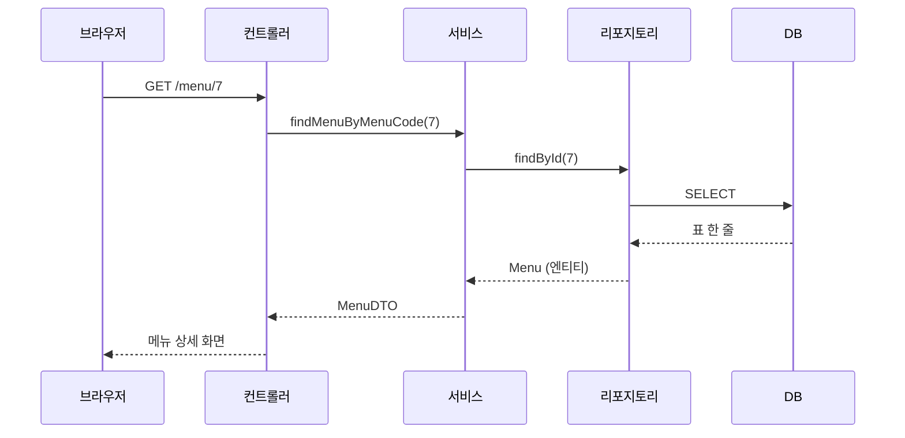
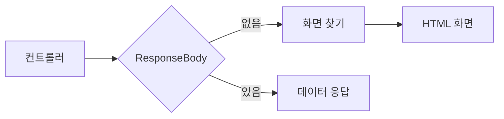

이 글은 수업에서 받은 메뉴 관리 프로젝트의 빈칸을 채우면서 배운 것들을 정리한 글이다. 메뉴 조회, 검색, 유효성 검사, 예외 처리, `@ResponseBody`, 카테고리 조회(JPQL과 Native Query)까지 한 번에 다룬다.

2026년 11월 4일 수업에서 진행한 내용을 정리했다.

## 이게 없으면 뭐가 불편할까

지금까지는 기능을 하나씩 따로 배웠다. [요청 매핑]({{ site.baseurl }}), [예외 처리]({{ site.baseurl }}), [의존성 주입]({{ site.baseurl }}), [JPA 엔티티]({{ site.baseurl }})를 각각 연습했다.

그런데 실제 프로그램에서는 이것들이 **요청 하나 안에서 줄줄이 이어진다.** 사용자가 "7번 메뉴 보여 줘"라고 하면, 주소를 받고, DB에서 꺼내고, 없으면 에러를 처리하고, 화면에 맞게 바꿔서 돌려줘야 한다. 하나라도 빠지면 화면이 뜨지 않는다.

이번 실습은 이 흐름을 한 프로젝트 안에서 처음부터 끝까지 이어 보는 시간이었다. 그리고 지난 글들의 "더 학습하면 좋은 개념"에 남겨 두었던 `JpaRepository`, `@ResponseBody`, `Optional`이 모두 여기서 나왔다.

> 한 줄 요약: 따로 배운 기능들을 요청 하나의 흐름 안에 이어 붙여 보는 실습이다.

---

## 먼저, 실습은 어떻게 준비했을까

### 프로젝트 받기

슬랙에서 프로젝트 압축 파일을 받아서 풀었다. 이름은 `module07-jpa-mini-project`다. 코드 곳곳에 `// TODO 1`, `// TODO 2`처럼 번호가 붙은 빈칸이 있고, 이 빈칸을 순서대로 채우는 실습이었다.

### 어떤 라이브러리를 쓰나 — build.gradle

`build.gradle`의 `dependencies`에는 이 프로젝트가 가져다 쓰는 라이브러리(의존성)가 적혀 있다. 처음 보는 두 가지에는 수업에서 주석을 달았다.

| 의존성 | 하는 일 |
|--------|---------|
| `spring-boot-starter-data-jpa` | JPA로 DB를 다룬다 |
| `spring-boot-starter-thymeleaf` | HTML 화면(타임리프)을 만든다 |
| `spring-boot-starter-validation` | **유효성 검사** 라이브러리다. 유효성 검사는 잘못된 값이 들어왔을 때 쓸 수 있는 값인지 판단하는 일이다 |
| `spring-boot-starter-web` | 웹 요청을 받는다 |
| `spring-boot-devtools` | 코드를 고치면 프로그램을 **자동으로 다시 시작**해 준다. 매번 직접 실행 버튼을 누르는 수고를 줄여 준다 |
| `mysql-connector-j` | 자바가 MySQL과 대화하게 해 주는 드라이버다 |
| `lombok` | getter, 생성자 같은 반복 코드를 어노테이션으로 만들어 준다 |

스프링 부트 공식 문서에서도 devtools를 쓰는 프로그램은 클래스패스의 파일이 바뀔 때마다 자동으로 다시 시작한다고 설명한다.

### 설정 파일 — application.yaml

아이디와 비밀번호는 자리 표시로 바꿔 적었다.

```yaml
spring:
  application:
    name: module07-jpa-mini-project
  datasource:
    driver-class-name: com.mysql.cj.jdbc.Driver
    url: jdbc:mysql://localhost:3306/menudb
    username: your_username
    password: your_password
  jpa:
    show-sql: true
    database: mysql
    hibernate:
      # 기존의 읽혀둔 DB Script 만 사용하며
      # 새롭게 Entity 를 추가하거나, 변경하는 것은 불가능하다.
      # 개발 시 데이터베이스 테이블이 수정될 가능성이 있다면
      # ddl-auto 설정을 update 로 두면 된다.
      ddl-auto: none
    properties:
      hibernate:
        format_sql: true
```

[지난 글]({{ site.baseurl }})에서는 `ddl-auto: create`로 클래스를 보고 테이블을 새로 만들었다. 이번에는 `none`이다. 테이블은 이미 DB에 만들어져 있으니, 하이버네이트(JPA 구현 라이브러리)는 테이블에 손대지 말라는 뜻이다.

### 폴더 구조

프로젝트를 열면 `project` 아래에 `domain`과 `global` 폴더가 있다. `domain` 안에는 다시 `menu`, `order` 폴더가 있다.

```text
wanted
└── project
    ├── domain
    │   ├── menu
    │   └── order
    └── global
```

`domain`이 무엇인지는 아직 정확히 모른다. 아래 "헷갈렸던 점"에서 따로 다룬다.

---

## 그림으로 보기 — 요청 하나가 지나가는 길

식당으로 비유해 보자. 손님이 "7번 메뉴 주세요"라고 하면 이런 순서로 일이 돌아간다.

| 식당에서 | 프로젝트에서 | 하는 일 |
|----------|--------------|---------|
| 홀 직원 | `MenuController` | 주문(요청)을 받고, 다 된 음식을 손님에게 낸다 |
| 주방장 | `MenuService` | 실제 요리 순서를 정하고 판단한다 |
| 창고 관리인 | `MenuRepository` | 창고에서 재료를 꺼내 온다 |
| 창고 | MySQL DB | 재료(데이터)가 쌓여 있다 |
| 창고용 원재료 상자 | `Menu` (엔티티) | DB 표 한 줄과 똑같이 생긴 객체 |
| 손님에게 내는 접시 | `MenuDTO` | 화면에 보여 줄 값만 담은 객체 |



요청은 컨트롤러에서 DB까지 내려갔다가, 엔티티가 DTO로 바뀌어서 다시 올라온다.

비유에는 한계가 있다. 식당에서는 홀 직원이 창고에 직접 갈 수도 있지만, 이 프로젝트는 **한 칸씩만** 내려가도록 나눠 두었다. 컨트롤러는 리포지토리를 직접 부르지 않고, 꼭 서비스를 거친다.

> 한 줄 요약: 컨트롤러는 받고 내주고, 서비스는 판단하고, 리포지토리는 꺼내 온다.

---

## 1. @RequiredArgsConstructor — final 필드는 누가 채워 줄까?

### 직접 해보기

`MenuController`의 앞부분이다.

```java
@Controller
// @RequiredArgsConstructor 는 해당 어노테이션은 필드들에 대한 생성자를 자동으로 추가해준다.
@RequiredArgsConstructor
@RequestMapping("/menu/*")
public class MenuController {

    private final MenuService menuService;

    // final 키워드를 붙이면 반드시 초기화를 해주어야 한다.
    // 그러나 현재 코드는 생성자를 통한 초기화 코드가 없다.
}
```

`final`은 "한 번 정하면 바꿀 수 없다"는 뜻이다. 그래서 `final` 필드는 객체가 만들어질 때 반드시 값을 채워야 한다. 그런데 이 코드에는 값을 채우는 생성자가 보이지 않는다.

여기서 많이들 헷갈린다. 생성자는 **보이지 않을 뿐 있다.** `@RequiredArgsConstructor`가 대신 만들어 준다.

### 무엇을 만들어 줄까?

Lombok 공식 문서는 `@RequiredArgsConstructor`가 **초기화하지 않은 `final` 필드마다 매개변수를 하나씩** 받는 생성자를 만든다고 설명한다. 그러니 위 코드는 아래 생성자를 직접 쓴 것과 같다. 아래는 이해를 돕기 위한 예시 코드다.

```java
public MenuController(MenuService menuService) {
    this.menuService = menuService;
}
```

그럼 이 생성자에 `MenuService`는 누가 넣어 줄까? 스프링이다. 스프링 공식 문서는 클래스에 생성자가 하나뿐이면 `@Autowired`를 붙이지 않아도 그 생성자를 쓴다고 설명한다. 그래서 스프링이 만들어 둔 `MenuService`를 생성자로 넣어 준다. 이것이 [의존성 주입 글]({{ site.baseurl }})에서 본 생성자 주입이다.

`MenuService`도 똑같은 방식으로 `MenuRepository`와 `CategoryRepository`를 받는다.

```java
@Service
@RequiredArgsConstructor
public class MenuService {

    // TODO 0 : DAO 계층 의존성 주입
    private final MenuRepository menuRepository;
    private final CategoryRepository categoryRepository;
}
```

출근하면 필요한 동료를 회사가 자동으로 배정해 주는 것과 비슷하다. 나는 "이 동료가 꼭 필요하다(`final`)"고 적어 두기만 하면 된다. 다만 회사와 달리, 스프링은 배정할 동료(빈)가 없으면 프로그램 자체가 켜지지 않는다.

> 한 줄 요약: `final`로 "꼭 필요하다"고 적으면, Lombok이 생성자를 만들고 스프링이 그 생성자로 값을 넣어 준다.

---

## 2. 메뉴 하나 조회하기 — 없는 메뉴 번호를 찾으면?

### 직접 해보기

컨트롤러는 주소의 메뉴 번호를 꺼내서 서비스에 넘긴다. 주소에서 값을 꺼내는 `@PathVariable`은 [요청 매핑 글]({{ site.baseurl }})에서 다뤘다.

```java
@GetMapping("/{menuCode}")
// URL 을 통해 넘어오는 값은 @PathVariable 어노테이션으로 꺼내올 수 있다.
public ModelAndView findByMenuByPathVariable(@PathVariable int menuCode, ModelAndView mv) {
    // TODO 1
    // 뷰에서부터 내려가보는 방식으로 작성할 것임!!
    MenuDTO findMenu = menuService.findMenuByMenuCode(menuCode);

    // 컨트롤러는 View 를 리턴하며, 응답 값을 View 에 보내준다.
    mv.addObject("result", findMenu);
    mv.setViewName("menu/detail");
    // ...
}
```

`mv.addObject("result", findMenu)`는 화면에 넘길 값을 `"result"`라는 이름표로 담는 것이다. `mv.setViewName("menu/detail")`은 보여 줄 화면 파일을 정한다.

서비스는 리포지토리로 DB에서 메뉴를 꺼낸다.

```java
public MenuDTO findMenuByMenuCode(int menuCode) {
    // TODO 1
    // 선택지 2) orElseThrow 메서드
    // 찾는 메뉴가 없다면 예외 발생! 있다면 foundMenu에 담음
    Menu foundMenu = menuRepository.findById(menuCode).orElseThrow(() -> new BusinessException(ErrorCode.MENU_NOT_FOUND));

    MenuDTO menuDTO = MenuDTO.from(foundMenu);
    return menuDTO;
}
```

### findById는 어디서 왔을까?

`MenuRepository`에는 `findById`를 만든 적이 없다. 수업 주석에도 "`findById()` 메서드는 JPA가 미리 구현해둔 메서드이다"라고 적었다.

리포지토리가 `JpaRepository`를 물려받기 때문이다. `JpaRepository`를 물려받으면 `findById`, `findAll`, `save` 같은 기본 메서드를 따로 만들지 않아도 쓸 수 있다. [지난 글]({{ site.baseurl }})에서 `find`, `save`를 직접 만들던 것과 비교하면 일이 크게 줄었다.

### Optional — 비어 있을 수도 있는 상자

`findById`가 돌려주는 것은 `Menu`가 아니라 **`Optional<Menu>`** 다.

택배 상자로 생각하면 쉽다. 7번 메뉴를 주문했는데 창고에 7번이 없을 수 있다. 그래서 창고 관리인은 물건을 바로 건네지 않고, **열어 봐야 알 수 있는 상자**에 담아 준다. 안에 메뉴가 있을 수도, 비어 있을 수도 있다.

자바 공식 문서는 `Optional`을 "`null`이 아닌 값을 담고 있을 수도, 아닐 수도 있는 그릇"이라고 설명한다. 스프링 데이터 공식 문서는 `findById`가 해당 번호의 엔티티를 돌려주고, **없으면 비어 있는 `Optional`을 돌려준다**고 설명한다.

비유에는 한계가 있다. 진짜 택배는 열지 않고 흔들어 볼 수 있지만, `Optional`은 정해진 메서드로만 안을 확인하거나 꺼낼 수 있다.

### orElseThrow — 비어 있으면 예외를 던진다

상자를 여는 방법 중 하나가 `orElseThrow`다. 공식 문서는 이 메서드가 값이 있으면 그 값을 돌려주고, 없으면 넘겨준 함수가 만든 예외를 던진다고 설명한다.

| 상자 상태 | `orElseThrow(...)`의 결과 |
|-----------|---------------------------|
| 메뉴가 들어 있다 | 그 `Menu`를 꺼내서 `foundMenu`에 담는다 |
| 비어 있다 | `BusinessException(ErrorCode.MENU_NOT_FOUND)`를 던진다 |

`() -> new BusinessException(...)`은 "필요할 때 예외를 만들어 줄 함수"다. 상자가 비어 있을 때만 실행된다. 던져진 예외는 7절의 예외 처리 핸들러가 받는다.

> 한 줄 요약: `findById`는 "있을 수도 없을 수도 있는 상자(`Optional`)"를 주고, `orElseThrow`는 비어 있으면 예외를 던진다.

---

## 3. MenuDTO.from — 엔티티를 DTO로 바꾸는 일을 왜 한 곳에 모을까?

### 직접 해보기

서비스는 꺼낸 엔티티를 그대로 돌려주지 않는다. `MenuDTO.from(foundMenu)`로 DTO로 바꿔서 돌려준다. 수업 주석에도 "Entity 객체를 DTO로 변환하여 Controller에 return 한다"고 적었다.

먼저 바뀌기 전의 `Menu` 엔티티다. DB의 `tbl_menu` 표와 똑같이 생겼다.

```java
@NoArgsConstructor
@AllArgsConstructor(access = AccessLevel.PRIVATE)
@Getter
@ToString
@Entity
@Table(name="tbl_menu")
public class Menu {

    @Id
    @Column(name = "menu_code")
    @GeneratedValue(strategy = GenerationType.IDENTITY)
    private int menuCode;

    @Column(name = "menu_name")
    private String menuName;

    @Column(name = "menu_price")
    private int menuPrice;

    @Column(name = "category_code")
    private int categoryCode;

    @Column(name = "orderable_status")
    private String orderableStatus;
}
```

그리고 `MenuDTO` 안에 만든 `from` 메서드다.

```java
public static MenuDTO from(Menu menu) {
    // TODO 1
    return new MenuDTO(
            menu.getMenuCode(),
            menu.getMenuName(),
            menu.getMenuPrice(),
            menu.getCategoryCode(),
            menu.getOrderableStatus()
    );
}
```

엔티티에서 값을 하나씩 꺼내(getter) 새 DTO에 옮겨 담는다. `static`이라서 `MenuDTO` 객체가 없어도 `MenuDTO.from(...)`으로 바로 부를 수 있다.

### 왜 전용 메서드로 만들까?

수업 노트에는 이렇게 적었다.

> `from`이라는 메서드가 없다면, 모든 코드마다 변환 코드가 전부 들어가 있어야 한다. DTO를 읽는 작업이 필수라서 다 들어가 있어야 한다. 그래서 전용 메서드를 만들어 준다.

메뉴 하나 조회, 메뉴 목록 조회, 가격 검색. 엔티티를 DTO로 바꾸는 일은 거의 모든 기능에 필요하다. `from`이 없으면 위의 다섯 줄을 기능마다 복사해야 한다.

나중에 DTO에 칸이 하나 늘면 복사한 곳을 전부 찾아 고쳐야 한다. 한 곳이라도 빠뜨리면 그 기능만 값이 빠진다. `from`에 모아 두면 **한 곳만** 고치면 된다.

포장 공정을 한 사람에게 맡기는 것과 비슷하다. 요리사마다 제각각 포장하면 접시 모양이 달라진다. 포장 담당이 한 명이면 모든 접시가 똑같이 나간다. 다만 실제 포장 담당과 달리 `from`은 쉬지도 실수하지도 않는다. 대신 처음에 잘못 만들면 모든 기능이 똑같이 틀린다.

> 한 줄 요약: 엔티티를 DTO로 바꾸는 코드를 `from` 한 곳에 모으면, 고칠 곳도 한 곳이 된다.

---

## 4. 가격으로 검색하기 — 메서드 이름만으로 쿼리가 될까?

### 직접 해보기

"입력한 가격 이상인 메뉴를 가격 순으로 보여 줘" 기능이다. 서비스 코드다.

```java
public List<MenuDTO> findByByMenuPrice(int menuPrice) {
    // 사용자가 입력한 menuPrice 이상인
    // 가격별 오름차순 정렬
    List<Menu> menuList = menuRepository.findByMenuPriceGreaterThanOrderByMenuPrice(menuPrice);

    // Entity -> DTO
    List<MenuDTO> dtos = menuList.stream().map(MenuDTO::from).toList();

    return dtos;
}
```

`findByMenuPriceGreaterThanOrderByMenuPrice`는 리포지토리에 **이름만** 적은 메서드다. SQL은 한 줄도 쓰지 않았다.

### 이름이 곧 주문서다 — 쿼리 메서드

스프링 데이터 JPA는 리포지토리 메서드의 이름을 읽어서 쿼리를 만들어 준다. 이런 메서드를 **쿼리 메서드(query method)** 라고 부른다. 이름을 단어로 쪼개 보면 이렇다.

| 이름 조각 | 뜻 |
|-----------|----|
| `findBy` | 조건으로 찾는다 |
| `MenuPrice` | `menuPrice` 필드를 기준으로 |
| `GreaterThan` | 넘겨준 값보다 큰 것 |
| `OrderByMenuPrice` | `menuPrice` 순서로 정렬해서 |

식당 주문서 양식과 비슷하다. "찾기 / 가격 / 보다 큰 / 가격순"처럼 정해진 칸에 단어를 채우면 주방이 알아서 요리한다. 다만 주문서와 달리, 단어 철자가 하나만 틀려도 프로그램이 켜지지 않는다. 스프링이 이름을 읽다가 모르는 단어를 만나기 때문이다.

### 주의할 점 — GreaterThan은 "이상"이 아니다

여기서 많이들 헷갈린다. 스프링 데이터 JPA 공식 문서의 키워드 표를 보면 두 가지가 다르다.

| 키워드 | 만들어지는 조건 | 우리말 |
|--------|-----------------|--------|
| `GreaterThan` | `price > ?1` | 초과 (그 값은 빠진다) |
| `GreaterThanEqual` | `price >= ?1` | 이상 (그 값도 들어간다) |

주석에는 "menuPrice **이상**"이라고 적었지만, 코드는 `GreaterThan`이다. 이대로라면 `1000`을 입력했을 때 딱 1000원인 메뉴는 결과에서 빠진다. "이상"을 원한다면 `GreaterThanEqual`을 써야 한다.

### "By를 하나 더 써 버림" 메모

수업 노트에 "By 하나 더 작성해버림 주의"라고 적었다. 서비스 메서드 이름이 `findByByMenuPrice`로 `By`가 두 번 들어갔다.

다행히 이 이름은 **서비스** 메서드라서 동작에는 문제가 없다. 이름을 읽어 쿼리를 만드는 것은 리포지토리 메서드뿐이다. 하지만 같은 실수를 리포지토리 메서드에 했다면 스프링이 이름을 해석하지 못해서 문제가 생긴다.

> 한 줄 요약: 리포지토리 메서드는 이름이 곧 쿼리이고, `GreaterThan`(초과)과 `GreaterThanEqual`(이상)은 다르다.

---

## 5. stream — 목록 전체를 한 번에 바꾸려면?

### 직접 해보기

4절 코드의 이 한 줄이다.

```java
List<MenuDTO> dtos = menuList.stream().map(MenuDTO::from).toList();
```

메뉴 목록(`List<Menu>`)을 DTO 목록(`List<MenuDTO>`)으로 통째로 바꾼다. 수업 노트에는 "stream이 쫙쫙 펴 줌"이라고 적었다.

### for문으로 쓰면 어떻게 될까?

같은 일을 for문으로 쓰면 이렇다. 아래는 이해를 돕기 위한 예시 코드다.

```java
List<MenuDTO> dtos = new ArrayList<>();
for (Menu menu : menuList) {
    dtos.add(MenuDTO.from(menu));
}
```

빈 목록을 만들고, 하나씩 꺼내 바꾸고, 하나씩 넣는다. 수업 주석에도 "for문의 경우 코드가 많고 복잡하다는 단점이 있다. stream은 그 단점을 짧은 코드로 해결할 수 있는 문법이다"라고 적었다.

### 컨베이어 벨트로 보면

`stream`은 공장의 **컨베이어 벨트**다.

1. `stream()` 목록에 담긴 메뉴를 벨트 위에 한 줄로 쫙 펼쳐 올린다. 노트의 "쫙쫙 펴 준다"가 이 장면이다.
2. `map(MenuDTO::from)` 벨트를 지나가는 메뉴 하나하나를 `from`으로 DTO로 바꾼다.
3. `toList()` 벨트 끝에서 바뀐 것들을 다시 목록 하나로 모은다.

자바 공식 문서는 `map`을 "각 요소에 함수를 적용한 결과로 이루어진 스트림을 돌려준다"고 설명하고, `toList()`는 스트림의 요소를 `List`로 모은다고 설명한다.

비유에는 한계가 있다. 진짜 컨베이어 벨트는 계속 돌지만, 스트림은 한 번 끝까지 흘려보내면 다시 쓸 수 없다.

### MenuDTO::from은 무슨 뜻일까?

수업 코드에는 주석으로 남겨 둔 한 줄이 더 있다.

```java
// List<MenuDTO> dtos = menuList.stream().map(menu -> MenuDTO.from(menu)).toList();
```

`menu -> MenuDTO.from(menu)`는 "메뉴 하나를 받아서 `MenuDTO.from`에 넣는다"는 뜻이다. `MenuDTO::from`은 이것을 줄여 쓴 모양이다. 둘은 같은 일을 한다.

> 한 줄 요약: `stream().map(MenuDTO::from).toList()`는 "펼치고, 하나씩 바꾸고, 다시 모은다"이다.

---

## 6. 유효성 검사 — 가격에 음수를 넣으면?

### 직접 해보기

가격 검색 주소는 `/menu/search?menuPrice=1000`처럼 생겼다. 그런데 누군가 `menuPrice=-500`을 넣으면 어떻게 될까? 가격이 음수인 메뉴는 없으니 이상한 요청이다.

```java
@GetMapping("/search")
public ModelAndView findByMenuPrice(@RequestParam @Min(value=0, message="가격은 0 이상입니다!") int menuPrice,
                                    ModelAndView mv) {
    // TODO 3 : menuPrice 이상의 모든 메뉴 조회
    List<MenuDTO> menuList = menuService.findByByMenuPrice(menuPrice);

    mv.addObject("menuList", menuList); // menuList 라는 키 값에 위에서 조회한 값을 넣어줌
    mv.addObject("price", menuPrice);
    mv.setViewName("menu/searchResult");

    return mv;
}
```

`@Min(value=0, ...)`는 "이 값은 0보다 작으면 안 된다"는 규칙이다. 규칙을 어기면 메서드가 실행되기 전에 막히고 예외가 난다.

### 물음표가 있으면 쿼리스트링, 없으면 PathVariable

수업 주석에서 "중요"라고 적은 부분이다.

| 모양 | 이름 | 꺼내는 방법 |
|------|------|-------------|
| `/menu/search?menuPrice=1000` | 쿼리스트링(query string) | `@RequestParam` |
| `/menu/7` | 경로 변수(path variable) | `@PathVariable` |

**물음표(`?`)가 있으면 쿼리스트링, 슬래시 뒤에 물음표 없이 값이 바로 오면 PathVariable**이다.

### 화면에서 막으면 되지 않나?

수업 주석에는 이렇게 적었다.

> 유효성 검사는 프론트(JS)에서도 할 수 있다. 다만, 프론트에서만 하면 URL 조작이나 body 조작에는 막을 방법이 없다. 따라서 백엔드에서도 유효성 검사를 해야 한다.

건물 입구의 안내 데스크로 생각해 보자. 1층 입구(화면)에서 출입증을 검사해도, 누군가 뒷문(주소창에 직접 입력)으로 들어올 수 있다. 그래서 중요한 방(서버) 문 앞에서 한 번 더 검사한다.

> 한 줄 요약: 화면 검사는 편의이고, 서버 검사는 필수다.

---

## 7. 예외 처리 핸들러 — 에러는 어디서 한꺼번에 받을까?

### 직접 해보기

2절에서 던진 `BusinessException`과 6절의 유효성 검사 실패는 모두 `GlobalExceptionHandler`가 받는다. `@ControllerAdvice`와 `@ExceptionHandler`의 기초는 [예외 처리 글]({{ site.baseurl }})에서 다뤘다.

```java
@Slf4j
@ControllerAdvice
// 예외처리를 전역으로 핸들링 하기 위해서는 해당 어노테이션이 반드시 필요하다.
// 위에 @ControllerAdvice 어노테이션을 작성하지 않으면 동작하지 않음
public class GlobalExceptionHandler {

    @ExceptionHandler(BusinessException.class)
    public ModelAndView handleBusinessException(BusinessException e) {
        // TODO 1
        return errorPage(e.getErrorCode().getStatus(), e.getMessage());
    }

    @ExceptionHandler(HandlerMethodValidationException.class)
    public ModelAndView handleMethodValidation(HandlerMethodValidationException e) {
        // TODO 3 : @RequestParam 에 직접 붙인 @Min 조건을 만족하지 못하면 동작하게 된다.
        String message = e.getMessage();
        return errorPage(HttpStatus.BAD_REQUEST, message);
    }
}
```

`@ExceptionHandler(BusinessException.class)`는 "`BusinessException`이 나면 이 메서드가 받는다"는 뜻이다. 두 메서드 모두 `errorPage(...)`로 에러 화면을 만들어 돌려준다.

### 왜 "전역"일까?

스프링 공식 문서는 `@ExceptionHandler` 메서드가 원래 **자기가 들어 있는 컨트롤러에만** 적용된다고 설명한다. 하지만 `@ControllerAdvice` 클래스에 두면 **모든 컨트롤러**에 적용된다고 한다.

회사의 고객센터와 같다. 부서마다 따로 항의를 받으면 대응이 제각각이다. 고객센터 한 곳으로 모으면 같은 문제에 같은 답이 나간다. 다만 고객센터는 사람이 판단하지만, 핸들러는 예외의 **종류(클래스)** 만 보고 어느 메서드로 보낼지 정한다.

### @Min을 어기면 어떤 예외가 날까?

스프링 공식 문서는 `@Min`, `@NotBlank` 같은 규칙을 **메서드 매개변수에 직접** 붙이면 메서드 검증이 일어나고, 실패하면 `HandlerMethodValidationException`이 난다고 설명한다. 6절의 `@RequestParam @Min(...)`이 바로 이 경우다.

반면 `@Valid`를 붙인 객체(`@ModelAttribute` 등)를 검증하다 실패하면 `MethodArgumentNotValidException`이 난다고 한다. 수업 코드의 `BindException` 핸들러(TODO 2) 위 주석에도 이것이 `BindException`의 자식이라고 적혀 있다. 이 부분은 이번 실습에서 아직 채우지 않았다.

| 검증 방식 | 예 | 실패하면 나는 예외 |
|-----------|----|--------------------|
| 매개변수에 규칙을 직접 붙임 | `@RequestParam @Min(0) int menuPrice` | `HandlerMethodValidationException` |
| `@Valid`로 객체 안의 규칙을 검사 | `@Valid @ModelAttribute MenuDTO` | `MethodArgumentNotValidException` |

> 한 줄 요약: `@ControllerAdvice`에 모은 핸들러는 모든 컨트롤러의 예외를 받고, 예외 종류에 따라 맞는 메서드로 보낸다.

---

## 8. @ResponseBody — 화면 대신 데이터만 보내려면?

### 왜 필요할까? — 수업 주석 그대로

수업 코드에 `@ResponseBody`의 등장 이유를 길게 적어 두었다.

```text
@ResponseBody 등장 이유!
- 현재 Controller 는 마지막 책임은 View 페이지를 return 해주는 것이다.
한계점,
만약 메인 페이지에서 메뉴 목록, 주문 목록, 회원 목록을 전부 보여주게 기획을 했다면?
여러 사람들이 작업한 결과물을 반복해서 또 작성해야 한다.
--------
@ResponseBody 는 응답 시 View 를 리턴하는 것이 아닌 Data 를 리턴한다.
== Controller 의 View 리턴 책임을 없애주며, 데이터만 응답할 수 있도록 해준다.
```

### 한계를 코드로 보면

메인 화면에 메뉴, 회원, 주문 목록을 모두 보여 주려면 컨트롤러가 이렇게 된다. 수업에서 보여 준 예시다.

```java
private final MenuService menuService;
private final MemberService service;
private final OrderService service2;

@GetMapping("/")
public ModelAndView main(ModelAndView mv) {
    service.findMemver(0);
    service2.findOrder(0);
    mv.addObject("menuList", menuList);
    mv.addObject("memberList", memberList);
    mv.addObject("orderList", orderList);
    return mv;
}
```

화면 하나를 만들려고 메뉴 컨트롤러가 회원 서비스와 주문 서비스까지 전부 알아야 한다. 수업 노트에도 "컨트롤러는 화면에 대한 책임이 있기 때문에 다 가져와야지만 한 번에 보여 주기가 가능하다"고 적었다.

회원 목록은 회원 담당자가, 주문 목록은 주문 담당자가 이미 만들었다. 그런데 화면을 한 번에 그려야 하니 그 결과를 또 가져와서 다시 담아야 한다.

### @ResponseBody를 붙이면 무엇이 달라질까?

메인 페이지 컨트롤러에 `@ResponseBody`를 붙여 봤다.

```java
@GetMapping(value = {"/", "/main"})
@ResponseBody
public String mainPage() {
    return "main/main";
}
```

`@ResponseBody`가 없을 때 `"main/main"`은 **화면 파일 이름**이다. 스프링이 `main/main.html`을 찾아서 화면을 그린다.

`@ResponseBody`를 붙이고 `localhost:8080`에 들어가니, 화면 대신 브라우저에 **`main/main`이라는 글자가 그대로** 나왔다. 이제 `"main/main"`은 화면 이름이 아니라 **보낼 데이터 그 자체**가 된 것이다.

스프링 공식 문서는 `@ResponseBody`를 붙이면 메서드의 반환값이 HttpMessageConverter를 거쳐 응답 본문(body)에 그대로 담긴다고 설명한다.



`@ResponseBody`가 없으면 반환값으로 화면을 찾고, 있으면 반환값 자체를 응답으로 보낸다.

식당으로 보면, 원래 홀 직원은 **상을 다 차려서(화면)** 내갔다. `@ResponseBody`는 **음식만 포장해서(데이터)** 내주는 방식이다. 상 차리기는 손님(화면 쪽)이 직접 한다. 다만 포장 음식과 달리, 데이터는 받는 쪽이 정해진 모양(JSON 등)으로 읽을 줄 알아야 한다.

### 객체를 돌려주면 JSON이 된다

카테고리 목록을 데이터로 돌려주는 메서드다.

```java
@GetMapping("/category")
@ResponseBody
public List<CategoryDTO> findCategoryList() {
    // TODO 4
    return menuService.findSubCategories();
}
```

이번에는 문자열이 아니라 `List<CategoryDTO>`를 돌려준다. `CategoryDTO` 클래스 위 주석에는 "`@ResponseBody`로 반환되면 getter를 통해 JSON으로 변환된다"고 적혀 있다. JSON은 `{"categoryCode": 4, "categoryName": "..."}`처럼 데이터를 글자로 주고받는 형식이다. 이 데이터를 받아 쓰는 쪽은 10절에서 본다.

### @RestController

수업 노트에는 "`@RestController`는 `@ResponseBody`를 작성하지 않아도 된다"고 적었다.

스프링 공식 문서는 `@ResponseBody`를 클래스에 붙이면 모든 메서드가 물려받고, 그 효과를 내는 것이 `@RestController`라고 설명한다. `@RestController`는 `@Controller`와 `@ResponseBody`를 합쳐 둔 어노테이션이다.

| 붙인 것 | 반환값의 뜻 |
|---------|-------------|
| `@Controller`만 | 화면 이름 (메서드에 `@ResponseBody`를 붙인 것만 데이터) |
| `@RestController` | 모든 메서드의 반환값이 데이터 |

> 한 줄 요약: `@ResponseBody`가 없으면 반환값은 "화면 이름"이고, 있으면 "보낼 데이터"다.

---

## 9. 카테고리 조회 — 쿼리 메서드로 어려우면? JPQL과 Native Query

### 무엇을 찾아야 하나

메뉴 등록 화면의 카테고리 선택 상자에 **하위 카테고리만** 보여 줘야 한다. 카테고리 표에는 "식사", "음료" 같은 큰 분류(최상위)와, 그 아래 작은 분류(하위)가 같이 들어 있다.

`Category` 엔티티다.

```java
@Entity
@Table(name="tbl_category")
public class Category {

    @Id
    @Column(name = "category_code")
    private int categoryCode;

    @Column(name = "category_name")
    private String categoryName;

    @Column(name = "ref_category_code")
    private Integer refCategoryCode;    // 최상위 카테고리는 NULL 이므로 int 가 아닌 Integer
}
```

`refCategoryCode`는 "내 위 분류의 번호"다. 최상위 카테고리는 위가 없으니 `NULL`이다. `int`는 비워 둘 수 없어서 `Integer`를 썼다. 이 이유는 [기본 자료형과 래퍼 클래스 글]({{ site.baseurl }})에서 다룬 것과 같다.

그러니 하위 카테고리는 "`ref_category_code`가 `NULL`이 아닌 것"이다.

### @Query — 직접 주문서를 쓴다

`CategoryRepository` 위 주석에는 이 리포지토리의 역할과 책임을 적어 두었다.

```text
역할 : Category Entity 의 DB 접근을 담당한다.
책임 : - 쿼리 메서드로 표현하기 어려운 조회는 @Query 로 직접 SQL 을 작성한다.
       - Entity 만 다룬다. DTO 변환은 Service 의 책임이다.
```

수업 주석에는 "쿼리 메서드는 조건식이 복잡하거나 Join이 많이 걸리면 작성하기 힘들어진다. `@Query` 어노테이션은 직접 SQL 구문을 작성할 수 있게 해 준다"고 적었다. 4절의 이름으로 만드는 주문서가 너무 길어질 때, **주문서를 직접 쓰는** 방법이다.

### 두 가지 언어 — JPQL과 Native Query

`@Query`에 쓰는 언어는 두 가지다. 수업 주석 그대로 옮기면 이렇다.

1. **JPQL** : 엔티티를 대상으로 SQL 구문 작성
2. **Native Query** : 실제 사용 DB의 SQL 구문을 작성

기본값은 JPQL이고, `nativeQuery = true`로 해야 실제 SQL을 작성할 수 있다.

실습에서 최종으로 쓴 것은 Native Query다.

```java
@Repository
public interface CategoryRepository extends JpaRepository<Category, Integer> {

    @Query(value = "select * from tbl_category m where ref_category_code is not null order by category_code", nativeQuery = true)
    List<Category> findSubCategory();
}
```

`JpaRepository<Category, Integer>`는 "`Category` 엔티티를 다루고, 기본 키(`@Id`)의 타입은 `Integer`"라는 뜻이다.

같은 조회를 JPQL로 쓰면 이렇게 된다. 아래는 비교를 위해 만든 예시 코드다.

```java
@Query("select c from Category c where c.refCategoryCode is not null order by c.categoryCode")
List<Category> findSubCategory();
```

두 줄을 나란히 놓고 이름을 비교해 보자.

| 비교 | JPQL | Native Query |
|------|------|--------------|
| 대상 | 엔티티(자바 클래스) | 실제 DB 표 |
| 표 이름 | `Category` (클래스 이름) | `tbl_category` (표 이름) |
| 칸 이름 | `refCategoryCode` (필드 이름) | `ref_category_code` (열 이름) |
| 설정 | 기본값 | `nativeQuery = true` |

회사 안의 두 가지 말투로 생각하면 쉽다. JPQL은 **사내 용어**로 쓴 주문서다. "카테고리 상자 중 상위 번호가 있는 것"처럼 자바 쪽 이름을 쓴다. Native Query는 **창고 실제 위치**로 쓴 주문서다. "tbl_category 선반, ref_category_code 칸"처럼 DB 쪽 이름을 쓴다.

비유에는 한계가 있다. 사내 용어는 사람이 알아서 통역하지만, JPQL은 JPA가 정해진 규칙대로 SQL로 바꾼다. 그리고 스프링 데이터 JPA 공식 문서는 Native SQL을 쓰면 **DB 플랫폼 독립성을 잃는다**고 설명한다. MySQL용으로 쓴 SQL은 다른 DB에서 그대로 동작하지 않을 수 있다는 뜻이다.

### 서비스에서 DTO로 바꾸기

꺼낸 카테고리 목록도 5절과 같은 방식으로 DTO 목록으로 바꾼다.

```java
public List<CategoryDTO> findSubCategories() {
    // TODO 4: 해당 메서드는 DB에서 카테고리 데이터를 조회한다.
    List<Category> categoryList = categoryRepository.findSubCategory();
    return categoryList.stream()
            .map(CategoryDTO::from)
            .toList();
}
```

> 한 줄 요약: 이름으로 표현하기 어려운 조회는 `@Query`로 직접 쓰고, JPQL은 자바 이름으로, Native Query는 DB 이름으로 쓴다.

---

## 10. regist.html — 화면은 데이터를 어떻게 받아 쓸까?

### 직접 해보기

8절에서 `/menu/category`는 화면이 아니라 카테고리 데이터(JSON)를 돌려줬다. 메뉴 등록 화면(`regist.html`)은 이 데이터를 받아서 선택 상자를 채운다.

```javascript
// fetch 는 해당 페이지가 켜질 때 비동기 방식으로 호출이 된다.
// == fetch('/menu/category')->Controller 의 return 값
fetch('/menu/category')
    // 문자열 형태의 데이터를 javaScript 객체로 변환
    .then(res => res.json())
    // data == json 로 변환 된 카테고리 리스트
    .then(data => {
        // select 태그 추출
        const $categoryCode = document.getElementById("categoryCode");

        // 카테고리 리스트를 순회하며 option 태그를 만들어서 대입
        for (let index in data) {
            const $option = document.createElement("option");
            $option.value = data[index].categoryCode;
            $option.textContent = data[index].categoryName;

            $categoryCode.appendChild($option);
        }
    });
```

순서대로 보면 이렇다.

1. `fetch('/menu/category')` 서버에 카테고리 데이터를 달라고 요청한다.
2. `.then(res => res.json())` 받은 글자(JSON)를 자바스크립트 객체로 바꾼다.
3. `.then(data => { ... })` 카테고리 하나마다 `<option>`을 만들어 선택 상자에 넣는다. 값(`value`)에는 번호를, 보이는 글자에는 이름을 넣는다.

MDN은 `fetch()`가 프로미스(Promise)를 돌려준다고 설명한다. 프로미스는 "결과가 나중에 도착하면 알려 주겠다"는 약속이다. `response.json()`도 비동기로, 응답 본문을 읽어 JSON으로 해석한다고 설명한다.

### 비동기란?

**비동기(asynchronous)** 는 결과를 기다리는 동안 멈추지 않고 다른 일을 계속하는 방식이다. 수업 주석에는 "우리가 특정 물리적인 행위를 하지 않더라도 백그라운드에서 실행"이라고 적었다.

카페의 진동벨과 같다. 주문하고 계산대 앞에서 서서 기다리지 않는다. 자리에 앉아 있다가 벨이 울리면(`.then`) 음료를 받으러 간다. 그동안 화면은 멈추지 않고 그려진다. 다만 진동벨은 한 번 울리면 끝이지만, `.then`은 여러 개를 이어 붙여서 "받으면 이것, 그다음 이것"처럼 차례를 정할 수 있다.

### 8절과 이어서 보면

`@ResponseBody`가 데이터만 보내 주니, **화면은 필요한 데이터를 필요할 때 직접 가져다 쓴다.** 메인 화면에 회원, 주문 목록이 필요하면 각각 `fetch`로 가져오면 된다. 메뉴 컨트롤러가 회원 서비스와 주문 서비스까지 알 필요가 없어진다. 8절의 한계가 이렇게 풀린다.

> 한 줄 요약: 서버는 `@ResponseBody`로 데이터만 주고, 화면은 `fetch`로 그 데이터를 가져와 스스로 그린다.

---

## 한 번에 보기 — 오늘 나온 것들

| 절 | 무엇 | 어디에 | 한 마디 |
|----|------|--------|---------|
| 1 | `@RequiredArgsConstructor` | Controller, Service | `final` 필드를 채울 생성자를 만들어 준다 |
| 2 | `findById`, `Optional`, `orElseThrow` | Service | 없을 수도 있는 메뉴를 안전하게 꺼낸다 |
| 3 | `MenuDTO.from` | DTO | 엔티티를 DTO로 바꾸는 코드를 한 곳에 모은다 |
| 4 | 쿼리 메서드 | Repository | 메서드 이름이 곧 쿼리다 |
| 5 | `stream().map().toList()` | Service | 목록을 통째로 바꾼다 |
| 6 | `@Min` 유효성 검사 | Controller | 서버에서도 값을 검사한다 |
| 7 | `@ControllerAdvice` | 전역 | 예외를 한 곳에서 받는다 |
| 8 | `@ResponseBody` | Controller | 화면 대신 데이터를 보낸다 |
| 9 | `@Query` (JPQL, Native) | Repository | 복잡한 조회는 직접 쓴다 |
| 10 | `fetch` | HTML | 화면이 데이터를 가져와 그린다 |

---

## 헷갈렸던 점

**1. domain 폴더는 무엇일까?**

아직 정확히 모른다. 수업 화면에서도 `domain` 폴더에 "해결해야 하는 문제"라는 표시가 붙어 있었다.

폴더 안에 든 것으로 짐작해 보면, `domain` 아래의 `menu`, `order`는 이 프로그램이 다루는 **업무 영역**별 폴더로 보인다. 메뉴에 관한 컨트롤러, 서비스, 리포지토리는 `menu` 안에, 주문에 관한 것은 `order` 안에 모으는 식이다. 실제로 `CategoryRepository`의 패키지는 `com.wanted.project.domain.menu.model.dao`였다. 반대로 `global`은 여러 영역이 함께 쓰는 것(예외 처리 같은 공통 코드)을 두는 곳으로 보인다.

다만 이것은 폴더 이름과 위치를 보고 짐작한 것이다. 수업에서 확인되면 이 부분을 고쳐 쓰겠다.

**2. findById가 없으면 에러가 나는 걸까, null이 오는 걸까?**

수업 주석에는 "DB에 MenuCode에 해당하는 데이터가 없으면 Error가 발생하지만, Optional 타입은 null을 담게 되어 서비스 종료를 방지할 수 있다"고 적었다.

공식 문서를 확인해 보니 조금 다르다. `findById`는 데이터가 없을 때 **에러를 내지도, `null`을 주지도 않는다.** 대신 **비어 있는 `Optional`** 을 돌려준다. 에러는 그다음에 우리가 `orElseThrow`로 **일부러** 던지는 것이다.

| 상황 | 일어나는 일 |
|------|-------------|
| `findById(7)`, 7번 메뉴가 없다 | 비어 있는 `Optional`을 돌려준다 (에러 아님) |
| 거기에 `.orElseThrow(...)` | 우리가 정한 `BusinessException`을 던진다 |

**3. "이상"이라고 적었는데 코드는 "초과"였다.**

4절에서 다뤘다. `GreaterThan`은 `>`이고 `GreaterThanEqual`이 `>=`다. 주석과 코드가 서로 다른 뜻이 되지 않게 맞춰야 한다.

**4. `@ResponseBody`를 붙였더니 왜 화면 대신 글자가 나왔을까?**

처음 보면 고장 난 것 같다. 하지만 이것이 `@ResponseBody`가 하는 일 그대로다. `"main/main"`은 화면 이름이 아니라 보낼 데이터가 되었으니, 브라우저에 그 글자가 그대로 보인다. 화면을 원하면 `@ResponseBody`를 빼야 한다.

**5. 수업 화면의 JPQL 예시는 그대로 쓰면 될까?**

수업 화면에서 JPQL 예시로 `@Query(value = "select m.categoryCode from Category m")`를 잠깐 썼다. 그런데 이 쿼리는 카테고리 **번호(`categoryCode`)만** 고르는데, 메서드는 `List<Category>`(카테고리 객체 목록)를 돌려준다고 되어 있다. 고르는 것과 돌려받는 것의 모양이 다르다.

그래서 이 글에서는 `select c from Category c ...`처럼 엔티티 전체를 고르는 모양으로 바꿔 예시를 썼다. 수업 예시를 실제로 실행해 보지는 않아서, 어떤 결과가 나오는지는 확인하지 못했다.

---

## 더 학습하면 좋은 개념

- **쿼리 메서드 키워드 표** — `GreaterThanEqual`, `Between`, `Like`, `In`처럼 이름에 쓸 수 있는 단어가 정해져 있다. 표를 한 번 보면 이번 같은 "초과/이상" 실수를 줄일 수 있다.
- **`@Valid`와 `BindException`** — 이번에는 `@RequestParam` 하나만 검사했다. 메뉴 등록처럼 여러 값을 한꺼번에 받을 때는 DTO 전체를 검사한다. TODO 2로 남은 핸들러를 채우려면 필요하다.
- **`Optional`의 다른 메서드** — `orElseThrow` 말고도 `orElse`, `isPresent`, `map` 등이 있다. 상황에 맞게 상자를 여는 방법을 고를 수 있다.
- **JSON과 Jackson** — `List<CategoryDTO>`가 어떻게 JSON 글자로 바뀌는지 알면, `@ResponseBody`가 실제로 무엇을 보내는지 더 정확히 이해할 수 있다.
- **`async`/`await`** — `.then`을 이어 붙이는 대신 더 읽기 쉽게 비동기 코드를 쓰는 방법이다. `fetch`를 여러 번 쓰는 화면을 만들 때 도움이 된다.

## 참고 자료

- [Lombok: @NoArgsConstructor, @RequiredArgsConstructor, @AllArgsConstructor](https://projectlombok.org/features/constructor)
- [Spring Framework: Using @Autowired](https://docs.spring.io/spring-framework/reference/core/beans/annotation-config/autowired.html)
- [Spring Data Commons: CrudRepository (API)](https://docs.spring.io/spring-data/commons/docs/current/api/org/springframework/data/repository/CrudRepository.html)
- [Optional (Java SE 21 API)](https://docs.oracle.com/en/java/javase/21/docs/api/java.base/java/util/Optional.html)
- [Spring Data JPA: JPA Query Methods](https://docs.spring.io/spring-data/jpa/reference/jpa/query-methods.html)
- [Stream (Java SE 21 API)](https://docs.oracle.com/en/java/javase/21/docs/api/java.base/java/util/stream/Stream.html)
- [Spring Framework: Validation (Web MVC)](https://docs.spring.io/spring-framework/reference/web/webmvc/mvc-controller/ann-validation.html)
- [Spring Framework: Controller Advice](https://docs.spring.io/spring-framework/reference/web/webmvc/mvc-controller/ann-advice.html)
- [Spring Framework: @ResponseBody](https://docs.spring.io/spring-framework/reference/web/webmvc/mvc-controller/ann-methods/responsebody.html)
- [Spring Boot: Developer Tools](https://docs.spring.io/spring-boot/reference/using/devtools.html)
- [Spring Boot: Database Initialization](https://docs.spring.io/spring-boot/how-to/data-initialization.html)
- [Using the Fetch API (MDN)](https://developer.mozilla.org/en-US/docs/Web/API/Fetch_API/Using_Fetch)
