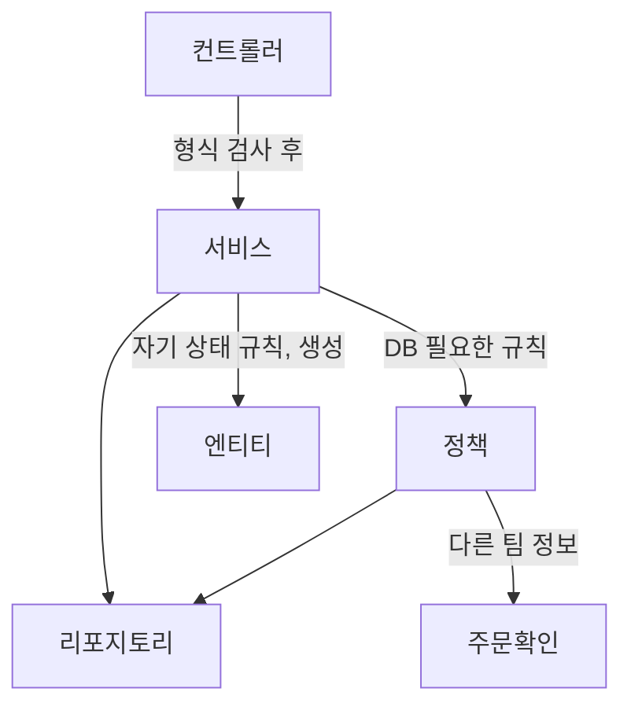

이 글은 메뉴 미니 프로젝트에서 메뉴 등록, 수정, 삭제를 만들면서 "누가 어떤 일을 맡아야 하는가"를 정리한 글이다.

2026년 11월 5일 수업에서 진행한 내용을 정리했다. [어제 글]({{ site.baseurl }})에서 이어지는 실습이다.

## 이게 없으면 뭐가 불편할까

메뉴를 등록할 때 지켜야 할 규칙이 있다.

- 메뉴 이름이 이미 있으면 등록하지 않는다.
- 카테고리는 "식사", "음료" 같은 큰 분류가 아니라 그 아래 작은 분류에만 등록한다.

이 규칙을 서비스 메서드 하나에 전부 `if`문으로 넣으면 어떻게 될까? 수업 자료에는 이렇게 짠 [Before] 코드와 그 문제점이 함께 실려 있었다.

```java
@Transactional
public int registNewMenu(MenuDTO registMenu) {

    // ① 비즈니스 규칙 : 이름 중복 금지 (다른 메뉴를 조회해야 판단 가능)
    if (menuRepository.existsByMenuName(registMenu.getMenuName())) {
        throw new BusinessException(ErrorCode.DUPLICATE_MENU_NAME);
    }

    // ② 비즈니스 규칙 : 하위 카테고리에만 등록 (카테고리를 조회해야 판단 가능)
    Category category = categoryRepository.findById(registMenu.getCategoryCode())
            .orElseThrow(() -> new BusinessException(ErrorCode.CATEGORY_NOT_FOUND));
    if (category.getRefCategoryCode() == null) { // Entity 내부 구조를 Service 가 해석
        throw new BusinessException(ErrorCode.NOT_SUB_CATEGORY);
    }

    // ③ 흐름 : 생성 -> 저장 -> 반환 (정작 이 메서드의 "할 일" 은 여기 3줄뿐이다)
    Menu menu = Menu.create(registMenu.getMenuName(), registMenu.getMenuPrice(), registMenu.getCategoryCode());
    menuRepository.save(menu);
    return menu.getMenuCode();
}
```

수업 자료에 적힌 문제점은 네 가지다.

1. ①의 중복 규칙이 메뉴 이름 수정(`modifyMenuName()`)에도 복사된다. 한쪽만 고치면 등록과 수정의 규칙이 달라진다.
2. ②에서 서비스가 "`refCategoryCode`가 `null`이면 상위 카테고리"라는 카테고리 내부 사정을 알아야 한다.
3. 규칙이 늘어날수록 `if`문이 쌓이고, ③의 "흐름"이 묻혀서 이 메서드가 무엇을 하는지 안 보인다.
4. 규칙 하나만 테스트하고 싶어도 서비스 전체(리포지토리 2개)를 준비해야 한다.

식당으로 비유하면, 주방장 한 명이 재료 검수, 위생 점검, 요리, 플레이팅을 혼자 다 하는 셈이다. 요리 순서는 보이지 않고, 검수 기준이 바뀌면 주방장의 일하는 방식 전체를 고쳐야 한다.

> 한 줄 요약: 규칙을 한 메서드에 몰아넣으면, 메서드가 무엇을 하는지 안 보이고 규칙을 고치기도 어렵다.

---

## 먼저, 어제 배운 것을 짧게 돌아보면

수업은 `@Controller`와 `@RestController`의 차이를 그림으로 복습하며 시작했다.

| 구분 | 책임 |
|------|------|
| `@Controller` | 요청을 받고, 간단한 유효성 검사를 하고, 비즈니스 로직을 호출하고, 사용자에게 **화면(View)** 으로 응답한다 |
| `@RestController` | `@Controller` + `@ResponseBody`. 앞의 세 가지는 같고, 사용자에게 **데이터**로 응답한다 |

수업 노트에는 이렇게 적었다. "뷰까지 리턴하기에는 컨트롤러 너는 너무 할 일이 많아. 화면은 내가 뿌릴게 느낌." 메인 화면처럼 회원 정보, 게시글, 메뉴, 랭킹이 한꺼번에 나오는 화면은 각자 만든 것을 데이터로 받아서 화면이 직접 그리는 편이 낫다는 이야기다. 자세한 내용은 [어제 글]({{ site.baseurl }})의 `@ResponseBody` 부분에 정리했다.

오늘은 이 "책임 나누기"를 서비스 안쪽까지 끌고 들어간다.

---

## 그림으로 보기 — 누가 무엇을 맡을까



서비스는 순서만 정하고, 판단은 정책과 엔티티에게 맡긴다. 다른 팀의 정보는 인터페이스(주문확인)로만 물어본다.

식당으로 다시 비유하면 이렇다.

| 식당에서 | 프로젝트에서 | 하는 일 |
|----------|--------------|---------|
| 홀 직원 | 컨트롤러 | 주문서가 제대로 채워졌는지(형식)만 보고 주방에 넘긴다 |
| 주방장 | 서비스 | 요리 **순서**를 정한다. 직접 검수하지 않는다 |
| 검수 담당 | 정책(Policy) | 창고를 확인해야 알 수 있는 규칙을 판단한다 |
| 재료 자신 | 엔티티 | "나는 지금 판매 중이라 뺄 수 없어"처럼 자기 상태로 판단한다 |
| 창고 관리인 | 리포지토리 | DB에서 꺼내고 넣는다 |

비유에는 한계가 있다. 진짜 재료는 말을 하지 못하지만, 엔티티는 자기 상태를 묻는 메서드(`isSubCategory()`, `validateDeletable()`)를 직접 가진다.

> 한 줄 요약: 서비스는 흐름만, 판단은 정책과 엔티티에게 맡긴다.

---

## 1. 메뉴 등록 ① — 입력 형식은 어디서 검사할까?

### 직접 해보기

`MenuDTO`의 필드에 검사 규칙을 붙였다.

```java
// TODO 2
@NotBlank(message = "메뉴 이름은 필수입니다!")   //빈칸을 허용하지 않는다.
@Size(max=30, message = "메뉴 이름은 30자 이하입니다!")   //30 글자 이하라서 사이즈도 지정해야함
private String menuName;

// TODO 2
@Min(value=0, message="메뉴 가격은 0원 이상입력!")
private int menuPrice;

// TODO 2
@Positive(message="카테고리를 선택 해주세요!")   //양수의 의미를 가지고 있음
private int categoryCode;
```

공식 문서(Jakarta Bean Validation)의 설명을 표로 정리했다.

| 어노테이션 | 공식 문서의 뜻 | 이 코드에서 |
|------------|----------------|-------------|
| `@NotBlank` | `null`이면 안 되고, 공백이 아닌 글자가 하나 이상 있어야 한다 | 이름을 비우거나 띄어쓰기만 넣으면 실패 |
| `@Size(max=30)` | 길이가 정한 범위 안이어야 한다 (경계 포함) | 30자까지 통과, 31자부터 실패 |
| `@Min(value=0)` | 정한 값 이상이어야 한다 | 가격 0원부터 통과 |
| `@Positive` | 0보다 커야 한다. **0은 실패**다 | 카테고리를 고르지 않아 0이 오면 실패 |

`@Positive`가 "카테고리를 선택 해주세요!"라는 메시지와 짝인 이유가 여기 있다. 카테고리를 고르지 않으면 숫자 칸에 0이 들어오고, 0은 양수가 아니어서 걸린다.

그리고 컨트롤러에서 `@Valid`를 붙여야 이 규칙이 실제로 검사된다.

```java
@PostMapping("/regist")
public ModelAndView registMenu(@Valid @ModelAttribute MenuDTO registMenu, ModelAndView mv) {
    // TODO 5 : DTO 내부에 유효성 검사를 해두고 적용되기 위해서는
    // @Valid 어노테이션을 반드시 달아주어야 한다.
    int menuCode=menuService.registNewMenu(registMenu);      //사용자가 입력한 메뉴 관련 정보를 같이 넘겨줌.

    // 메뉴 등록하기를 누르면 상세 조회 페이지로 가고 싶음.
    mv.setViewName("redirect:/menu/" + menuCode);       // 메뉴 등록이므로(인서트) 포워드방식으로 하면 큰일 남!!
    return mv;
}
```

시험지 채점에 비유하면, DTO의 어노테이션은 **채점 기준표**이고 `@Valid`는 "**이 답안지를 채점하라**"는 지시다. 기준표만 있고 지시가 없으면 아무도 채점하지 않는다. 다만 채점자와 달리, 스프링은 기준을 어긴 답안지를 받으면 메서드를 아예 실행하지 않고 예외를 던진다.

### 검사에 실패하면?

[어제 글]({{ site.baseurl }})에서 비워 두었던 `BindException` 핸들러(TODO 2)를 채웠다.

```java
/* MethodArgumentNotValidException(@Valid @ModelAttribute 검증 실패) 는 BindException 의 자식이다. */
@ExceptionHandler(BindException.class)
public ModelAndView handleBindException(BindException e) {
    // TODO 2 : @Valid 유효성 검사 불통과 시 동작하는 핸들러
    // 유효성 검사 실패 관련 에러 객체
    FieldError fieldError = e.getFieldError();

    String message = fieldError.isBindingFailure() ? fieldError.getField() + "의 형식이 올바르지 않습니다" : fieldError.getDefaultMessage();
    return errorPage(HttpStatus.BAD_REQUEST, message);
}
```

`FieldError`는 어떤 칸이 왜 실패했는지 담은 객체다. 실패는 두 종류로 나뉜다.

- `isBindingFailure()`가 `true`면 **형식부터 틀린** 경우다. 예를 들어 가격 칸에 숫자 대신 글자가 들어왔다. 이때는 "`menuPrice`의 형식이 올바르지 않습니다"를 보여 준다.
- 그 외는 **규칙을 어긴** 경우다. 이때는 DTO에 적어 둔 `message`(예: "메뉴 이름은 필수입니다!")를 그대로 보여 준다.

### 컨트롤러에서 검사해도 될까?

수업 노트에 이렇게 적었다.

> 원래는 컨트롤러에서 유효성 검사(데이터베이스를 들려야만 알 수 있는)를 하면 안 되고 서비스에서 해야 하는데, 데이터베이스를 보지 않아도 알 수 있는 검사(예: 30글자 이하)는 컨트롤러에서 해도 된다.

| 검사 | DB가 필요한가 | 어디서 |
|------|----------------|--------|
| 이름이 비었는가, 30자 이하인가 | 필요 없다 | DTO + `@Valid` (컨트롤러 단계) |
| 가격이 0원 이상인가 | 필요 없다 | DTO + `@Valid` |
| 같은 이름의 메뉴가 이미 있는가 | **필요하다** | 정책 (서비스 단계) |
| 하위 카테고리인가 | **필요하다** | 정책 + 엔티티 |

> 한 줄 요약: DB 없이 알 수 있는 형식은 DTO와 `@Valid`로, DB를 봐야 아는 규칙은 서비스 쪽에서 검사한다.

---

## 2. 메뉴 등록 ② — 규칙은 정책(Policy)에게 맡긴다

### 직접 해보기

서비스에 두 개의 정책 클래스를 주입받았다.

```java
// TODO 5 : Service 는 규칙을 판단하지 않고, Policy 에게 위임한다.
private final MenuNamePolicy menuNamePolicy;            // 의존성을 주입 받음
private final MenuCategoryPolicy menuCategoryPolicy;    // 두가지의 클래스에 대한 의존성을 추가함!!
```

**이름 중복 정책**이다.

```java
@Component
@RequiredArgsConstructor
public class MenuNamePolicy {

    // TODO 0 : JPA 를 상속받은 Interface 의존
    private final MenuRepository menuRepository;

    public void validateNewName(String menuName) {
        // TODO 1 : DB를 거쳐서 중복 된 메뉴이름이 존재하는 지를 확인
        if(menuRepository.existsByMenuName(menuName)) {      //이 친구는 쿼리메소드임
            // 해당 if문 내부에는 중복된 메뉴가 있을 때 동작 == 중복된 메뉴가 있다는 뜻!!
            throw new BusinessException(ErrorCode.DUPLICATE_MENU_NAME);
        }
    }
}
```

`existsByMenuName`은 리포지토리에 이름만 적은 쿼리 메서드다. 스프링 데이터 JPA 공식 문서는 `exists…By`로 시작하는 메서드가 보통 `boolean`을 돌려준다고 설명한다. 그래서 "있으면 `true`, 없으면 `false`"가 온다.

```java
// TODO 3 : JPA 가 제공하는 쿼리 메서드
boolean existsByMenuName(String menuName);
```

**카테고리 정책**이다.

```java
@Component
@RequiredArgsConstructor
public class MenuCategoryPolicy {

    // TODO 0
    private final CategoryRepository categoryRepository;     //카테고리 리포지토리를 의존성 주입 받음

    public void validateRegistrable(int categoryCode) {
        // TODO 1 : 카테고리 DB를 조회해서 하위 카테고리인 지 판단
        //findById 의 타입은 옵셔널 타입임 => 카테고리 코드가 없을 수도 있으니까. (옵셔널 타입으로 받거나/예외처리를 해줘야함)
        Category category = categoryRepository.findById(categoryCode).orElseThrow(() -> new BusinessException(ErrorCode.CATEGORY_NOT_FOUND));

        // 조회 한 카테고리 엔티티가 상위카테고리 / 하위카테고리 인 지 판단
        if (!category.isSubCategory()) {
            throw new BusinessException(ErrorCode.NOT_SUB_CATEGORY);
        }
    }
}
```

"하위 카테고리인가?"는 카테고리 **자신에게** 물어본다.

```java
public boolean isSubCategory() {
    // TODO 3 : 도메인의 상태를 물어보는 메서드
    return refCategoryCode != null;
}
```

Before 코드에서는 서비스가 `getRefCategoryCode() == null`을 직접 해석했다. 이제는 카테고리가 "나는 하위 카테고리야"라고 답한다. "위 분류 번호가 있으면 하위"라는 사정은 카테고리 안에만 있다.

### 정책 클래스에는 왜 `@Component`일까?

스프링 공식 문서는 `@Component`를 스프링이 관리하는 객체를 표시하는 일반적인 표시라고 설명한다. `@Service`, `@Repository`, `@Controller`는 그중 서비스, 저장, 화면 쪽에 쓰도록 이름을 붙인 특수한 형태다. 정책은 그 어디에도 딱 맞지 않아서 일반적인 `@Component`를 썼다. 이 표시가 있어야 스프링이 객체를 만들어서 서비스에 주입해 준다.

### 이 방법의 한계

수업 코드에는 이런 주석이 있었다.

```text
한계점
: 동시에 2명이 같은 이름을 가진 메뉴를 등록할 때는 둘 다 통과할 수 있다.
왜냐하면 조회와 저장 사이에는 정말 미세하지만 간격이 있기 때문이다.
따라서 실제 운영환경에서는 데이터베이스 내부 menu_name 컬럼에 unique 제약조건까지 붙여야 완벽하게 의도된 대로 동작하게 된다.
```

두 사람이 거의 동시에 "김치찌개"를 등록하면, 둘 다 "아직 없음"을 확인한 뒤 둘 다 저장할 수 있다. [프로세스와 스레드 글]({{ site.baseurl }})에서 본 `count++` 문제와 같은 모양이다. 그래서 DB 쪽에서도 같은 이름이 두 번 들어가지 못하게 막아야 한다.

> 한 줄 요약: DB를 봐야 아는 규칙은 정책 클래스로 빼고, 대상 자신의 상태는 엔티티에게 묻는다.

---

## 3. 메뉴 등록 ③ — 엔티티는 누가 만들까?

### 직접 해보기

정책을 통과하면 서비스는 엔티티를 만들고 저장한다. 최종 코드다.

```java
@Transactional
public int registNewMenu(MenuDTO registMenu) {
    // TODO 5 Service 계층의 책임은 흐름을 조합하며, Transaction 을 제어한다.

    // 1. 비즈니스 규칙 확인
    // 1-1) 메뉴 등록 시 중복 된 메뉴는 등록 X -> DB를 들려야만 알 수 있다.
    menuNamePolicy.validateNewName(registMenu.getMenuName());
    // 1-2) 메뉴 등록 시 카테고리는 하위 카테고리만 등록 가능하다. -> 얘도 마찬가지로 DB를 들려야만 알 수 있다.
    menuCategoryPolicy.validateRegistrable(registMenu.getCategoryCode());

    // ------ 위에 두 개 통과하면 정책들을 통과한 것임.

    // 2. Entity 객체 생성
    Menu menu = Menu.create(
            registMenu.getMenuName(),
            registMenu.getMenuPrice(),
            registMenu.getCategoryCode()
    );

    // 3. 영속성 컨텍스트에 Entity 객체 Persist
    menuRepository.save(menu);

    return menu.getMenuCode();
}
```

Before 코드와 비교하면 `if`문이 사라지고 "확인 → 생성 → 저장 → 반환"만 남았다. 이 메서드가 무엇을 하는지 한눈에 보인다.

### `new Menu(...)` 대신 `Menu.create(...)`

수업 노트에 이렇게 적었다. "서비스는 엔티티 객체를 만들지 않음. 만들면 책임 위반임! 따라서 만드는 것도 '야 엔티티! 너 클래스 내부에서 만들어.' 이렇게 하는 것임."

```java
@NoArgsConstructor
@AllArgsConstructor(access = AccessLevel.PRIVATE)
...
public class Menu {

    // 판매 상태를 나타내는 두 가지 필드 작성
    // Y, N 은 의미를 파악하기 힘든 값이기 때문에 값에 의미를 부여하기 위한 변수 선언
    private static final String ON_SALE = "Y";
    private static final String STOPPED = "N";

    ...

    public static Menu create(String menuName, int menuPrice, int categoryCode) {
        // TODO 3 : 정적 팩토리 메서드
        // 엔티티 객체를 생성하는 것은 Entity 클래스만의 책임이며
        // 외부에서는 해당 메서드를 부르면 Entity 객체를 return 해준다.

        return new Menu(0, menuName, menuPrice, categoryCode, ON_SALE);      // 엔티티 객체를 하나 만든 다음에 전달해 줌.
        // 위에 0을 넣어준 값은 @GeneratedValue 는 보통 데이터베이스를 거치고 그 값으로 바뀌기 때문에 0으로 넣어줌.
    }
}
```

세 가지를 짚어 보자.

1. **모든 칸을 받는 생성자가 `private`이다.** `@AllArgsConstructor(access = AccessLevel.PRIVATE)` 때문에 클래스 밖에서는 `new Menu(...)`로 칸을 마음대로 채울 수 없다. 만드는 길은 `create` 하나뿐이다.
2. **새 메뉴의 판매 상태는 항상 `ON_SALE`("Y")이다.** 부르는 쪽이 판매 상태를 고를 수 없다. "새 메뉴는 판매 중으로 시작한다"는 규칙이 `create` 안에 들어 있다.
3. **`"Y"` 대신 `ON_SALE`이라는 이름을 붙였다.** `"Y"`만 보면 무슨 뜻인지 알기 어렵다.

공장 출고로 비유하면, 서비스가 부품을 사다 직접 조립하는 대신 공장(엔티티)에 "이 사양으로 하나 주세요"라고 주문하는 것이다. 공장은 출고 기준(판매 중으로 시작)을 지켜서 내보낸다. 다만 실제 공장과 달리, `create`는 DB에 저장까지 하지는 않는다. 저장은 리포지토리의 `save`가 따로 한다.

### 0을 넣었는데 메뉴 번호는 어떻게 생길까?

`menuCode`는 `@GeneratedValue(strategy = GenerationType.IDENTITY)`가 붙은 칸이다. 번호를 DB가 정해 준다. 그래서 `create`에서는 아무 값(0)이나 넣어 두고, 저장한 뒤 `menu.getMenuCode()`로 DB가 정한 번호를 꺼냈다. 실제로 등록 후 주소가 `/menu/37`이 되었다. 37번이 DB가 정해 준 번호다.

참고로 스프링 데이터 공식 문서는 `save`에 대해 "저장 과정에서 엔티티 객체가 완전히 바뀔 수도 있으니, 이후 작업에는 **반환된 객체**를 쓰라"고 설명한다. 이번 코드는 `save`의 반환값 대신 원래 `menu`에서 번호를 꺼냈는데, 실행해 보니 번호가 잘 나왔다. 그래도 문서를 따르려면 `Menu saved = menuRepository.save(menu);`처럼 반환값을 받아 쓰는 편이 안전하다.

> 한 줄 요약: 엔티티는 엔티티가 만든다. 서비스는 `create`로 주문하고 `save`로 저장만 한다.

---

## 4. @Transactional — 왜 서비스 메서드에 붙일까?

`registNewMenu`, `modifyMenuName`, `deleteMenu` 모두 서비스 메서드에 `@Transactional`이 붙어 있다. 트랜잭션과 `@Transactional`의 기본은 [엔티티 매핑 글]({{ site.baseurl }})에서 다뤘다.

수업 중에 "왜 `@Transactional`을 서비스에만 쓸까?"를 정리했다. 요약하면 이렇다.

1. **서비스가 "하나의 완결된 일"의 단위다.** 송금을 예로 들면 "A 계좌 출금"과 "B 계좌 입금"은 각각 리포지토리 작업이다. 둘을 묶어 "송금하기"라는 흐름을 만드는 곳은 서비스다. 그래서 "둘 다 성공하거나, 둘 다 취소"도 서비스에서 정한다.
2. **각 층의 역할이 다르다.** 컨트롤러는 요청을 받고 응답하는 창구이고, 리포지토리는 테이블에 넣고 빼는 일만 한다. 전체 흐름을 아는 곳은 서비스뿐이다.
3. **영속성 컨텍스트의 수명이 트랜잭션과 같다.** 서비스 메서드가 시작될 때 열리고 끝날 때 닫히므로, 메서드 안에서 6절의 변경 감지 같은 기능을 쓸 수 있다.

중간에 정책이 예외를 던지면 어떻게 될까? 스프링 공식 문서는 기본 설정에서 `RuntimeException`(과 그 자식) 같은 확인되지 않는 예외가 나면 트랜잭션을 롤백(취소)한다고 설명한다. 반대로 확인 예외(checked exception)는 기본적으로 롤백하지 않는다. `BusinessException`이 어느 쪽을 물려받았는지는 이 글의 캡처에 없어서 확인하지 못했다.

> 한 줄 요약: 흐름을 아는 서비스가 "어디서 시작해서 어디서 끝나는지"를 책임진다.

---

## 5. 등록 후에는 왜 redirect일까?

### 처음에는 에러가 났다

처음에는 등록 후 상세 화면으로 가려고 이렇게 썼다.

```java
mv.setViewName("/menu/" + menuCode);
```

실행하니 이런 화면이 나왔다.

```text
Whitelabel Error Page
There was an unexpected error (type=Internal Server Error, status=500).
Error resolving template [/menu/37], template might not exist or might not be accessible by any of the configured Template Resolvers
```

`"/menu/37"`을 **화면 파일 이름**으로 받아들였기 때문이다. `templates` 폴더에 `menu/37.html`이라는 파일은 없으니 에러가 났다. 수업 노트에도 "메뉴 37이라는 페이지가 없으니까 오류가 남. 화면이 없기 때문에 오류가 난 것이지 데이터는 잘 이동했음"이라고 적었다. 실제로 DB에는 37번 메뉴가 저장되었다.

### `redirect:`를 붙이면

```java
mv.setViewName("redirect:/menu/" + menuCode);       // 메뉴 등록이므로(인서트) 포워드방식으로 하면 큰일 남!!
```

스프링 공식 문서는 화면 이름 앞의 `redirect:`를 "리다이렉트하라는 지시"로 받아들이고, 나머지를 이동할 주소로 쓴다고 설명한다. 그러면 브라우저가 `/menu/37` 주소로 **새로 GET 요청**을 보내고, 상세 조회 메서드(`/{menuCode}`)가 다시 실행된다. 수업 노트에도 "redirect를 붙인 순간 위에 메서드가 다시 실행됨"이라고 적었다.

### 왜 등록 후에는 꼭 redirect일까?

forward와 redirect의 차이는 [서블릿 응답 글]({{ site.baseurl }})과 [ViewResolver 글]({{ site.baseurl }})에서 다뤘다. 여기서는 "등록 직후" 상황만 보자.

| 방식 | 등록 후 주소창 | 이 상태에서 새로고침(F5)을 누르면 |
|------|----------------|-------------------------------------|
| forward | `/menu/regist` 그대로 | 방금 보낸 **등록(POST)** 이 다시 간다. 같은 메뉴가 또 등록될 수 있다 |
| redirect | `/menu/37`로 바뀜 | **조회(GET)** 만 다시 간다. 안전하다 |

택배 접수 창구로 비유하면, forward는 접수증을 받은 창구 앞에 그대로 서 있는 것이다. "한 번 더"를 누르면 같은 택배가 또 접수된다. redirect는 접수가 끝나면 "조회 창구로 가세요"라며 다른 창구로 보내는 것이다. 거기서는 몇 번을 다시 물어봐도 조회만 된다. 다만 실제 창구와 달리, 이동은 브라우저가 알아서 하므로 사용자는 눈치채지 못한다.

이렇게 "POST로 처리한 뒤 redirect로 보내고, GET으로 결과를 보여 주는" 방식을 흔히 PRG(Post-Redirect-Get) 패턴이라고 부른다. 메뉴 수정과 삭제 뒤에도 같은 이유로 `redirect:`를 썼다.

> 한 줄 요약: 데이터를 바꾼 뒤에는 redirect로 보내야 새로고침해도 두 번 처리되지 않는다.

---

## 6. 메뉴 수정 — update 메서드가 없다

### 직접 해보기

컨트롤러는 메뉴 번호와 새 이름을 받아 서비스에 넘긴다.

```java
@PostMapping("/modify")
public ModelAndView modifyMenuName(@RequestParam int menuCode, @RequestParam String menuName, ModelAndView mv) {
    // TODO 6 : 메뉴코드와 변경할 이름을 전달 받아 수정!
    menuService.modifyMenuName(menuCode, menuName);      //메뉴 코드와 메뉴 이름을 전달!
    mv.setViewName("redirect:/menu/" + menuCode);
    return mv;
}
```

서비스는 메뉴를 꺼내서 이름을 바꾸기만 한다.

```java
@Transactional       // 하나의 트랜잭션으로 메서드를 감싸기
public void modifyMenuName(int menuCode, String menuName) {
    // TODO 6

    // 1. 수정하고자 하는 엔티티 조회가 선행되어야 함.
    Menu foundMenu = menuRepository.findById(menuCode).orElseThrow(()->new BusinessException(ErrorCode.MENU_NOT_FOUND));

    // 2. 전달 받은 새 이름으로 엔티티 이름 변경
    // Entity 객체는 DB의 한 행이기 때문에 Setter 로 무분별하게 수정하는 것을 지양한다.
    // 변경이 필요할 시 메서드를 통해서 Entity 내부 규칙에 의한 수정을 할 수 있게 한다.
    foundMenu.changeMenuName(menuName);
}
```

```java
public void changeMenuName(String newMenuName) {
    // TODO 4 : 해당 메서드로만 메뉴 이름을 바꿀 수 있다.
    this.menuName = newMenuName;    //사용자가 입력한 메뉴네임으로 변경
}
```

`save`도 `update`도 부르지 않았다. 그런데 DB의 이름이 바뀐다. **변경 감지(Dirty Checking)** 덕분이다. 수업 코드의 주석을 그대로 옮긴다.

```text
영속성 컨텍스트는 변경 감지(Dirty Checking) 기능이 있다.
1. findById 를 하는 순간 PC(영속성 컨텍스트) 는 해당 메뉴 엔티티를 스냅샷 찍어둔다.
2. changeMenuName() 을 진행해서 메뉴 이름을 변경한다.
3. @Transactional 이 걸린 메서드가 종료되면 commit() 이 일어난다.
4. commit() 바로 직전 스냅샷과 엔티티 객체의 변화가 있는지 비교한다.
5. 변화가 감지되면 update 쿼리문을 알아서 실행한다.
```

변경 감지의 원리는 [JPA 영속성 컨텍스트 글]({{ site.baseurl }})의 "수정 메서드는 왜 없을까?"에서 자세히 다뤘다.

### 왜 Setter 대신 `changeMenuName`일까?

`setMenuName`이 열려 있으면 어디서든 이름을 바꿀 수 있다. 엔티티는 DB의 한 행이라서, 어디서 바뀌었는지 모르면 추적이 어렵다. `changeMenuName`처럼 **바꾸는 길을 하나로** 정해 두면, 나중에 "이름은 30자 이하" 같은 규칙을 그 메서드 안에 넣기만 하면 된다. 수업 노트에도 "서비스는 순서만 잘 정리해. 값을 바꾸고 싶으면 호출만 해. 반드시 메서드로만 접근하는 방법이 권장되는 방식임"이라고 적었다.

참고로 수정할 때도 이름 중복을 검사해야 한다. `MenuNamePolicy`에는 그 일을 할 `validateRename()`이 TODO로 남아 있었다. 이 메서드를 채우면 Before 코드의 문제점 1번(중복 규칙이 등록과 수정에 각각 복사됨)이 해결된다. 규칙이 정책 한 곳에 모이기 때문이다.

> 한 줄 요약: 엔티티의 값을 메서드로 바꾸기만 하면, 트랜잭션이 끝날 때 JPA가 알아서 UPDATE를 보낸다.

---

## 7. 메뉴 삭제 — 엔티티 규칙과 정책이 함께 나온다

삭제에는 규칙이 두 개 있다.

1. 판매 중(`"Y"`)인 메뉴는 삭제할 수 없다.
2. 주문된 적이 있는 메뉴는 삭제할 수 없다.

둘은 성격이 다르다. 1번은 **메뉴 자신의 상태**만 보면 안다. 2번은 **주문이라는 다른 영역**의 정보가 필요하다.

### 직접 해보기

최종 서비스 코드다.

```java
@Transactional
public void deleteMenu(int menuCode) {
    // TODO 7 : 메뉴 삭제 시 정책/규칙 처리

    // 사전 준비 Entity 의 상태를 확인하기 위해 find
    Menu found = menuRepository.findById(menuCode).orElseThrow(()->new BusinessException(ErrorCode.MENU_NOT_FOUND));

    // 1. 판매상태가 Y 인 메뉴는 삭제할 수 없다. - 엔티티 객체의 상태를 가져와야 함.
    found.validateDeletable();          //삭제가 가능한지를 판단하는 메서드 (도메인 규칙-Y/N 판단) 엔티티 내부에 구현해 놓음

    // 2. 주문된 적이 있는 메뉴는 삭제할 수 없다.
    // 비즈니스 규칙(여러 도메인/DB 의 값을 통해서 판단해야 하는 것들)
    menuDeletionPolicy.validateDeletable(menuCode);

    // 3. 위 규칙과 정책을 통과하면 삭제 진행!
    menuRepository.delete(found);
}
```

1번 규칙은 엔티티 안에 있다.

```java
public void validateDeletable() {
    // TODO 5 : 판매상태가 Y 이면 삭제 불가 예외 발생
    if (this.orderableStatus.equals(ON_SALE)) {  // 문자열 비교는 동등비교가 안 되므로 equals() 메서드로 비교 해야함!!!(중요)
        throw new BusinessException(ErrorCode.ON_SALE_MENU_CANNOT_DELETE);   //판매상태가 Y 이면 삭제가 불가능하다.
    }
}
```

문자열을 `==`로 비교하면 "같은 객체인가"를 묻게 된다. 내용이 같은지 보려면 `equals`를 써야 한다. 같은 이야기를 [래퍼 클래스 글]({{ site.baseurl }})의 `Integer` 비교에서도 다뤘다.

수업 자료의 [Before] 코드에서는 서비스가 `"Y".equals(foundMenu.getOrderableStatus())`처럼 `"Y"`라는 내부 표현을 직접 알아야 했다. 이제 서비스는 "삭제해도 되니?"라고 묻기만 한다. 수업 자료의 표현으로는 "Service는 `"Y"`가 무엇인지도 모른다".

### deleteById 대신 delete(found)

수업 중에 처음에는 `menuRepository.deleteById(menuCode);`를 썼다가 `menuRepository.delete(found);`로 바꿨다. 수업 노트에는 "규칙이 없으면 이렇게 식별자만 건네주면 됨. 근데 우리는 규칙이 있으므로 이렇게 작성하면 안 됨"이라고 적었다.

규칙을 검사하려면 어차피 `found`를 먼저 꺼내야 한다. 이미 꺼낸 엔티티가 있으니 그대로 지우면 된다. 그리고 스프링 데이터 공식 문서는 `deleteById`에 대해 "해당 번호의 엔티티가 없으면 **조용히 무시한다**"고 설명한다. 없는 메뉴를 지우려 해도 아무 일도 일어나지 않는다는 뜻이다. 이번 코드는 `findById(...).orElseThrow(...)`로 "없는 메뉴"를 먼저 걸러 내기 때문에 이런 일이 생기지 않는다.

> 한 줄 요약: 자기 상태로 판단하는 규칙은 엔티티에, 다른 영역의 정보가 필요한 규칙은 정책에 둔다.

---

## 8. 다른 팀의 데이터가 필요하면? — 인터페이스로 주문하기

### 왜 주문 리포지토리를 직접 쓰면 안 될까?

2번 규칙("주문된 적 있는 메뉴는 삭제 불가")을 판단하려면 주문 데이터를 봐야 한다. 그런데 주문 데이터는 **주문 팀**의 것이다.

[Before] 코드에서는 메뉴 서비스가 주문 팀의 리포지토리를 직접 주입받았다.

```java
private final OrderMenuRepository orderMenuRepository; // 다른 팀(Order) 의 Repository 를 직접 주입
...
if (orderMenuRepository.existsByMenuCode(menuCode)) {
    throw new BusinessException(ErrorCode.ORDERED_MENU_CANNOT_DELETE);
}
```

수업 노트에는 이렇게 적었다. "다른 팀이 개발하고 있는 리포지토리 의존성을 주입받으면? 만약 다른 팀에서 수정하면 나는 영문도 모르고 오류가 남."

### 인터페이스를 사이에 둔다

수업 그림은 메뉴 팀과 주문 팀 사이에 빨간 선을 긋고, 그 선 위에 **인터페이스**를 놓았다.

1. 메뉴 팀은 "이 메뉴 팔린 적 있어?"라고 물을 **창구의 모양**을 인터페이스(`MenuOrderHistoryChecker`)로 정한다. 이 인터페이스에는 `hasOrdered(int menuCode)`라는 메서드가 약속되어 있다.
2. 주문 팀은 그 인터페이스를 **구현**해서, 자기 DB를 어떻게 뒤질지는 스스로 정한다.
3. 메뉴 팀은 인터페이스만 알고, 구현체가 무엇인지는 모른다.

메뉴 팀의 정책 코드다.

```java
@Component
@RequiredArgsConstructor
public class MenuDeletionPolicy {

    // TODO 0
    private final MenuOrderHistoryChecker menuOrderHistoryChecker;      //인터페이스 활용

    public void validateDeletable(int menuCode) {
        // TODO 1
        if(menuOrderHistoryChecker.hasOrdered(menuCode)) {
            throw new BusinessException(ErrorCode.ORDERED_MENU_CANNOT_DELETE);  //주문된 메뉴는 삭제할 수 없다라는 예외코드 발생
        }
    }
}
```

주문 팀의 진짜 코드는 아직 없다. 그래서 수업에서는 가짜(Fake) 구현체를 제공했다.

```java
@Component
public class FakeMenuOrderHistoryChecker implements MenuOrderHistoryChecker {

    private static final Set<Integer> ORDERED_MENU_CODES = Set.of(1, 2, 3);

    /* comment.
        Menu 개발 팀은 Order 팀의 정보가 필요하다.
        따라서 메뉴 팀은 Interface 로 주문을 하고 주문 팀은 Interface 를 구현하여 필요한 값을 전달한다.
     */
    @Override
    public boolean hasOrdered(int menuCode) {
        return ORDERED_MENU_CODES.contains(menuCode);
    }
}
```

"1, 2, 3번 메뉴는 팔린 적이 있다고 치자"는 가짜 답이다. 클래스 위 주석에는 "Order 팀이 실제 구현(예: `tbl_order_menu`를 조회하는 클래스)을 만들면 이 클래스는 삭제한다. Menu 팀 코드(`MenuDeletionPolicy`)는 한 줄도 바뀌지 않는다"고 적혀 있다.

식당의 배달 앱 주문서로 비유해 보자. 식당(메뉴 팀)은 "주소, 메뉴, 연락처" 칸이 있는 주문서 양식(인터페이스)만 정한다. 배달 업체(주문 팀)가 어디든 그 양식대로만 받아 주면 된다. 배달 업체가 바뀌어도 식당은 하는 일이 같다. 다만 실제 주문서와 달리, 인터페이스는 컴파일러가 "약속한 메서드를 다 만들었는지" 확인해 준다.

수업 노트에는 "메뉴 팀은 인터페이스만 의존하고 있기 때문에 오더 팀이 무슨 짓을 해도 오류가 나지 않음. 이게 바로 Port/Adapter 구조임"이라고 적었다. 인터페이스가 꽂는 구멍(포트)이고, 구현체가 거기 맞춰 꽂는 플러그(어댑터)라는 뜻으로 이해했다. 이 프로젝트에는 `MenuOrderHistoryChecker`의 구현체가 Fake 하나뿐이어서, 스프링이 그 객체를 정책에 넣어 준다.

> 한 줄 요약: 남의 데이터가 필요하면 남의 코드를 직접 쓰지 말고, 내가 정한 인터페이스로 물어본다.

---

## 한 번에 보기 — 오늘 나온 것들

| 절 | 무엇 | 누가 맡았나 | 한 마디 |
|----|------|-------------|---------|
| 1 | `@NotBlank`, `@Size`, `@Min`, `@Positive` + `@Valid` | DTO, 컨트롤러 | DB 없이 아는 형식 검사 |
| 2 | `MenuNamePolicy`, `MenuCategoryPolicy` | 정책 | DB를 봐야 아는 규칙 |
| 2 | `Category.isSubCategory()` | 엔티티 | 자기 상태로 답한다 |
| 3 | `Menu.create()` | 엔티티 | 엔티티는 엔티티가 만든다 |
| 4 | `@Transactional` | 서비스 | 흐름과 트랜잭션을 책임진다 |
| 5 | `redirect:` | 컨트롤러 | 데이터를 바꾼 뒤에는 redirect |
| 6 | `changeMenuName()` + 변경 감지 | 엔티티 | update 메서드 없이 수정 |
| 7 | `Menu.validateDeletable()` | 엔티티 | 판매 중이면 삭제 불가 |
| 8 | `MenuOrderHistoryChecker` | 인터페이스 | 다른 팀에는 인터페이스로 묻는다 |

---

## 헷갈렸던 점

**1. 정책에서는 왜 예외를 던질까?**

수업 노트에 "예외 처리 해 줌 (왜 하는지는 모르겠음…)"이라고 적었다. 정리해 보면 이렇다.

정책 메서드는 `void`다. 아무 값도 돌려주지 않는다. 그러면 "삭제하면 안 된다"는 결과를 어떻게 알릴까? **예외를 던지는 것**이 그 방법이다.

예외가 나면 세 가지 일이 한꺼번에 일어난다.

1. **그 뒤의 코드가 실행되지 않는다.** `deleteMenu`에서 정책이 예외를 던지면 `menuRepository.delete(found)` 줄까지 가지 않는다. 그래서 삭제되지 않는다.
2. **트랜잭션이 롤백된다.** 4절에서 본 대로, 기본 설정에서는 확인되지 않는 예외(`RuntimeException` 계열)가 나면 스프링이 트랜잭션을 취소한다. `BusinessException`이 이 계열이라면 그렇다.
3. **`GlobalExceptionHandler`가 받아서 에러 화면을 보여 준다.** [어제 글]({{ site.baseurl }}) 7절에서 만든 `handleBusinessException`이 `ErrorCode`에 맞는 메시지로 화면을 만든다.

교통 신호로 비유하면, 정책은 건널목의 **빨간불**이다. 빨간불이 켜지면 그 자리에서 멈추고(1), 이미 반쯤 건넌 것도 없던 일로 되돌리고(2), 안내원이 "지금은 못 건넙니다"라고 알려 준다(3). 다만 진짜 빨간불은 잠시 기다리면 바뀌지만, 예외는 요청 자체를 끝낸다. 사용자가 조건을 고쳐서 다시 요청해야 한다.

`if`로 `true/false`를 돌려주는 방법도 있지만, 그러면 부르는 쪽(서비스)이 매번 결과를 보고 판단해야 한다. 그러면 다시 서비스에 `if`가 쌓인다. 예외를 던지면 서비스는 "검사해 줘"라고 부르기만 하면 된다.

**2. 컨트롤러에서 검사하면 안 되는 것은?**

1절의 표대로, **DB를 봐야 아는 검사**다. 컨트롤러는 요청을 받는 창구라서 DB에 직접 가지 않는다. "이름이 비었나"는 창구에서 볼 수 있지만, "이 이름이 이미 있나"는 창고(DB)를 봐야 안다.

**3. `@Positive`와 `@Min(1)`은 같을까?**

정수 칸에서는 결과가 같다. 공식 문서는 `@Positive`를 "0은 실패인, 0보다 큰 수"로, `@Min(value)`를 "정한 값 이상"으로 설명한다. 이번 코드에서는 "양수여야 한다"는 뜻이 이름에 드러나는 `@Positive`를 썼다.

**4. 엔티티에 Setter가 없으면 값은 어떻게 바꿀까?**

6절의 `changeMenuName`처럼, 바꾸는 이유가 이름에 드러나는 메서드를 엔티티 안에 만든다. 판매 중지와 재개도 `stopSelling()`, `resumeSelling()`이라는 메서드로 준비되어 있었다(이번 실습에서는 TODO로 남았다).

---

## 더 학습하면 좋은 개념

- **DB의 unique 제약조건** — 2절의 "동시에 두 명이 같은 이름을 등록하는" 한계를 막는 방법이다. 코드의 검사와 DB의 제약을 함께 쓰는 이유를 알 수 있다.
- **단위 테스트와 가짜 객체(Fake)** — 정책을 클래스로 나누고 인터페이스를 쓰면, 서비스 전체 없이 규칙 하나만 테스트할 수 있다. Before 코드의 문제점 4번이 이것이다.
- **포트와 어댑터(헥사고날 아키텍처)** — 8절의 구조에 붙는 이름이다. 왜 바깥과는 인터페이스로만 연결하는지 더 큰 그림으로 볼 수 있다.
- **`@Transactional`의 롤백 규칙** — 어떤 예외에서 롤백되고 어떤 예외에서 안 되는지, `rollbackFor` 같은 설정은 무엇인지 알아야 예외를 설계할 수 있다.
- **정적 팩토리 메서드** — `Menu.create()` 같은 방식이 생성자와 비교해 어떤 장점이 있는지 알면, 엔티티를 설계할 때 선택지가 늘어난다.

## 참고 자료

- [Jakarta Bean Validation 3.0: NotBlank](https://jakarta.ee/specifications/bean-validation/3.0/apidocs/jakarta/validation/constraints/NotBlank.html)
- [Jakarta Bean Validation 3.0: Size](https://jakarta.ee/specifications/bean-validation/3.0/apidocs/jakarta/validation/constraints/Size.html)
- [Jakarta Bean Validation 3.0: Min](https://jakarta.ee/specifications/bean-validation/3.0/apidocs/jakarta/validation/constraints/Min.html)
- [Jakarta Bean Validation 3.0: Positive](https://jakarta.ee/specifications/bean-validation/3.0/apidocs/jakarta/validation/constraints/Positive.html)
- [Spring Data JPA: Repository query keywords](https://docs.spring.io/spring-data/jpa/reference/repositories/query-keywords-reference.html)
- [Spring Data Commons: CrudRepository (API)](https://docs.spring.io/spring-data/commons/docs/current/api/org/springframework/data/repository/CrudRepository.html)
- [Spring Framework: Classpath Scanning and Managed Components](https://docs.spring.io/spring-framework/reference/core/beans/classpath-scanning.html)
- [Spring Framework: Rolling Back a Declarative Transaction](https://docs.spring.io/spring-framework/reference/data-access/transaction/declarative/rolling-back.html)
- [Spring Framework: View Resolution (redirect: 접두사)](https://docs.spring.io/spring-framework/reference/web/webmvc/mvc-servlet/viewresolver.html)
