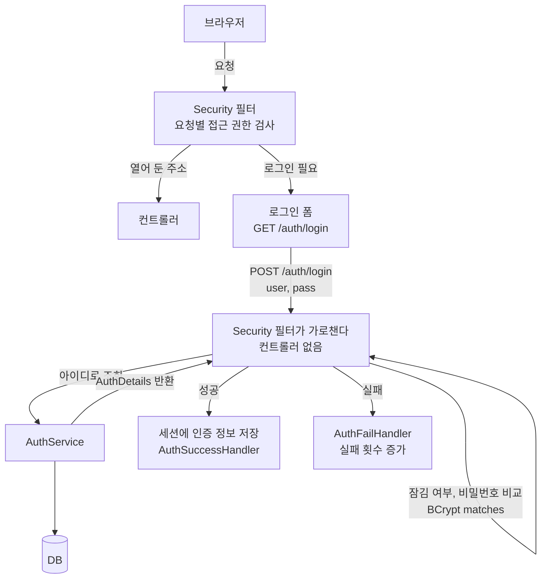
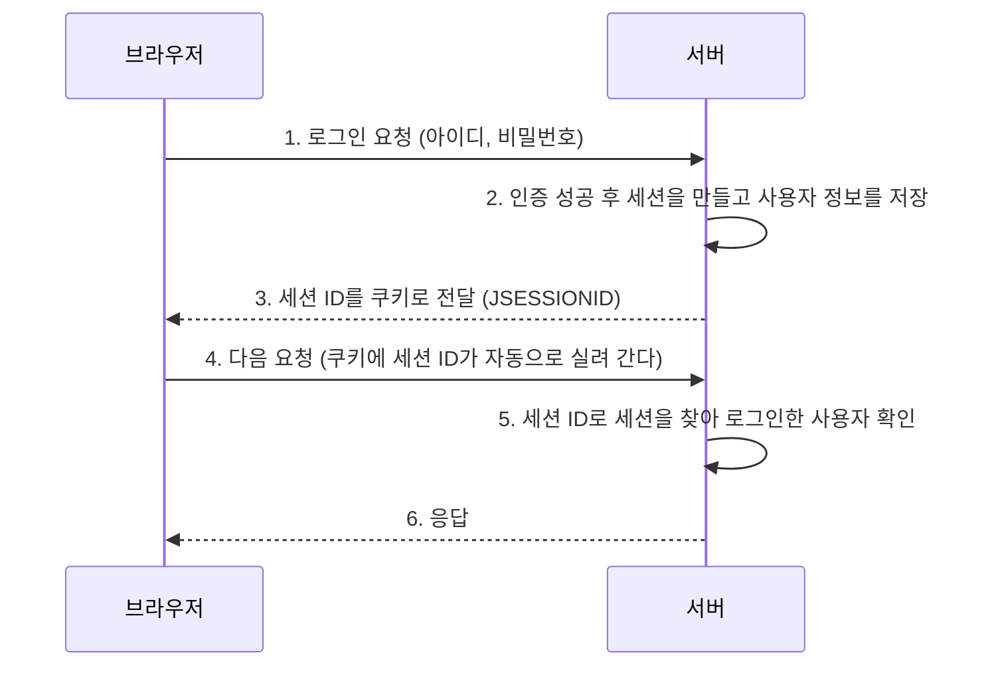
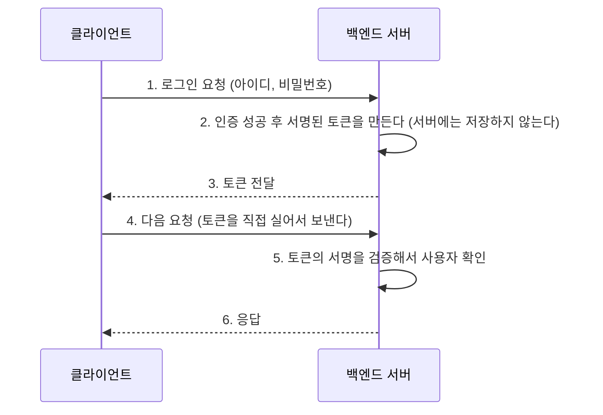

이 글은 Spring Security로 세션 방식 로그인을 만들면서 "누가 들어올 수 있고(인증), 들어온 사람이 무엇을 할 수 있는지(인가)"를 정리한 글이다.

2026년 11월 6일 수업에서 진행한 내용을 정리했다. 수업 프로젝트(`10_Spring-Security/module01-security-session`)의 실제 코드를 따라가며 설명한다. 예외를 사용자에게 보여 줄 메시지로 바꾸는 흐름은 [메뉴 미니 프로젝트 글]({{ site.baseurl }})에서 만든 예외 처리와 닮은 부분이 있다.

## 오늘 수업은 이 순서로 진행했다

수업 노트의 순서를 그대로 옮겼다.

1. **실습 준비** : 루트 계정에서 붙여넣고 실행한다. 이어서 원티드 계정에서 슬랙에 있는 것 중 2번째 것을 붙여넣고 실행한다. 그다음 슬랙에서 다운 받은 폴더를 프로젝트 폴더에 압축 해제한다.
2. **개념** : 로그인 방식(토큰 / 세션), 우리는 SSR로 진행한다는 것, 인증과 인가.
3. **BCrypt** : 비밀번호 암호화에 쓰는 이유 4가지를 정리하고, 슬랙에서 가져온 코드를 붙여넣었다.
4. **요청 필터링** : 요청별 접근 권한을 설정했다.
5. **`AuthDetails`** : `UserDetails`를 구현한 클래스를 만들었다. 슬랙에서 내용을 가져와 `return` 문장을 지우고 붙여넣었다.
6. **로그인 실패 처리** : 원인별 메시지와 실패 횟수 증가. 앞부분을 작성한 뒤 슬랙에서 내용을 붙여넣었다.
7. **핸들러** : 각각의 클래스가 담당하는 역할을 정리했다.
8. **마지막 확인** : 의존성에 Security를 추가하면 `index.html`이 안 보이는 현상.

## 이게 없으면 뭐가 불편할까

로그인 기능이 없는 사이트를 떠올려 보자.

- 주소만 알면 누구나 모든 페이지에 들어간다. 관리자 페이지(`/admin/logs`)도 마찬가지다.
- 비밀번호를 DB에 있는 그대로 저장하면, DB가 한 번 유출되는 순간 모든 회원의 비밀번호가 드러난다.
- 비밀번호를 틀려도 횟수 제한이 없어서 같은 아이디에 계속 시도할 수 있다.

Spring Security 없이 직접 막으려면 모든 컨트롤러 메서드에 "로그인했나?", "권한이 있나?" 확인을 `if`문으로 넣어야 한다. 지난 글의 Before 코드처럼 규칙이 여기저기 복사되고, 하나라도 빼먹으면 그 주소가 뚫린다.

건물로 비유하면, 경비실 없이 출입문 하나하나에 직원이 따로 서 있는 셈이다. 직원이 한 명이라도 자리를 비우면 그 문으로 아무나 들어온다.

> 한 줄 요약: 로그인 확인을 코드 곳곳에 흩어 놓으면 빠뜨리기 쉽다. 입구에서 한꺼번에 검사하는 틀이 필요하다.

---

## 먼저, 이번 프로젝트의 모양

### 기술 구성

`build.gradle`과 `application.yaml`에서 확인한 구성이다.

| 항목 | 내용 |
|------|------|
| Spring Boot / Java | Spring Boot 3.5.13, Java 21, Gradle |
| 화면 | Thymeleaf (서버가 HTML을 완성해서 내려 준다. SSR) |
| 보안 | `spring-boot-starter-security`, 화면에서 보안 문법을 쓰기 위한 `thymeleaf-extras-springsecurity6` |
| DB | MySQL, 데이터베이스 이름 `login`, 접속 계정 `wanted` |
| 데이터 접근 | Spring Data JPA (`ddl-auto: none` → 테이블은 SQL 스크립트로 직접 만든다) |

### 파일 구조

```text
com.wanted.securitysession
├─ domain
│  ├─ auth                          ← 인증(로그인) 담당
│  │  ├─ config/SecurityConfig.java        보안 규칙 모음 (가장 중요)
│  │  ├─ controller/AuthController.java    로그인 화면, 실패 안내 화면
│  │  ├─ handler/AuthSuccessHandler.java   로그인 성공 뒤 처리
│  │  ├─ handler/AuthFailHandler.java      로그인 실패 뒤 처리
│  │  └─ model
│  │     ├─ dto/AuthDetails.java           세션에 담길 사용자 정보 (UserDetails 구현)
│  │     └─ service/AuthService.java       아이디로 회원 조회 (UserDetailsService 구현)
│  └─ user                          ← 회원 담당
│     ├─ controller/UserController.java    회원가입
│     ├─ controller/AdminController.java   관리자 로그 화면
│     └─ model
│        ├─ dao/UserRepository.java, LoginLogRepository.java
│        ├─ dto/LoginUserDTO.java, SignupDTO.java
│        ├─ entity/User.java, LoginLog.java
│        └─ service/MemberService.java
└─ global/config
   ├─ IndexController.java          메인 화면, 권한 확인 예제
   ├─ ContextConfig.java, JpaConfig.java
   └─ Module01SecuritySessionApplication.java
```

### 전체 흐름 지도

`SecurityConfig` 맨 위에는 수업 자료의 전체 흐름 지도가 주석으로 적혀 있다. 이 글도 이 번호를 따라간다.

```java
/* comment.
*   [ 전체 흐름 지도 ] - 각 클래스 주석의 [회원가입 ①], [로그인 ③] 번호를 따라가며 읽어보자.
*
*   ■ 회원가입
*     ① GET  /user/signup  -> UserController.signupPage()   : 회원가입 화면 보여주기
*     ② POST /user/signup  -> UserController.signup()       : 입력값(SignupDTO) 받기
*     ③ MemberService.regist()                             : 비밀번호 암호화(PasswordEncoder) 후 User.create()
*     ④ UserRepository.save()                              : DB 저장
*
*   ■ 로그인 (POST /auth/login 을 처리하는 컨트롤러는 우리가 만들지 않는다! Security 필터가 가로챈다.)
*     ① GET  /auth/login   -> AuthController.login()        : 로그인 화면 보여주기
*     ② POST /auth/login   -> Security 필터                  : 아래 formLogin 설정대로 user / pass 값을 꺼낸다.
*     ③ AuthService.loadUserByUsername()                   : 아이디로 회원 조회 (MemberService -> UserRepository)
*     ④ AuthDetails 반환                                    : 조회한 회원 정보를 Security 가 이해하는 타입으로 감싼다.
*     ⑤ Security 가 직접 검사                               : 계정 잠금 여부(isAccountNonLocked), 비밀번호 일치(PasswordEncoder.matches)
*     ⑥-1 성공 -> 세션에 인증 정보 저장 -> AuthSuccessHandler : 실패 횟수 초기화 + 성공 로그 저장 -> 페이지 이동
*     ⑥-2 실패 -> AuthFailHandler                           : 실패 횟수 증가(5회 시 잠금) + 실패 로그 저장 -> /auth/fail
*
*   ■ 로그인 이후 요청 (예: /admin/logs)
*     요청 -> 세션(JSESSIONID)으로 사용자 확인 -> authorizeHttpRequests 권한 검사 -> 통과 시 컨트롤러 실행
*     (+ 핸들러 메서드에 @PreAuthorize 가 있으면 메서드 실행 직전에 한 번 더 권한 검사 -> IndexController 예시)
*
*   ■ 로그아웃
*     POST /auth/logout -> 세션 무효화 + 쿠키 삭제 -> "/" 로 이동 (이것도 컨트롤러 없이 Security 가 처리)
*  */
```

그림으로 옮기면 이렇다.



건물 보안으로 비유하면 이렇다.

| 건물에서 | 프로젝트에서 | 하는 일 |
|----------|--------------|---------|
| 출입 규칙표 | `SecurityConfig`의 `authorizeHttpRequests` | 어느 문은 누구나, 어느 문은 로그인한 사람만, 어느 문은 관리자만 |
| 입주자 명부 담당 | `AuthService` + DB | 아이디로 입주자를 찾아 온다 |
| 출입증 | `AuthDetails` | 세션에 담을 사용자 정보. 권한과 잠김 여부도 여기서 답한다 |
| 비밀번호 보관함 | `BCryptPasswordEncoder` | 비밀번호를 갈아서 보관하고, 입력값과 비교한다 |
| 입구 안내 방송 | `AuthSuccessHandler`, `AuthFailHandler` | 성공/실패 뒤에 무엇을 할지 |

비유에는 한계가 있다. 실제 건물의 출입증은 사람이 들고 다니지만, 여기서 `AuthDetails`는 서버가 보관하고 브라우저는 번호표(세션 ID)만 들고 있다. 이 부분은 3절에서 자세히 본다.

> 한 줄 요약: 필터가 입구를 지키고, 인증 처리가 신원을 확인하고, 성공하면 세션에 기록하고, 결과에 따라 핸들러가 뒷일을 처리한다.

---

## 0. 실습 준비 — DB와 프로젝트 설정

노트에는 "루트 계정에서 붙여넣고 실행", "원티드 계정에서 슬랙에 있는 것 중 2번째 붙여넣고 실행"이라고 적혀 있다. 프로젝트의 `resources/sql` 폴더에 있는 두 스크립트가 이 두 단계에 해당한다.

**① 루트 계정으로 실행 — 데이터베이스를 만들고 `wanted` 계정에 권한을 준다.** (`create_database.sql`)

```sql
CREATE DATABASE login;
show databases;
GRANT ALL PRIVILEGES ON login.* TO 'wanted'@'%';

show grants for 'wanted'@'%';
```

**② 원티드(`wanted`) 계정으로 실행 — 테이블 두 개를 만든다.** (`create_tables.sql`)

```sql
USE login;

-- 재실행 시 기존 테이블 삭제 (데이터도 함께 삭제된다)
DROP TABLE IF EXISTS TBL_LOGIN_LOG;
DROP TABLE IF EXISTS TBL_USER;

-- TBL_USER 테이블 생성
CREATE TABLE IF NOT EXISTS TBL_USER
(
    USER_NO              INT AUTO_INCREMENT COMMENT '사용자 번호',
    USER_ID              VARCHAR(30) NOT NULL COMMENT '사용자 아이디',
    USER_NAME            VARCHAR(30) COMMENT '사용자 이름',
    PASSWORD             VARCHAR(100) NOT NULL COMMENT '사용자 비밀번호',
    USER_ROLE            VARCHAR(50) NOT NULL COMMENT '사용자 권한',
    LOGIN_FAIL_COUNT     INT NOT NULL DEFAULT 0 COMMENT '로그인 실패 횟수',
    IS_ACCOUNT_LOCKED    BOOLEAN NOT NULL DEFAULT FALSE COMMENT '계정 잠금 여부',
    CONSTRAINT pk_user_no PRIMARY KEY (USER_NO),
    CONSTRAINT uk_user_id UNIQUE (USER_ID)
    ) ENGINE=INNODB COMMENT '고객정보';

-- TBL_LOGIN_LOG 테이블 생성
CREATE TABLE IF NOT EXISTS TBL_LOGIN_LOG
(
    ID                   BIGINT AUTO_INCREMENT COMMENT '로그 ID',
    USER_ID              VARCHAR(30) NOT NULL COMMENT '사용자 아이디',
    LOGIN_TIME           DATETIME NOT NULL COMMENT '로그인 시간',
    SUCCESS              BOOLEAN NOT NULL COMMENT '성공 여부',
    IP_ADDRESS           VARCHAR(45) COMMENT 'IP 주소',
    CONSTRAINT pk_log_id PRIMARY KEY (ID)
    ) ENGINE=INNODB COMMENT '로그인 로그';

SHOW TABLES;
```

테이블의 의미는 다음과 같다.

| 테이블 | 용도 | 눈여겨볼 칸 |
|--------|------|-------------|
| `TBL_USER` | 회원 정보 | `PASSWORD`(암호화된 값이 들어가서 `VARCHAR(100)`), `USER_ROLE`(권한), `LOGIN_FAIL_COUNT`(실패 횟수), `IS_ACCOUNT_LOCKED`(잠금 여부), `USER_ID`에 `UNIQUE` 제약 |
| `TBL_LOGIN_LOG` | 로그인 시도 기록 | `SUCCESS`(성공 여부), `IP_ADDRESS`, `LOGIN_TIME` |

`application.yaml`은 이렇다. `ddl-auto: none`이라서 JPA가 테이블을 만들지 않고, 위 스크립트로 만든 테이블을 그대로 쓴다.

```yaml
spring:
  application:
    name: module01-security-session
  datasource:
    driver-class-name: com.mysql.cj.jdbc.Driver
    url: jdbc:mysql://localhost:3306/login
    username: wanted
    password: wanted
  jpa:
    show-sql: true
    database: mysql
    hibernate:
      ddl-auto: none
      # create : 실행 시 테이블 drop 후 새로 생성한다. (기존 데이터 삭제됨.)
      # create-drop : 시작 시 생성, 종료 시 삭제 -> 테스트 환경에서 활용
      # update : 변경 된 엔티티만 반영 -> 개발환경에서 사용
      # none : 아무 작업도 하지 않는다. -> resources/sql 의 스크립트로 테이블을 직접 생성한 후 실행한다.
    properties:
      hibernate:
        format_sql: true
```

> 한 줄 요약: 루트 계정으로 DB를 만들고, `wanted` 계정으로 테이블을 만든 뒤 프로젝트를 실행한다.

---

## 1. 의존성을 넣자마자 첫 화면이 사라졌다

### 직접 해보기

`build.gradle`에 Security 의존성을 추가했더니 `index.html`이 보이지 않고, Security가 제공하는 기본 페이지만 보였다. 수업 노트에도 "의존성에 Security 추가하면 `index.html`이 안 보임. Security가 제공하는 기본 페이지만 보임"이라고 적었다.

```gradle
dependencies {
    implementation 'org.springframework.boot:spring-boot-starter-data-jpa'
    // Spring 에서 제공하는 인증/인가 기능을 사용하기 위한 의존성
    implementation 'org.springframework.boot:spring-boot-starter-security'
    implementation 'org.springframework.boot:spring-boot-starter-thymeleaf'
    implementation 'org.springframework.boot:spring-boot-starter-web'
    compileOnly 'org.projectlombok:lombok'
    developmentOnly 'org.springframework.boot:spring-boot-devtools'
    runtimeOnly 'com.mysql:mysql-connector-j'
    annotationProcessor 'org.projectlombok:lombok'
    testImplementation 'org.springframework.boot:spring-boot-starter-test'
    testImplementation 'org.springframework.security:spring-security-test'
    testCompileOnly 'org.projectlombok:lombok'
    testRuntimeOnly 'org.junit.platform:junit-platform-launcher'
    testAnnotationProcessor 'org.projectlombok:lombok'
    // Thymeleaf 문법으로 security 관련 문법 사용하기 위한 확장 의존성
    // 공식 기능이 아니기 때문에 mvnrepository 에서 직접 복사해야 된다.
    // thymeleaf-extras-springsecurity6: https://mvnrepository.com/artifact/org.thymeleaf.extras/thymeleaf-extras-springsecurity6
    implementation 'org.thymeleaf.extras:thymeleaf-extras-springsecurity6'
    // ModelMapper 의존성 제거 -> 정적 팩토리 메서드로 변환 (LoginUserDTO.from, User.create)
}
```

버그가 아니라 기본 동작이다. Spring Boot는 Security 의존성이 있고 우리가 `SecurityFilterChain`을 따로 만들지 않았다면, 모든 요청에 로그인을 요구하고 내장 로그인 페이지를 보여 준다. 이때 기본 사용자는 `user`이고, 비밀번호는 서버를 켤 때 로그에 임시로 찍힌다.

새 건물에 보안 시스템을 설치한 직후에 모든 문이 잠겨 있는 것과 같다. 출입 규칙표를 넣어야 열어 줄 문이 생긴다. 다만 실제 건물과 달리, 규칙표가 없을 때는 "전부 잠금"이 기본값이라서 실수로 열려 있을 일이 적다.

그래서 "어느 주소를 누구에게 열어 줄지"를 우리가 직접 정해야 한다. 이 이야기는 5절의 `authorizeHttpRequests`에서 이어진다. 그 설정에서 `/`를 `permitAll()`에 넣었기 때문에 `index.html`이 다시 보인다.

> 한 줄 요약: Security를 넣으면 기본값은 "전부 로그인 필요"다. 열어 줄 곳은 우리가 정한다.

---

## 2. 인증과 인가는 다른 질문이다

수업 노트에 이렇게 적었다.

> 인증: 우리 사이트에 들어와도 되는가
> 인가: 이 사람이 이 기능 또한 수행할 수 있는가 (권한의 문제)

| 구분 | 질문 | 실패하면 | 이번 프로젝트에서 |
|------|------|----------|-------------------|
| 인증(Authentication) | 당신은 누구인가, 들어와도 되는가 | 로그인 화면으로 이동 | 아이디·비밀번호 확인 (`formLogin`, `AuthService`, BCrypt) |
| 인가(Authorization) | 로그인한 당신이 이 기능을 써도 되는가 | 403(권한 없음) | `hasAnyAuthority("ADMIN")` 같은 요청별 접근 권한 |

공항으로 비유하면, 여권과 신분증을 확인하는 것이 인증이고, 탑승권으로 "이 라운지에 들어갈 수 있는가"를 보는 것이 인가다. 다만 공항에서는 한 직원이 둘을 이어서 하기도 하지만, 코드에서는 둘을 따로 설정한다.

이 프로젝트의 상황별 결과를 정리하면 이렇다. (`IndexController`의 주석에도 같은 내용이 있다.)

| 상황 | 결과 | 어느 쪽 문제 |
|------|------|--------------|
| 로그인하지 않고 `/admin/logs` 접속 | 로그인 페이지로 이동 | 인증 |
| `USER`로 로그인 후 `/admin/logs` 접속 | 403 | 인가 |
| `ADMIN`으로 로그인 후 `/admin/logs` 접속 | 정상 화면 | 둘 다 통과 |
| 로그인하지 않고 `/` 접속 | 정상 화면 (`permitAll`) | 검사 없음 |

인가는 "누구인지" 알아야 판단할 수 있으므로, 항상 **인증이 먼저, 인가가 그 다음**이다.

> 한 줄 요약: 인증은 "누구인지", 인가는 "무엇을 할 수 있는지"다. 인증이 먼저다.

---

## 3. 세션 방식과 토큰 방식 — 가장 헷갈렸던 부분

수업 노트에는 이렇게 적혀 있다.

- 토큰 방식으로 로그인 구현: 백엔드 서버와 프론트 서버를 따로 둘 때
- 세션 방식으로 로그인 구현: 사용자의 인증 정보(로그인 상태)를 클라이언트가 아닌 **서버 측에서 직접 저장하고 관리**하는 방식
- 두 가지를 구분하는 방법: **세션이 어디에 있는가**
- 우리는 SSR 방식으로 진행한다

그리고 "위에 두 개 개념 모르겠음"이라고 적어 두었다. 이 절에서 처음부터 차근차근 정리한다.

### 3-1. 문제부터 — 웹 서버는 기억을 못 한다

HTTP는 **요청 하나하나가 서로 독립적**이다. 1초 전에 로그인한 사람이 지금 보낸 요청과 같은 사람인지, 서버는 스스로 알 수 없다. 이런 성질을 "무상태(stateless)"라고 한다.

요청이 올 때마다 기억을 잃는 가게 점원을 떠올려 보자. 손님이 "아까 로그인했어요"라고 말해도 점원은 기억이 없다. 그러면 손님이 매번 신분증을 보여 주고 처음부터 로그인해야 한다. 다만 실제 점원과 달리, 서버가 일부러 기억하지 않도록 만든 것은 이유가 있다. 기억하지 않으면 서버가 단순해서 많은 요청을 빠르게 처리할 수 있기 때문이다.

그래서 "로그인했다는 사실을 다음 요청까지 어떻게 이어 갈까?"라는 문제가 생긴다. 해결책은 크게 두 가지다.

| 해결책 | 한 줄 설명 | 가게 비유 |
|--------|------------|-----------|
| **세션** | **서버가** 로그인한 사람을 장부에 적어 두고, 손님에게는 번호표만 준다 | 점원이 장부에 "7번 손님은 김철수"라고 적고, 손님에게 7번 번호표를 준다 |
| **토큰** | **손님이** 도장 찍힌 증명서를 들고 다닌다 | 가게가 "김철수 확인함"이라고 쓰고 인감도장을 찍은 증명서를 준다. 손님이 올 때마다 보여 준다 |

핵심 차이는 하나다. **로그인했다는 정보가 어디에 있는가.** 세션은 서버의 장부에, 토큰은 손님의 주머니에 있다.

### 3-2. 세션 방식 — 서버가 기억한다 (우리가 쓰는 방식)



차례대로 따라가 보자. 오른쪽 열은 이번 프로젝트에서 그 일을 하는 곳이다.

| 단계 | 일어나는 일 | 이 프로젝트에서 |
|------|-------------|-----------------|
| 1 | 브라우저가 아이디와 비밀번호를 보낸다 | `login.html`의 form → `POST /auth/login` |
| 2 | 인증에 성공하면 서버가 **세션**이라는 저장 공간에 사용자 정보를 넣는다 | `AuthService`가 반환한 `AuthDetails`가 세션에 저장된다 |
| 3 | 서버가 그 세션을 가리키는 **세션 ID**(번호표)를 쿠키로 내려 준다 | 쿠키 이름 `JSESSIONID` |
| 4 | 브라우저는 이후 모든 요청에 그 쿠키를 자동으로 붙여 보낸다 | 사용자가 따로 할 일 없음 |
| 5 | 서버는 번호표로 세션을 찾아 "아, 이 사람이구나" 하고 알아본다 | `authorizeHttpRequests`의 권한 검사, 화면의 `sec:authorize` |
| 6 | 로그아웃하거나 시간이 지나면 세션을 지운다 | `logout` 설정의 `invalidateHttpSession`, `deleteCookies` |

정확히 말하면 세션 안의 보안 정보(`SecurityContext`) 안에 인증 객체가 있고, 그 안에 우리가 만든 `AuthDetails`가 들어 있다. `AuthService`의 주석에도 이 점이 적혀 있다.

```java
// AuthService.loadUserByUsername() 안의 마지막 부분
/* comment.
*   return 되는 객체가 곧 Session 에 저장되는 객체!
*  */
return new AuthDetails(loginUser);
```

**직접 확인해 보는 방법.** 로그인한 뒤 브라우저의 개발자 도구(F12)에서 Application(응용 프로그램) → Cookies → `localhost`를 보면 `JSESSIONID`가 있다. 로그인 폼에서 "로그인 유지하기"를 체크했다면 `remember-me` 쿠키도 보인다. 로그아웃 버튼을 누르면 이 쿠키들이 지워지는 것도 볼 수 있다. 쿠키에는 번호표만 있고 사용자 정보는 없다는 점을 눈으로 확인해 보면 이해가 빨라진다.

세션의 특징은 다음과 같다.

- 서버가 장부를 들고 있으니, 서버가 세션을 지우면 그 사람을 바로 로그아웃시킬 수 있다. (이 프로젝트의 동시 접속 제한도 이 덕분에 가능하다. 11절 참고)
- 로그인한 사람이 늘수록 서버 메모리가 쓰인다. 일반적으로 세션은 서버 메모리에 있어서, 서버가 여러 대일 때는 세션을 서버끼리 어떻게 나눌지가 숙제가 된다.

### 3-3. 토큰 방식 — 손님이 증명서를 들고 다닌다



1. 로그인에 성공하면 서버가 사용자 정보가 담긴 **토큰**을 만들고, 서버만 아는 비밀 키로 **서명**(인감도장)을 찍어서 내려 준다.
2. 클라이언트가 토큰을 보관하고, 요청마다 직접 실어 보낸다. 보통 `Authorization` 헤더를 쓴다.
3. 서버는 서명이 진짜인지만 확인하면 된다. 로그인 상태를 서버가 따로 저장해 둘 필요가 없다.

토큰의 대표적인 형식이 JWT다. 점(`.`)으로 나뉜 세 부분(헤더, 내용, 서명)으로 되어 있다.

```text
xxxxx.yyyyy.zzzzz
헤더  내용   서명
```

주의할 점이 있다. 내용 부분은 **암호화가 아니라 인코딩**이라서 누구나 읽을 수 있다. 서명은 "위조를 막는" 장치이지 "내용을 숨기는" 장치가 아니다. 그래서 토큰 안에는 비밀번호 같은 민감한 정보를 넣으면 안 된다.

토큰의 특징은 다음과 같다. (서버가 아무것도 저장하지 않는 순수한 토큰 방식 기준이다.)

- 서버가 로그인 상태를 저장하지 않아서 서버를 여러 대로 늘리기 쉽다.
- 이미 발급한 토큰은 만료되기 전까지 유효해서, 서버가 특정 사용자를 즉시 로그아웃시키기는 어렵다.

### 3-4. 한눈에 비교

| 구분 | 세션 방식 | 토큰 방식 |
|------|-----------|-----------|
| 로그인 상태를 기억하는 곳 | **서버** | 서버는 기억하지 않는다 |
| 브라우저가 들고 있는 것 | 세션 ID(번호표) | 토큰(사용자 정보가 담긴 증표) |
| 요청이 오면 서버가 하는 일 | 세션 ID로 세션을 **찾아본다** | 토큰의 서명을 **검증한다** |
| 서버에서 강제로 로그아웃시키기 | 쉽다. 세션을 지우면 끝 | 어렵다. 만료 전까지 토큰이 유효하다 |
| 서버를 여러 대로 늘릴 때 | 세션을 서버끼리 공유해야 한다 | 서버가 상태를 안 들고 있어 늘리기 쉽다 |
| 잘 어울리는 구조 | 한 서버가 화면까지 만드는 SSR | 백엔드와 프론트가 분리된 구조 |

비유를 이어 가면, 세션은 "놀이공원 입구에서 손목밴드 번호만 주고 명단은 매표소가 보관하는 방식"이고, 토큰은 "서명이 찍힌 입장권을 손님이 들고 다니는 방식"이다. 다만 실제 놀이공원은 매표소가 하나지만, 서버는 여러 대일 수 있어서 세션 방식은 명단(세션)을 어디에 둘지가 숙제가 된다.

### 3-5. 쿠키, 세션, 세션 ID, 토큰은 서로 다른 층의 말이다

이 네 단어가 섞이면 가장 헷갈린다. 표로 구분하면 이렇다.

| 용어 | 정체 | 어디에 있나 |
|------|------|-------------|
| 쿠키 | 브라우저가 보관했다가 요청마다 자동으로 실어 보내는 **저장 공간** | 브라우저 |
| 세션 | 로그인한 사용자의 정보를 담아 둔 **서버의 저장 공간** | 서버 |
| 세션 ID | 어느 세션인지 가리키는 **번호표**. 보통 쿠키에 담겨 간다 | 브라우저(쿠키) |
| 토큰 | 사용자 정보와 서명이 담긴 **증표 그 자체** | 클라이언트 |

그래서 "세션 방식은 쿠키를 안 쓴다"는 오해다. 세션 방식에서도 세션 ID를 **운반하는 수단**으로 쿠키를 쓴다. 중요한 것은 쿠키에 무엇이 들었는가다. 세션 방식의 쿠키에는 번호표만 들어 있고, 사용자 정보는 서버에 있다.

### 3-6. 우리가 세션을 쓰는 이유 — SSR

SSR(서버 사이드 렌더링)은 서버가 템플릿으로 HTML 화면을 **완성해서** 내려 주는 방식이다. 이 프로젝트는 Thymeleaf로 화면을 만드는 SSR이다. 화면을 만드는 곳과 로그인을 처리하는 곳이 **같은 서버**라서, 서버가 로그인 상태를 세션에 들고 있는 것이 가장 단순하다.

실제로 화면을 그릴 때 서버가 세션의 정보를 바로 쓴다. `index.html`의 일부다.

```html
<div class="hero-user" sec:authorize="isAuthenticated()">
    현재 로그인 사용자:
    <span sec:authentication="name"></span>
</div>

<div class="hero-user" sec:authorize="isAnonymous()">
    현재 로그인 상태가 아닙니다.
</div>
```

`sec:authorize="isAuthenticated()"`는 "로그인한 사람에게만 이 블록을 그려라"는 뜻이고, `sec:authentication="name"`은 세션에 있는 사용자의 아이디를 꺼내 쓴다. 서버가 세션을 보고 HTML을 만들기 때문에 가능한 일이다. 백엔드와 프론트가 분리된 구조라면 화면은 다른 서버가 만들고, 토큰을 들고 백엔드 API를 호출하는 방식이 자연스럽다. 노트의 "토큰 방식: 백엔드 서버, 프론트 서버 따로 둘 때"가 이 뜻이다.

정리하면 노트의 구분 기준 "세션이 어디에 있는가"는 이렇게 읽는다.

> 로그인 상태가 **서버에** 있으면 세션, **클라이언트가 들고** 있으면 토큰이다.

### 3-7. 스스로 점검해 보기

| 질문 | 답 |
|------|----|
| 브라우저 쿠키에 사용자 아이디가 그대로 들어 있나? | 아니다. 세션 방식이라면 세션 ID(번호표)만 있다 |
| 서버를 껐다 켜면 세션 방식의 로그인은? | 세션이 서버 메모리에 있으면 사라져서 다시 로그인해야 하는 것이 일반적이다 |
| 서버가 로그인 상태를 저장하지 않는 쪽은? | 토큰 방식이다 |
| 이번 실습이 세션 방식인 이유는? | 한 서버가 Thymeleaf로 화면까지 만드는 SSR이기 때문이다 |

한 가지 더 알아 둘 점이 있다. SSR이면 꼭 세션이고 분리 구조면 꼭 토큰인 것은 아니다. 분리 구조에서도 세션을 쓸 수 있고, SSR에서 토큰을 쓸 수도 있다. 위 내용은 "잘 어울리는 조합"이다.

세션 방식 안에서도 토큰과 닮은 것이 하나 있다. 11절의 **Remember Me**다. 이 쿠키에는 서버가 서명한 값이 들어 있어서, 세션이 사라져도 이 값을 검증해 다시 로그인시켜 준다. 성격이 토큰에 가깝다.

> 한 줄 요약: 세션은 서버가 기억하고(브라우저는 번호표만), 토큰은 클라이언트가 들고 다닌다. 우리는 SSR이라 세션 방식이다.

---

## 4. 회원가입 — 비밀번호는 BCrypt로 갈아서 보관한다

로그인보다 먼저 회원이 있어야 하니, 회원가입부터 본다. 흐름은 `SecurityConfig` 주석의 [회원가입 ①~④]를 따른다.

### 4-1. 입력 화면과 DTO

가입 화면의 입력칸 `name`은 `SignupDTO`의 필드 이름과 같아야 값이 담긴다.

```html
<form class="signup-form" th:action="@{/user/signup}" method="post">
        <input class="form-input" type="text" id="userId" name="userId" placeholder="아이디를 입력하세요" />
        <input class="form-input" type="text" id="userName" name="userName" placeholder="이름을 입력하세요" />
        <input class="form-input" type="password" id="userPass" name="userPass" placeholder="비밀번호를 입력하세요" />
        <select class="form-select" id="role" name="role">
            <option value="USER">일반회원</option>
            <option value="ADMIN">관리자</option>
        </select>
        <button type="submit" class="btn btn-primary">회원가입</button>
</form>
```

```java
// [회원가입 ②] 회원가입 form 에서 넘어오는 값을 담는 DTO (input 의 name 과 필드명이 일치해야 한다.)
@NoArgsConstructor
@AllArgsConstructor
@Getter
@Setter
@ToString
public class SignupDTO {

    private String userId;
    private String userName;
    private String userPass;
    private String role;
}
```

### 4-2. 컨트롤러 — [회원가입 ①②]

```java
@Controller
@RequestMapping("/user")
@RequiredArgsConstructor
public class UserController {

    private final MemberService memberService;

    // [회원가입 ①] 회원가입 화면 보여주기
    @GetMapping("/signup")
    public String signupPage() {
        return "user/signup";
    }

    /* comment.
    *   [회원가입 ②] 회원가입 요청 처리
    *   MemberService.regist() 의 반환값으로 결과를 구분한다.
    *   - null : 중복 아이디 / 0 : 서버 오류 / 1 이상 : 가입 성공(생성된 회원 번호)
    *  */
    @PostMapping("/signup")
    public ModelAndView signup(@ModelAttribute SignupDTO signupDTO, ModelAndView mv) {

        System.out.println("회원가입 시 화면에서 넘어오는 값 = " + signupDTO);

        Integer result = memberService.regist(signupDTO);
        String message;

        if (result == null) {
            message = "중복회원이 존재합니다.";
            mv.setViewName("user/signup");
        } else if (result == 0) {
            message = "서버에서 오류가 발생하였습니다.";
            mv.setViewName("user/signup");
        } else {
            message = "회원가입이 완료되었습니다.";
            mv.setViewName("auth/login");
        }

        mv.addObject("message", message);

        return mv;
    }

//    View 에서 Session 에 저장 된 회원의 PK 를 hidden input 같은 걸로 넘기면,
//    사용자가 값을 바꿔서 다른 사람 ID로 글을 등록하는 것처럼 조작할 수 있다.
//    반면 서버에서 현재 로그인한 사용자를 기준으로 작성자를 정하면, 클라이언트가 작성자 정보를 마음대로 바꿀 수 없다.
//    @AuthenticationPrincipal AuthDetails authDetails 를 활용해서 로그인 한 사용자의 정보를 꺼내보자.
//    @PostMapping("/posts")
//    public String createPost(@AuthenticationPrincipal AuthDetails authDetails,
//                             PostRequest request) {
//        postService.create(request.getTitle(), request.getContent(), authDetails.getUsername());
//        return "redirect:/posts";
//    }

}
```

### 4-3. 서비스에서 암호화 — [회원가입 ③④]

```java
@Service
@RequiredArgsConstructor
public class MemberService {

    private final UserRepository userRepository;
    // SecurityConfig 에 Bean 으로 등록한 BCryptPasswordEncoder 가 주입된다.
    private final PasswordEncoder encoder;

    /* comment.
    *   Entity <-> DTO 변환 방식 : 정적 팩토리 메서드 (ModelMapper 제거)
    *   - Entity -> DTO : LoginUserDTO.from(user)     (DTO 클래스에 위치)
    *   - DTO -> Entity : User.create(값, 값, ...)     (Entity 클래스에 위치)
    *  */

    /* 1. [회원가입 ③] 회원가입 */
    @Transactional
    public Integer regist(SignupDTO signupDTO) {

        // 중복 아이디 체크 -> 중복이면 null 반환
        if (userRepository.existsByUserId(signupDTO.getUserId())) {
            return null;
        }

        try {
            // 비밀번호는 절대 그대로 저장하지 않는다! 암호화 된 값으로 Entity 를 만든다.
            User user = User.create(
                    signupDTO.getUserId(),
                    signupDTO.getUserName(),
                    // encode(암호화 필요한 값) 메서드는 Bcrypt 알고리즘을 적용해준다.
                    encoder.encode(signupDTO.getUserPass()),
                    signupDTO.getRole()
            );

            // [회원가입 ④] 저장 후 생성된 사용자 코드 반환
            User savedUser = userRepository.save(user);
            return savedUser.getUserCode();

        } catch (Exception e) {
            e.printStackTrace();
            return 0; // 서버 오류를 0 으로 표시
        }
    }

    /* comment.
    *   2. [로그인 ③] 아이디로 회원 조회 (AuthService 에서 호출)
    *   - 회원이 없으면 null 을 반환한다. -> AuthService 에서 UsernameNotFoundException 발생
    *   - LoginUserDTO::from 은 user -> LoginUserDTO.from(user) 를 줄여 쓴 "메서드 참조" 이다.
    *  */
    public LoginUserDTO findByUsername(String username) {

        return userRepository.findByUserId(username)
                             .map(LoginUserDTO::from)
                             .orElse(null);
    }

    /* comment.
    *   3. [로그인 ⑥-2] 로그인 실패 횟수 증가 (AuthFailHandler 에서 호출)
    *   - ifPresent : 회원이 존재할 때만 실행한다. (없는 아이디로 로그인 시도한 경우 무시)
    *   - 값 변경은 Entity 의 도메인 메서드가 하고, UPDATE 는 변경 감지가 처리한다.
    *  */
    @Transactional
    public void incrementLoginFailCount(String username) {

        userRepository.findByUserId(username)
                      .ifPresent(User::increaseLoginFailCount);
    }

    /* 4. [로그인 ⑥-1] 로그인 실패 횟수 초기화 (AuthSuccessHandler 에서 호출) */
    @Transactional
    public void resetLoginFailCount(String username) {

        userRepository.findByUserId(username)
                      .ifPresent(User::resetLoginFailCount);
    }
}
```

`regist()`의 핵심은 이 부분이다. 비밀번호를 그대로 저장하지 않고 `encoder.encode(...)`로 암호화한 값으로 엔티티를 만든다.

```java
User user = User.create(
        signupDTO.getUserId(),
        signupDTO.getUserName(),
        // encode(암호화 필요한 값) 메서드는 Bcrypt 알고리즘을 적용해준다.
        encoder.encode(signupDTO.getUserPass()),
        signupDTO.getRole()
);
```

엔티티는 `new`가 아니라 정적 팩토리 메서드 `User.create()`로 만든다. 11월 5일 글에서 본 구조와 같다.

```java
@NoArgsConstructor
/* comment.
*   전체 필드 생성자를 private 으로 막아두었다.
*   외부에서는 아래의 정적 팩토리 메서드 User.create(...) 로만 User 를 만들 수 있다.
*  */
@AllArgsConstructor(access = AccessLevel.PRIVATE)
@Getter
@ToString
@Entity
@Table(
    name = "TBL_USER",
    uniqueConstraints = {
        @UniqueConstraint(name = "uk_user_id", columnNames = "USER_ID")
    }
)
public class User {

    @Id
    @GeneratedValue(strategy = GenerationType.IDENTITY)
    @Column(name = "USER_NO")
    private Integer userCode;

    @Column(name = "USER_ID", nullable = false, length = 30)
    private String userId;

    @Column(name = "USER_NAME", length = 30)
    private String userName;

    @Column(name = "PASSWORD", nullable = false, length = 100)
    private String password;

    @Column(name = "USER_ROLE", nullable = false, length = 50)
    private String userRole;

    @Column(name = "LOGIN_FAIL_COUNT", nullable = false)
    private int loginFailCount;

    @Column(name = "IS_ACCOUNT_LOCKED", nullable = false)
    private boolean isAccountLocked;

    /* comment.
    *   [회원가입 ③] 신규 회원 생성용 정적 팩토리 메서드
    *   - password 는 반드시 "암호화 된 값" 을 전달 받는다. (MemberService 에서 PasswordEncoder 로 암호화)
    *   - userCode 는 DB 가 만들어주는 값(IDENTITY)이므로 받지 않는다.
    *   - 신규 회원은 실패 횟수 0, 잠금 해제 상태로 시작한다.
    *  */
    public static User create(String userId, String userName, String encodedPassword, String userRole) {
        return new User(null, userId, userName, encodedPassword, userRole, 0, false);
    }

    /* comment.
    *   [로그인 ⑥-2] 로그인 실패 시 호출되는 도메인 메서드
    *   - 실패 횟수를 1 증가시키고, 5회 이상이면 계정을 잠근다.
    *   - 영속 상태의 Entity 값만 바꾸면 트랜잭션 커밋 시
    *     변경 감지(dirty checking)로 UPDATE 가 실행된다. (save 호출 불필요)
    *  */
    public void increaseLoginFailCount() {
        this.loginFailCount++;

        if (this.loginFailCount >= 5) {
            this.isAccountLocked = true;
        }
    }

    // [로그인 ⑥-1] 로그인 성공 시 실패 횟수 초기화
    public void resetLoginFailCount() {
        this.loginFailCount = 0;
    }
}
```

### 4-4. BCrypt 빈 등록

`MemberService`가 주입받는 `PasswordEncoder`는 `SecurityConfig`에서 등록한 빈이다. 수업 노트에 적은 BCrypt를 쓰는 이유 4가지가 이 주석에 그대로 있다.

```java
    /* comment.
    *   비밀번호를 인코딩하기 위한 Bean  ([회원가입 ③] 암호화, [로그인 ⑤] 비교 에서 사용)
    *   Bcrypt 는 비밀번호 해싱에 가장 많이 사용되는 알고리즘 중 하나이다.
    *   사용 이유
    *   1. 보안성 : 해시 함수에 무작위 솔트를 적용하여 생성한다.
    *   2. 비용 증가 : 매개변수에 값을 주면 암호 생성 시간을 조절할 수 있어 무차별 공격을 어렵게 한다.
    *   3. 호환성 : 높은 보안 수준 및 데이터베이스에 저장하기 쉬운 특징
    *   4. 알고리즘 신뢰성 : 보안에 대한 검증과 평가를 거친 알고리즘으로 문제없이 계속 사용 중
    *  */
    @Bean
    public PasswordEncoder passwordEncoder() {
        return new BCryptPasswordEncoder();
    }
```

### 4-5. BCrypt를 쓰는 이유

Spring Security 공식 문서의 설명과 맞춰 보면 노트의 4가지 이유는 이렇게 읽힌다.

| 노트의 이유 | 풀어 쓰면 |
|-------------|-----------|
| 보안성(솔트) | 비밀번호마다 무작위 값(솔트)을 섞어서 해시한다. 같은 비밀번호도 결과가 매번 다르다 |
| 비용 증가 | `strength`(4~31, 기본 10)를 올리면 계산이 오래 걸린다. 일부러 느린 알고리즘이라 공격자의 대입 시도를 어렵게 만든다 |
| 호환성 | 결과 문자열 안에 알고리즘 버전, 강도, 솔트가 함께 들어 있어서 따로 저장할 칸이 필요 없다. 강도를 나중에 바꿔도 기존 비밀번호가 깨지지 않는다 |
| 신뢰성 | 오랫동안 검증되어 널리 쓰인다 |

비밀번호를 믹서에 넣고 갈아서 보관하는 것으로 비유할 수 있다. 갈린 결과로는 원래 재료를 되돌리기 어렵고, 로그인할 때는 입력값을 같은 방식으로 갈아서 비교한다. 다만 실제 믹서와 달리 bcrypt는 매번 다른 솔트가 섞여서 같은 비밀번호도 결과가 달라진다. 그래서 `equals`로 비교하면 안 되고 `matches`를 써야 한다. 이 프로젝트에서 `matches`는 우리가 호출하지 않는다. 로그인할 때 Security가 대신 호출한다([로그인 ⑤]).

bcrypt 결과는 보통 60자 정도라서, `TBL_USER.PASSWORD` 칸을 `VARCHAR(100)`으로 넉넉하게 잡은 것이다.

> 한 줄 요약: 비밀번호는 평문 대신 BCrypt 해시로 저장하고, 비교는 Security가 `matches`로 한다.

---

## 5. 요청별 접근 권한 — 출입 규칙표 만들기

### 직접 해보기

노트에는 "요청에 대한 필터링 작성 == 요청별 접근 권한 설정했다"라고 적었다. `SecurityConfig`의 `SecurityFilterChain` 빈이 이 역할을 한다. 모든 요청이 컨트롤러에 도착하기 **전에** 이 규칙을 거친다.

```java
    @Bean
    public SecurityFilterChain configure(HttpSecurity http,
                                         // 로그인 실패 시 동작하는 메서드의 집합 클래스
                                         AuthFailHandler authFailHandler,
                                         // 로그인 성공 시 동작하는 메서드의 집합 클래스
                                         AuthSuccessHandler authSuccessHandler,
                                         SessionRegistry sessionRegistry) throws Exception {
```

`AuthFailHandler`, `AuthSuccessHandler`는 `@Component` 빈이라서, 매개변수로 선언만 하면 Spring이 주입해 준다.

요청별 접근 권한 부분이다.

```java
        /* 1. 요청 별 접근 권한 설정 (위에서부터 순서대로 검사한다) */
        http.authorizeHttpRequests(auth -> {
            auth.requestMatchers("/auth/login", "/user/signup", "/auth/fail", "/").permitAll(); // 누구나 접근 가능
//            auth.requestMatchers("/*").permitAll(); // 누구나 접근 가능
            auth.requestMatchers("/admin/*").hasAnyAuthority("ADMIN");                         // ADMIN 만
            auth.requestMatchers("/user/*").hasAnyAuthority("USER", "ADMIN");                  // USER, ADMIN
            // authenticated() -> 이미 로그인(인증)이 된 사람만 가능
            auth.anyRequest().authenticated();                                                 // 나머지는 로그인만 하면 가능
        })
```

규칙을 표로 정리하면 이렇다. **위에서부터 순서대로** 검사하고, 먼저 맞는 규칙이 적용된다.

| 순서 | 주소 | 누가 | 메서드 |
|------|------|------|--------|
| 1 | `/auth/login`, `/user/signup`, `/auth/fail`, `/` | 누구나 | `permitAll()` |
| 2 | `/admin/*` | `ADMIN`만 | `hasAnyAuthority("ADMIN")` |
| 3 | `/user/*` | `USER`, `ADMIN` | `hasAnyAuthority("USER", "ADMIN")` |
| 4 | 나머지 전부 | 로그인한 사람 | `anyRequest().authenticated()` |

순서가 중요한 이유를 이 프로젝트에서 바로 볼 수 있다. `/user/signup`은 3번의 `/user/*`에도 맞지만, **1번에서 먼저** `permitAll()`로 열어 두었기 때문에 로그인 없이 회원가입 화면에 들어갈 수 있다. 만약 1번과 3번의 순서를 바꾸면 회원가입 화면에 들어가려면 로그인이 필요해지는 모순이 생긴다. 그래서 넓은 규칙인 `anyRequest()`는 항상 맨 아래에 둔다.

`/admin/*`처럼 `*`가 하나인 패턴은 **한 단계**까지만 맞는다. 이 부분은 아래 "코드를 다시 점검해 보니"에서 다시 짚는다.

정적 파일(css, js, 이미지)은 아예 검사에서 제외했다.

```java
    /* comment.
    *   - 세션이 생성될 때 : HttpSessionEventPublisher 가 SessionRegistry 에 세션을 등록
    *   - 세션이 소멸될 때 : HttpSessionEventPublisher 가 SessionRegistry 에서 세션을 제거
    *   이를 통해 SessionRegistry 는 현재 활성화된 세션 목록을 정확하게 유지할 수 있다.
    *   (AdminController 에서 활성 사용자 수를 계산할 때 사용)
    *  */
    @Bean
    public HttpSessionEventPublisher httpSessionEventPublisher() {
        return new HttpSessionEventPublisher();
    }

    @Bean
    public SessionRegistry sessionRegistry() {
        return new SessionRegistryImpl();
    }

    // 정적 리소스(static 하위 css, js, image 등)에 대한 요청은 Security 검사에서 제외한다.
    @Bean
    public WebSecurityCustomizer webSecurityCustomizer() {
        return web -> web.ignoring().requestMatchers(PathRequest.toStaticResources().atCommonLocations());
    }
```

위 코드의 `webSecurityCustomizer` 부분이 그렇다. `PathRequest.toStaticResources().atCommonLocations()`는 Spring Boot가 정한 정적 파일의 흔한 위치(`/css/**`, `/js/**`, `/images/**` 등)를 가리킨다. 세션 레지스트리 두 개의 역할은 11절에서 본다.

출입 규칙표를 경비실 벽에 붙여 두는 것과 같다. 직원이 매번 판단하지 않고 표에 적힌 대로 문을 열고 닫는다. 다만 실제 규칙표와 달리 순서가 중요해서, 위쪽 규칙이 아래쪽 규칙을 가린다.

### `hasAnyAuthority`의 문자열은 어디서 오나?

`hasAnyAuthority("ADMIN")`의 `"ADMIN"`은 로그인한 사람의 **권한 목록**과 비교된다. 이 목록은 `AuthDetails.getAuthorities()`가 돌려준다. 7절에서 자세히 본다.

> 한 줄 요약: 요청별 접근 권한은 `SecurityFilterChain` 한 곳에 모아서 정하고, 위에서부터 읽으며 `anyRequest()`는 맨 아래에 둔다.

---

## 6. 로그인 설정 — "무조건 일치시켜야 함"

### 직접 해보기

수업 노트에는 "무조건 일치시켜야함"이라는 메모가 있다. 무엇을 일치시키는지는 로그인 화면과 `formLogin` 설정을 같이 보면 알 수 있다.

```java
        /* 2. 로그인 설정 ([로그인 ②] ~ [로그인 ⑥]) */
        .formLogin(login -> {
            login.loginPage("/auth/login");           // 로그인 페이지 GET 요청 경로 (AuthController 에 핸들러 메서드가 있어야 한다.)
            login.usernameParameter("user");          // 사용자 id 입력 필드 (input 의 name 과 일치)
            login.passwordParameter("pass");          // 사용자 pass 입력 필드 (input 의 name 과 일치)
            login.successHandler(authSuccessHandler); // [로그인 ⑥-1] 성공 시 실행
            login.failureHandler(authFailHandler);    // [로그인 ⑥-2] 실패 시 실행
        })
```

로그인 화면(`login.html`)의 form이다.

```html
<form th:action="@{/auth/login}" method="post">

    <!-- name 은 SecurityConfig 의 usernameParameter("user") 와 일치해야 한다. -->
    <label for="user">아이디</label>
    <input type="text" id="user" name="user" placeholder="아이디 입력">

    <!-- name 은 SecurityConfig 의 passwordParameter("pass") 와 일치해야 한다. -->
    <label for="pass">비밀번호</label>
    <input type="password" id="pass" name="pass" placeholder="비밀번호 입력">

    <!-- name 은 SecurityConfig 의 rememberMeParameter("remember-me") 와 일치해야 한다. -->
    <label class="remember">
        <input type="checkbox" name="remember-me"> 이 컴퓨터에서 로그인 유지하기
    </label>

    <button class="btn" type="submit">로그인</button>
</form>
```

일치시켜야 하는 것은 **설정에 적은 파라미터 이름과, 화면 `input`의 `name` 속성**이다.

| `SecurityConfig` 설정 | `login.html`의 `input` | 뜻 |
|-----------------------|------------------------|----|
| `usernameParameter("user")` | `name="user"` | 아이디 칸 |
| `passwordParameter("pass")` | `name="pass"` | 비밀번호 칸 |
| `rememberMeParameter("remember-me")` | `name="remember-me"` | 로그인 유지 체크박스 |

한쪽만 바꾸면 Security 필터가 값을 꺼내지 못해서 로그인이 안 된다. Security 필터는 폼이 전송되면 설정에 적힌 이름으로 값을 꺼내기 때문이다. 마찬가지로 `AuthFailHandler`도 같은 이름 `"user"`로 아이디를 꺼낸다(9절).

### 로그인 처리 컨트롤러가 없다

`AuthController`에는 화면을 보여 주는 GET 메서드만 있다. **`POST /auth/login`을 처리하는 메서드는 없다.** form이 POST로 전송되면 컨트롤러가 아니라 Security 필터가 중간에서 가로채서 처리한다.

```java
@Controller
@RequestMapping("/auth")
public class AuthController {

    /* comment.
    *   [로그인 ①] 로그인 화면 보여주기 (GET)
    *   로그인 처리(POST /auth/login) 메서드는 여기에 없다.
    *   form 이 POST 로 전송되면 컨트롤러가 아닌 Security 필터가 가로채서 처리한다. ([로그인 ②])
    *  */
    @GetMapping("/login")
    public String login() {
        return "auth/login";
    }

    // [로그인 ⑥-2] AuthFailHandler 가 이동시킨 실패 안내 페이지
    @GetMapping("/fail")
    public ModelAndView loginFail(@RequestParam String message, ModelAndView mv) {

        mv.addObject("message", message);
        mv.setViewName("auth/fail");

        return mv;
    }
}
```

`loginFail()`은 실패 핸들러가 이동시켜 준 안내 화면을 보여 준다. `fail.html`은 메시지를 보여 주고 2.2초 뒤에 로그인 화면으로 돌려보낸다.

```html
<script th:inline="javascript">
    const message = [[${message}]];
    console.log("로그인 안내 메시지:", message);

    setTimeout(() => {
        window.location.replace("/auth/login");
    }, 2200);
</script>
```

> 한 줄 요약: `formLogin`에 적은 파라미터 이름과 화면 `input`의 `name`은 글자까지 똑같아야 한다. 로그인 POST는 컨트롤러가 아니라 Security 필터가 처리한다.

---

## 7. 로그인 처리 — AuthService와 AuthDetails

Security 필터가 form에서 아이디와 비밀번호를 꺼낸 뒤에는 이런 일이 일어난다.

1. **[로그인 ③]** `AuthService.loadUserByUsername()`을 호출해 "이 아이디의 회원 정보를 가져와줘"라고 한다.
2. **[로그인 ④]** 우리가 `AuthDetails`로 감싸서 돌려준다.
3. **[로그인 ⑤]** Security가 직접 검사한다. 계정이 잠겼는지(`isAccountNonLocked`), 비밀번호가 맞는지(`PasswordEncoder.matches`).

우리는 회원을 **조회만** 하고, 비교와 판단은 Security가 한다.

### 7-1. AuthService — 회원 조회

```java
/* comment. ⭐⭐⭐⭐⭐
*   [로그인 ③] UserDetailsService
*   - Security 가 로그인 시 "이 아이디의 회원 정보를 가져와줘" 라고 호출하는 인터페이스이다.
*   - loadUserByUsername 을 필수로 구현해야 한다.
*   - 우리는 회원을 "조회" 만 한다. 비밀번호 비교는 Security 가 직접 한다. ([로그인 ⑤])
*  */
@Service
@RequiredArgsConstructor
public class AuthService implements UserDetailsService {

    private final MemberService memberService;

    /* comment.
    *   해당 메서드는 SecurityFilter 가 직접 실행하는 메서드이다.
    *   사용자의 ID,PWD 를 전달 받아 로그인 작업을 진행한다.
    *   @param username : 로그인 form 의 user 필드에 입력한 아이디
    *   @return UserDetails 구현체(AuthDetails) -> [로그인 ④]
    *   Username -> 입력한 ID
    *  */
    @Override
    public UserDetails loadUserByUsername(String username) throws UsernameNotFoundException {

        LoginUserDTO loginUser = memberService.findByUsername(username);

        if (Objects.isNull(loginUser)) {
            throw new UsernameNotFoundException("회원정보가 존재하지 않습니다!");
        }

        /* comment.
        *   return 되는 객체가 곧 Session 에 저장되는 객체!
        *  */
        return new AuthDetails(loginUser);
    }
}
```

`UserDetailsService`는 "사용자 이름으로 사용자 정보를 찾아 오는 곳"이라는 약속(인터페이스)이다. 이 인터페이스를 구현한 `@Service`가 있으면 Security가 로그인 때 자동으로 호출한다. 회원이 없으면 `UsernameNotFoundException`을 던지고, 있으면 `AuthDetails`를 돌려준다.

`MemberService.findByUsername()`은 4절에서 본 `MemberService`에 있다. `UserRepository.findByUserId()`로 조회한 `User` 엔티티를 `LoginUserDTO`로 바꿔서 돌려준다.

```java
@Repository
public interface UserRepository extends JpaRepository<User, Integer> {

    // [로그인 ③] 사용자 ID 로 사용자 찾기 (없을 수도 있으므로 Optional)
    Optional<User> findByUserId(String userId);

    // [회원가입 ③] 사용자 ID 가 이미 존재하는지 확인 (중복 ID 체크)
    boolean existsByUserId(String userId);
}
```

```java
/* comment.
*   [로그인 ③] 로그인 시 DB 에서 조회한 회원 정보를 담는 DTO
*   -> [로그인 ④] AuthDetails 안에 담겨서 Security 에 전달된다.
*  */
@NoArgsConstructor
@AllArgsConstructor
@Getter
@Setter
@ToString
public class LoginUserDTO {

    private int userCode;
    private String userId;
    private String userName;
    private String password;
    private String userRole;
    private int loginFailCount;
    private boolean isAccountLocked;

    /* comment.
    *   Entity -> DTO 변환용 정적 팩토리 메서드
    *   (의존 방향 : DTO -> Entity, 자세한 설명은 JPA 미니 프로젝트의 MenuDTO.from 참고)
    *  */
    public static LoginUserDTO from(User user) {
        return new LoginUserDTO(
                user.getUserCode(),
                user.getUserId(),
                user.getUserName(),
                user.getPassword(),
                user.getUserRole(),
                user.getLoginFailCount(),
                user.isAccountLocked()
        );
    }

    /* comment.
    *   권한 문자열을 List 로 변환한다. (AuthDetails.getAuthorities() 에서 사용)
    *   예 : "USER,ADMIN" -> ["USER", "ADMIN"]
    *  */
    public List<String> getRole() {
        if (this.userRole != null && this.userRole.length() > 0) {
            return Arrays.asList(this.userRole.split(","));
        }
        return new ArrayList<>();
    }
}
```

권한은 `USER_ROLE` 칸에 `"USER,ADMIN"`처럼 쉼표로 이어서 저장하고, `getRole()`이 이것을 `["USER", "ADMIN"]` 리스트로 바꿔 준다.

### 7-2. AuthDetails — 세션에 담길 출입증

수업 노트에 이렇게 적었다.

> `AuthDetails`는 `UserDetails` 인터페이스를 구현한 클래스였음. 세션이라고 하는 저장소에 내가 저장하고픈 것들을 커스터마이징 함.

```java
/* comment. ⭐⭐⭐⭐⭐⭐⭐⭐
*   [로그인 ④] UserDetails 구현체
*   - AuthService.loadUserByUsername() 이 반환하는 타입이다.
*   - 우리가 만든 LoginUserDTO 를 Security 가 이해할 수 있는 형태(UserDetails)로 감싼다.
*   - 로그인 성공 시 이 객체가 세션에 저장되어 이후 요청에서 "로그인한 사용자" 로 사용된다.
*   [로그인 ⑤] Security 는 아래 메서드들을 호출해서 로그인 가능 여부를 직접 판단한다.
*   - getPassword()         : 입력한 비밀번호와 비교할 DB 비밀번호
*   - isAccountNonLocked()  : 잠긴 계정인지
*   - getAuthorities()      : 권한 검사(hasAnyAuthority) 에 사용할 권한 목록
*  */
@NoArgsConstructor
@AllArgsConstructor
@Getter
@Setter
public class AuthDetails implements UserDetails {

    /* comment.
    *   해당 클래스는 Session 저장소에 저장 될 사용자의
    *   정보를 정의하는 클래스이다.
    *   해당 클래스에 정의한 정보를 토대로 화면에서
    *   사용자 정보를 꺼내올 수 있게 된다.
    *  */

    private LoginUserDTO loginUserDTO;

    /* comment.
    *   권한 정보를 반환하는 메서드이다.
    *   SecurityConfig 의 hasAnyAuthority("ADMIN") 같은 권한 검사에 사용된다.
    *  */
    @Override
    public Collection<? extends GrantedAuthority> getAuthorities() {

        // 해당 메서드의 반환타입이 Collection 인 이유는 다중 권한 때문이다.

        Collection<GrantedAuthority> authorities = new ArrayList<>();
        loginUserDTO.getRole().forEach(role -> authorities.add(() -> role));

        return authorities;
    }

    // 사용자의 비밀번호를 반환한다. 사용자가 입력한 비밀번호와 비교할 때 사용된다.
    @Override
    public String getPassword() {
        return loginUserDTO.getPassword();
    }

    // 사용자의 아이디를 반환한다.
    @Override
    public String getUsername() {
        return loginUserDTO.getUserId();
    }

    /* comment.
    *   아래 4개의 메서드는 false 를 반환하면 해당 계정을 사용할 수 없다.
    *   - isAccountNonExpired     : 계정 만료 여부
    *   - isAccountNonLocked      : 계정 잠금 여부 (비밀번호 반복 실패, 오랜 기간 비접속 휴면 처리 등)
    *   - isCredentialsNonExpired : 비밀번호 만료 여부
    *   - isEnabled               : 계정 활성화 여부 (탈퇴, 삭제 처리 등)
    *   이번 수업에서는 "계정 잠금" 만 실제 값으로 판단하고 나머지는 true 로 둔다.
    *  */
    @Override
    public boolean isAccountNonExpired() {
        return true;
    }

    @Override
    public boolean isAccountNonLocked() {

        return !loginUserDTO.isAccountLocked();
    }

    @Override
    public boolean isCredentialsNonExpired() {
        return true;
    }

    @Override
    public boolean isEnabled() {
        return true;
    }

    /* comment.
    *   equals() / hashCode() 오버라이딩
    *   - Spring Security 의 SessionRegistry 는 내부적으로 Map 형태로 사용자를 관리한다.
    *   - 같은 사용자라도 로그인할 때마다 새로운 AuthDetails 객체가 생성되므로
    *     기본 Object.equals()(주소값 비교) 를 쓰면 서로 다른 사용자로 인식된다.
    *     -> 동시 접속 제한(maximumSessions), 활성 사용자 수 계산이 틀어진다.
    *   - equals() 와 hashCode() 는 반드시 "같은 기준" 으로 함께 오버라이딩해야 한다.
    *  */
}
```

`UserDetails`는 Spring Security가 "로그인한 사용자는 이런 질문에 답할 수 있어야 해"라고 정해 둔 인터페이스다. 수업에서는 슬랙에서 이 메서드들의 틀을 가져와서, `return` 문장을 지우고 우리 값으로 채웠다.

| `UserDetails`의 질문 | 이 프로젝트의 답 |
|----------------------|------------------|
| `getAuthorities()` | `loginUserDTO.getRole()`의 문자열 각각을 권한으로 만들어 돌려준다 |
| `getPassword()` | `loginUserDTO.getPassword()` (DB에 저장된 암호화된 비밀번호) |
| `getUsername()` | `loginUserDTO.getUserId()` |
| `isAccountNonExpired()` | 항상 `true` |
| `isAccountNonLocked()` | `!loginUserDTO.isAccountLocked()` |
| `isCredentialsNonExpired()` | 항상 `true` |
| `isEnabled()` | 항상 `true` |

`getAuthorities()`가 `Collection`을 돌려주는 이유는 한 사람이 **여러 권한**을 가질 수 있기 때문이다. `authorities.add(() -> role)`은 `GrantedAuthority`가 메서드 하나짜리 인터페이스라서 람다로 만든 것이다.

노트에서 눈에 띈 줄은 이것이다.

> `!잠겼니` ⇒ `false`가 된다.

`isAccountNonLocked()`는 "잠기지 **않았니**?"라고 묻는다. DB의 값은 "잠겼니?(`isAccountLocked`)"이므로 `!`로 뒤집어서 답한다.

| DB의 `isAccountLocked` | `!isAccountLocked` = `isAccountNonLocked()`의 답 | 결과 |
|------------------------|--------------------------------------------------|------|
| `false` (안 잠김) | `true` ("안 잠겼어요") | 로그인 진행 |
| `true` (잠김) | `false` ("안 잠겼냐고요? 아니요") | `LockedException`, 로그인 막힘 |

출입증 카드로 비유하면, 카드에 이름과 권한을 새겨 넣고, "정지된 카드"는 단말기에 대면 거절되는 것이다. 다만 실제 카드와 달리 이 정보는 카드가 아니라 서버의 세션에 있고, 브라우저는 그 세션을 가리키는 번호표만 갖고 있다.

### 7-3. 화면에서 꺼내 쓰기

`AuthDetails`에 담긴 정보는 화면에서 꺼내 쓸 수 있다. `admin.html`에 주석으로 이런 예가 적혀 있다.

```html
<!-- Security 인증 객체 -->
<!--<span th:text="${#authentication.principal}"></span>-->

<!-- 커스텀 사용자 로그인 객체 접근 -->
<!--<span th:text="${#authentication.principal.loginUserDTO.userId}"></span>-->
```

`principal`이 곧 `AuthDetails`이고, 그 안의 `loginUserDTO`를 거쳐 값을 꺼낸다. 그래서 `AuthDetails`에 "세션에 저장하고픈 것들"을 넣는다는 노트의 말이 성립한다.

> 한 줄 요약: `AuthService`는 조회만, 판단은 Security가 한다. `AuthDetails`는 세션에 담길 사용자 정보이고 "잠기지 않았니?"는 값을 뒤집어서 답한다.

---

## 8. 로그인 성공 핸들러 — 실패 횟수 초기화와 로그 저장

Security는 로그인에 성공했을 때와 실패했을 때 실행할 **핸들러**를 꽂을 수 있다. 성공 핸들러는 이렇다.

```java
/* comment.
*   [로그인 ⑥-1] 로그인 성공 핸들러
*   - Security 가 아이디/비밀번호 검사를 통과시킨 "직후" 에 호출된다.
*   - 이 시점에는 이미 세션에 로그인 정보(Authentication)가 저장되어 있다.
*   - 기본 동작(페이지 이동)은 부모 클래스(SimpleUrlAuthenticationSuccessHandler)에 맡기고
*     우리가 필요한 기능만 추가한다.
*   추가 기능
*   1. 로그인 실패 횟수 초기화 (예 : 4번 실패 후 성공하면 0 으로 리셋)
*   2. 로그인 성공 로그 저장
*  */
@Component
@RequiredArgsConstructor
public class AuthSuccessHandler extends SimpleUrlAuthenticationSuccessHandler {

    private final MemberService memberService;
    private final LoginLogRepository loginLogRepository;

    /* comment.
    *   @param request        사용자 요청 객체
    *   @param response       서버 응답 객체
    *   @param authentication 인증이 완료된 사용자 정보
    *  */
    @Override
    public void onAuthenticationSuccess(HttpServletRequest request, HttpServletResponse response, Authentication authentication) throws IOException, ServletException {

        String username = authentication.getName();

        /* 1. 로그인 실패 횟수 초기화 */
        memberService.resetLoginFailCount(username);

        /* 2. 로그인 성공 로그 저장 */
        LoginLog log = LoginLog.create(
                // RemoteAddr(접속 컴퓨터 IP)
                username, true, request.getRemoteAddr()
        );
        loginLogRepository.save(log);

        /* 3. 페이지 이동 */
        super.onAuthenticationSuccess(request, response, authentication);
    }

}
```

성공 핸들러가 하는 일은 세 가지다.

1. 로그인 실패 횟수를 0으로 초기화한다. (4번 실패한 뒤 성공하면 처음부터 다시 센다.)
2. 성공 로그를 `TBL_LOGIN_LOG`에 저장한다.
3. 부모 클래스(`SimpleUrlAuthenticationSuccessHandler`)에게 페이지 이동을 맡긴다.

로그 엔티티와 리포지토리는 이렇다.

```java
@NoArgsConstructor
@AllArgsConstructor(access = AccessLevel.PRIVATE)
@Getter
@ToString
@Entity
@Table(name = "TBL_LOGIN_LOG")
public class LoginLog {

    @Id
    @GeneratedValue(strategy = GenerationType.IDENTITY)
    private Long id;

    @Column(name = "USER_ID", nullable = false)
    private String userId;

    @Column(name = "LOGIN_TIME", nullable = false)
    private LocalDateTime loginTime;

    @Column(name = "SUCCESS", nullable = false)
    private boolean success;

    @Column(name = "IP_ADDRESS")
    private String ipAddress;

    /* comment.
    *   [로그인 ⑥] 로그인 로그 생성용 정적 팩토리 메서드
    *   - 성공/실패 핸들러 양쪽에서 사용한다.
    *   - 로그인 시간은 "지금" 이므로 외부에서 받지 않고 여기서 채운다.
    *  */
    public static LoginLog create(String userId, boolean success, String ipAddress) {
        return new LoginLog(null, userId, LocalDateTime.now(), success, ipAddress);
    }
}
```

```java
@Repository
public interface LoginLogRepository extends JpaRepository<LoginLog, Long> {

    // 관리자 페이지 : 로그인 로그 전체를 로그인 시간 내림차순(최신순)으로 조회
    List<LoginLog> findAllByOrderByLoginTimeDesc();
}
```

한 가지 주의할 점이 있다. 코드 주석에는 3번이 "로그인 전에 가려던 페이지가 있으면 그 페이지로 간다"고 적혀 있지만, **`SimpleUrlAuthenticationSuccessHandler`는 기본 설정에서 가려던 페이지를 기억하지 않는다.** 그 기능은 `SavedRequestAwareAuthenticationSuccessHandler`에 있다. 자세한 내용은 아래 "코드를 다시 점검해 보니"에서 다룬다.

> 한 줄 요약: 성공 핸들러는 실패 횟수를 0으로 되돌리고 성공 로그를 남긴 뒤, 부모에게 이동을 맡긴다.

---

## 9. 로그인 실패 핸들러 — 원인별 메시지와 실패 횟수

### 직접 해보기

수업 노트에는 이 클래스의 위쪽을 먼저 작성한 뒤 슬랙에서 내용을 붙여넣었다고 적혀 있다. 완성된 코드는 이렇다.

```java
/* comment.
*   [로그인 ⑥-2] 로그인 실패 핸들러
*   - [로그인 ③] ~ [로그인 ⑤] 중 어디서든 문제가 생기면 호출된다.
*   - 실패 원인은 매개변수 exception 의 "타입" 으로 구분할 수 있다.
*   패키지 구조
*   AuthenticationFailureHandler(interface) -> SimpleUrlAuthenticationFailureHandler(class) -> AuthFailHandler
*   - 인터페이스를 직접 구현하는 대신, 이미 구현되어 있는 SimpleUrlAuthenticationFailureHandler 를 상속받아
*     응답 메시지와 이동할 페이지 경로만 재정의한다.
*   - 이동할 페이지 경로는 setDefaultFailureUrl("경로") 메서드로 설정한다.
*   추가 기능
*   1. 로그인 실패 횟수 증가 (5회 이상이면 계정 잠금)
*   2. 로그인 실패 로그 저장
*  */
@Component
@RequiredArgsConstructor
public class AuthFailHandler extends SimpleUrlAuthenticationFailureHandler {

    private final MemberService memberService;
    private final LoginLogRepository loginLogRepository;

    /* comment.
    *   @param request   사용자 요청 객체
    *   @param response  서버 응답 객체
    *   @param exception 발생한 오류를 담는 객체
    *  */
    @Override
    public void onAuthenticationFailure(HttpServletRequest request, HttpServletResponse response, AuthenticationException exception) throws IOException, ServletException {

        String errorMessage; // 실패 시 전달 할 변수 선언.
        // 인증객체가 없기 때문에 request 에서 id 꺼내오기
        String username = request.getParameter("user");

        /* 1. 실패 원인 별 메시지 만들기 (+ 비밀번호 오류 시 실패 횟수 증가) */

        /* 1. 실패 원인 별 메시지 만들기 (+ 비밀번호 오류 시 실패 횟수 증가) */
        if (exception instanceof BadCredentialsException) {
            // BadCredentialsException 오류는 사용자의 아이디가 DB 에 존재하지 않는 경우,
            // 또는 비밀번호가 맞지 않는 경우 발생한다.
            errorMessage = "아이디가 존재하지 않거나 비밀번호가 일치하지 않습니다.";

            // 로그인 실패 횟수 증가
            if (username != null && !username.isEmpty()) {
                memberService.incrementLoginFailCount(username);
                errorMessage += " (실패 횟수: 누적)";
            }
        } else if (exception instanceof LockedException) {
            // 계정이 잠긴 상태 (AuthDetails.isAccountNonLocked() 가 false -> 5회 이상 로그인 실패)
            errorMessage = "계정이 잠겨있습니다. 관리자에게 문의하세요.";
        } else if (exception instanceof InternalAuthenticationServiceException) {
            // 서버에서 사용자 정보를 검증하는 과정에서 발생하는 에러이다.
            errorMessage = "서버에서 오류가 발생되었습니다.";
        } else if (exception instanceof UsernameNotFoundException) {
            // DB 에 사용자의 정보가 없는 경우 발생하는 오류이다. (AuthService 에서 던진 예외)
            errorMessage = "존재하지 않는 아이디입니다.";
        } else if (exception instanceof AuthenticationCredentialsNotFoundException) {
            // 보안 컨텍스트에 인증 객체가 존재하지 않거나 인증 정보가 없는 상태에서
            // 보안처리된 리소스에 접근하는 경우 발생한다.
            errorMessage = "인증 요청이 거부되었습니다.";
        } else {
            errorMessage = "알 수 없는 오류로 로그인 요청을 처리할 수 없습니다.";
        }

        /* 2. 로그인 실패 로그 저장 */
        loginLogRepository.save(LoginLog.create(username, false, request.getRemoteAddr()));

        /* 3. 실패 안내 페이지로 이동 -> AuthController.loginFail() */
        errorMessage = URLEncoder.encode(errorMessage, "UTF-8");

        setDefaultFailureUrl("/auth/fail?message=" + errorMessage);

        // 부모의 메서드를 호출하여 위에서 설정한 경로로 이동시킨다.
        super.onAuthenticationFailure(request, response, exception);

    }
}
```

### 구조 정리

주석에 적힌 클래스 계층은 이렇다.

```text
AuthenticationFailureHandler(interface)
  → SimpleUrlAuthenticationFailureHandler(class)
    → AuthFailHandler  (우리가 만든 클래스)
```

인터페이스를 직접 구현하는 대신, 이미 구현되어 있는 `SimpleUrlAuthenticationFailureHandler`를 상속받아서 메시지와 이동할 경로만 정했다.

핸들러가 하는 일은 세 가지다.

1. **아이디 꺼내기** : 로그인에 실패했으니 인증 객체가 없다. 그래서 `request.getParameter("user")`로 form에 입력한 값을 직접 꺼낸다. (6절의 `usernameParameter("user")`와 같은 이름이다.)
2. **원인별 메시지** : 매개변수 `exception`의 **타입**(`instanceof`)으로 실패 원인을 구분한다.
3. **로그 저장과 이동** : 실패 로그를 저장하고, 메시지를 URL 인코딩해서 `/auth/fail`로 이동시킨다.

원인별로 표로 정리했다.

| 예외 | 언제 | 보여 주는 메시지 |
|------|------|------------------|
| `BadCredentialsException` | 아이디가 없거나 비밀번호가 틀림 | 아이디가 없거나 비밀번호가 일치하지 않음 (+ 실패 횟수 증가) |
| `LockedException` | 계정이 잠김 (`isAccountNonLocked()`가 `false`, 5회 이상 실패) | 계정이 잠겨 있으니 관리자에게 문의 |
| `InternalAuthenticationServiceException` | 사용자 정보를 확인하는 과정에서 서버 오류 | 서버에서 오류 발생 |
| `UsernameNotFoundException` | DB에 사용자가 없음 (`AuthService`가 던진 예외) | 존재하지 않는 아이디 |
| `AuthenticationCredentialsNotFoundException` | 인증 정보 없이 보호된 자원에 접근 | 인증 요청 거부 |
| 그 외 | 알 수 없음 | 알 수 없는 오류 |

### 실패 횟수와 계정 잠금은 어떻게 돌아갈까

실패 횟수를 올리는 곳은 `MemberService.incrementLoginFailCount()`이고, 실제 값을 바꾸는 곳은 `User` 엔티티의 도메인 메서드다.

```java
// MemberService
@Transactional
public void incrementLoginFailCount(String username) {

    userRepository.findByUserId(username)
                  .ifPresent(User::increaseLoginFailCount);
}
```

```java
// User 엔티티
public void increaseLoginFailCount() {
    this.loginFailCount++;

    if (this.loginFailCount >= 5) {
        this.isAccountLocked = true;
    }
}
```

`save()`를 부르지 않았는데도 DB가 바뀌는 이유는 변경 감지(dirty checking) 때문이다. 영속 상태의 엔티티 값만 바꾸면 트랜잭션이 끝날 때 JPA가 UPDATE를 보낸다. 11월 5일 글에서 본 `changeMenuName`과 같은 원리다.

한 사용자가 연달아 로그인에 실패하면 이렇게 진행된다.

| 시도 | 입력 | 예외 | DB의 `LOGIN_FAIL_COUNT` | DB의 `IS_ACCOUNT_LOCKED` |
|------|------|------|-------------------------|--------------------------|
| 1~4회 | 틀린 비밀번호 | `BadCredentialsException` | 1, 2, 3, 4 | `false` |
| 5회 | 틀린 비밀번호 | `BadCredentialsException` | 5 | **`true`** (5회째에 잠긴다) |
| 6회 | **맞는** 비밀번호 | `LockedException` | 5 그대로 | `true` |

6회째에 맞는 비밀번호를 넣어도 막히는 이유는, Security가 비밀번호를 비교하기 **전에** 계정 상태(잠김 등)부터 확인하기 때문이다. 4번 실패한 뒤 성공하면 8절의 성공 핸들러가 횟수를 0으로 되돌린다.

`MemberService`의 주석에는 "`ifPresent`: 회원이 존재할 때만 실행한다. (없는 아이디로 로그인 시도한 경우 무시)"라고 적혀 있다. 존재하지 않는 아이디로 실패한 경우는 횟수를 올릴 대상이 없으므로 아무 일도 하지 않는다.

### 핸들러는 MSG 같은 느낌

수업 노트에는 이렇게도 적혀 있다.

> 각각의 클래스가 담당하는 역할들 알면 좋음
> 핸들러 메서드는 msg 같은 느낌 (맛을 더 추가하는 그런 느낌임)

로그인이라는 기본 요리는 Security가 하고, 성공이나 실패 뒤에 무엇을 할지 양념을 얹는 것이 핸들러라는 뜻으로 이해했다. 조미료처럼 없어도 요리는 되지만, 있으면 사용자에게 훨씬 친절한 맛이 난다. 이 프로젝트에서는 실패 횟수 관리, 계정 잠금, 로그 저장이 그 양념이다.

> 한 줄 요약: 실패 핸들러에서 예외 종류별로 메시지를 정하고, 비밀번호 오류일 때만 실패 횟수를 올린다. 5번째 실패에서 계정이 잠긴다.

---

## 10. 로그인 이후 — 세션으로 사용자를 알아본다

로그인에 성공한 뒤의 요청은 이렇게 처리된다. (`SecurityConfig` 주석의 "로그인 이후 요청")

```text
요청 → 세션(JSESSIONID)으로 사용자 확인 → authorizeHttpRequests 권한 검사 → 통과 시 컨트롤러 실행
```

### 10-1. URL 단위 권한 — `/admin/logs`

`AdminController`의 `/admin/logs`는 5절의 `/admin/*` 규칙으로 ADMIN만 들어올 수 있다. 그래서 이 메서드가 실행되었다면 이미 "로그인 + ADMIN" 검사를 통과한 상태다.

```java
@Controller
@RequiredArgsConstructor
public class AdminController {

    private final LoginLogRepository loginLogRepository;
    private final SessionRegistry sessionRegistry;

    /* comment.
    *   관리자 로그인 로그 페이지
    *   - /admin/* 경로는 SecurityConfig 에서 ADMIN 권한만 허용했다.
    *     -> 이 메서드가 실행되었다면 이미 "로그인 + ADMIN 권한" 검사를 통과한 상태이다.
    *  */
    @GetMapping("/admin/logs")
    public ModelAndView getLoginLogs(ModelAndView mv) {

        /* 1. 로그인 로그 전체 조회 (최신순) */
        List<LoginLog> logs = loginLogRepository.findAllByOrderByLoginTimeDesc();

        /* comment.
        *   2. 현재 활성 사용자 수 계산
        *   - getAllPrincipals() 는 SessionRegistry 가 알고 있는 사용자 목록을 반환한다.
        *   - 단순히 size() 를 사용하면 이미 로그아웃했거나 세션이 만료된 사용자가 포함될 수 있으므로
        *     각 사용자(principal)가 실제로 만료되지 않은 세션을 가지고 있는지 확인한 뒤 카운트한다.
        *  */
        int activeUserCount = 0;

        for (Object principal : sessionRegistry.getAllPrincipals()) {

            // false 옵션은 만료된 세션을 제외한다.
            List<SessionInformation> sessions = sessionRegistry.getAllSessions(principal, false);

            // 살아있는 세션이 하나라도 있는 사용자만 활성 사용자로 간주한다.
            if (!sessions.isEmpty()) {
                activeUserCount++;
            }
        }

        /* 3. 화면에 데이터 전달 */
        mv.addObject("logs", logs);
        mv.addObject("activeUsers", activeUserCount);
        mv.setViewName("admin/admin");

        return mv;
    }
}
```

로그 목록과 "현재 활성 사용자 수"를 계산해서 보여 준다. 활성 사용자 수는 `SessionRegistry`가 알고 있는 사용자 중 **만료되지 않은 세션이 하나라도 있는 사용자**만 센다. 단순히 `size()`를 쓰면 이미 로그아웃한 사람이 섞일 수 있기 때문이다.

### 10-2. 화면에서 권한별로 다르게 그리기

`index.html`은 서버가 세션을 보고 권한에 따라 버튼을 다르게 그린다.

```html
<div class="action-group" sec:authorize="isAnonymous()">
    <a th:href="@{/auth/login}" class="btn btn-primary">로그인 하기</a>
    <a th:href="@{/user/signup}" class="btn btn-secondary">회원가입</a>
</div>

<div class="action-group" sec:authorize="isAuthenticated()">
    <a th:href="@{/auth/login}" class="btn btn-secondary">로그인 페이지</a>

    <form th:action="@{/auth/logout}" th:method="post" class="logout-form">
        <button type="submit" class="btn btn-danger">로그아웃</button>
    </form>
</div>
```

| 문법 | 뜻 |
|------|----|
| `sec:authorize="isAnonymous()"` | 로그인하지 않은 사람에게만 그린다 |
| `sec:authorize="isAuthenticated()"` | 로그인한 사람에게만 그린다 |
| `sec:authorize="hasAnyAuthority('ADMIN')"` | `ADMIN` 권한이 있는 사람에게만 그린다 |

이 문법은 `thymeleaf-extras-springsecurity6` 의존성 덕분에 쓸 수 있다. 그리고 로그아웃은 `th:method="post"`인 form으로 `/auth/logout`에 POST를 보낸다. 로그아웃 컨트롤러도 만들지 않았다. Security가 처리한다.

주의할 점이 있다. **화면에서 버튼을 숨기는 것은 보안이 아니다.** 주소를 직접 입력하면 버튼 없이도 요청은 갈 수 있다. 진짜 막는 곳은 5절의 요청별 접근 권한이고, 화면의 `sec:authorize`는 보기 좋게 정리하는 용도다.

### 10-3. 메서드 단위 권한 — `@PreAuthorize`

`IndexController`에는 URL 방식(방법 1)과 메서드 방식(방법 2)이 함께 있다.

```java
@Controller
public class IndexController {

    // 메인 페이지 (permitAll : 로그인 없이 접근 가능)
    @GetMapping("/")
    public String root() {
        return "index";
    }

    /* comment.
    *   [방법 1] URL 단위 권한 검사 (SecurityConfig 의 authorizeHttpRequests)
    *   - SecurityConfig 의 규칙이 컨트롤러보다 "먼저" 검사된다.
    *   - 권한이 없으면 이 메서드는 실행조차 되지 않는다.
    *     (미로그인 -> 로그인 페이지로 이동 / 권한 부족 -> 403)
    *  */
    @GetMapping("/admin/page")      // "/admin/*" 규칙 -> ADMIN 만 접근 가능
    public String admin() {
        return "admin/admin";
    }

    @GetMapping("/user/page")       // "/user/*" 규칙 -> USER, ADMIN 접근 가능
    public String user() {
        return "user/user";
    }

    /* comment.
    *   [방법 2] 메서드 단위 권한 검사 (@PreAuthorize)
    *   - "/method/*" 는 SecurityConfig 에 따로 규칙이 없다. -> anyRequest().authenticated() 로 로그인만 하면 통과
    *   - 하지만 핸들러 메서드에 붙은 @PreAuthorize 가 메서드 실행 "직전" 에 권한을 한 번 더 검사한다.
    *   - SecurityConfig 에 @EnableMethodSecurity 가 있어야 동작한다. (SecurityConfig 의 TODO [메서드 권한] 참고)
    *   확인 방법
    *   - USER 로 로그인 후 /method/admin 요청 -> 403 (메서드가 실행되지 않는다.)
    *   - ADMIN 으로 로그인 후 /method/admin 요청 -> 아래 문자열이 화면에 출력된다.
    *   URL 방식 vs 메서드 방식
    *   - URL 방식    : 경로 단위로 한 곳(SecurityConfig)에서 관리할 때 편하다.
    *   - 메서드 방식 : 같은 컨트롤러 안에서도 메서드마다 권한을 다르게 줄 때 편하다.
    *  */
    @GetMapping("/method/admin")
    // TODO @PreAuthorize 로 ADMIN 만 호출 가능하도록 막아보자.
    @ResponseBody
    public String methodAdmin() {
        return "ADMIN 권한 확인 완료! (@PreAuthorize 통과)";
    }

    @GetMapping("/method/user")
    // TODO @PreAuthorize 로 USER, ADMIN 만 호출 가능하도록 막아보자.
    @ResponseBody
    public String methodUser() {
        return "USER 또는 ADMIN 권한 확인 완료! (@PreAuthorize 통과)";
    }
}
```

| 방식 | 어디서 | 편할 때 |
|------|--------|---------|
| URL 단위 | `SecurityConfig`의 `authorizeHttpRequests` | 경로 단위로 한 곳에서 관리할 때 |
| 메서드 단위 | 핸들러 메서드의 `@PreAuthorize` | 같은 컨트롤러 안에서도 메서드마다 권한을 다르게 줄 때 |

이 부분은 코드에 `TODO`로 남아 있다. `@EnableMethodSecurity`와 `@PreAuthorize`를 채우면 동작한다. 채우는 방법은 아래 "코드를 다시 점검해 보니"에서 정리한다.

### 10-4. 로그인한 사용자 꺼내기 — `@AuthenticationPrincipal`

`UserController`의 끝에는 주석으로 이런 설명이 있다. 화면에서 회원 번호를 hidden input으로 넘기면 사용자가 값을 바꿔서 다른 사람 행세를 할 수 있다. 서버가 **세션의 로그인 사용자**를 기준으로 작성자를 정하면 조작할 수 없다는 뜻이다. 그때 쓰는 것이 `@AuthenticationPrincipal AuthDetails authDetails`다.

> 한 줄 요약: 로그인 이후에는 세션이 "누구인지"를 알려 주고, 요청별 접근 권한과 화면의 `sec:authorize`, `@PreAuthorize`가 "무엇을 할 수 있는지"를 가른다.

---

## 11. Remember Me, 로그아웃, 세션 관리, CSRF

### Remember Me — 브라우저를 껐다 켜도 로그인 유지

```java
        /* 3. Remember Me 설정 (브라우저를 껐다 켜도 로그인 유지) */
        .rememberMe(rememberMe -> {
            rememberMe.rememberMeParameter("remember-me"); // 체크박스 name 속성과 일치
            rememberMe.tokenValiditySeconds(86400);        // 토큰 유효 기간 : 24시간 (초 단위)
            rememberMe.key("remember-me-secret-key");      // Remember Me 토큰 생성에 사용되는 Key
        })
```

로그인 폼의 "로그인 유지하기" 체크박스(`name="remember-me"`)를 체크하면, 24시간(86400초) 동안 유지되는 `remember-me` 쿠키가 내려간다. 세션이 사라져도 이 쿠키를 검증해서 다시 로그인시켜 준다. `key`는 이 값을 서명하는 비밀 문자열이다.

### 로그아웃

```java
        /* 4. 로그아웃 설정 */
        .logout(logout -> {
            logout.logoutUrl("/auth/logout");      // 로그아웃 처리 URL
            logout.deleteCookies("JSESSIONID");    // 세션 쿠키 삭제
            logout.deleteCookies("remember-me");   // Remember Me 쿠키 삭제
            logout.invalidateHttpSession(true);    // 세션 소멸
            logout.logoutSuccessUrl("/");          // 로그아웃 후 이동할 페이지
        })
```

`POST /auth/logout`이 오면 세션을 없애고(`invalidateHttpSession`), 두 쿠키를 지운 뒤 `/`로 보낸다. 3절에서 본 "서버가 세션을 지우면 로그아웃"이 이 설정이다.

### 세션 관리 — 동시 접속 1개로 제한

```java
        /* 5. 세션 설정 */
        .sessionManagement(session -> {
            session.maximumSessions(1).sessionRegistry(sessionRegistry); // 한 계정 당 동시 접속 세션 1개로 제한
            session.invalidSessionUrl("/");                              // 세션 만료 시 이동할 페이지
        })
```

- `maximumSessions(1)` : 한 계정이 동시에 가질 수 있는 세션을 1개로 제한한다. 같은 계정으로 다른 곳에서 또 로그인하면 기본 설정에서는 **먼저 로그인한 세션이 만료**된다.
- `sessionRegistry(sessionRegistry)` : 누가 어떤 세션을 갖고 있는지 장부를 연결한다. 5절에서 본 `SessionRegistry` 빈이다.
- `HttpSessionEventPublisher` : 세션이 만들어지고 사라질 때 이 장부를 갱신해 주는 역할이다.
- `invalidSessionUrl("/")` : 세션이 만료되었을 때 `/`로 보낸다.

이 기능이 제대로 동작하려면 `AuthDetails`의 `equals()`와 `hashCode()`가 필요하다. `AuthDetails` 주석에 적힌 내용이고, 아래 "코드를 다시 점검해 보니"에서 자세히 본다.

### CSRF

```java
        /* comment.
        *   6. CSRF(Cross-Site Request Forgery) 보호 설정
        *   CSRF 란?
        *   - 공격자가 사용자의 권한을 이용하여 악의적인 요청을 전송하는 공격
        *   - 예 : 사용자가 로그인한 상태에서 공격자의 악성 사이트 방문 시,
        *          자동으로 은행 송금 요청이 실행되는 경우
        *   이번 수업에서는 학습 목적으로 비활성화한다. (프로덕션 환경에서는 반드시 활성화!)
        *   - 세션 기반 인증 사용 시 -> CSRF 보호 필수
        *   - JWT 토큰 기반 인증 시 -> CSRF 보호 불필요 (Stateless)
        *  */
        .csrf(csrf -> csrf.disable());
```

CSRF는 로그인한 사용자의 권한을 이용해 공격자가 원치 않는 요청을 보내게 만드는 공격이다. 세션 방식은 브라우저가 쿠키(세션 ID)를 자동으로 붙여 보내기 때문에 이 공격에 노출되기 쉽다. 그래서 주석에도 "세션 기반 인증이면 CSRF 보호 필수"라고 적혀 있다. 이번 수업에서는 학습 목적으로 껐고, 실제 서비스에서는 반드시 켜야 한다. CSRF를 켜면 Thymeleaf의 `th:action`이 폼에 CSRF 토큰을 자동으로 넣어 준다.

> 한 줄 요약: 세션 방식에서는 로그아웃(세션 삭제), 동시 접속 제한, CSRF 방어를 함께 챙겨야 한다.

---

## 각각의 클래스는 무슨 일을 맡았나

노트의 "각각의 클래스가 담당하는 역할들 알면 좋음"을 표로 정리했다.

| 클래스 | 맡은 일 | 부르는 쪽 |
|--------|---------|-----------|
| `SecurityConfig` | 요청별 접근 권한, 로그인/로그아웃/세션 설정, BCrypt 빈 등록 | Spring이 시작할 때 |
| `AuthController` | 로그인 화면, 실패 안내 화면 보여 주기 (로그인 POST는 없다) | 브라우저 GET 요청 |
| `AuthService` | 아이디로 회원을 조회해 `AuthDetails`로 돌려준다. 없으면 `UsernameNotFoundException` | Security 필터 |
| `AuthDetails` | 조회한 회원을 Security가 이해하는 모양(`UserDetails`)으로 감싼다. 권한·잠김 여부를 답하고 세션에 담긴다 | Security가 검사할 때 |
| `LoginUserDTO` | DB의 회원 정보를 담는 DTO. 권한 문자열을 리스트로 바꿔 준다 | `MemberService`, `AuthDetails` |
| `MemberService` | 회원가입(암호화 후 저장), 회원 조회, 실패 횟수 증가/초기화 | 컨트롤러, `AuthService`, 핸들러 |
| `User` | 회원 엔티티. 실패 횟수 증가, 5회 잠금 규칙을 스스로 가진다 | `MemberService` |
| `AuthSuccessHandler` | 로그인 성공 뒤: 실패 횟수 초기화 + 성공 로그 + 이동 | Security |
| `AuthFailHandler` | 로그인 실패 뒤: 원인별 메시지 + 실패 횟수 증가 + 실패 로그 + 이동 | Security |
| `LoginLog`, `LoginLogRepository` | 로그인 시도 기록의 저장과 조회 | 핸들러, `AdminController` |
| `AdminController` | 로그인 로그와 활성 사용자 수 보여 주기 (ADMIN 전용) | 브라우저 GET 요청 |

> 한 줄 요약: Security가 큰 흐름을 돌리고, 우리는 "회원 조회", "사용자 정보 모양", "성공·실패 뒤 처리"만 채운다.

---

## 한 번에 보기 — 오늘 나온 것들

| 절 | 무엇 | 한 마디 |
|----|------|---------|
| 0 | `create_database.sql`, `create_tables.sql` | 루트로 DB, `wanted`로 테이블 |
| 1 | Security 기본 동작 | 의존성만 넣어도 모든 요청에 로그인이 필요해진다 |
| 2 | 인증 / 인가 | "누구인가" / "무엇을 할 수 있는가". 인증이 먼저 |
| 3 | 세션 / 토큰, SSR | 세션은 서버가 기억한다. 우리는 SSR이라 세션 방식 |
| 4 | `BCryptPasswordEncoder`, `User.create` | 솔트와 비용이 들어간 해시. 비교는 `matches` |
| 5 | `authorizeHttpRequests` | 요청별 접근 권한. 위에서부터, `anyRequest()`는 맨 아래 |
| 6 | `formLogin` | 파라미터 이름과 `input`의 `name`을 일치시킨다 |
| 7 | `AuthService`, `AuthDetails` | 조회만 하고 판단은 Security. `!잠겼니` |
| 8 | `AuthSuccessHandler` | 실패 횟수 초기화 + 성공 로그 |
| 9 | `AuthFailHandler` | 원인별 메시지, 5회 실패 시 잠금 |
| 10 | `sec:authorize`, `@PreAuthorize` | 화면, URL, 메서드 단위 권한 |
| 11 | Remember Me, 로그아웃, 세션 관리, CSRF | 세션 방식에서 함께 챙길 것들 |

---

## 헷갈렸던 점

**1. 세션 방식과 토큰 방식은 정확히 뭐가 다른가?**

수업 노트에 "위에 두 개 개념 모르겠음"이라고 적었던 부분이다. 3절을 다 읽기 전에 이것만 기억해도 된다.

> 로그인했다는 사실을 **누가 들고 있는가.**
> 세션 = 서버가 장부(세션)에 적어 두고, 브라우저는 번호표(세션 ID)만 갖는다.
> 토큰 = 손님이 서명된 증명서(토큰)를 직접 들고 다닌다.

가게 점원 비유로 한 번 더 정리한다. 점원은 요청마다 기억을 잃는다. 세션은 "점원이 장부에 적어 두고 번호표를 나눠 주는 방식", 토큰은 "손님이 도장 찍힌 증명서를 매번 보여 주는 방식"이다. 요청이 올 때 서버가 하는 일도 달라진다. 세션은 번호표로 장부를 **찾아보고**, 토큰은 도장이 진짜인지 **검증한다**.

**2. 쿠키, 세션, 세션 ID, 토큰은 같은 말인가?**

아니다. 층이 다르다. 쿠키는 브라우저의 저장 공간, 세션은 서버의 저장 공간, 세션 ID는 세션을 가리키는 번호표(보통 쿠키에 담김), 토큰은 정보와 서명이 담긴 증표다. 3-5절의 표를 보자.

**3. SSR이면 꼭 세션이고, 분리 구조면 꼭 토큰인가?**

아니다. 노트와 3절에서 정리한 것은 **잘 어울리는 조합**이지 규칙이 아니다. 다만 SSR은 화면과 로그인을 한 서버가 처리하니 세션이 가장 단순하고, 분리 구조는 서버끼리 세션을 공유하기가 번거로워서 토큰이 편하다.

**4. 로그인 POST를 처리하는 컨트롤러가 왜 없나?**

Security 필터가 `POST /auth/login`을 컨트롤러에 닿기 전에 가로채기 때문이다. 우리가 하는 일은 필터가 쓸 재료(회원 조회, 파라미터 이름, 핸들러)를 `SecurityConfig`와 `AuthService`에 채워 주는 것이다. 로그아웃(`POST /auth/logout`)도 마찬가지다.

**5. 인증과 인가는 어떻게 구분하는가?**

질문이 다르다. 인증은 "당신은 누구인가", 인가는 "그 사람이 이걸 해도 되는가"다. 로그인하지 않았는데 들어가려 하면 인증, 로그인은 했는데 권한이 없으면 인가 문제다. 인증을 통과해도 인가에서 막힐 수 있다.

**6. `AuthService`가 비밀번호도 비교하나?**

아니다. `AuthService`는 회원을 **조회**해서 `AuthDetails`를 돌려줄 뿐이고, 비밀번호 비교(`matches`)와 잠김 확인은 Security가 한다. 그래서 `AuthDetails`가 `getPassword()`(DB의 암호화된 값)와 `isAccountNonLocked()`에 답하는 것이다.

**7. `!잠겼니`가 왜 `false`가 되는가?**

7절의 표 그대로다. 메서드 이름이 "잠기지 **않았니**?"라서 DB의 "잠겼니?" 값을 뒤집어서 답한다. "잠겼다 → 안 잠겼니? → 아니다(false)"로 따라가면 된다.

**8. `BadCredentialsException`과 `UsernameNotFoundException`은 어떻게 다른가?**

글자 그대로면 이렇게 나뉜다.

- `UsernameNotFoundException` : 이 아이디가 DB에 없다 (`AuthService`가 던진다)
- `BadCredentialsException` : 아이디는 있는데 비밀번호가 틀렸다

그런데 `AuthFailHandler`의 주석은 `BadCredentialsException`을 "아이디가 없거나, 또는 비밀번호가 맞지 않는 경우"라고 두 가지로 적었다. 이유가 있다. Spring Security의 `DaoAuthenticationProvider`는 `hideUserNotFoundExceptions`라는 설정이 **기본값 `true`**라서, `AuthService`가 던진 `UsernameNotFoundException`을 **`BadCredentialsException`으로 바꿔서** 던진다. 아이디가 존재하는지 아닌지가 화면에 드러나면 공격자가 가입된 아이디를 알아내는 데 쓸 수 있기 때문이다.

```text
이 프로젝트에서의 흐름 (기본 설정)
아이디 없음  → AuthService가 UsernameNotFoundException → (Security가 변환) → BadCredentialsException
비밀번호 틀림 →                                                            BadCredentialsException
```

이 프로젝트는 그 설정을 바꾸지 않았다. 그래서 `AuthFailHandler`의 `UsernameNotFoundException` 분기("존재하지 않는 아이디입니다")는 **실행되지 않을 가능성이 크다.** 아이디가 없는 경우도 첫 번째 분기의 "아이디가 존재하지 않거나 비밀번호가 일치하지 않습니다"로 간다.

**9. 비밀번호가 맞는데도 로그인이 안 될 수 있나?**

있다. 계정이 잠겼다면 `LockedException`이 나온다. Spring Security는 비밀번호를 비교하기 **전에** 계정 상태(잠김, 사용 가능 여부, 만료)부터 확인하기 때문이다. 5회 실패로 잠긴 계정은 맞는 비밀번호를 넣어도 들어갈 수 없다. 9절의 표에서 6회째가 그 경우다.

**10. 없는 아이디로 실패하면 실패 횟수는 어떻게 되나?**

아무 일도 일어나지 않는다. `MemberService.incrementLoginFailCount()`가 `findByUserId(username).ifPresent(...)`를 쓰기 때문에, 회원이 있을 때만 횟수가 올라간다. 코드의 주석에도 "없는 아이디로 로그인 시도한 경우 무시"라고 적혀 있다.

**11. 로그인 실패 예외는 왜 `GlobalExceptionHandler`가 못 받을까?**

로그인 검사는 컨트롤러에 요청이 도착하기 **전**, Security의 필터 단계에서 일어난다. 컨트롤러 밖에서 나온 예외라서 컨트롤러용 예외 처리기에는 닿지 않고, Security가 정해 둔 길을 따라 **실패 핸들러**로 간다.

| 구분 | 예외가 생기는 곳 | 받는 곳 |
|------|------------------|---------|
| 메뉴 등록 중 이름 중복 같은 비즈니스 예외 | 서비스(컨트롤러 안쪽) | `GlobalExceptionHandler` |
| 로그인 실패 | Security 필터(컨트롤러 바깥쪽) | 로그인 실패 핸들러 |

**12. `hasAnyAuthority`와 `hasRole`은 뭐가 다른가?**

이 프로젝트는 권한 문자열(`"ADMIN"`)을 그대로 `hasAnyAuthority("ADMIN")`와 비교한다. `hasRole("ADMIN")`은 내부적으로 `ROLE_` 접두사를 붙여 `ROLE_ADMIN`과 비교하는 방식이다. DB에 `ADMIN`이라고 저장했다면 `hasAnyAuthority`가 맞다.

**13. 왜 `User` 엔티티를 바로 쓰지 않고 `LoginUserDTO`와 `AuthDetails`로 감쌀까?**

엔티티를 세션에 직접 넣으면 영속성 컨텍스트와 얽혀 문제가 생기기 쉽고, Security가 요구하는 질문(`UserDetails`)에 답할 방법도 필요하기 때문이다. 그래서 `User` → `LoginUserDTO.from(user)` → `new AuthDetails(loginUser)` 순서로 감싼다.

---

## 코드를 다시 점검해 보니 — 틀렸거나 보완할 부분

수업 코드를 꼼꼼히 읽으며 공식 문서와 대조해 본 결과다. 수업에서는 문제없이 돌아가지만, 알고 넘어가면 좋은 부분들이다.

**1. 성공 핸들러 주석이 사실과 다르다**

`AuthSuccessHandler`의 주석은 "로그인 전에 가려던 페이지가 있으면 그 페이지로, 없으면 `/`로 redirect 한다"고 적혀 있다. 하지만 `SimpleUrlAuthenticationSuccessHandler`는 기본 설정에서 가려던 페이지를 기억하지 않고 기본 주소(`/`)로 보낸다. 가려던 페이지로 보내는 기능은 `SavedRequestAwareAuthenticationSuccessHandler`에 있다. 폼 로그인의 기본 성공 핸들러가 바로 이쪽이다. 우리가 `successHandler(authSuccessHandler)`로 직접 핸들러를 꽂으면서 이 기본 동작이 사라진다.

가려던 페이지로 보내고 싶다면 상속 대상을 바꾸면 된다. (아래는 예시다.)

```java
// 예시 : 부모 클래스만 바꾸면 로그인 전에 가려던 페이지로 이동한다.
public class AuthSuccessHandler extends SavedRequestAwareAuthenticationSuccessHandler {
    // 나머지 코드는 그대로
}
```

**2. 실패 핸들러가 공유 객체를 매 요청마다 바꾼다**

`AuthFailHandler`는 `@Component`라서 **하나의 객체를 모든 요청이 함께 쓴다.** 그런데 `setDefaultFailureUrl(...)`은 그 객체의 필드를 요청마다 바꾼다. 두 사용자가 거의 동시에 실패하면 이론상 한 사용자의 메시지가 다른 사용자에게 갈 수 있다. 수업 실습에서는 일어나기 어렵지만, 안전하게 하려면 객체의 필드를 바꾸지 않고 직접 이동시키면 된다. (아래는 예시다.)

```java
// 예시 : 필드를 바꾸지 않고 응답에서 바로 이동시킨다.
errorMessage = URLEncoder.encode(errorMessage, "UTF-8");
response.sendRedirect(request.getContextPath() + "/auth/fail?message=" + errorMessage);
```

**3. `UsernameNotFoundException` 분기는 실행되지 않을 가능성이 크다**

"헷갈렸던 점" 8번에서 본 대로 `hideUserNotFoundExceptions` 기본값 때문이다. 이 분기의 메시지를 화면에서 볼 수 있을 것이라고 기대하면 안 된다.

**4. `/admin/*`은 한 단계 주소만 맞는다**

`*` 하나는 경로의 **한 단계**만 가리킨다. `/admin/logs`는 맞지만 `/admin/logs/detail`은 맞지 않는다. 그러면 이 주소는 1~3번 규칙을 지나쳐서 4번 `anyRequest().authenticated()`에 걸려, **로그인만 한 일반 `USER`도 들어갈 수 있다.** 하위 경로까지 막으려면 `/admin/**`를 쓴다.

```java
auth.requestMatchers("/admin/**").hasAnyAuthority("ADMIN");
auth.requestMatchers("/user/**").hasAnyAuthority("USER", "ADMIN");
```

**5. 아직 `TODO`로 남은 부분이 두 군데 있다**

*(a) `@EnableMethodSecurity`와 `@PreAuthorize`* — `SecurityConfig`에는 `@EnableMethodSecurity`를 추가하라는 `TODO`가, `IndexController`에는 `@PreAuthorize`를 붙이라는 `TODO`가 남아 있다. 채우면 이렇게 된다. (예시)

```java
// SecurityConfig
@Configuration
@EnableWebSecurity
@EnableMethodSecurity   // 이 어노테이션이 있어야 @PreAuthorize가 동작한다
public class SecurityConfig { ... }

// IndexController
@GetMapping("/method/admin")
@PreAuthorize("hasAnyAuthority('ADMIN')")
@ResponseBody
public String methodAdmin() { ... }

@GetMapping("/method/user")
@PreAuthorize("hasAnyAuthority('USER', 'ADMIN')")
@ResponseBody
public String methodUser() { ... }
```

*(b) `AuthDetails`의 `equals()`와 `hashCode()`* — 이게 없으면 `maximumSessions(1)`과 활성 사용자 수 계산이 틀어질 수 있다. `SessionRegistryImpl`은 로그인한 사용자 객체를 키로 삼아 세션을 관리한다. 같은 사용자도 로그인할 때마다 `AuthDetails` 객체가 새로 만들어지는데, 기본 `equals()`는 주소값을 비교하므로 서로 다른 사용자로 인식한다. Spring Security 문서와 이슈에서도 사용자 정의 `UserDetails`는 `equals`와 `hashCode`를 구현하라고 권한다. 아이디가 같으면 같은 사용자로 보도록 채운다. (예시)

```java
@Override
public boolean equals(Object o) {
    if (this == o) return true;
    if (!(o instanceof AuthDetails that)) return false;
    return Objects.equals(getUsername(), that.getUsername());
}

@Override
public int hashCode() {
    return Objects.hash(getUsername());
}
```

**6. 회원가입에서 누구나 ADMIN을 고를 수 있다**

`signup.html`의 권한 선택에 `ADMIN`이 열려 있다. 테스트 목적이라는 안내가 있지만, 실제 서비스라면 가입 때 권한을 사용자가 정하게 해서는 안 된다.

**7. 계정 잠금을 풀 방법이 없다**

5회 실패로 `IS_ACCOUNT_LOCKED`가 `true`가 되면, 코드에는 이를 되돌리는 곳이 없다. 성공 핸들러는 실패 횟수만 0으로 되돌린다. 실제로 쓰려면 관리자가 풀어 주거나 일정 시간 뒤 풀리는 정책이 필요하다.

**8. 실패 메시지의 "(실패 횟수: 누적)"은 글자 그대로 출력된다**

`errorMessage += " (실패 횟수: 누적)"`은 실제 횟수를 보여 주는 것이 아니라 문구를 덧붙일 뿐이다. 실제 횟수를 보여 주려면 `MemberService`가 횟수를 돌려주도록 바꿔야 한다.

**9. Remember Me의 `key`와 CSRF**

Remember Me의 `key("remember-me-secret-key")`는 코드에 그대로 박혀 있다. 실제 서비스에서는 외부 설정으로 빼서 추측하기 어렵게 만들어야 한다. CSRF는 학습용으로 껐지만, 11절에서 본 대로 세션 방식에서는 켜는 것이 기본이다.

**10. 회원가입의 중복 검사와 DB 제약**

`regist()`는 `existsByUserId`로 중복을 확인한 뒤 저장한다. 두 요청이 동시에 오면 둘 다 통과할 수 있다. 이 프로젝트는 `TBL_USER.USER_ID`에 `UNIQUE` 제약(`uk_user_id`)을 걸어 두었기 때문에 DB가 마지막 방어선이 된다. 11월 5일 글의 "이 방법의 한계"에서 본 내용이 그대로 적용된다.

---

## 더 학습하면 좋은 개념

- **Security 필터 체인의 구조** — 요청이 어떤 필터들을 어떤 순서로 지나가는지 알면 5절의 `SecurityFilterChain`이 더 잘 보인다.
- **`SecurityContext`와 `SecurityContextHolder`** — 로그인한 사용자 정보가 세션 안 어디에 담기는지, 컨트롤러가 아닌 곳에서 현재 사용자를 어떻게 꺼내는지 알 수 있다.
- **CSRF와 세션 고정 공격(Session Fixation)** — 11절에서 끈 CSRF가 정확히 어떻게 막히는지, 로그인 전후로 세션 ID를 바꾸는 이유를 알 수 있다.
- **JWT와 토큰 방식** — 3절에서 비교만 해 본 토큰 방식을 직접 구현해 보면 두 방식의 차이가 선명해진다.
- **세션 공유(Session Clustering)** — 서버를 여러 대로 늘릴 때 세션을 어디에 둘지가 세션 방식의 대표적인 과제다.
- **인증 실패 정보 숨기기** — "헷갈렸던 점" 8번의 `hideUserNotFoundExceptions`처럼, 보안에서 "알려 주지 않는 것"이 왜 중요한지 알 수 있다.
- **계정 잠금 해제 정책** — 5회 실패 뒤 잠긴 계정을 언제, 누가, 어떻게 풀 것인지 정해야 실제 서비스가 된다.

## 참고 자료

- [Spring Security Reference: Spring Security Crypto Module (BCryptPasswordEncoder)](https://docs.spring.io/spring-security/reference/6.0.2/features/integrations/cryptography.html)
- [Spring Security API: AbstractUserDetailsAuthenticationProvider](https://docs.spring.io/spring-security/site/apidocs/org/springframework/security/authentication/dao/AbstractUserDetailsAuthenticationProvider.html)
- [Spring Security API: DaoAuthenticationProvider](https://docs.spring.io/spring-security/site/apidocs/org/springframework/security/authentication/dao/DaoAuthenticationProvider.html)
- [Baeldung: Redirect to the Previously Requested URL after Login](https://www.baeldung.com/spring-security-redirect-login)
- [Spring Security GitHub: SessionRegistryImpl과 equals/hashCode 관련 이슈 #15036](https://github.com/spring-projects/spring-security/issues/15036)
