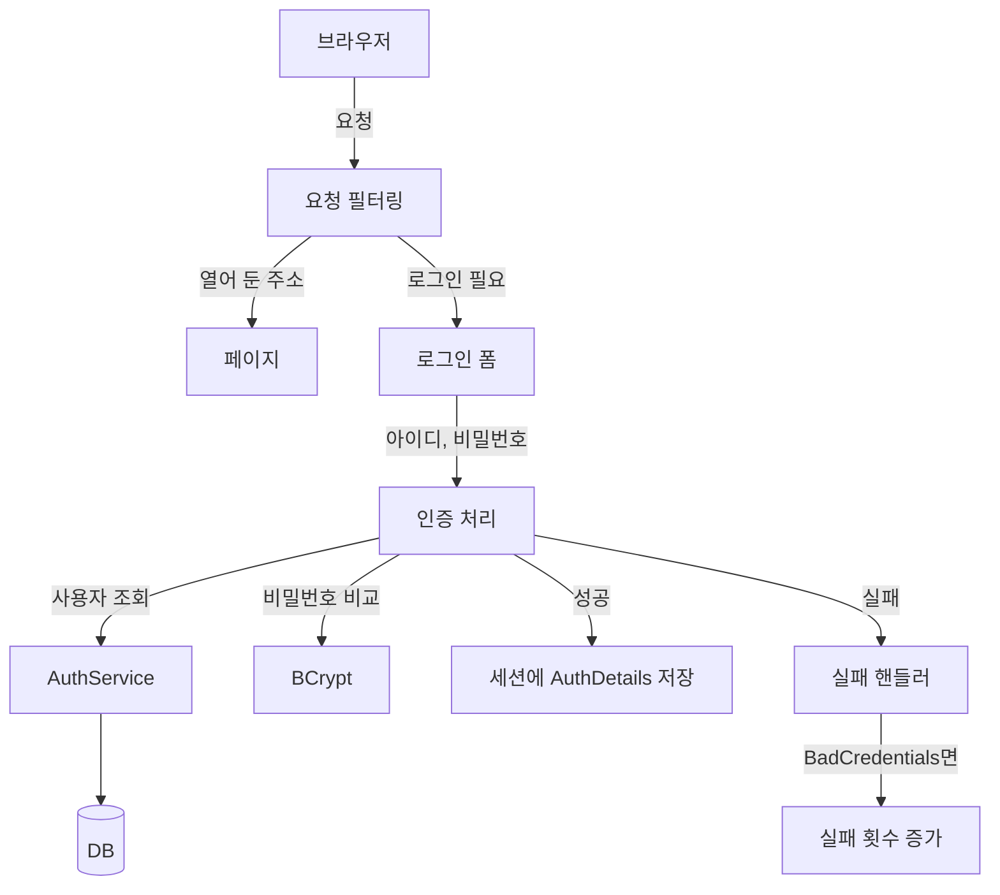
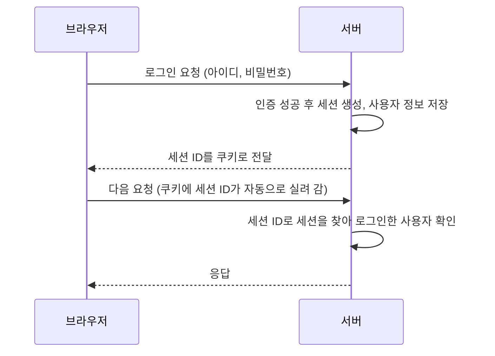
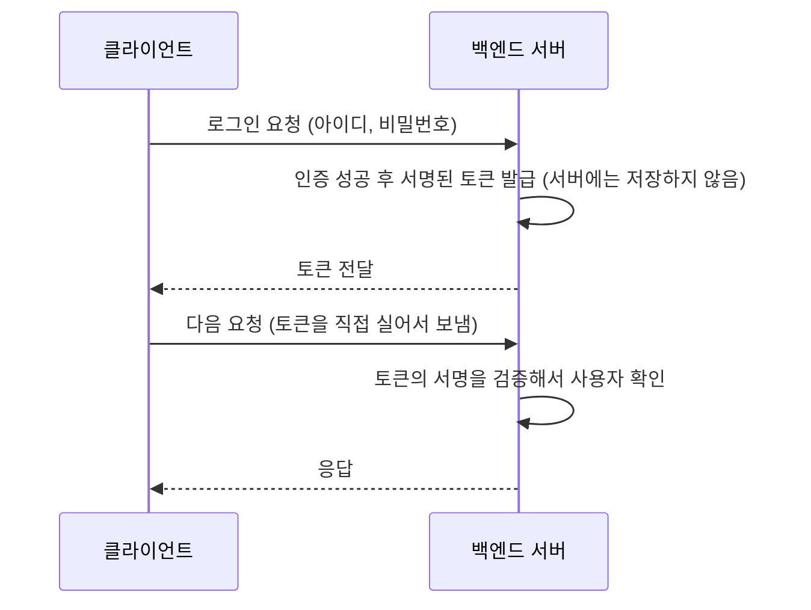

이 글은 Spring Security로 로그인을 만들면서 "누가 들어올 수 있고(인증), 들어온 사람이 무엇을 할 수 있는지(인가)"를 정리한 글이다.

2026년 11월 6일 수업에서 진행한 내용을 정리했다. 예외를 사용자에게 보여 줄 메시지로 바꾸는 흐름은 [메뉴 미니 프로젝트 글]({{ site.baseurl }})에서 만든 예외 처리와 닮은 부분이 있다.

## 오늘 수업은 이 순서로 진행했다

수업 노트의 순서를 그대로 옮겼다.

1. **실습 준비** : 루트 계정에서 붙여넣고 실행한다. 이어서 원티드 계정에서 슬랙에 있는 것 중 2번째 것을 붙여넣고 실행한다. 그다음 슬랙에서 다운 받은 폴더를 프로젝트 폴더에 압축 해제한다.
2. **개념** : 로그인 방식(토큰 / 세션), 우리는 SSR로 진행한다는 것, 인증과 인가.
3. **BCrypt** : 비밀번호 암호화에 쓰는 이유 4가지를 정리하고, 슬랙에서 가져온 코드를 붙여넣었다.
4. **요청 필터링** : 요청별 접근 권한을 설정했다.
5. **`AuthDetails`** : `UserDetails`를 구현한 클래스를 만들었다. 슬랙에서 내용을 가져와 `return` 문장을 지우고 붙여넣었다.
6. **로그인 실패 처리** : 원인별 메시지와 실패 횟수 증가. 앞부분을 작성한 뒤 슬랙에서 내용을 붙여넣었다.
7. **핸들러** : 각각의 클래스가 담당하는 역할을 정리했다.
8. **마지막 확인** : 의존성에 Security를 추가하면 `index.html`이 안 보이는 현상.

<!-- TODO(캡처): 1번 실습 준비에서 루트 계정 / 원티드 계정에 붙여넣은 내용, 압축 해제한 폴더 구조 -->

## 이게 없으면 뭐가 불편할까

로그인 기능이 없는 사이트를 떠올려 보자.

- 주소만 알면 누구나 모든 페이지에 들어간다.
- 비밀번호를 DB에 있는 그대로 저장하면, DB가 한 번 유출되는 순간 모든 회원의 비밀번호가 드러난다.
- 비밀번호를 틀려도 횟수 제한이 없어서 같은 아이디에 계속 시도할 수 있다.

Spring Security 없이 직접 막으려면 모든 컨트롤러 메서드에 "로그인했나?", "권한이 있나?" 확인을 `if`문으로 넣어야 한다. 지난 글의 Before 코드처럼 규칙이 여기저기 복사되고, 하나라도 빼먹으면 그 주소가 뚫린다.

건물로 비유하면, 경비실 없이 출입문 하나하나에 직원이 따로 서 있는 셈이다. 직원이 한 명이라도 자리를 비우면 그 문으로 아무나 들어온다.

> 한 줄 요약: 로그인 확인을 코드 곳곳에 흩어 놓으면 빠뜨리기 쉽다. 입구에서 한꺼번에 검사하는 틀이 필요하다.

---

## 그림으로 보기 — 로그인 한 번에 무슨 일이 일어날까



요청은 먼저 필터링을 거치고, 로그인이 필요한 곳이면 로그인 폼으로 보낸다. 로그인에 성공하면 사용자 정보가 서버의 세션에 저장되고, 실패하면 실패 핸들러가 원인별로 메시지를 만든다.

건물 보안으로 다시 비유하면 이렇다.

| 건물에서 | 프로젝트에서 | 하는 일 |
|----------|--------------|---------|
| 출입 규칙표 | 요청 필터링(`SecurityFilterChain`) | 어느 문은 누구나, 어느 문은 로그인한 사람만, 어느 문은 관리자만 |
| 입주자 명부 | `AuthService` + DB | 아이디로 사용자를 찾아 온다 |
| 출입증 | `AuthDetails` | 세션에 담을 사용자 정보. 잠김 여부, 권한도 여기서 답한다 |
| 비밀번호 보관함 | `BCrypt` | 비밀번호를 갈아서 보관하고, 입력값과 비교한다 |
| 경비실 안내 방송 | 로그인 실패 핸들러 | 실패 원인에 맞는 안내문을 만든다 |

비유에는 한계가 있다. 실제 건물의 출입증은 사람이 들고 다니지만, 여기서 `AuthDetails`는 서버가 보관하고 브라우저는 번호표(세션 ID)만 들고 있다. 이 부분은 3절에서 자세히 본다.

> 한 줄 요약: 필터링이 입구를 지키고, 인증 처리가 신원을 확인하고, 성공하면 세션에 기록하고, 실패하면 핸들러가 안내한다.

---

## 1. 의존성을 넣자마자 첫 화면이 사라졌다

### 직접 해보기

의존성에 Security를 추가했더니 `index.html`이 보이지 않았다. 대신 Security가 제공하는 기본 페이지만 보였다. 수업 노트에도 "의존성에 Security 추가하면 `index.html`이 안 보임. Security가 제공하는 기본 페이지만 보임"이라고 적었다.

버그가 아니라 기본 동작이다. Spring Boot는 Security 의존성이 있고 우리가 `SecurityFilterChain`을 따로 만들지 않았다면, 모든 요청에 로그인을 요구하고 내장 로그인 페이지를 보여 준다. 이때 기본 사용자는 `user`이고, 비밀번호는 서버를 켤 때 로그에 임시로 찍힌다.

새 건물에 보안 시스템을 설치한 직후에 모든 문이 잠겨 있는 것과 같다. 출입 규칙표를 넣어야 열어 줄 문이 생긴다. 다만 실제 건물과 달리, 규칙표가 없을 때는 "전부 잠금"이 기본값이라서 실수로 열려 있을 일이 적다.

그래서 "어느 주소를 누구에게 열어 줄지"를 우리가 직접 정해야 한다. 이 이야기는 5절에서 이어진다.

> 한 줄 요약: Security를 넣으면 기본값은 "전부 로그인 필요"다. 열어 줄 곳은 우리가 정한다.

---

## 2. 인증과 인가는 다른 질문이다

수업 노트에 이렇게 적었다.

> 인증: 우리 사이트에 들어와도 되는가
> 인가: 이 사람이 이 기능 또한 수행할 수 있는가 (권한의 문제)

| 구분 | 질문 | 실패하면 | 이번 프로젝트에서 |
|------|------|----------|-------------------|
| 인증(Authentication) | 당신은 누구인가, 들어와도 되는가 | 로그인 화면으로 | 아이디·비밀번호 확인 |
| 인가(Authorization) | 로그인한 당신이 이 기능을 써도 되는가 | "권한이 없다"는 응답 | 요청별 접근 권한 설정 |

HTTP 상태 코드로는 인증 실패를 보통 401, 인가 실패(권한 없음)를 403으로 나타낸다.

공항으로 비유하면, 여권과 신분증을 확인하는 것이 인증이고, 탑승권으로 "이 라운지에 들어갈 수 있는가"를 보는 것이 인가다. 다만 공항에서는 한 직원이 둘을 이어서 하기도 하지만, 코드에서는 둘을 따로 설정한다. 로그인 처리는 인증, 요청별 접근 권한은 인가다.

순서도 중요하다. 인가는 "누구인지" 알아야 판단할 수 있으므로, 항상 **인증이 먼저, 인가가 그 다음**이다.

<!-- TODO(캡처): 인증/인가 아래에 붙여 둔 이미지 2장 -->

> 한 줄 요약: 인증은 "누구인지", 인가는 "무엇을 할 수 있는지"다. 인증이 먼저다.

---

## 3. 세션 방식과 토큰 방식 — 가장 헷갈렸던 부분

### 노트에서 막혔던 부분

수업 노트에는 이렇게 적혀 있다.

- 토큰 방식으로 로그인 구현: 백엔드 서버와 프론트 서버를 따로 둘 때
- 세션 방식으로 로그인 구현: 사용자의 인증 정보(로그인 상태)를 클라이언트가 아닌 **서버 측에서 직접 저장하고 관리**하는 방식
- 두 가지를 구분하는 방법: **세션이 어디에 있는가**
- 우리는 SSR 방식으로 진행한다

그리고 "위에 두 개 개념 모르겠음"이라고 적어 두었다. 이 절에서 확실하게 정리한다.

### 먼저 문제부터

HTTP는 요청 하나하나가 서로를 기억하지 못한다. 1초 전에 로그인했어도, 다음 요청이 오면 서버는 "이 사람이 아까 그 사람인가?"를 알 수 없다. 그래서 **로그인했다는 사실을 다음 요청까지 어떻게 이어 갈까**가 문제다. 세션과 토큰은 이 문제를 푸는 두 가지 답이다.

둘의 차이는 한 줄이다. **로그인 상태를 서버가 기억하느냐, 클라이언트가 들고 다니느냐.**

### 세션 방식 — 서버가 기억한다



1. 로그인에 성공하면 서버가 **세션**이라는 저장 공간을 만들고 그 안에 사용자 정보를 넣는다.
2. 브라우저에는 그 세션을 가리키는 **세션 ID**(번호표)만 쿠키로 건넨다. 자바 웹 서버(Tomcat)에서는 보통 `JSESSIONID`라는 이름이다.
3. 브라우저는 이후 요청마다 이 쿠키를 자동으로 보낸다.
4. 서버는 번호표로 세션을 찾아서 "아, 이 사람이구나" 하고 알아본다.

6절의 `AuthDetails`가 담기는 곳이 바로 이 세션이다. 노트에 "세션이라고 하는 저장소에 내가 저장하고픈 것들을 커스터마이징 함"이라고 적은 이유다.

### 토큰 방식 — 클라이언트가 들고 다닌다



1. 로그인에 성공하면 서버가 사용자 정보가 담긴 **토큰**을 만들고, 서버만 아는 비밀 키로 **서명**을 찍어서 내려 준다.
2. 클라이언트가 그 토큰을 보관하고, 요청마다 직접 실어 보낸다(보통 `Authorization` 헤더).
3. 서버는 서명이 진짜인지만 확인하면 된다. 로그인 상태를 서버에 따로 저장해 둘 필요가 없다.

이 때문에 토큰 방식은 화면을 만드는 프론트 서버와 데이터를 주는 백엔드 서버가 따로 있는 구조에서 많이 쓴다. 노트에 "백엔드 서버, 프론트 서버 따로 둘 때"라고 적은 부분이다. 토큰의 대표 형식이 JWT인데, 주의할 점은 안에 든 내용이 **암호화가 아니라 인코딩**일 뿐이라서 누구나 읽을 수 있다는 것이다. 서명은 "위조를 막는" 장치이지 "내용을 숨기는" 장치가 아니다. 그래서 토큰 안에 비밀번호 같은 민감한 정보를 넣으면 안 된다.

### 한눈에 비교

| 구분 | 세션 방식 | 토큰 방식 |
|------|-----------|-----------|
| 로그인 상태를 기억하는 곳 | **서버** | 서버는 기억하지 않는다 |
| 브라우저가 들고 있는 것 | 세션 ID(번호표) | 토큰(사용자 정보가 담긴 증표) |
| 요청이 오면 서버가 하는 일 | 세션 ID로 세션을 **찾아본다** | 토큰의 서명을 **검증한다** |
| 서버에서 강제로 로그아웃시키기 | 쉽다. 서버가 세션을 지우면 끝 | 어렵다. 이미 발급한 토큰은 만료 전까지 유효하다 |
| 서버를 여러 대로 늘릴 때 | 세션을 서버끼리 공유해야 한다 | 서버가 상태를 안 들고 있어 늘리기 쉽다 |
| 잘 어울리는 구조 | 한 서버가 화면까지 만드는 SSR | 백엔드와 프론트가 분리된 구조 |

놀이공원으로 비유하면, 세션 방식은 입구에서 손목밴드 번호만 주고 명단은 매표소가 보관하는 것이다. 토큰 방식은 서명이 찍힌 입장권을 손님이 들고 다니는 것이다. 다만 실제 놀이공원과 달리, 서버는 여러 대일 수 있어서 명단(세션)을 어디에 둘지가 실제 서비스에서는 숙제가 된다.

### 우리는 왜 세션인가 — SSR

SSR(서버 사이드 렌더링)은 서버가 템플릿으로 HTML 화면을 **완성해서** 내려 주는 방식이다. 화면을 만드는 곳과 로그인을 처리하는 곳이 같은 서버이므로, 그 서버가 로그인 상태를 세션에 들고 있는 것이 가장 단순하다. 그래서 노트에 "우리는 SSR 방식으로 진행할 것임"이라고 적었고, 이번 실습은 세션 방식이다.

노트의 "세션이 어디에 있는가"라는 구분 기준은 이렇게 읽으면 된다. 세션은 **서버에** 있고, 토큰은 **클라이언트에** 있다.

> 한 줄 요약: 세션은 서버가 기억하고(브라우저는 번호표만), 토큰은 클라이언트가 들고 다닌다. 우리는 SSR이라 세션 방식이다.

---

## 4. 비밀번호는 BCrypt로 갈아서 보관한다

### 직접 해보기

수업 노트에는 BCrypt를 쓰는 이유 네 가지가 적혀 있었다.

```txt
*   Bcrypt는 비밀번호 해싱에 가장 많이 사용되는 알고리즘 중 하나이다.
*사용 이유*
1. 보안성 : 해시 함수에 무작위 솔트를 적용하여 생성한다.
2. 비용 증가 : 매개변수에 값을 주면 암호 생성 시간을 조절할 수 있어 무차별 공격을 어렵게 한다.
3. 호환성 : 높은 보안 수준 및 데이터베이스에 저장하기 쉬운 특징
4. 알고리즘 신뢰성 : 보안에 대한 검증과 평가를 거친 알고리즘으로 문제없이 계속 사용 중
```

Spring Security 공식 문서의 설명과 맞춰 보면 이렇게 읽힌다.

| 노트의 이유 | 풀어 쓰면 |
|-------------|-----------|
| 보안성(솔트) | 비밀번호마다 무작위 값(솔트)을 섞어서 해시한다. 같은 비밀번호도 결과가 매번 다르다 |
| 비용 증가 | `strength`(4~31, 기본 10)를 올리면 계산이 오래 걸린다. 일부러 느린 알고리즘이라 공격자의 대입 시도를 어렵게 만든다 |
| 호환성 | 결과 문자열 안에 알고리즘 버전, 강도, 솔트가 함께 들어 있어서 따로 저장할 칸이 필요 없다. 강도를 나중에 바꿔도 기존 비밀번호가 깨지지 않는다 |
| 신뢰성 | 오랫동안 검증되어 널리 쓰인다 |

수업에서는 이 부분의 코드를 슬랙에서 가져와 붙여넣었다. 사용법의 핵심은 `encode`로 갈고, `matches`로 비교하는 것이다. (아래는 개념 확인용 예시 코드다.)

```java
BCryptPasswordEncoder encoder = new BCryptPasswordEncoder();

String hashed = encoder.encode("myPassword");          // 저장할 때
boolean ok = encoder.matches("myPassword", hashed);    // 로그인할 때 : true
```

<!-- TODO(캡처): BCrypt 관련 캡처 3장과 슬랙에서 붙여넣은 실제 코드 (PasswordEncoder 빈 등록, 회원가입 시 encode 위치 등) -->

비밀번호를 믹서에 넣고 갈아서 보관하는 것으로 비유할 수 있다. 갈린 결과로는 원래 재료를 되돌리기 어렵고, 로그인할 때는 입력값을 같은 방식으로 갈아서 비교한다. 다만 실제 믹서와 달리 bcrypt는 매번 다른 솔트가 섞여서 같은 비밀번호도 결과가 달라진다. 그래서 `equals`로 비교하면 안 되고 반드시 `matches`를 써야 한다.

참고로 bcrypt 결과는 보통 60자 정도의 문자열이므로, DB의 비밀번호 칸은 그보다 넉넉하게 잡아야 한다.

> 한 줄 요약: 비밀번호는 평문 대신 BCrypt 해시로 저장하고, 비교는 `matches`로 한다.

---

## 5. 요청별 접근 권한 — 출입 규칙표 만들기

### 직접 해보기

노트에는 "요청에 대한 필터링 작성 == 요청별 접근 권한 설정했다"라고 적었다. 이 코드도 슬랙에서 가져와 붙여넣었다. 1절에서 본 "전부 잠금" 기본값을 바꿔서, 어느 주소를 누구에게 열어 줄지 정하는 일이다. 형태는 이렇다. (개념 확인용 예시이고, 주소와 권한 이름은 프로젝트에 맞게 바꾼다.)

```java
@Bean
public SecurityFilterChain filterChain(HttpSecurity http) throws Exception {
    http
        .authorizeHttpRequests(auth -> auth
            .requestMatchers("/", "/auth/**").permitAll()          // 누구나
            .requestMatchers("/admin/**").hasAuthority("ADMIN")    // 관리자만
            .anyRequest().authenticated()                           // 나머지는 로그인한 사람만
        );
    return http.build();
}
```

세 가지를 짚어 보자.

1. **`permitAll()`** 로 열어 둔 주소는 로그인 없이 들어갈 수 있다. 첫 화면(`/`)이 다시 보이게 하려면 여기에 넣어야 한다.
2. **규칙은 위에서부터 읽는다.** 먼저 맞는 규칙이 적용되므로, 넓은 규칙인 `anyRequest()`는 항상 맨 아래에 둔다.
3. 이 규칙들은 컨트롤러에 닿기 **전에** 검사된다. 그래서 컨트롤러마다 `if`를 쓸 필요가 없다.

출입 규칙표를 경비실 벽에 붙여 두는 것과 같다. 직원이 매번 판단하지 않고 표에 적힌 대로 문을 열고 닫는다. 다만 실제 규칙표와 달리 순서가 중요해서, 위쪽 규칙이 아래쪽 규칙을 가린다.

수업 노트에는 이 부분 아래에 "무조건 일치시켜야함"이라는 메모가 있다.

<!-- TODO(캡처): "무조건 일치시켜야함" 메모가 가리키는 대상. 무엇과 무엇을 일치시키는지 캡처 확인 후 여기에 설명 추가 -->
<!-- TODO(캡처): 요청 필터링 관련 캡처 5장 (SecurityConfig 실제 코드) -->

> 한 줄 요약: 요청별 접근 권한은 `SecurityFilterChain` 한 곳에 모아서 정하고, `anyRequest()`는 맨 아래에 둔다.

---

## 6. AuthDetails — 세션에 담을 출입증

### 직접 해보기

수업 노트에 이렇게 적었다.

> `AuthDetails`는 `UserDetails` 인터페이스를 구현한 클래스였음. 세션이라고 하는 저장소에 내가 저장하고픈 것들을 커스터마이징 함.

`UserDetails`는 Spring Security가 "로그인한 사용자는 이런 질문에 답할 수 있어야 해"라고 정해 둔 인터페이스다. 이 질문들에 답하는 클래스를 우리가 만든 것이 `AuthDetails`다.

| `UserDetails`의 질문 | 뜻 |
|----------------------|----|
| `getUsername()`, `getPassword()` | 아이디, (해시된) 비밀번호 |
| `getAuthorities()` | 이 사람이 가진 권한 |
| `isAccountNonLocked()` | 계정이 **잠기지 않았는가** |
| `isAccountNonExpired()` | 계정이 만료되지 않았는가 |
| `isCredentialsNonExpired()` | 비밀번호가 만료되지 않았는가 |
| `isEnabled()` | 계정이 사용 가능한가 |

수업에서는 슬랙에서 이 메서드들의 틀을 가져와서, `return` 문장을 지우고 우리 값으로 채웠다. 여기에 이름 같은 필드를 더 넣으면 세션에 보관할 정보를 원하는 대로 늘릴 수 있다. 그래서 노트에 "세션에 저장하고픈 것들을 커스터마이징"이라고 적었다.

노트에서 눈에 띈 줄은 이것이다.

> `!잠겼니` ⇒ `false`가 된다.

메서드 이름이 "잠기지 **않았니**(NonLocked)?"라서, 우리가 가진 "잠겼니(locked)?" 값은 뒤집어서 답해야 한다는 뜻이다. (필드 이름은 예시다.)

```java
@Override
public boolean isAccountNonLocked() {
    return !locked;   // 잠겼으면(true) → !true = false : "잠기지 않았니?"의 답은 false
}
```

이 `false` 하나가 로그인을 막는다. 7절의 실패 핸들러 주석에도 "`AuthDetails.isAccountNonLocked()`가 `false` → 5회 이상 로그인 실패"라고 적혀 있다.

출입증 카드로 비유하면, 카드에 이름과 권한을 새겨 넣고, "정지된 카드"는 단말기에 대면 거절되는 것이다. 다만 실제 카드와 달리 이 정보는 카드가 아니라 서버의 세션에 있고, 브라우저는 그 세션을 가리키는 번호표만 갖고 있다.

<!-- TODO(캡처): AuthDetails 실제 코드 (필드, getAuthorities 구현, 나머지 is~ 메서드 반환값) -->
<!-- TODO(캡처): 6절 관련 캡처 (AuthDetails, 슬랙에서 가져와 붙여넣은 내용, 잠김 관련 이미지 등 총 8장) -->

> 한 줄 요약: `AuthDetails`는 세션에 담을 사용자 정보이고, "잠기지 않았니?"는 값을 뒤집어서 답한다.

---

## 7. 로그인에 실패했을 때 — 원인별 메시지와 실패 횟수

### 직접 해보기

Spring Security는 로그인에 성공했을 때와 실패했을 때 실행할 **핸들러**를 꽂을 수 있다. 이번 노트의 주인공은 실패 핸들러다. 앞부분을 작성한 뒤 슬랙에서 내용을 붙여넣었고, 실패 원인에 따라 메시지를 만들고, 비밀번호가 틀린 경우에는 실패 횟수를 올린다.

```java
/* 1. 실패 원인 별 메시지 만들기 (+ 비밀번호 오류 시 실패 횟수 증가) */
if (exception instanceof BadCredentialsException) {
    // BadCredentialsException 오류는 사용자의 아이디가 DB 에 존재하지 않는 경우,
    // 또는 비밀번호가 맞지 않는 경우 발생한다.
    errorMessage = "아이디가 존재하지 않거나 비밀번호가 일치하지 않습니다.";

    // 로그인 실패 횟수 증가
    if (username != null && !username.isEmpty()) {
        memberService.incrementLoginFailCount(username);
        errorMessage += " (실패 횟수: 누적)";
    }
} else if (exception instanceof LockedException) {
    // 계정이 잠긴 상태 (AuthDetails.isAccountNonLocked() 가 false -> 5회 이상 로그인 실패)
    errorMessage = "계정이 잠겨있습니다. 관리자에게 문의하세요.";
} else if (exception instanceof InternalAuthenticationServiceException) {
    // 서버에서 사용자 정보를 검증하는 과정에서 발생하는 에러이다.
    errorMessage = "서버에서 오류가 발생되었습니다.";
} else if (exception instanceof UsernameNotFoundException) {
    // DB 에 사용자의 정보가 없는 경우 발생하는 오류이다. (AuthService 에서 던진 예외)
    errorMessage = "존재하지 않는 아이디입니다.";
} else if (exception instanceof AuthenticationCredentialsNotFoundException) {
    // 보안 컨텍스트에 인증 객체가 존재하지 않거나 인증 정보가 없는 상태에서
    // 보안처리된 리소스에 접근하는 경우 발생한다.
    errorMessage = "인증 요청이 거부되었습니다.";
} else {
    errorMessage = "알 수 없는 오류로 로그인 요청을 처리할 수 없습니다.";
}
```

원인별로 표로 정리했다.

| 예외 | 언제 | 보여 주는 메시지 |
|------|------|------------------|
| `BadCredentialsException` | 아이디가 없거나 비밀번호가 틀림 | 아이디가 없거나 비밀번호가 일치하지 않음 (+ 실패 횟수 증가) |
| `LockedException` | 계정이 잠김 (5회 이상 실패) | 계정이 잠겨 있으니 관리자에게 문의 |
| `InternalAuthenticationServiceException` | 사용자 정보를 확인하는 과정에서 서버 오류 | 서버에서 오류 발생 |
| `UsernameNotFoundException` | DB에 사용자가 없음 (`AuthService`가 던진 예외) | 존재하지 않는 아이디 |
| `AuthenticationCredentialsNotFoundException` | 인증 정보 없이 보호된 자원에 접근 | 인증 요청 거부 |
| 그 외 | 알 수 없음 | 알 수 없는 오류 |

<!-- TODO(캡처): 7절 앞부분 캡처(실패 핸들러 클래스 선언부, username을 꺼내는 부분)와 슬랙에서 붙여넣은 내용 2건, 관련 캡처 3장 -->

### 핸들러는 MSG 같은 느낌

수업 노트에는 이렇게도 적혀 있다.

> 각각의 클래스가 담당하는 역할들 알면 좋음
> 핸들러 메서드는 msg 같은 느낌 (맛을 더 추가하는 그런 느낌임)

로그인이라는 기본 요리는 Security가 하고, 성공이나 실패 뒤에 무엇을 할지 양념을 얹는 것이 핸들러라는 뜻으로 이해했다. 조미료처럼 없어도 요리는 되지만, 있으면 사용자에게 훨씬 친절한 맛이 난다. 각 클래스의 역할은 아래 "헷갈렸던 점" 8번에 표로 정리했다.

> 한 줄 요약: 실패 핸들러에서 예외 종류별로 메시지를 정하고, 비밀번호 오류일 때만 실패 횟수를 올린다.

---

## 한 번에 보기 — 오늘 나온 것들

| 절 | 무엇 | 한 마디 |
|----|------|---------|
| 1 | Security 기본 동작 | 의존성만 넣어도 모든 요청에 로그인이 필요해진다 |
| 2 | 인증 / 인가 | "누구인가" / "무엇을 할 수 있는가". 인증이 먼저 |
| 3 | 세션 / 토큰, SSR | 세션은 서버가 기억한다. 우리는 SSR이라 세션 방식 |
| 4 | `BCryptPasswordEncoder` | 솔트와 비용이 들어간 해시. 비교는 `matches` |
| 5 | `SecurityFilterChain` | 요청별 접근 권한을 한 곳에서 정한다 |
| 6 | `AuthDetails` (`UserDetails` 구현) | 세션에 담을 정보와 잠김 여부 |
| 7 | 실패 핸들러 | 원인별 메시지, 비밀번호 오류 시 실패 횟수 증가 |

---

## 헷갈렸던 점

**1. 세션 방식과 토큰 방식은 정확히 뭐가 다른가?**

수업 노트에 "위에 두 개 개념 모르겠음"이라고 적었던 부분이다. 핵심은 이것 하나다.

> 로그인했다는 사실을 **누가 들고 있는가.**
> 세션 = 서버가 들고 있고, 브라우저는 번호표(세션 ID)만 갖는다.
> 토큰 = 클라이언트가 증표(토큰) 자체를 들고 다닌다.

그래서 노트의 "세션이 어디에 있는가"가 구분 기준이다. 요청이 올 때 서버가 하는 일도 달라진다. 세션은 번호표로 서버의 세션을 **찾아보고**, 토큰은 토큰의 서명이 진짜인지 **검증한다**. 전체 흐름은 3절의 그림 두 장을 보면 된다.

**2. 쿠키, 세션, 토큰은 서로 같은 말인가?**

아니다. 층이 다른 말이라서 섞이면 헷갈린다.

| 용어 | 정체 | 어디에 있나 |
|------|------|-------------|
| 쿠키 | 브라우저가 보관했다가 요청마다 자동으로 실어 보내는 **저장 공간** | 브라우저 |
| 세션 | 로그인한 사용자의 정보를 담아 둔 **서버의 저장 공간** | 서버 |
| 세션 ID | 어느 세션인지 가리키는 **번호표**. 보통 쿠키에 담겨 간다 | 브라우저(쿠키) |
| 토큰 | 사용자 정보와 서명이 담긴 **증표 그 자체** | 클라이언트 |

그러니 "세션 방식은 쿠키를 안 쓴다"는 오해다. 세션 방식에서도 세션 ID를 **운반하는 수단**으로 쿠키를 쓴다. 중요한 것은 쿠키에 무엇이 들었는가다. 세션 방식의 쿠키에는 번호표만 들어 있고, 사용자 정보는 서버에 있다.

**3. SSR이면 꼭 세션이고, 분리 구조면 꼭 토큰인가?**

그렇지는 않다. 노트와 3절에서 정리한 것은 **잘 어울리는 조합**이지 규칙이 아니다. 백엔드와 프론트가 분리되어 있어도 세션을 쓸 수 있고, SSR에서 토큰을 쓸 수도 있다. 다만 SSR은 화면과 로그인을 한 서버가 처리하니 세션이 가장 단순하고, 분리 구조는 서버끼리 세션을 공유하기가 번거로워서 토큰이 편하다. 이번 실습은 SSR이라서 세션을 택했다.

**4. 인증과 인가는 어떻게 구분하는가?**

질문이 다르다. 인증은 "당신은 누구인가", 인가는 "그 사람이 이걸 해도 되는가"다.

| 상황 | 어느 쪽 문제인가 |
|------|------------------|
| 로그인하지 않았는데 마이페이지에 들어가려 한다 | 인증 (로그인부터 해야 한다) |
| 로그인한 일반 회원이 관리자 페이지에 들어가려 한다 | 인가 (누구인지는 알지만 권한이 없다) |
| 아이디나 비밀번호가 틀려서 로그인이 안 된다 | 인증 |

로그인했다고 모든 기능을 쓸 수 있는 것은 아니다. 인증을 통과해도 인가에서 막힐 수 있다.

**5. `!잠겼니`가 왜 `false`가 되는가?**

`UserDetails`가 묻는 말은 "잠기지 **않았니**?"(`isAccountNonLocked`)이다. 우리가 가진 값은 "잠겼니?"(`locked`)다. 둘은 서로 반대라서 뒤집어서 답한다.

| 우리 값 `locked` | `!locked` (= `isAccountNonLocked()`의 답) | 결과 |
|------------------|--------------------------------------------|------|
| `false` (안 잠김) | `true` ("안 잠겼어요") | 로그인 진행 |
| `true` (잠김) | `false` ("안 잠겼냐고요? 아니요") | `LockedException`, 로그인 막힘 |

이름에 부정(`Non`)이 들어간 메서드는 읽을 때 한 번 꼬인다. "잠겼다 → 안 잠겼니? → 아니다(false)"로 따라가면 된다.

**6. `BadCredentialsException`과 `UsernameNotFoundException`은 어떻게 다른가?**

글자 그대로면 아래처럼 나뉜다.

- `UsernameNotFoundException` : 이 아이디가 DB에 없다 (`AuthService`가 던진다)
- `BadCredentialsException` : 아이디는 있는데 비밀번호가 틀렸다

그런데 7절 코드의 주석은 `BadCredentialsException`을 "아이디가 없거나, 또는 비밀번호가 맞지 않는 경우"라고 두 가지로 적었다. 이유가 있다. Spring Security의 `DaoAuthenticationProvider`는 `hideUserNotFoundExceptions`라는 설정이 **기본값 `true`**라서, 아이디를 못 찾아 `UsernameNotFoundException`이 나와도 **`BadCredentialsException`으로 바꿔서 던진다.** "이 아이디는 존재한다/존재하지 않는다"가 화면에 드러나면 공격자가 가입된 아이디를 알아내는 데 쓸 수 있기 때문이다.

```text
기본 설정에서의 흐름
아이디 없음  → UsernameNotFoundException → (Security가 변환) → BadCredentialsException
비밀번호 틀림 →                                                 BadCredentialsException
```

그래서 7절의 `UsernameNotFoundException` 분기는 기본 설정에서는 실행되지 않을 가능성이 크다. 아이디 없음과 비밀번호 틀림이 같은 `BadCredentialsException`으로 오기 때문에, 메시지도 "아이디가 존재하지 않거나 비밀번호가 일치하지 않습니다"로 뭉뚱그려 쓴 것으로 이해했다. 실제로 어느 분기로 들어오는지는 직접 로그인 실패를 만들어 보면서 확인하면 가장 확실하다.

**7. 비밀번호가 맞는데도 로그인이 안 될 수 있나?**

있다. 계정이 잠겼다면 `LockedException`이 나온다. Spring Security는 비밀번호를 비교하기 **전에** 계정 상태(잠김, 사용 가능 여부, 만료)부터 확인하기 때문이다. 5회 이상 틀려서 잠긴 계정은 다음에 맞는 비밀번호를 넣어도 들어갈 수 없다. "비밀번호가 맞는데 왜 안 되지?"의 답이 대개 이것이다.

**8. 각각의 클래스는 무슨 일을 맡았나?**

노트의 "각각의 클래스가 담당하는 역할들 알면 좋음"을 표로 정리했다.

| 클래스 | 맡은 일 | 이 글에서 |
|--------|---------|-----------|
| 보안 설정(`SecurityFilterChain`) | 어느 주소를 누구에게 열어 줄지 정한다. 로그인 폼, 성공/실패 핸들러를 연결한다 | 5절 |
| `AuthService` | 아이디로 DB에서 사용자를 찾아 온다. 없으면 `UsernameNotFoundException`을 던진다 | 7절 표 |
| `AuthDetails` | 찾아온 사용자를 Security가 이해하는 모양(`UserDetails`)으로 감싼다. 권한과 잠김 여부를 답하고, 세션에 담긴다 | 6절 |
| `BCryptPasswordEncoder` | 비밀번호를 해시로 만들고, 입력값과 해시를 `matches`로 비교한다 | 4절 |
| 실패 핸들러 | 로그인이 실패했을 때 원인별 메시지를 만든다 | 7절 |
| `MemberService` | 로그인 실패 횟수를 올린다(`incrementLoginFailCount`) | 7절 |

이 중 `AuthService`가 구현하는 표준 인터페이스가 `UserDetailsService`다. "사용자 이름으로 `UserDetails`를 찾아 오는 곳"이라는 약속이다.

**9. 실패 핸들러와 `GlobalExceptionHandler`는 어떻게 다른가?**

로그인 검사는 컨트롤러에 요청이 도착하기 **전**, Security의 필터 단계에서 일어난다. 이때 나온 예외는 컨트롤러 밖에서 생긴 것이라서, 컨트롤러 쪽 예외를 받는 `GlobalExceptionHandler`에는 닿지 않는다. 대신 Security가 정해 둔 길을 따라 **실패 핸들러**로 간다.

| 구분 | 예외가 생기는 곳 | 받는 곳 |
|------|------------------|---------|
| 메뉴 등록 중 이름 중복 같은 비즈니스 예외 | 서비스(컨트롤러 안쪽) | `GlobalExceptionHandler` |
| 로그인 실패 | Security 필터(컨트롤러 바깥쪽) | 로그인 실패 핸들러 |

**10. 존재하지 않는 아이디로 실패하면 실패 횟수는 어떻게 될까?**

7절의 코드는 `BadCredentialsException`일 때 `incrementLoginFailCount(username)`을 부른다. 그런데 6번에서 본 대로 `BadCredentialsException`에는 "아이디가 없는 경우"도 섞여 있다. 그러면 없는 아이디가 이 메서드에 넘어갈 수 있다. 그때 `MemberService`가 어떻게 동작하는지는 코드를 직접 확인해 봐야 한다.

**11. 왜 Security 의존성만 넣었는데 `index.html`이 안 보였나?**

1절에서 본 대로 기본값이 "전부 로그인 필요"이기 때문이다. `index.html`도 하나의 요청이라서 막힌 것이다. `/`를 `permitAll()`에 넣어서 열어 주면 다시 보인다.

---

## 더 학습하면 좋은 개념

- **Security 필터 체인의 구조** — 요청이 어떤 필터들을 어떤 순서로 지나가는지 알면 5절의 `SecurityFilterChain`이 더 잘 보인다.
- **`SecurityContext`와 세션** — 로그인한 사용자 정보가 세션 안 어디에 담기는지, 컨트롤러에서 현재 사용자를 어떻게 꺼내는지 알 수 있다.
- **CSRF** — 폼을 서버에서 만드는 SSR 구조에서는 로그인 폼 같은 POST 요청에 CSRF 토큰이 어떻게 붙는지 알아야 한다.
- **세션 고정 공격(Session Fixation)** — 로그인 전후로 세션 ID를 바꾸는 이유를 알 수 있다.
- **JWT와 토큰 방식** — 3절에서 비교만 해 본 토큰 방식을 직접 구현해 보면 두 방식의 차이가 더 선명해진다.
- **세션 공유(Session Clustering)** — 서버를 여러 대로 늘릴 때 세션을 어디에 둘지가 세션 방식의 대표적인 과제다.
- **계정 잠금 해제 정책** — 5회 실패 뒤 잠긴 계정을 언제, 누가, 어떻게 풀 것인지 정해야 실제 서비스가 된다.

## 참고 자료

- [Spring Security Reference: Spring Security Crypto Module (BCryptPasswordEncoder)](https://docs.spring.io/spring-security/reference/6.0.2/features/integrations/cryptography.html)
- [Spring Security API: AbstractUserDetailsAuthenticationProvider](https://docs.spring.io/spring-security/site/apidocs/org/springframework/security/authentication/dao/AbstractUserDetailsAuthenticationProvider.html)
- [Spring Security API: DaoAuthenticationProvider](https://docs.spring.io/spring-security/site/apidocs/org/springframework/security/authentication/dao/DaoAuthenticationProvider.html)
